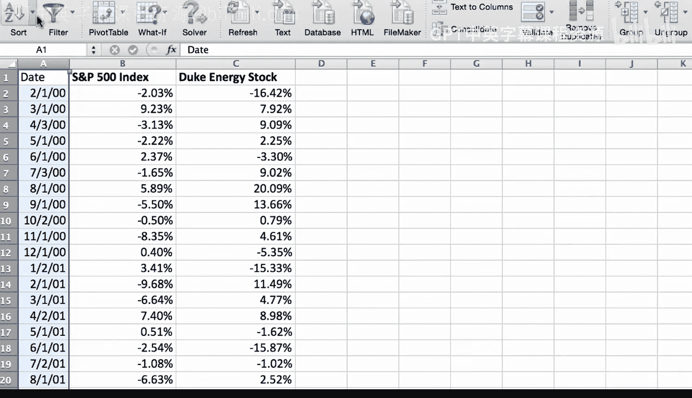

# 杜克大学《Excel 到 MySQL：商业分析（5课全）｜Excel to MySQL： Analytic Techniques for Business》中英 p44 09_02_03_Excel数据排序.zh_en -BV1mS421X7yw_p44-

Next， we're going to look again。At our。Yeah。S&P 500 index versus Duke Energy stock data。

And we're going to use one of Excel's very handy data functions。

What we'd like to do is we'd like to look at。Those months。

When the S&P 500 index performed best and we'd like to see whether those were also months where Duke Energy stock performed best because we're trying to understand。

Get a more intuitive feeling for how closely related these two sets of returns really are。

So I'm going to go to data。Sort。And I'm going to choose descending order。

 but first I'm going to choose the column of data that I want。

And so now I'm going to sort in descending order。But notice that if I only sorted。If I only sorted。

The data in column B， that would not be useful。Because I want to preserve the ordered pairs。

Of a particular month。And a particular S&P index return。

And then a particular S& B index return and this Duke energy stock return for that same month。

 the way that I do that。Is I look at my sort warning here and I say， yes。

 I want to expand the selection and what this means is any columns that are touching my current column。

 meaning they are contiguous with no empty columns to the left or right will also be sorted based on the ordering for column B。

Okay。So these are my best performing months for the S&P 500 index and what you can see very quickly and easily is there's not a strong association between what's going on with the S&P and what's going on with Duke Energy stock。

 in fact， in April of 2000，Of nine， when the S&P 500 index had one of its best months over this entire 14 year period。

 Duke Energy stock was down。ok。In April of 2003， we had a good return in the SB 500 index and we had a spectacular return for Duke Energy stock。

 so it's pretty apparent looking at these that there is not a strong association of the very best returns。

How about the very worst returns？So now we're going to sort in ascending order。

 meaning as we go down the rows， the values will get higher。And again。

 I'm going to expand my selection。Okay， so now I see that there were some months。When both were down。

Okay， but there are also months when S&P 500 index performed very poorly and Duke Energy was only slightly down。

So what I would say here is that there's a stronger association on the downside。

 it appears then on the upside， in other words， when the S&P 500 index is way down。

 Duke Energy stock seems generally to be down。When the S&P 500 index is way up。

 Duke Energy stock is not necessarily way up。Well， that's pretty interesting。

 why don't we sort by the best and worst performance of Duke Energy stock itself？

So let's start sorting in descending order。And again， of course， we're going to expand our selection。

So now we see that the very best months for Duke Energy stock， 20%， 19%， 13%， 12%， 11%。11%， 9%。

 only half of those months was the S&P 500 index even up。

 so there is very little association between the best performing times of Duke Energy stock and the S&P 500 indexex。

And if we look。At。Ascending order。We see that we have a number of months when Duke Energy stock was dramatically off and in most cases the S&P 500 index was also down。

 but far， far less， so what this tells us perhaps。Is that when the S&P index？

Is down a little bit and there's perhaps some bad news about Duke Energy stock at all。

 the market tends to react with much more volatility with regard to Duke Energy stock than it does with the index as a whole。

So。If we want to restore our data to its original ordering。We can do that by date。

If we sort by an ascending order by date， we will have the earliest date at the top。

And that returns our data to an ordered form， and of course we can sort by descending。

And that's the form that it originally appeared in our earlier spreadsheet。

