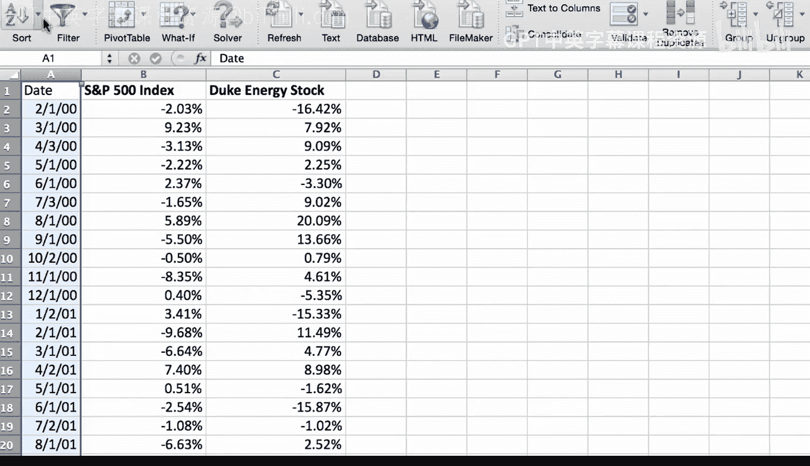

# Excel 数据分析：第 09 章：Excel 数据排序 📊

在本节课中，我们将学习如何使用 Excel 的数据排序功能，来直观地分析标准普尔 500 指数与杜克能源公司股票回报率之间的关系。通过排序，我们可以快速识别表现最佳和最差的月份，并观察两者之间的关联性。

## 分析目标与数据准备

上一节我们介绍了数据的基本结构，本节中我们来看看如何通过排序来探索数据间的关系。我们手头有两组数据：标准普尔 500 指数的月度回报率和杜克能源公司股票的月度回报率。我们的目标是，找出标准普尔 500 指数表现最好的月份，并观察在这些月份里，杜克能源公司的股票是否也表现良好，以此来直观感受两组回报率之间的关联程度。

## 对标准普尔 500 指数进行排序

首先，我们将对标准普尔 500 指数的回报率进行降序排序，以找出其表现最佳的月份。在 Excel 中，操作步骤如下：

1.  选中标准普尔 500 指数回报率所在的列（例如 B 列）。
2.  点击 **数据** 选项卡下的 **排序** 按钮。
3.  在排序对话框中，选择 **降序** 排列。

在进行排序时，有一个关键点需要注意：我们不能只对单列数据进行排序，否则会破坏数据行中月份与对应回报率的配对关系。以下是正确的操作方式：

当 Excel 弹出“排序警告”对话框时，选择 **扩展选定区域**。这意味着，所有与所选列相邻（即中间没有空列）的列，都会根据 B 列的排序顺序一同移动。这样，每一行数据（包含月份、标普指数回报、杜克能源股票回报）就能作为一个整体保持配对。

排序完成后，我们立刻可以看到标准普尔 500 指数表现最好的月份。通过观察可以发现，这些月份与杜克能源股票的最佳表现月份关联性并不强。例如，在 2009 年 4 月，标普指数取得了整个 14 年期间最好的月度回报之一，但杜克能源的股票却是下跌的。而在 2003 年 4 月，标普指数表现良好，杜克能源股票则表现优异。

## 观察表现最差的月份

接下来，我们来看看表现最差的月份是否存在更强的关联性。我们将对标准普尔 500 指数进行升序排序。

操作步骤与之前类似，但在排序对话框中选择 **升序** 排列，并同样选择 **扩展选定区域**。

观察排序结果，我们发现了一些两者都下跌的月份。但同时，也存在标普指数表现非常糟糕，而杜克能源股票仅小幅下跌的月份。这表明，在下跌行情中，两者的关联性似乎比上涨行情中更强。换句话说，当标普指数大幅下跌时，杜克能源股票通常也会下跌；但当标普指数大幅上涨时，杜克能源股票不一定随之大涨。

## 对杜克能源股票进行排序

为了从另一个角度验证，我们不妨对杜克能源股票本身的回报率进行排序。首先进行降序排序，找出其表现最佳的月份。

以下是杜克能源股票回报率最高的几个月份示例：`20%`, `19%`, `13%`, `12%`, `11%`, `11%`, `9%`。观察发现，在这些月份中，只有大约一半的时间标普 500 指数是上涨的。这进一步证实了杜克能源股票的最佳表现期与标普 500 指数之间关联性很弱。

接着，我们对杜克能源股票进行升序排序，观察其表现最差的月份。

结果显示，在杜克能源股票大幅下跌的多数月份里，标普 500 指数也处于下跌状态，但跌幅通常远小于杜克能源股票。这或许说明，当市场整体（以标普指数衡量）只是小幅下跌，而杜克能源公司本身又有利空消息时，市场对杜克能源股票的反应会比对整个指数的反应剧烈得多，即波动性更大。

## 恢复数据原始顺序

完成分析后，我们可能需要将数据恢复到最初的按时间顺序排列的状态。这很简单，只需按日期列进行排序即可。

1.  选中日期列。
2.  点击 **数据** -> **排序**。
3.  选择 **升序** 排列，并 **扩展选定区域**。

这样，最早的日期会排在最上方，数据就恢复到了我们最初电子表格中的有序形式。当然，你也可以选择按日期降序排列，这取决于你最初的数据视图。

本节课中我们一起学习了如何使用 Excel 的排序功能来探索两组金融数据之间的关联。通过分别对标准普尔 500 指数和杜克能源股票回报率进行升序和降序排序，我们直观地发现，两者在下跌时的关联性比上涨时更强，并且杜克能源股票的表现受其自身特定因素影响较大。最后，我们还学会了如何通过按日期排序来恢复数据的原始顺序。