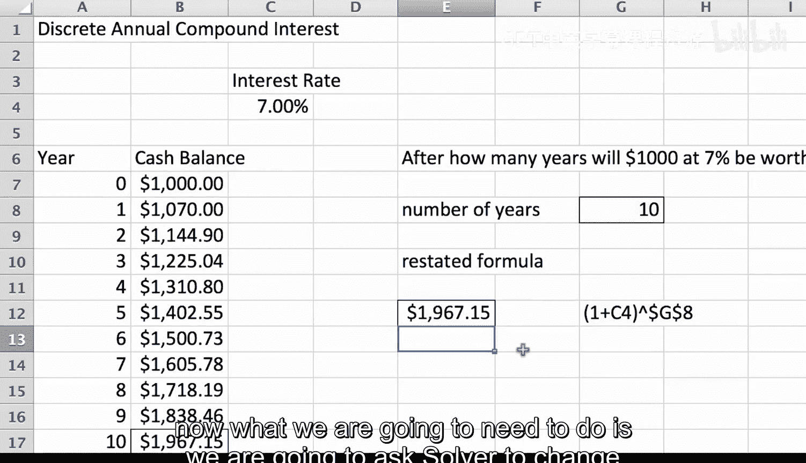
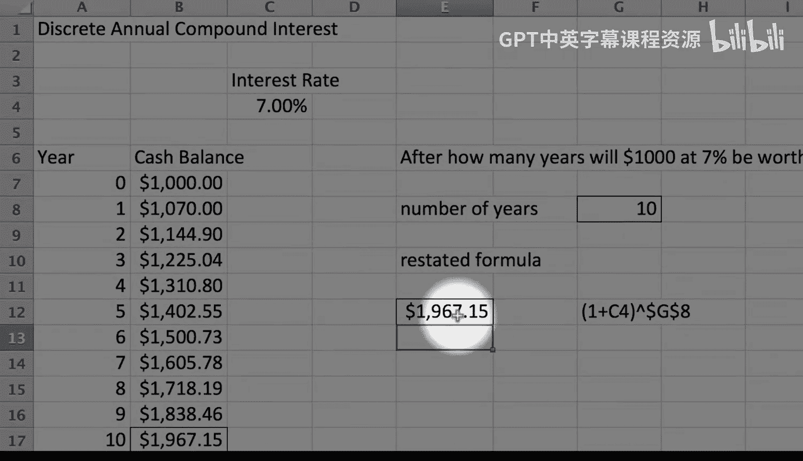
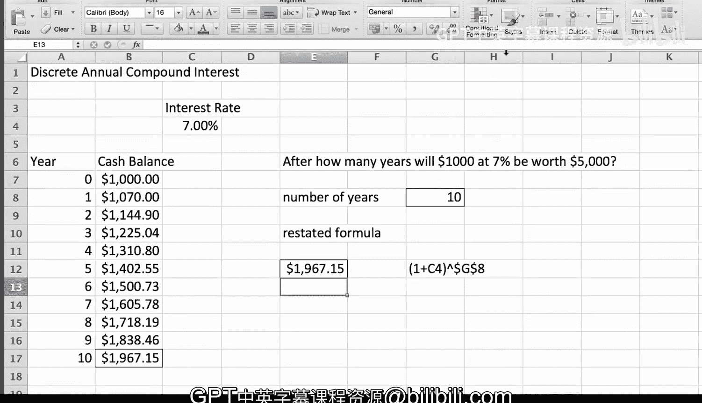

# 杜克大学《Excel 到 MySQL：商业分析（5课全）｜Excel to MySQL： Analytic Techniques for Business》中英 p45 10_02_04_Solver插件入门.zh_en -BV1mS421X7yw_p45-

嗯。Next， I'd like to turn to one of the most powerful tools。That is that can be used。With Excel。

 and that is something called the solver plugin。The solver plugin is useful when you have a function。

Or series of functions。And you want to know what value to put into x so that F of x equals a certain kind of y。

 and we have three different choices for our Y。We can choose a certain target value。

Or we can choose a maximum or a minimum。And in addition。

 we can subject our x variables to certain constraints， for example。

 that they need to be positive or they need to be between zero and1 and so on。ok。😊。

We also can use solver when we have functions of more than one variable。In this example。

 we have a function where we have a discrete annual interest rate。

And this is just like the earlier problem that we had。

We have an initial balance and what we want to know is what initial balance。

At a fixed interest rate of。Something this is the unknown。Gives us a final value of $5，000。

So to do this， we go to。Slver， which you'll see on my display。

 it's at the very bottom of the tools menu。If solver is not yet installed。😡，You will not see it。

At the bottom of your menu， instead you go to the Add ins item on your tools。

And then you will see a little box to click to select solver to activate it。

 but here that's already been installed。So， we choose solver。And what we're interested in doing。

We want a discrete annual interest rate。That at a starting balance of 1000 will give us $5。

000 down here in cell B17。So what that looks like is we set the objective of B17 to the value of 5000 by changing the variable cell and the variable cell that we're going to change here is。

The interest rate。Which is in cell C4。It's not necessary to make these absolute values。

 but they are commonly displayed that way。Okay。So I don't actually have any constraints。

 so all I need to do is hit solve and we'll see what happens。

So solver is generating a solution by iteratively guessing， so it guesses。

25% it guesses 5% says the value is below 25 and greater than5 than it might guess 20 and 10。

And so on。And it iterates its way into the correct answer。

So you see here that we can come up with an answer very rapidly to a problem that otherwise could be relatively hard to solve。

I don't want to save this solution。I'm going to restore my original value so that we can do a new and different problem。

Okay。My new and different problem is。Now I want to keep my interest rate at 10% and I want to change my initial balance in order to achieve the result of $5。

000 in 10 years。So again， I go to solver。And now I'm going to change。

I keep my objective of cell B17 at 5000， but now I am changing my variable cell B7。ok。

And I hit solve。And it tells me that in order to have $5。

000 after 10 years at a 10% annual discrete compounded interest rate， I need $1，927。72。

 so that's pretty effective。So now we have a slightly more challenging problem。Which is。

 suppose I wanted to know。After how many years？Will $1，000 at 7% be worth $5，000？

We can't do this using our current functions as written。So you know。

 we have for each function we've got。The previous balance。Directly in the cells directly above。

 and we're using our interest rate here， but what we need is to be able to change the number of years over here on the left column and we don't have a simple。

 easy way to do that。So now we're going to move on to our solver challenge problem。

 but I suggest you think about this for a few minutes and see if you can solve it for yourself first。

Before we demonstrate the solution。So now we're going on to our solver challengege problem。

The issue here is how many years are needed？At a 7% interest rate to turn $1，000 into $5，000。

So what we need to do is we need to restate our。Annual compounded return formula。

In such a way that we can have a variable for the number of years that stays in one single cell。

 so the layout that we have before where we have years zero through 10 spread out in separate cells will not work。

We need to have a reference， an absolute reference to the number of years。

 and that requires a different formula。So the way that this would work is we would have our initial balance。

And it would be multiplied by。One plus。The interest rate， right？1 plus。C4。Okay。

Raised to the exponent。Of the number of years。ok。And if we look at what we've done。

This is exactly what we have here。We have。Our initial cash balance times。Our。

One plus our discrete interest rate raised to the exponent of the number of years。

Under our PEmDOS rules， this is correctly ordered。So now what we're going to need to do is we're going to ask solver。

To change。This cell， G 8。So that this cell becomes 5000。

E 12。So we want to set objective E12 to 5000 by changing cell G8 and we solve。

And it turns out that we would need 23。788 years to turn $1，000 into $5，000 at a 7% interest rate。

And that is the answer to our solver challenge problem。

