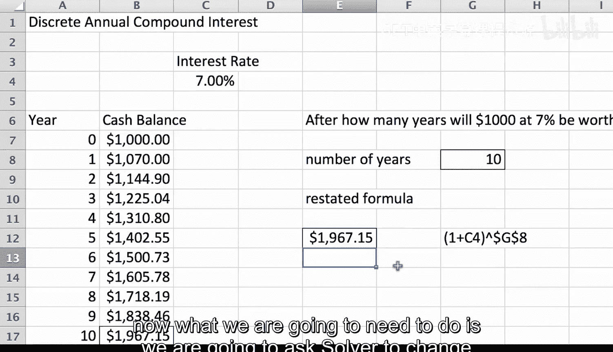
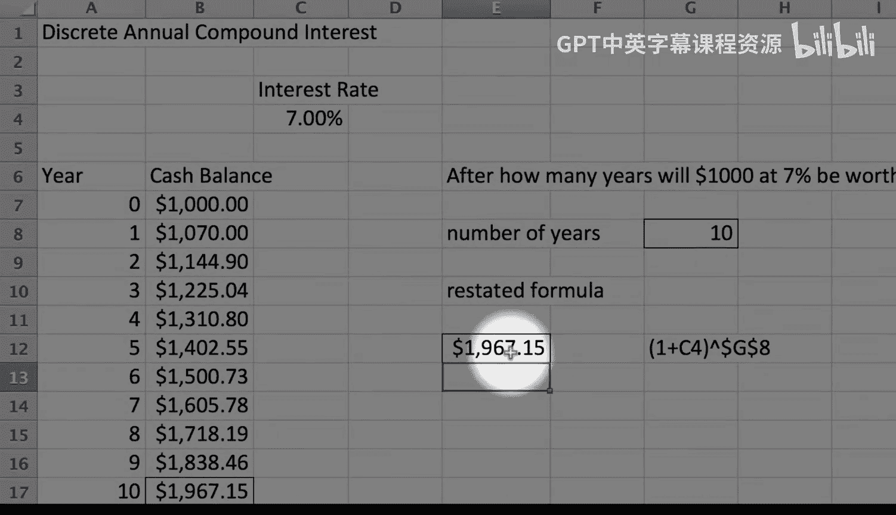
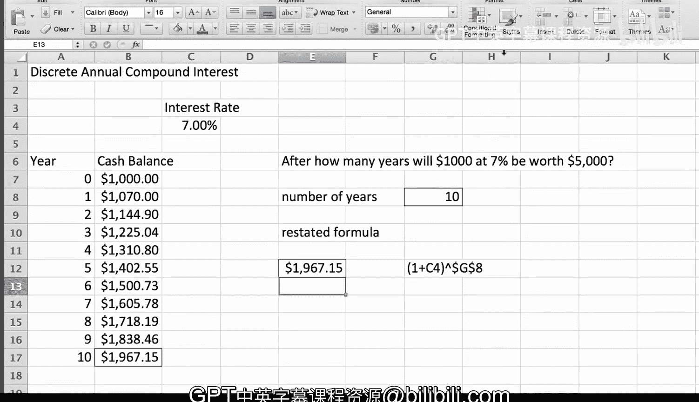

# Excel 到 MySQL：商业分析：第 10 课：Solver 插件入门 🧮

在本节课中，我们将要学习 Excel 中一个非常强大的工具——Solver 插件。Solver 可以帮助我们解决涉及函数优化和约束条件的问题，例如寻找特定输入值以达到目标输出。

## 什么是 Solver 插件？ 🤔

Solver 插件是一个用于解决优化问题的工具。当你有一个函数或一系列函数，并且想知道输入什么值（x）能使函数输出（F(x)）达到特定目标时，Solver 非常有用。

我们可以为输出目标（Y）选择三种不同的设定：
*   达到某个特定值。
*   寻找最大值。
*   寻找最小值。

此外，我们还可以为输入变量（x）设置约束条件，例如要求它们必须为正数，或在 0 到 1 之间等。

Solver 同样适用于多变量函数。

## 如何使用 Solver：单变量示例 💰

上一节我们介绍了 Solver 的基本概念，本节中我们来看看一个具体的应用示例。

假设我们有一个复利计算问题：已知年利率和最终目标金额（$5,000），想要求解所需的初始本金。公式为：
`最终值 = 初始本金 * (1 + 利率)^年数`

以下是使用 Solver 解决此问题的步骤：

1.  **启用 Solver**：在 Excel 的“数据”选项卡中，找到“分析”组。如果看不到“规划求解”（Solver）按钮，则需要通过“文件”->“选项”->“加载项”->“转到”来启用“规划求解加载项”。

2.  **设置问题**：假设初始本金（B7单元格）为 $1000，年利率（C4单元格）未知，年数固定，最终值（B17单元格）目标为 $5000。

3.  **打开 Solver**：点击“数据”选项卡下的“规划求解”。

4.  **配置参数**：
    *   **设置目标**：选择最终值所在的单元格（B17）。
    *   **目标值**：选择“值为”，并输入 `5000`。
    *   **通过更改可变单元格**：选择存放利率的单元格（C4）。

5.  **求解**：点击“求解”按钮。Solver 会通过迭代计算，快速找到使最终值等于 $5000 所需的利率。完成后，可以选择“保留规划求解的解”或“还原初始值”进行其他计算。

## 挑战问题：求解所需年数 ⏳

刚才我们学习了如何求解利率。现在，我们面临一个更复杂的问题：如果利率固定为 7%，初始本金为 $1,000，需要多少年才能增长到 $5,000？

我们之前按年份逐行计算的方法不再适用，因为年数本身成了需要求解的变量。我们需要一个单独的公式，其中年数是一个可变的参数。

新的计算公式应放在一个单元格中（例如 E12），公式为：
`=B7 * (1 + C4) ^ G8`
其中，`G8` 是代表未知年数的单元格。

以下是解决此挑战的步骤：

1.  **构建公式**：在单元格 E12 中输入上述公式，引用初始本金（B7）、利率（C4）和年数（G8）。

2.  **配置 Solver**：
    *   打开“规划求解”对话框。
    *   **设置目标**：选择包含公式的单元格（E12）。
    *   **目标值**：选择“值为”，并输入 `5000`。
    *   **通过更改可变单元格**：选择代表年数的单元格（G8）。

3.  **求解**：点击“求解”。Solver 将计算出，在 7% 的年利率下，需要大约 **23.788 年** 才能使 $1,000 变成 $5,000。

## 总结 📝

本节课中我们一起学习了 Excel 的 Solver 插件。我们了解了它的基本用途——在满足约束条件下，通过调整输入变量来达成函数输出的目标值、最大值或最小值。我们通过两个实例演示了其操作：先求解未知利率，再解决更具挑战性的求解所需年数问题。掌握 Solver 能帮助我们高效解决许多原本复杂的商业和数据分析问题。