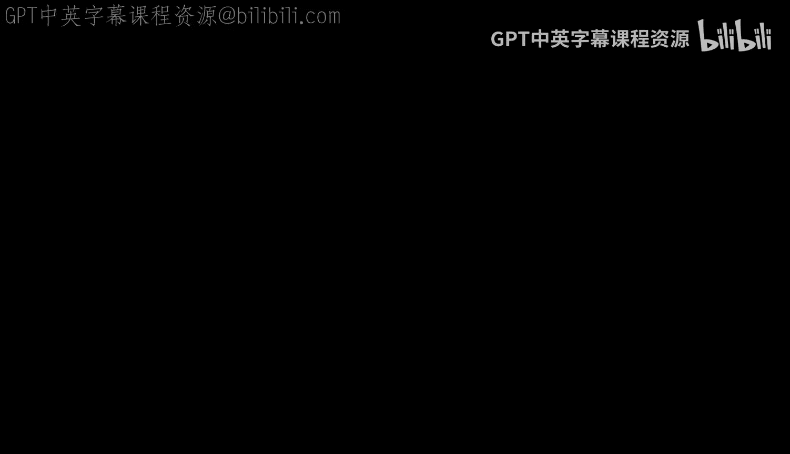
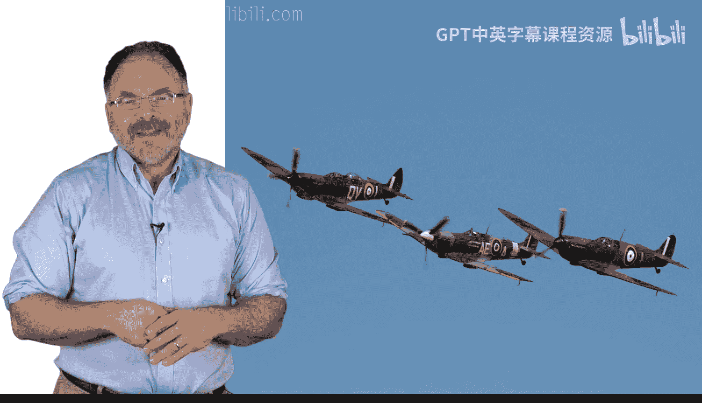
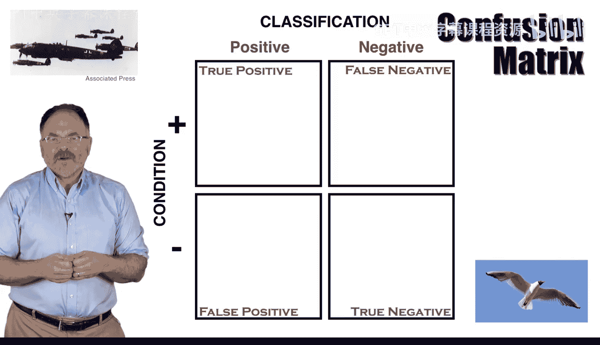
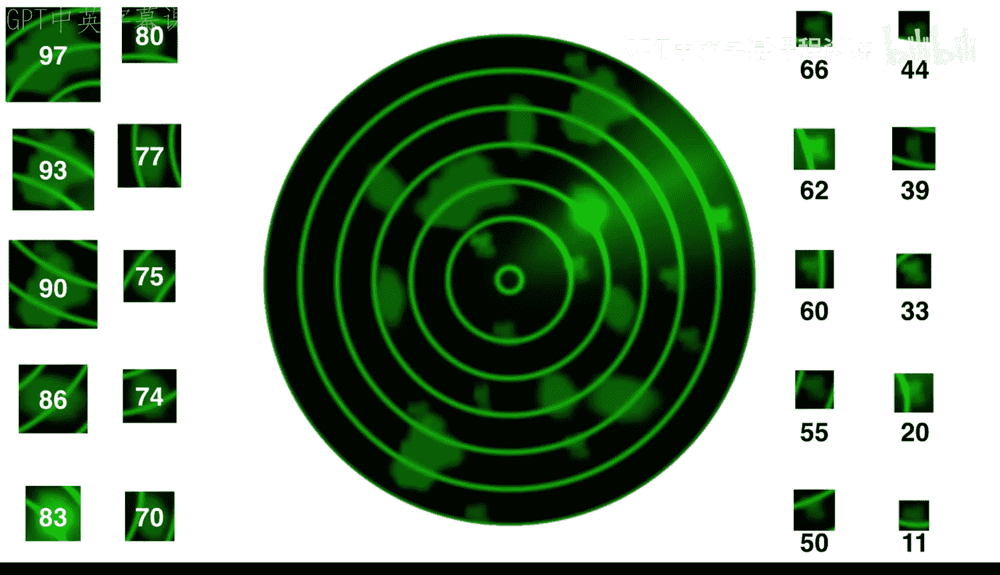
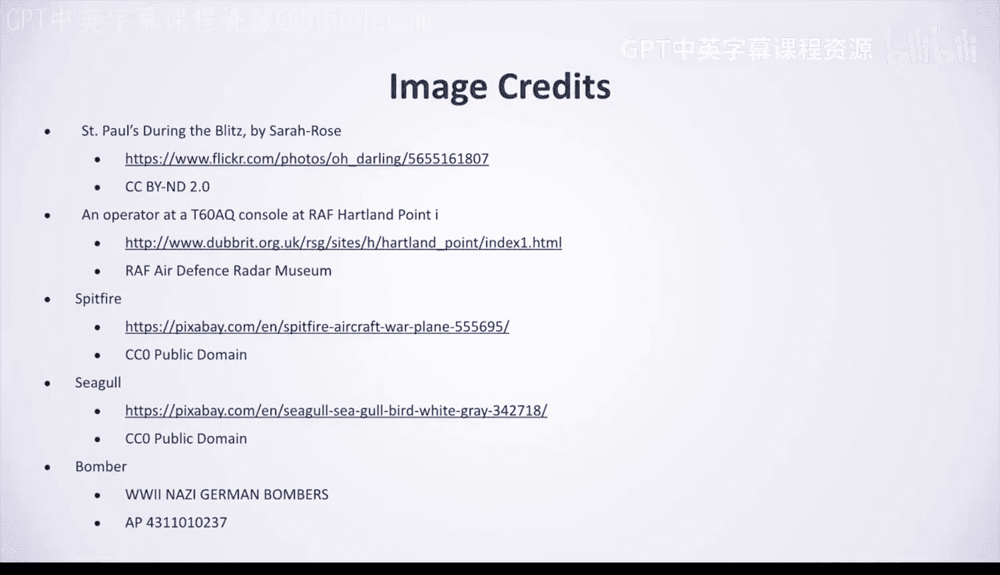

# 杜克大学《Excel 到 MySQL：商业分析（5课全）｜Excel to MySQL： Analytic Techniques for Business》中英 p46 11_03_02_二分类问题导论.zh_en -BV1mS421X7yw_p46-

From September 7， 1940 to May 11，1941。In what came to be called the Blitz。

 German bombers attacked the city of London， killing over 43000 civilians。

When I was a child living on Earls Court Road in London。

 the woman who lived next door told me how she watched the building across the street burn and collapse after being hit by a German bomb。

It was still an empty lot then， much of London was still not rebuilt 25 years after the war。

In the early 1940s， radar was still a top secret technology just being developed。

British fighter Command managed to intercept German bombers in part based on very primitive radar signals。

A blur on a radar screen could be bombers headed across the English channel。

Or it could be random noise， maybe a flock of seagulls or nothing。

Those tasked with making decisions based on early radar data faced a difficult problem in binary classification。

Giving a positive command， scrambled British H and spit firefighters， consuming precious resources。

 exhausting pilots and burning aviation fuel that could not be replaced while you boatats blockaded the country。

Sending up fighters when there were no bombers， a false positive， had obvious significant costs。

 It was impossible to respond to every blur on a radar with a positive command。On the other hand。

 a negative command。

Do nothing。 Stay on the ground。Could have catastrophic consequences。

If a radar image really was a squadron of German bombers。

 a false negative would allow them to burn London uncontested。

To evaluate these primitive radar systems， someone quite brilliant。

 invented a very clever methodology known as the receiver operating characteristic curve or ROC curve。

The curve itself allowed decision makers to choose when to scramble their planes。

Based on their best estimate of the relative cost of the two different kinds of mistakes。

The false alarm or false positive。And the failure to react to a real attack， the false negative。

Maximizing the area under the ROC curve is still such a good measure of the power of a binary classification model to discriminate signal from noise that it is commonly used now 75 years later to choose winners in commercial data mining competitions。

We will learn how to calculate ROC curves and their area。

 and this methodology will remain useful throughout the course and throughout your careers in data science。

So we have two conditions， which we will call bombers and seagulls and two classifications， positive。

Namely， send up the fighters and negative do nothing。

This gives us a two by two grid of four possible classifications plus conditions。

It is traditional to locate the actual conditions to the left of this grid。

The condition that we are trying to identify above that's bombers and the alternative seagulls below。

The classification itself。Is placed above the grid。

 a positive classification to the left and negative to the right。

This allows us to label the four squares on the grid， true positive， false positive， false negative。

 and true negative。This entire arrangement of eight values is known as a confusion matrix。

 It will come up again and again throughout this course and throughout your work in data science。

 So it is worthwhile to familiarize yourself with it completely。

The way an ROC curve is calculated is that all the radar images are assigned a numerical score。

In this case， a number corresponding to the maximum area。Of the blur that showed up on the screen。

The ultimate condition， bomber or seagull is also tracked。After data are collected。

 pairs of scores and actual conditions are placed in rank order from highest score to lowest score。

Note that all that matters is the relative ordering， not the details of the scoring method used。 Now。

 fighter command could， in theory， decide that no image on radar radar warranted a positive command。

In that case， they could set a threshold。For a positive classification。Higher than any score。

 and every score would be classified as negative。Or they could decide that every image justified a positive score。

That would involve setting the threshold for a positive classification below every score。In reality。

 the threshold dividing positive and negative classifications is always set somewhere in between。

And exactly where depends on the relative cost of false negatives versus false positives。

We will learn how to set these thresholds for ourselves later on in this course in the videos that follow and working through the problems in the included Excel spreadsheets For now。

 it's enough to understand。That keeping the scoring method constant， but changing the threshold。

Leads to different values for the confusion matrix。

The ROC curve is drawn by identifying for a given threshold。Its false positive rate。

So that would be false positives at the given threshold as a percentage of total seagulls。

And its true positive rate， truee positives at the same threshold as a percentage of total bombers。

Then plotting a point。Where the x axis is the false positive rate and the Y axis is the true positive rate。

 Simply move the threshold from above the highest score。Equivalent to 000 to below the lowest score。

 equivalent to 0。11。 and find the X， Y ordered pairs at each threshold in between。

Summing the area beneath the ROC curve over all possible thresholds gives the area under the curve or AUC。

One final note， the area under the curve metric helped win the Battle of Britain and has continued to be the most widely used way to optimize binary classification systems。

 but its inventor remains anonymous。By the time references to the AUC curve started to appear in unclassified writings in the early 1950s。

 no one bothered to give him or her credit， and the first documents where the AUC appears apparently remain classified。

