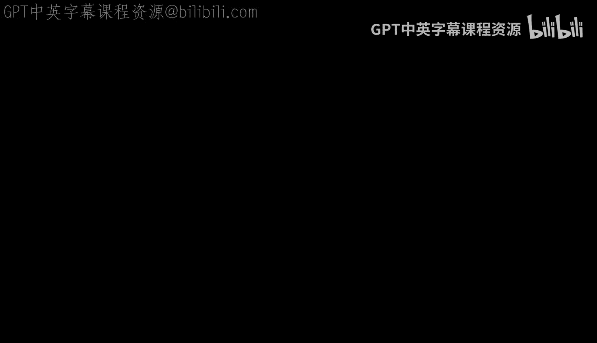
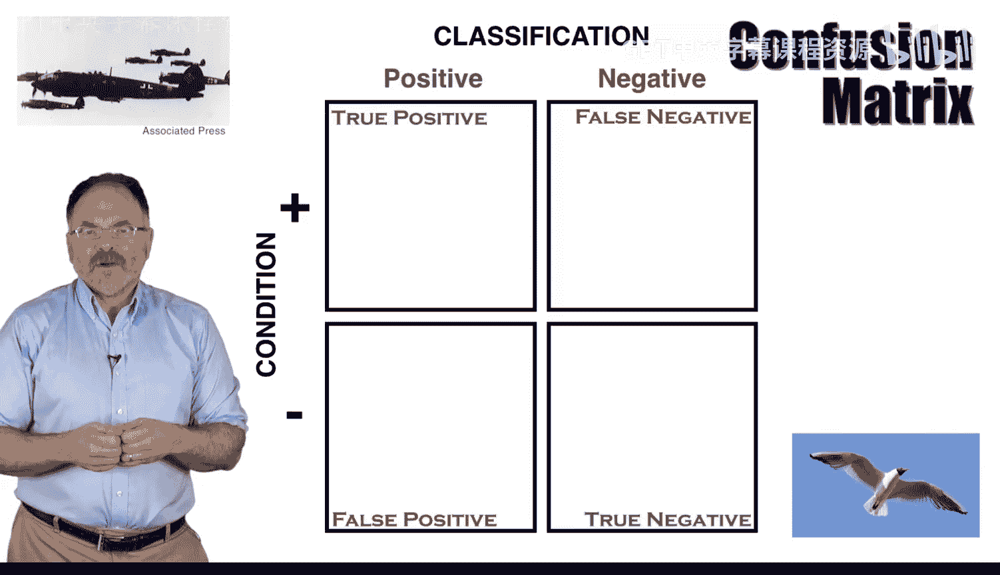
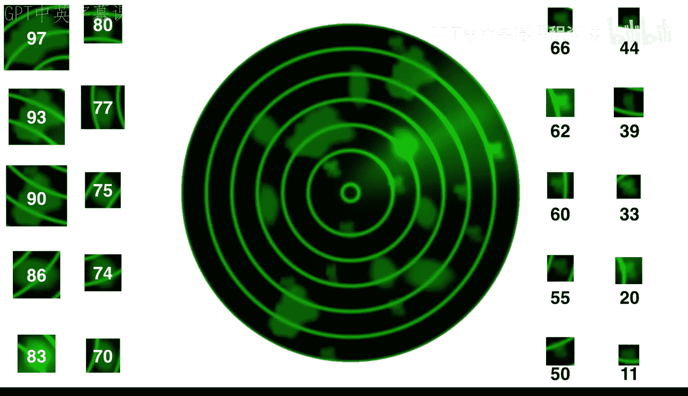
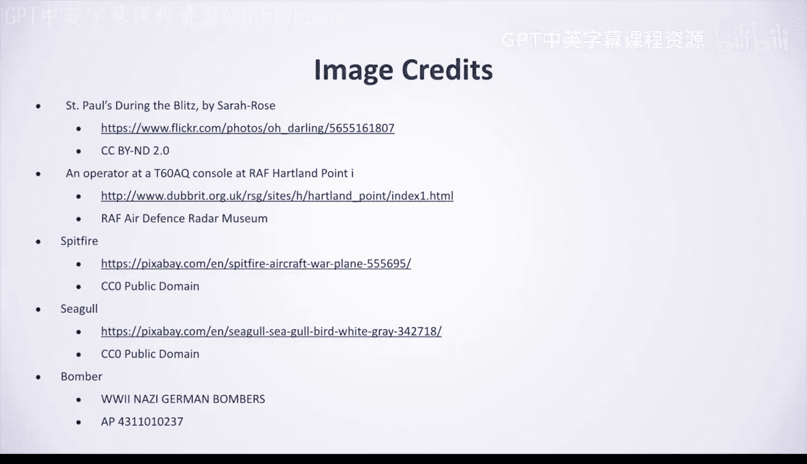

# 商业分析：11：二分类问题导论 🎯

在本节课中，我们将要学习二分类问题的基本概念，并重点介绍一种用于评估分类模型性能的强大工具——ROC曲线及其面积（AUC）。我们将通过一个历史案例来理解其重要性。

## 历史背景：伦敦大轰炸与雷达预警

从1940年9月7日到1941年5月11日，在被称为“伦敦大轰炸”的战役期间，德国轰炸机袭击了伦敦，造成超过43,000名平民死亡。

当时，雷达是一项正在开发的绝密技术。英国战斗机司令部部分依靠非常原始的雷达信号来拦截德国轰炸机。雷达屏幕上的一个模糊影像，可能是飞越英吉利海峡的轰炸机，也可能只是随机噪声，比如一群海鸥，甚至什么都没有。

基于早期雷达数据做出决策的人员，面临着一个典型的**二分类问题**。

## 二分类的代价与混淆矩阵

发出“阳性”指令（即派遣战斗机）会消耗宝贵的资源，耗尽飞行员体力，并燃烧当时因英国被封锁而无法补充的航空燃油。如果雷达上实际没有轰炸机（即**假阳性**），这个错误的代价显而易见。

另一方面，发出“阴性”指令（即按兵不动）也可能带来灾难性后果。如果雷达影像确实是一个德国轰炸机中队，那么**假阴性**的错误将让它们畅通无阻地轰炸伦敦。

为了评估这些原始雷达系统，一位非常杰出的人发明了一种巧妙的方法论，即**受试者工作特征曲线**，或称**ROC曲线**。

上一节我们介绍了二分类决策面临的严峻挑战，本节中我们来看看如何系统地描述和评估这些决策结果。

我们有两种实际状况（我们称之为“轰炸机”和“海鸥”），以及两种分类决策（“阳性”：派遣战斗机；“阴性”：不作为）。这为我们提供了一个2x2的网格，包含四种可能的“分类-状况”组合。

传统上，我们将实际状况标注在网格左侧（上方是“轰炸机”，下方是“海鸥”），将分类决策标注在网格上方（左侧是“阳性”，右侧是“阴性”）。

以下是这个网格的四个象限及其名称：

*   **真阳性**：实际是轰炸机，且被正确分类为阳性。
*   **假阳性**：实际是海鸥，但被错误分类为阳性。
*   **假阴性**：实际是轰炸机，但被错误分类为阴性。
*   **真阴性**：实际是海鸥，且被正确分类为阴性。

这整个包含八个值的排列被称为**混淆矩阵**。它在本课程以及你未来的数据科学工作中会反复出现，因此完全熟悉它非常有必要。

## ROC曲线与AUC的计算原理

ROC曲线的计算方式是：为所有雷达影像分配一个数值分数（例如，对应屏幕上模糊影像的最大面积），并追踪其最终的真实状况（轰炸机或海鸥）。数据收集后，将（分数， 真实状况）这对数据按分数从高到低排序。

**请注意**：重要的是相对顺序，而非所使用的具体评分方法细节。

理论上，战斗机司令部可以设定一个**分类阈值**。如果他们将阈值设得比任何分数都高，那么每个影像都会被分类为阴性（不作为）。如果他们将阈值设得比任何分数都低，那么每个影像都会被分类为阳性（派遣战斗机）。

现实中，区分阳性和阴性分类的阈值总是设在两者之间的某个位置。具体设在哪里，取决于假阴性与假阳性之间的相对代价。我们将在本课程后续的视频和Excel练习中学习如何为自己设定这些阈值。

目前，只需理解：保持评分方法不变，但改变阈值，会导致混淆矩阵的值发生变化。

理解了阈值的作用后，我们来看看如何绘制ROC曲线。

ROC曲线的绘制方法是：针对一个给定的阈值，确定其**假阳性率**（即在该阈值下，假阳性数量占所有“海鸥”总数的百分比）和**真阳性率**（即在该阈值下，真阳性数量占所有“轰炸机”总数的百分比），然后在图上绘制一个点，其中X轴是假阳性率，Y轴是真阳性率。

只需将阈值从最高分之上（对应点`(0, 0)`）移动到最低分之下（对应点`(1, 1)`），并找出中间每个阈值对应的`(X, Y)`坐标点，连接这些点就形成了ROC曲线。

对所有可能阈值下的ROC曲线下方面积求和，就得到了**曲线下面积**，即**AUC**。

## 总结与历史注记

本节课中我们一起学习了二分类问题的核心框架——混淆矩阵，以及评估分类模型区分能力的核心工具——ROC曲线与AUC。

最后一点注记：曲线下面积（AUC）指标帮助赢得了不列颠之战，并且至今仍是优化二分类系统最广泛使用的方法，但其发明者却默默无闻。当关于AUC曲线的参考文献在20世纪50年代初开始出现在非机密著作中时，已经没有人费心为他或她记上一功，而首次出现AUC的文件显然至今仍属机密。