# 杜克大学《Excel 到 MySQL：商业分析（5课全）｜Excel to MySQL： Analytic Techniques for Business》中英 p47 12_03_03_轰炸机与海鸥：混淆矩阵解析.zh_en -BV1mS421X7yw_p47-

When we have binary outcomes and a binary classification。We can be right in two different ways。

 and we can be wrong in two different ways。If the true condition is the thing that we're trying to identify。

In the case of the radar image， the true bombers。And we correctly classify。An event as positive。

This is known as a true positive。On the other hand。

If we correctly identify a condition as nothing to be worried about。

This is the seagu or some other blotch on our radar that does not have any particular meaning。

We are classifying something as negative。And it is a true negative。Now。

 if we could just always classify things as。True positives or true negatives。

There would be nothing to talk about， there'd be no field of data mining。

The question is always how we can achieve。A good result or even a great result。

While minimizing our errors， if we have a positive classification。But in fact。

 the condition turns out to be。Negative。This is what's called a。False， positive。

And perhaps our biggest mistake， when the condition is positive and our classification tells us negative。

 this is a false negative。So。In our situation with our， our bombers and our seagulls。

We've got the following scenario。

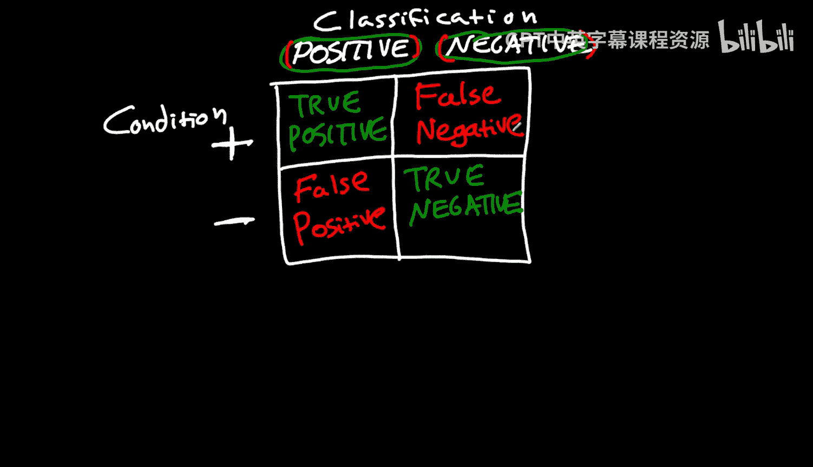

3 farmers。And we've got 17 seagulls。And when we rank。All of our different events。From first。To 20th。

In terms of。The size of the radar image。We've got our three bombers in there somewhere。

 something like that。They're not at the very top if they were neatly organized， number one， two。

 three。Then we would。Be able to do a perfect job， but that is really not going to happen。

So let's say that our actual bombers had rankings of 93 ratings of 93， 83 and 75。

Let's say that our highest rating was in '97。And our lowest rating was。Maybe 10。Okay。

We can evaluate this radar system。Based on where we decide to declare something to be positive。

So now we're going to show two different possible ways。That we could use this same radar screen。

The same radar system。We could decide that our threshold。Is going to be at 80。

And then we would be successful， we would have two true positives and one false negative。

Or we could set our threshold at 70。And then we would have three true positives and no false negatives。

Okay，But the question now is going to arise。How many false alarms are we going to have？

Because what we want to avoid is a huge number of times that we need to scramble our planes just to deal with some clouds or some seabellls。

So。Let's say that we have a false alarm at 97。We have got a false alarm at 90。

And we've got a false alarm at 86。And we've got。A false alarm at 80。

And we've got a false alarm at 77。And we've got a false alarm at 74 and at 70。Okay。So。I hope that。

You can see that where we draw this cutoff line， which is called the threshold。

Is going to determine how many false alarms we have。So if we draw our threshold at 80。

We are going to have four false alarms at 80， 86， 90 and 97。

 and we're going to have two true positives。If we draw our cutoff line at 70。

We are going to have seven false alarms， but we'd be able to capture all three events。

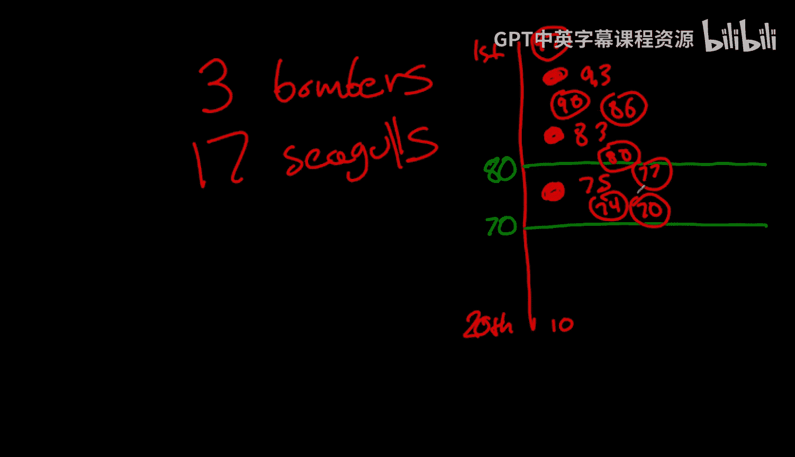

It ought to be start to be clear that。

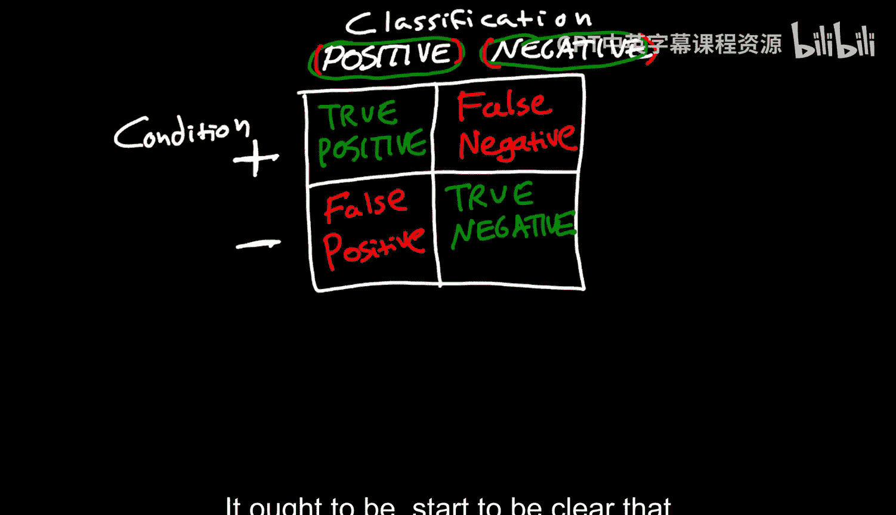

A radar does not determine how many values go into each of these boxes。

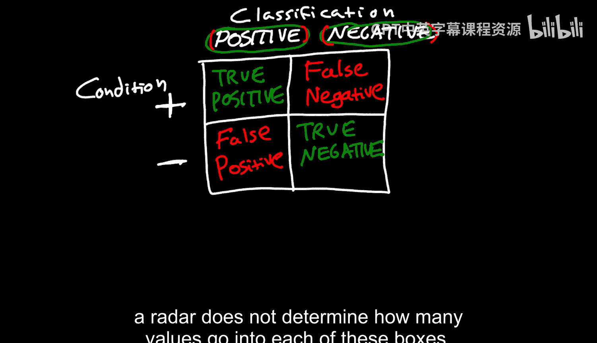

It's our radar with its ranking of the relative size of different images combined with。A threshold。

So at the threshold of 80。

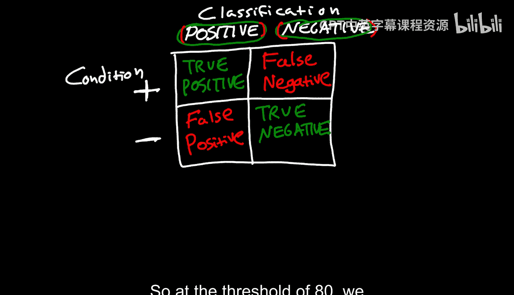

We would have two events that are true positives and four events。That are false positives。

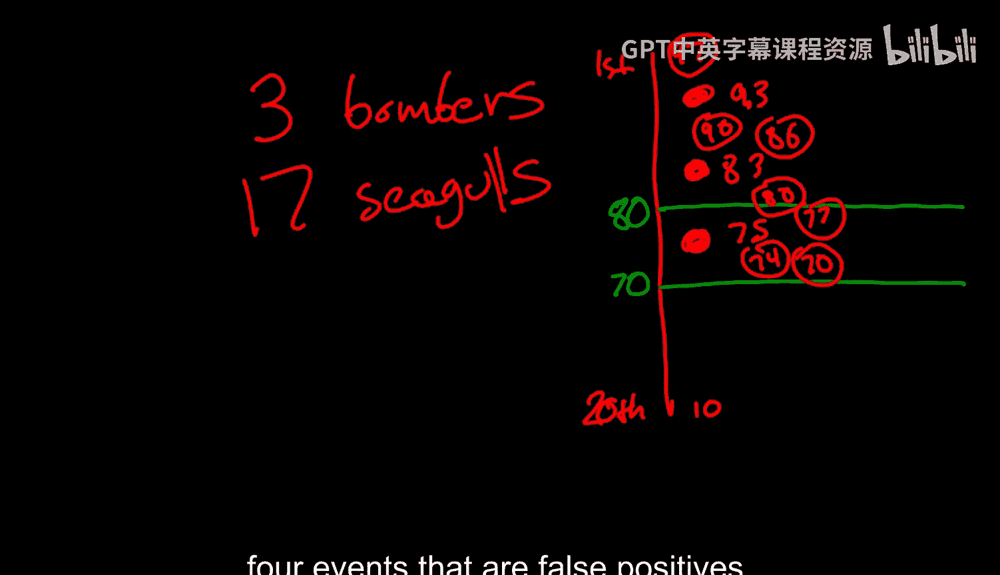

So， we would have。2 events。That are true positives。4 events。That are false positives。

We're also going to have one。Bober that we missed。So that would be a false。False negative。

But we've been correct about a large number of our negatives。 So they're all together， there are。

17 negatives。So， we would have。13。And these would be， this would be our picture。

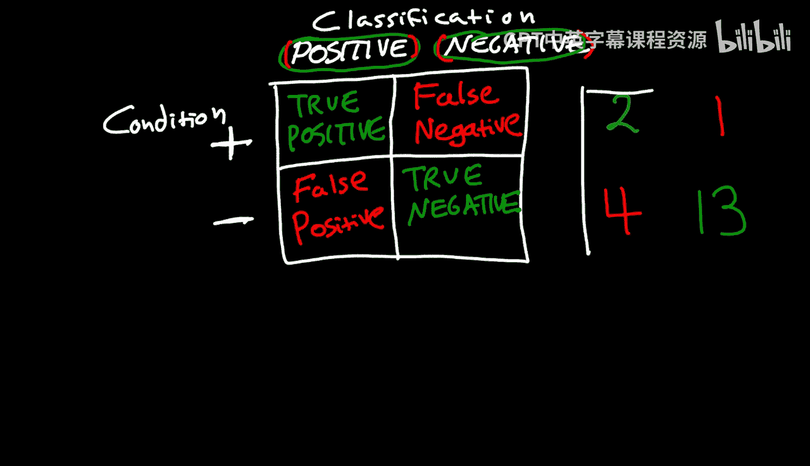

True positive。False negative。False positive。True negative。That is our picture at a threshold。Of。80。

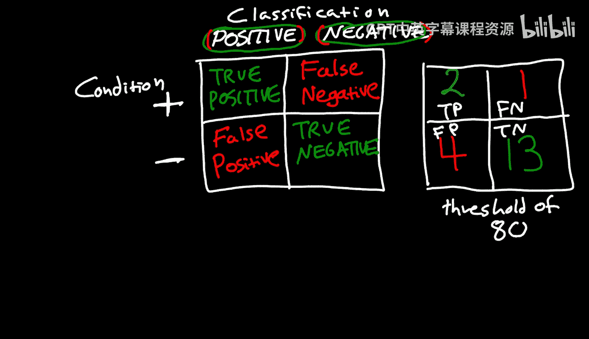

Now let's go back and let's look at what would happen if we set our threshold at。70。Okay。

 I'll put the picture here now。So how many true positives do we have？We have three。

How many false positives do we have。We have 7。And how many false negatives do we have zero。

 which is good and how many true negatives we have we have。10。Okay。So the idea here。

The idea that we're trying to communicate。Is that our binary classification system。

Involves something that generates ratings。Ratingings。That can be turned into rankings。

To which we can apply。

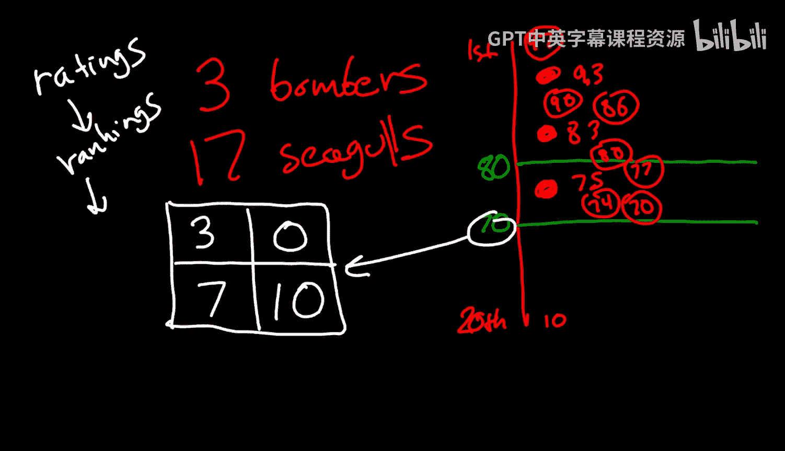

A threshold。Then everything above the threshold is going to be declared positive and everything below the threshold is going to be declared negative。

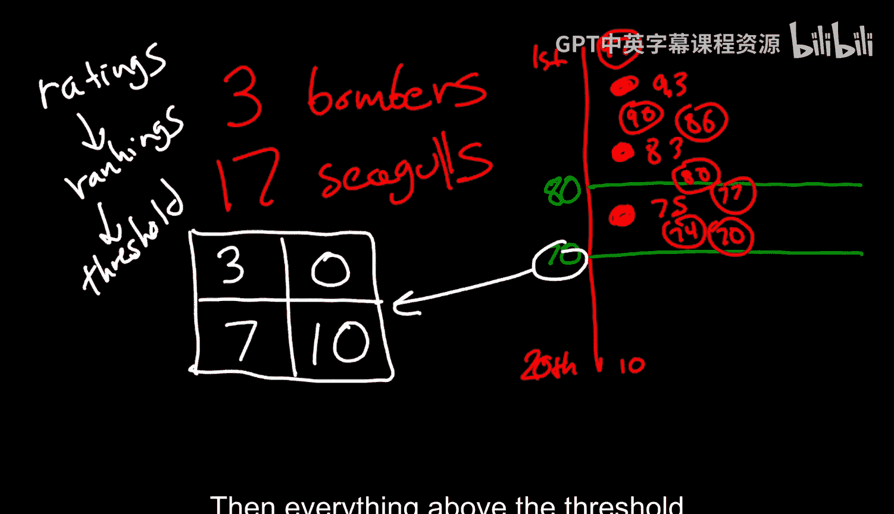

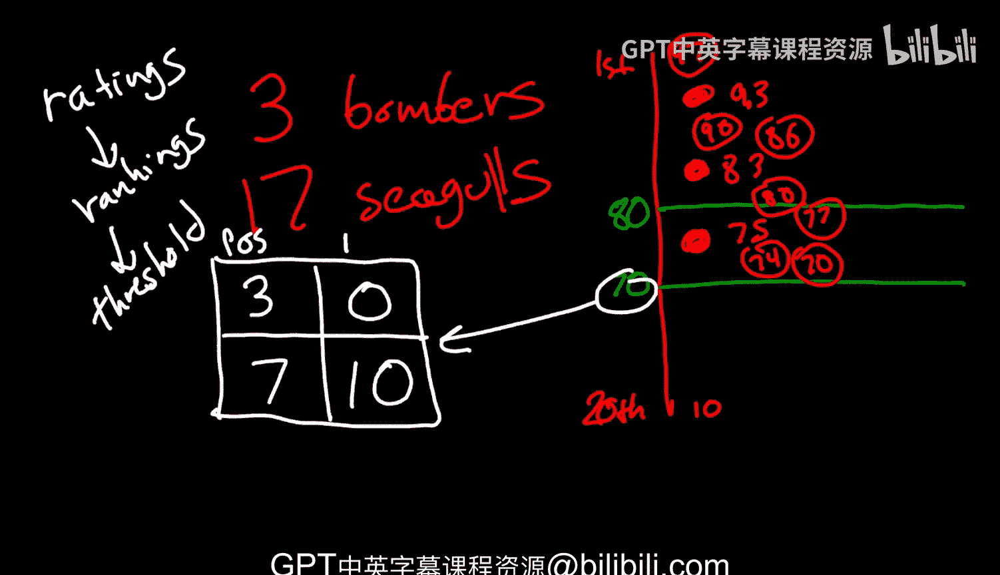