# 商业分析：P47：混淆矩阵解析 🎯

在本节课中，我们将学习混淆矩阵的核心概念。混淆矩阵是评估二元分类模型性能的关键工具。我们将通过一个雷达识别轰炸机与海鸥的生动例子，来理解分类中的四种可能结果，并探讨阈值如何影响这些结果。

## 二元分类的四种结果

当面对二元结果和二元分类问题时，我们的预测可能以两种不同的方式正确，也可能以两种不同的方式错误。

如果我们试图识别的真实情况是“轰炸机”（即我们关注的正类），并且我们正确地将一个事件分类为正类，这被称为**真阳性**。

另一方面，如果我们正确地将一个情况识别为“无需担忧”（例如雷达上的海鸥或其他无意义的斑点），即我们将其分类为负类，并且它确实是负类，这被称为**真阴性**。

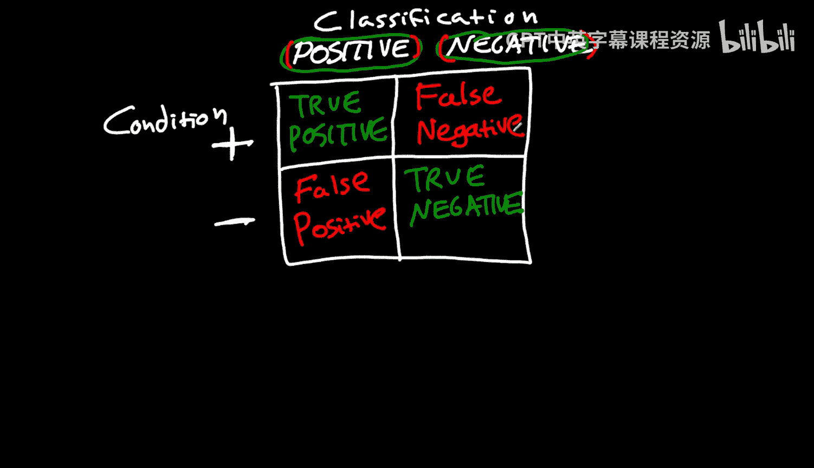

如果总能将事物分类为真阳性或真阴性，那么数据挖掘领域就无事可谈了。核心问题始终是：如何在最小化错误的同时，获得良好甚至优秀的结果。

当我们做出了正类分类，但实际情况却是负类时，这就产生了**假阳性**。

而当我们最严重的错误发生时，即实际情况是正类，但我们的分类却告诉我们它是负类，这就是**假阴性**。

## 轰炸机与海鸥的实例分析

在我们的轰炸机与海鸥场景中，假设有3架轰炸机和17只海鸥。雷达系统会根据图像大小为每个事件生成一个评分（例如最高97分，最低10分），并据此排序。

轰炸机的实际评分假设为93、83和75。它们并非整齐地排在前三位，这为我们评估系统性能创造了条件。

我们评估该雷达系统的性能，取决于我们决定将多少分以上的事件宣布为“阳性”（即轰炸机）。

## 不同阈值下的性能对比

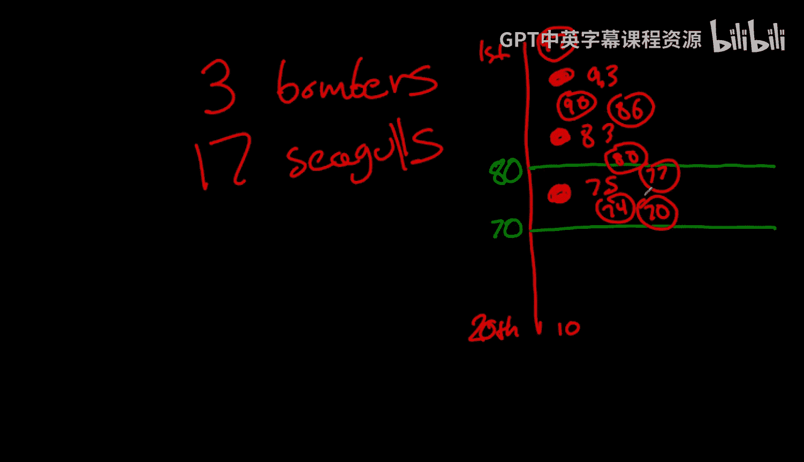

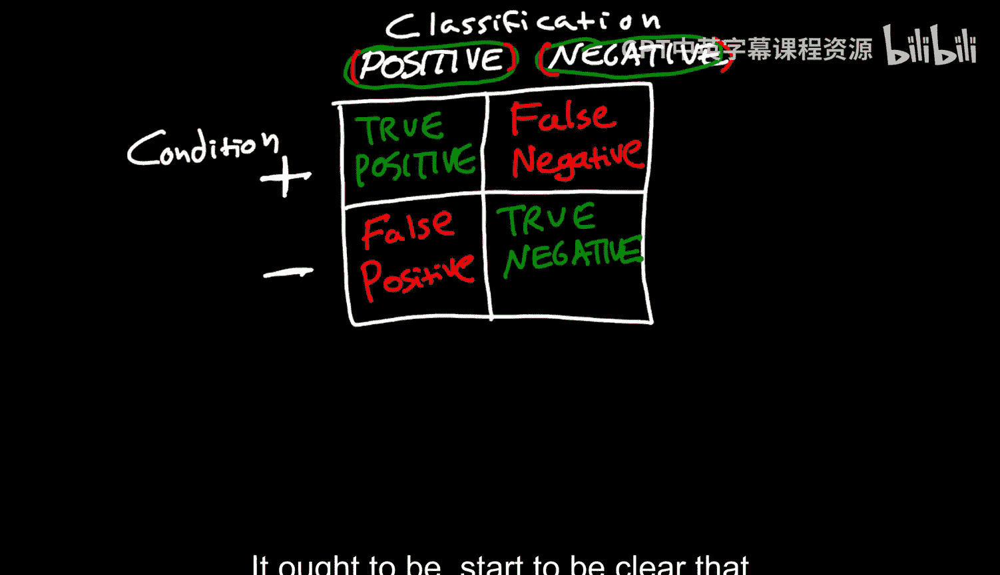

以下是两种使用相同雷达系统和数据，但设置不同决策阈值的方法。

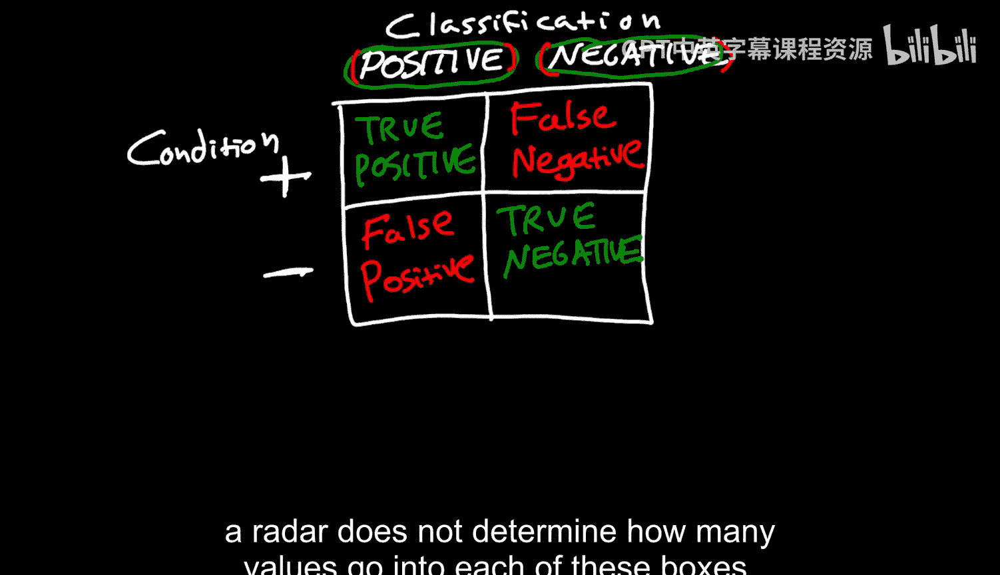

**第一种情况：阈值设为80分**
*   **真阳性**：评分高于80的轰炸机（93分和83分），共2个。
*   **假阴性**：评分低于80的轰炸机（75分），被漏报，共1个。
*   **假阳性**：评分高于80的海鸥（假设评分为97、90、86、80的海鸥），被误报为轰炸机，共4个。
*   **真阴性**：评分低于80的海鸥，共13个。

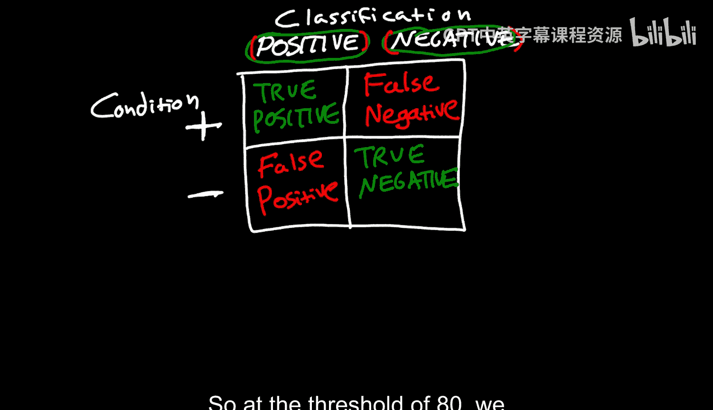

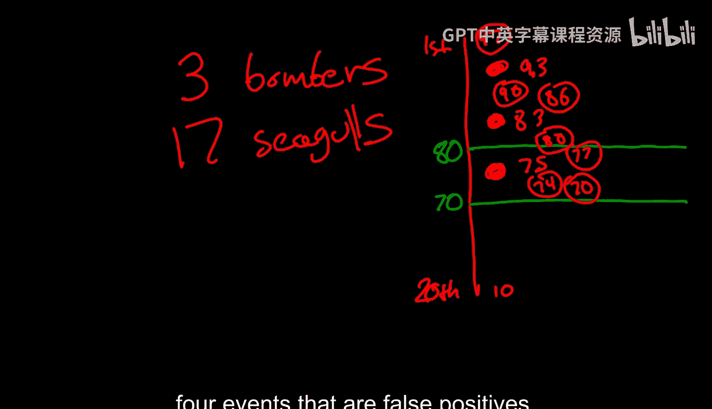

**第二种情况：阈值设为70分**
*   **真阳性**：评分高于70的轰炸机（93、83、75分），全部捕获，共3个。
*   **假阴性**：0个。
*   **假阳性**：评分高于70的海鸥（假设评分为97、90、86、80、77、74、70的海鸥），共7个。
*   **真阴性**：评分低于70的海鸥，共10个。

通过对比可以清晰地看到，**阈值线的位置直接决定了我们会产生多少误报（假阳性）**。阈值设得越高（如80分），误报越少，但可能漏掉真正的威胁（假阴性）。阈值设得越低（如70分），能捕获所有威胁，但代价是误报警报大幅增加。

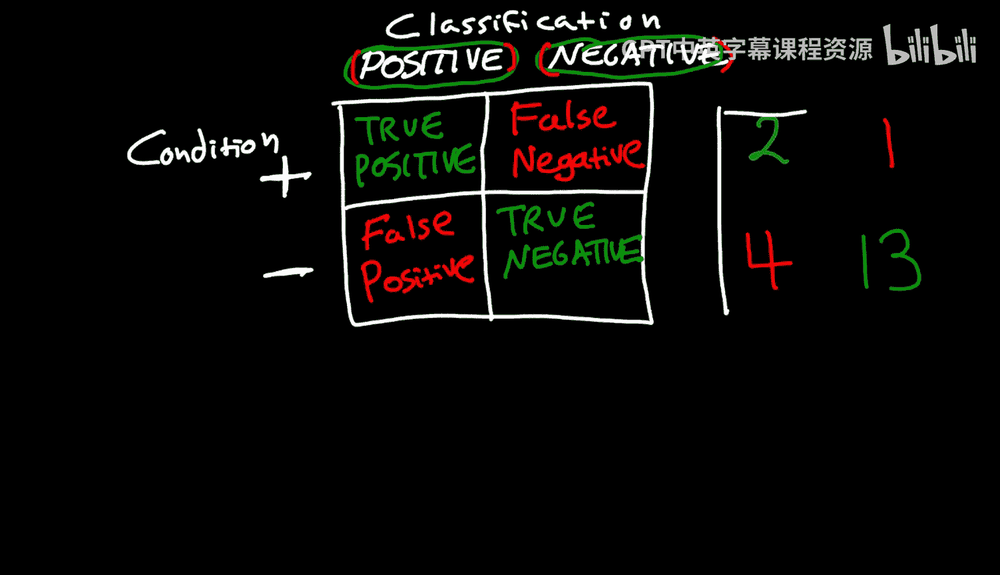

## 核心概念总结

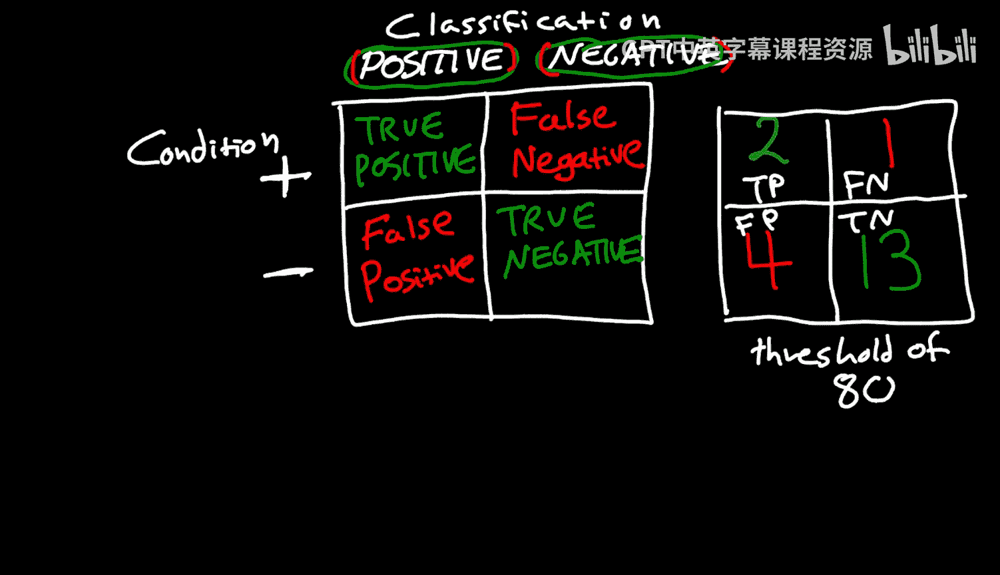

本节课中我们一起学习了混淆矩阵的构成。关键在于理解：

**雷达系统本身并不直接决定混淆矩阵中每个格子的数量。** 决定因素是我们的**雷达评分系统**（为不同图像生成相对大小的评分和排序）与我们设定的**决策阈值**这两者的结合。

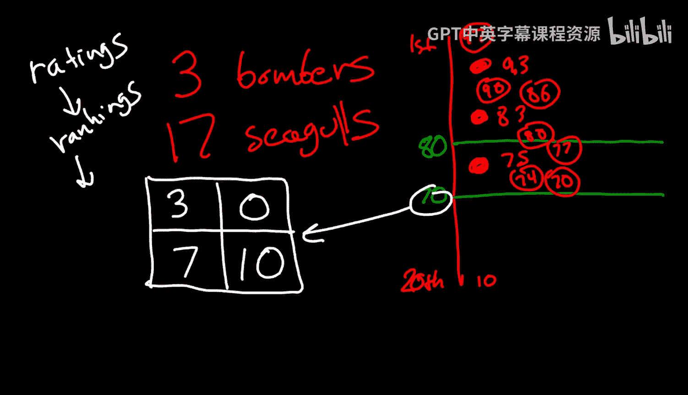

整个二元分类系统的流程可以概括为：
1.  模型生成**评分**。
2.  根据评分进行**排序**。
3.  应用一个**阈值**。
4.  **阈值以上**的所有事件被宣布为**阳性**。
5.  **阈值以下**的所有事件被宣布为**阴性**。

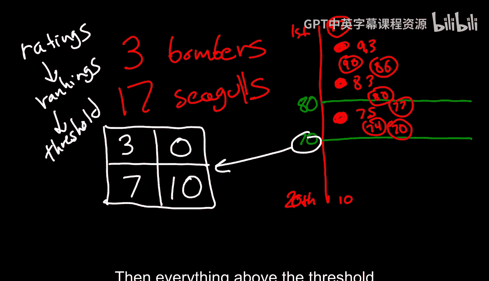

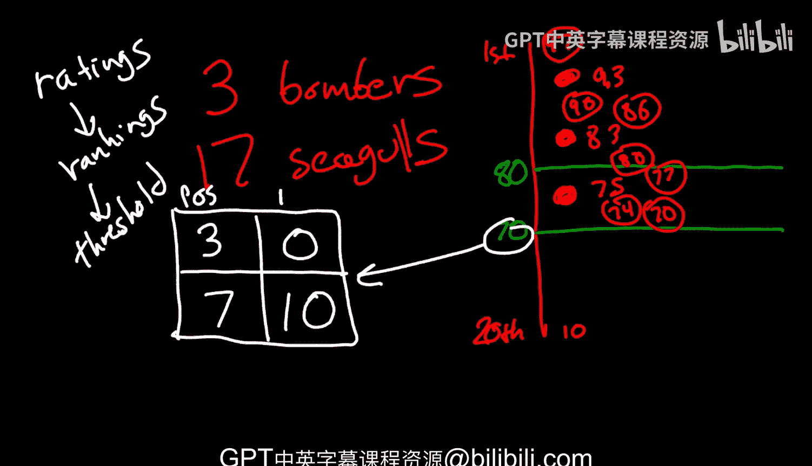

通过调整阈值，我们可以在捕获率（真阳性）和误报率（假阳性）之间进行权衡，这正是评估和优化分类模型的核心。