# 杜克大学《Excel 到 MySQL：商业分析（5课全）｜Excel to MySQL： Analytic Techniques for Business》中英 p48 13_03_04_成本决定最优阈值.zh_en -BV1mS421X7yw_p48-

The typical way that we characterize。

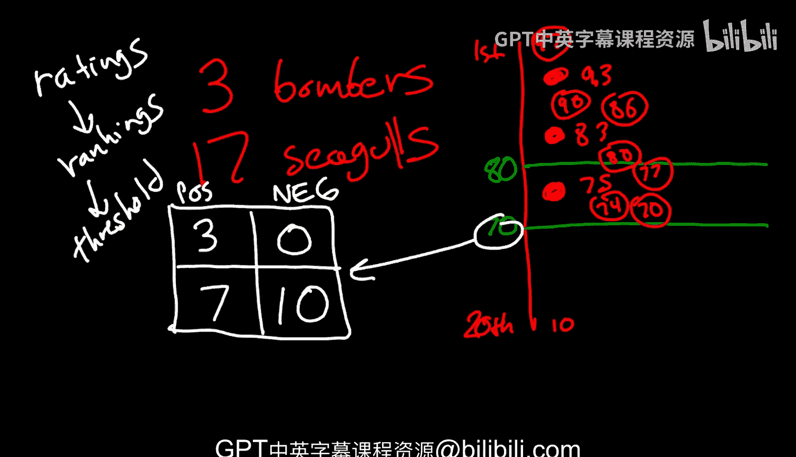

A particular threshold is by its false positive rate and its true positive。

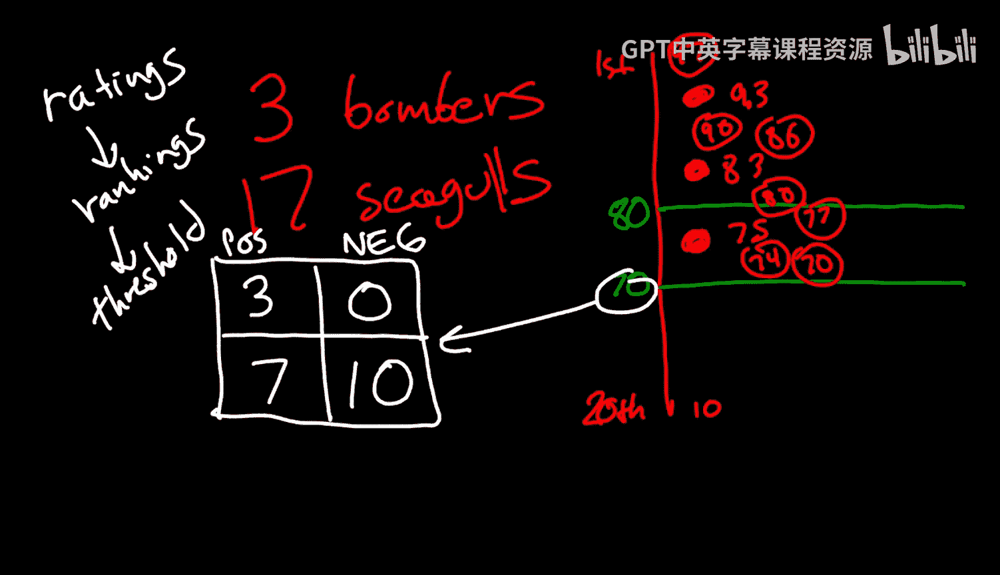

Rate， a false， positive rate。Is the number of false。Positives。

Divided by the total number of negatives。So this picture that we're looking at here is the threshold。

呃。8。And it has a false， positive rate。Of for。Deed by 17。It has a true positive rate。Of two thirds。

And our threshold of 70。Has a false， positive rage。嗯。7even，17th。But it has a true， positive rate。Of。

1。And as we saw in our。Little movie。Each ordered pair。X is equal to the false， positive rate。

Y is equal to the true positive rate。Each of these points can be plotted。An X Y coordinate plane。

And so every threshold has its corresponding point。So the threshold of 80 would have the 0 for17th。

 so that's。

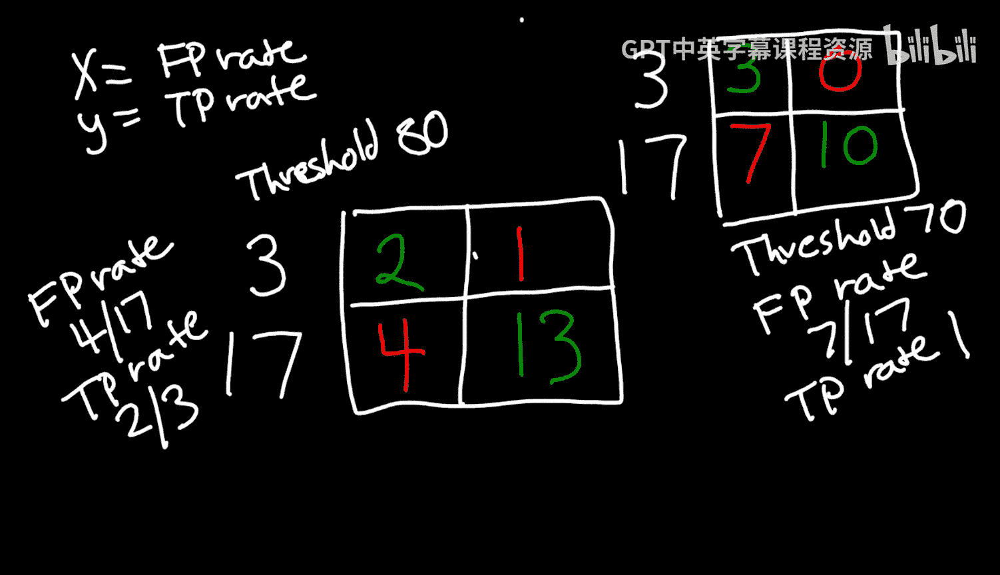

A little bit less than a quarter and two thirds for。17th。thirds。

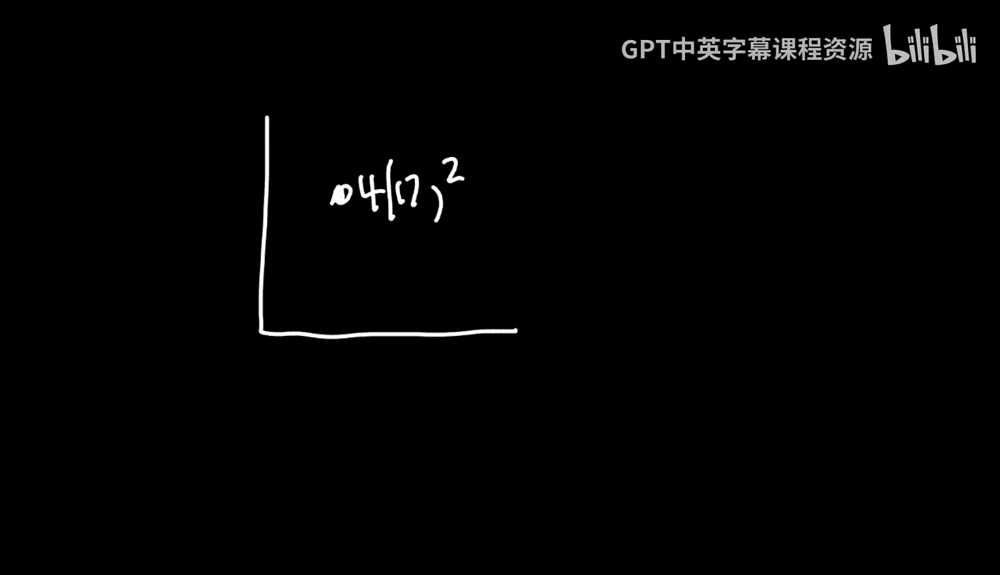

And 7，17th one。

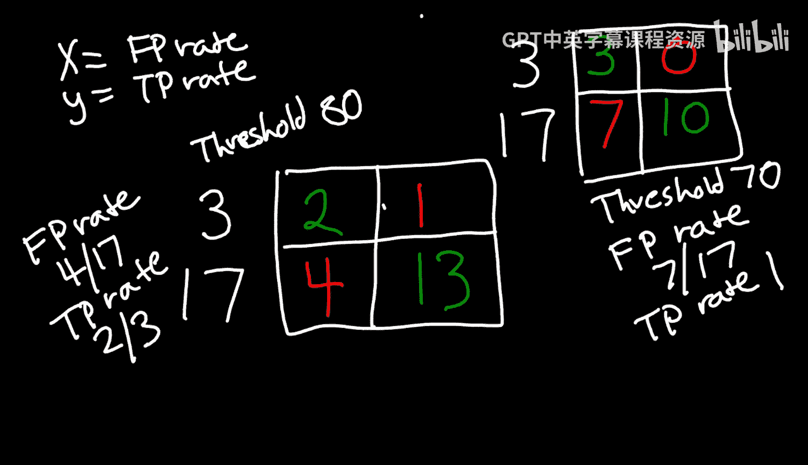

So。This is a representation of。The false positive rates。And the true positive rates。

At all possible thresholds。And。This is the area。Under the curve。Which in the case of our example。

 is equal to 08。Which is quite a reasonable， decent rate for a。

Diagnostic or for any kind of tool that's trying to discriminate between two states。

How much it's actually going to cost us？A cost function。Is dependent upon。

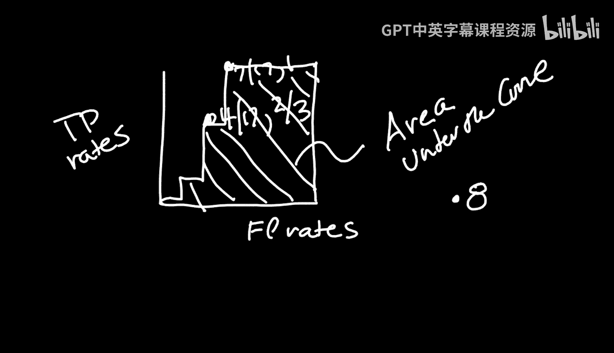

The cost for each。Mistake。So， generally， these mistakes。Are very expensive。

Bombs get through and they destroy a lot of things。These mistakes。Are also expensive。

But usually less so。We sent up a bunch of planes， and we used up fuel。

 and we also had the risk that our planes were one place where bombers might be somewhere else。

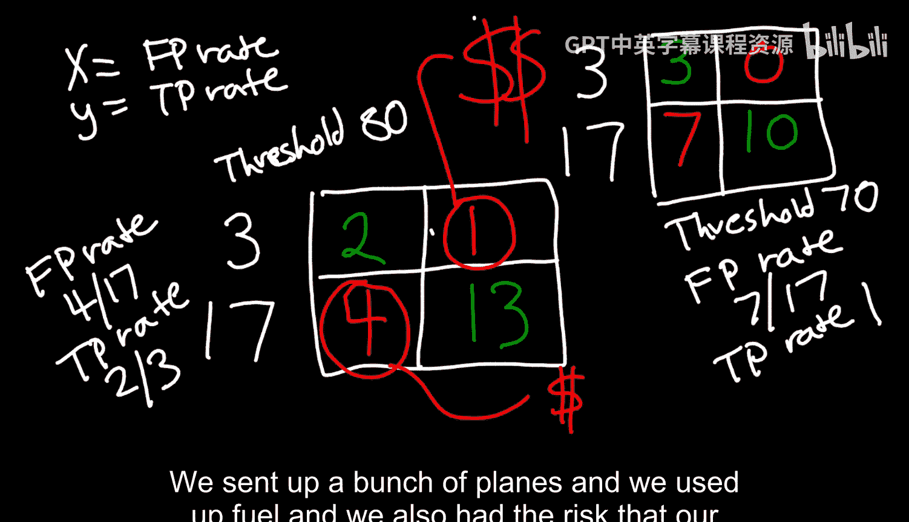

Okay。

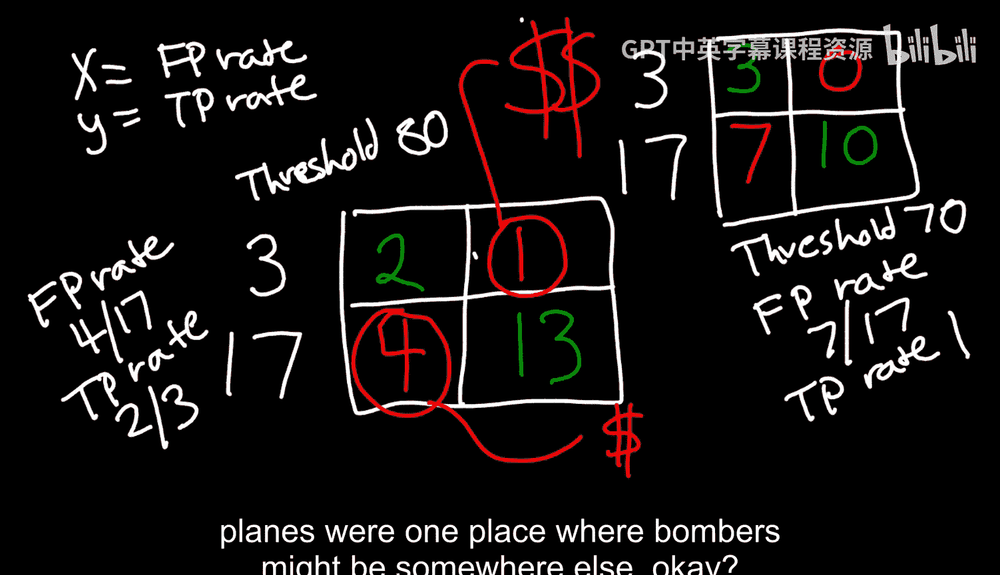

We will see when we work with some quiz problems and with Excel spreadsheets。That。

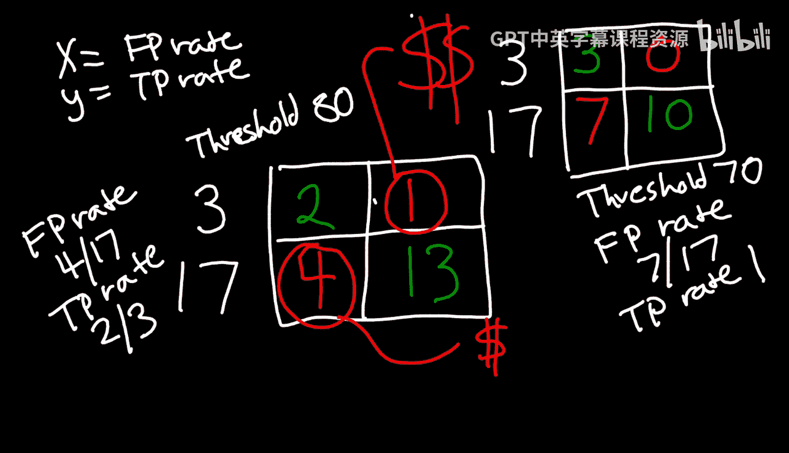

Where you put your threshold is going to be determined by the relative size of these two costs。

So in a situation where。

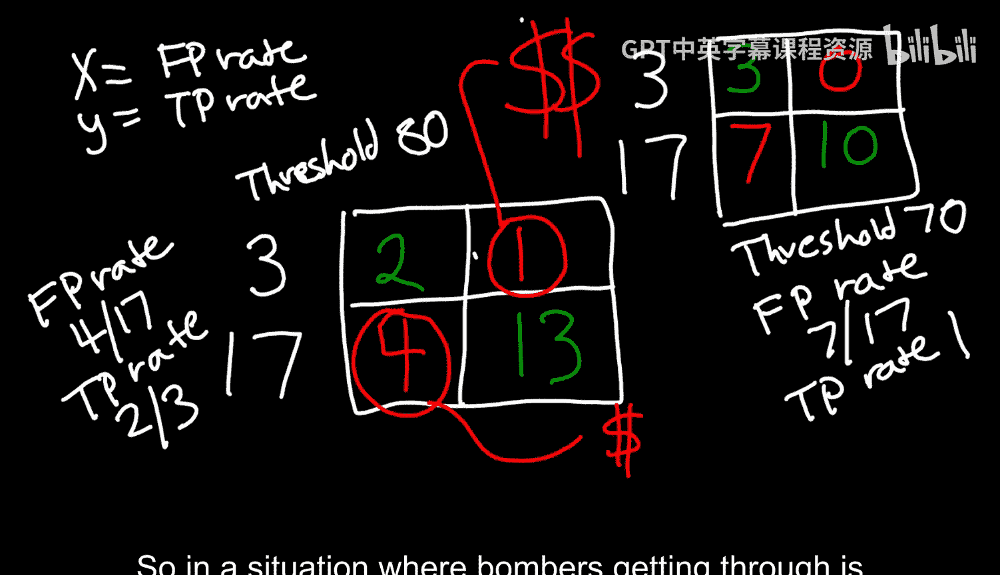

Bombs getting through is hugely expensive。

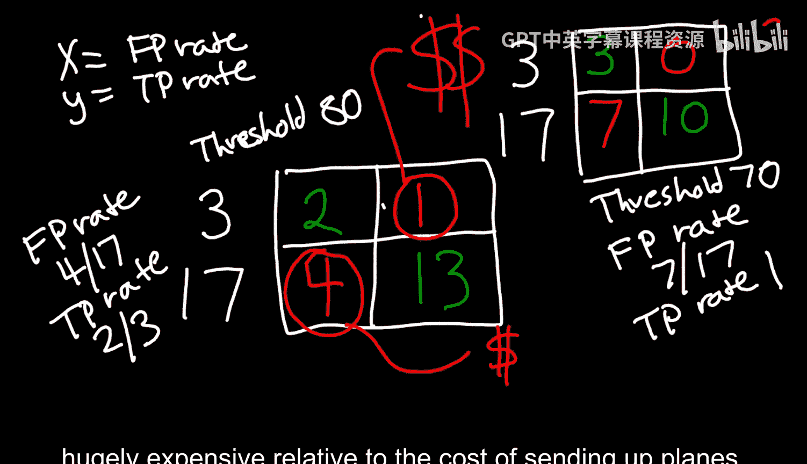

Relative to the cost of sending up planes。Then you really。

 really want the smallest possible number here。And we're willing to go for a lower threshold。

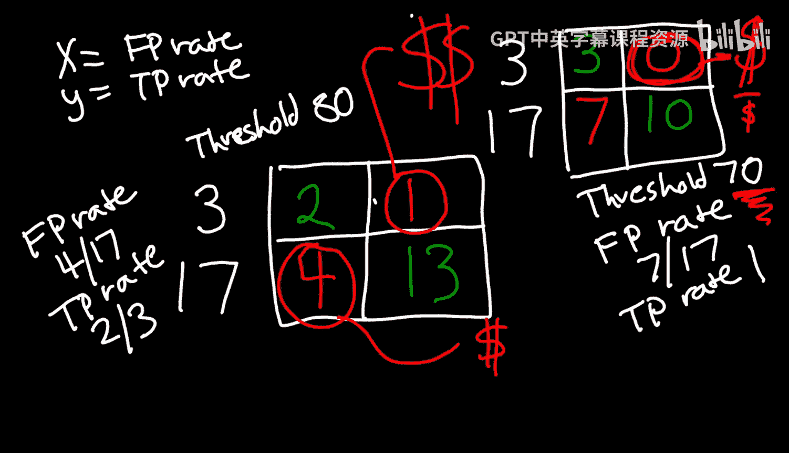