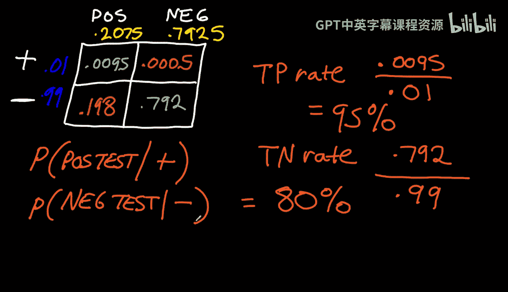
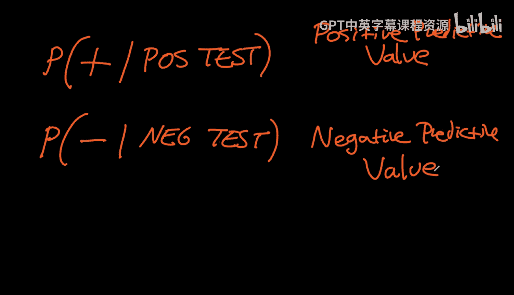
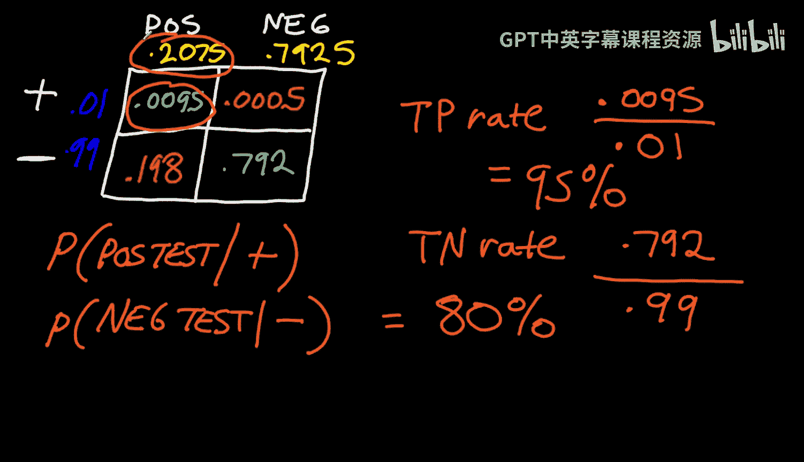
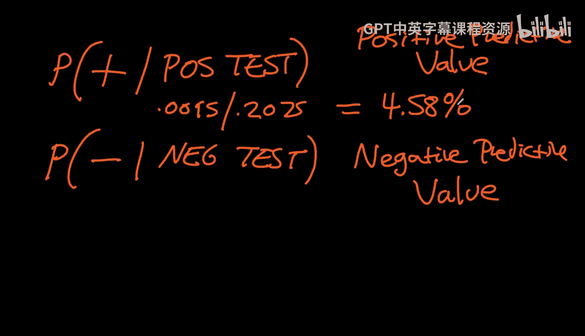
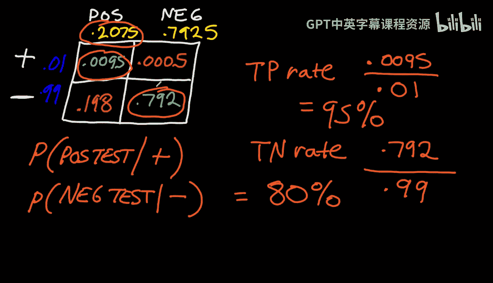
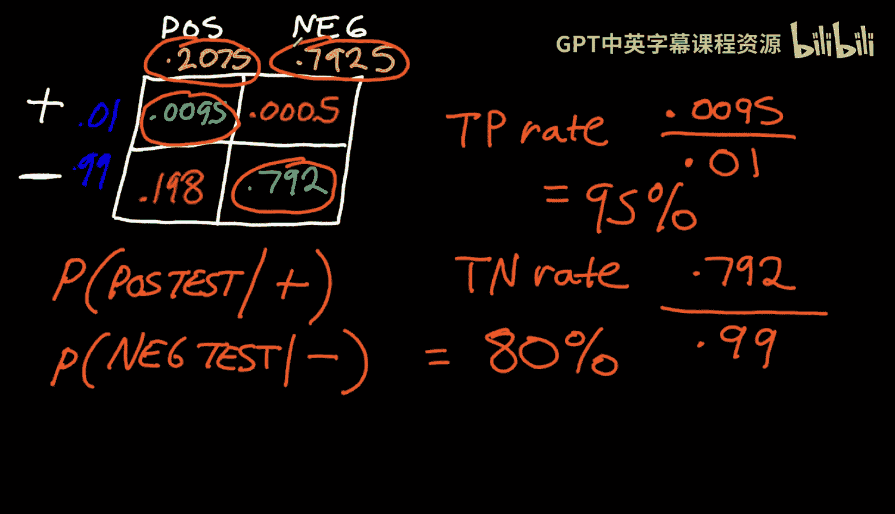
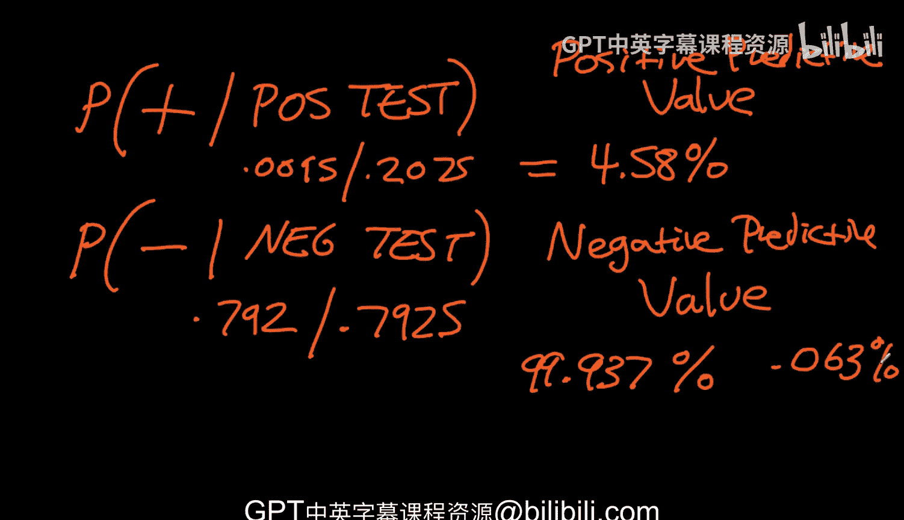

# 杜克大学《Excel 到 MySQL：商业分析（5课全）｜Excel to MySQL： Analytic Techniques for Business》中英 p49 14_03_05_计算阳性与阴性预测值.zh_en -BV1mS421X7yw_p49-

Next we'd like to turn to another example of binary classification。

 and this one is a typical kind of distribution for a cancer diagnostic。

We'll say that this is a protein blood test that identifies a rare cancer。

It's a cancer that has an incidence in our population that we are studying。Of 1%。

 meaning that when people walk in the door of the doctor's office and before they've taken a test。

They have a 1% chance that they have this cancer and a 99% chance that they do not This is a what would generally be considered a fairly good test。

And the reason why I say that is because it's true positive rate。Which is。It's true positive。Over it。

Actual incidents。Is equal to 95%。And it's true negative rate。Which is it。True negatives。

Divided by the。Incidents of not having the condition。Is 80%。

So if you come into the doctor's office and you get。A positive test result。You might be alarmed。

 particularly if you'd been told that the test has a true positive rate of 95%。

But that is not what a true positive rate means。And now for the first time。

 we're going to look at what these terms mean。In relation to the ideas of。Conditional probability。

Let's think about these terms as defined by conditional probabilities。

The true positive rate is the conditional probability。Of having a positive test。If。

I have the condition if I have cancer。And the true negative rate is the probability of having a。

Negative tests。Okay。Yes。I do not have the condition。

But that is not actually what we would want to know what we would want to know is something a little bit different。

 We would want to know what is the conditional probability。

 what is the conditional probability that we have the condition。

If we have。A positive test。Or。What is the probability that we don't have the condition。

If we have a negative test。And these two conditional probabilities have special names because they come up all the time this one is called the positive。

Predictive。Value of the test。And this one is called the negative predictive value。

The way that we calculate these。And we'll go back and we'll look at our chart for a moment。

Is。We are going to take。To calculate the positive predict predictive value， we are going to take the。

True positive part of all positive tests。So that's this value here。And we are going to divide by the。

Total number of positive tests， so that's 0。0095。

Divided by。0095 divided by 。2075， which is 4。58。Percent。So if I receive a positive test。

All of that is telling me is that I have a 4。58% chance of having cancer。

 which means of course I still have a better than 95% chance that I do not have cancer。

The negative predictive value。

Is based on。Taking this number divided by this number or 0。792。

。792 divided by 07925。Which is going to equal 99。937% when I came into the office。

 I had a 1% chance of having cancer。Now， I have a。06，3% chance。Of having cancer or。

Well less than a tenth0 of 1%。