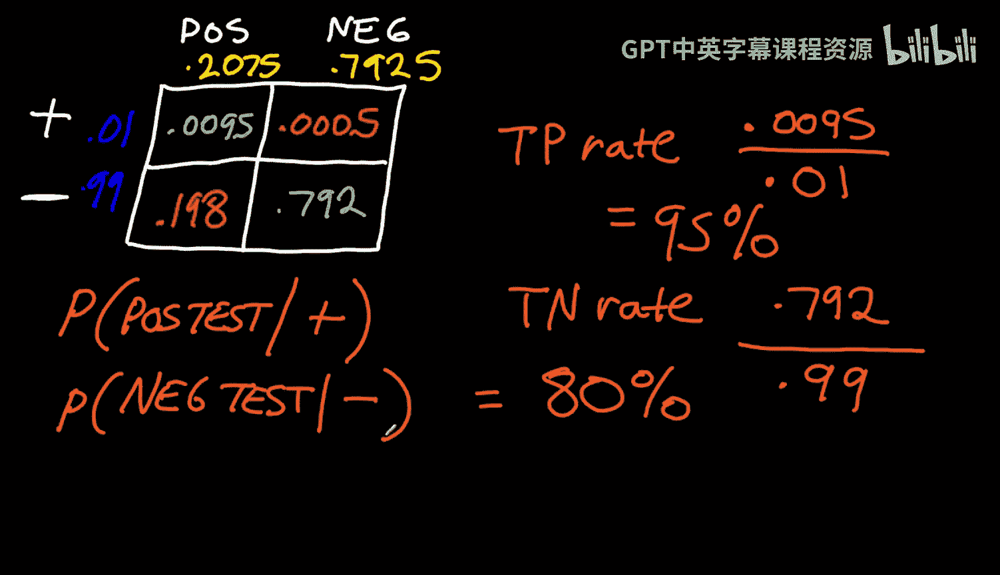
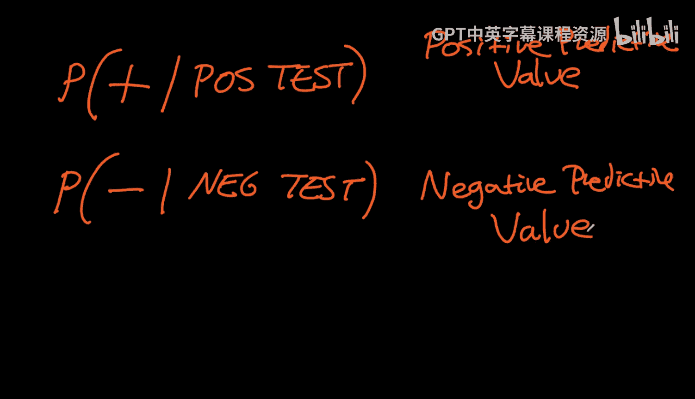
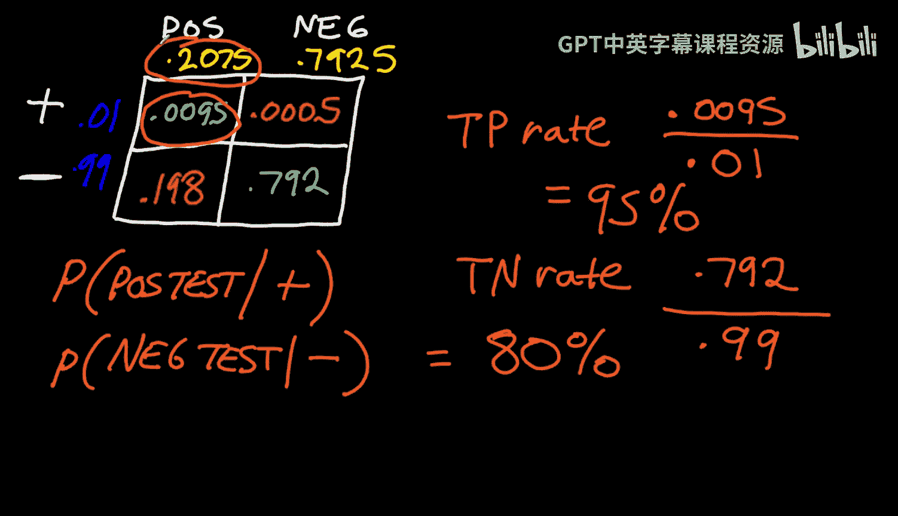
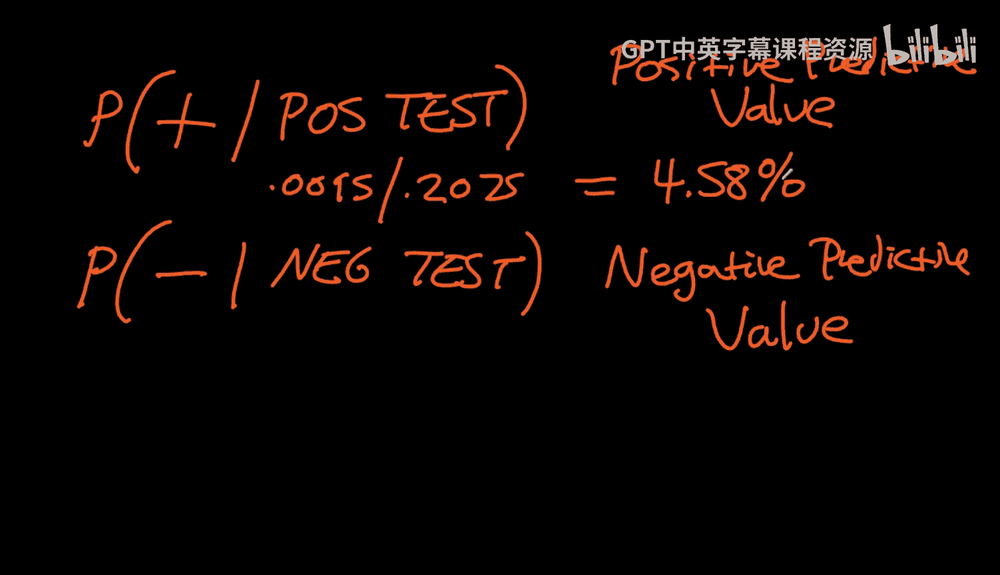
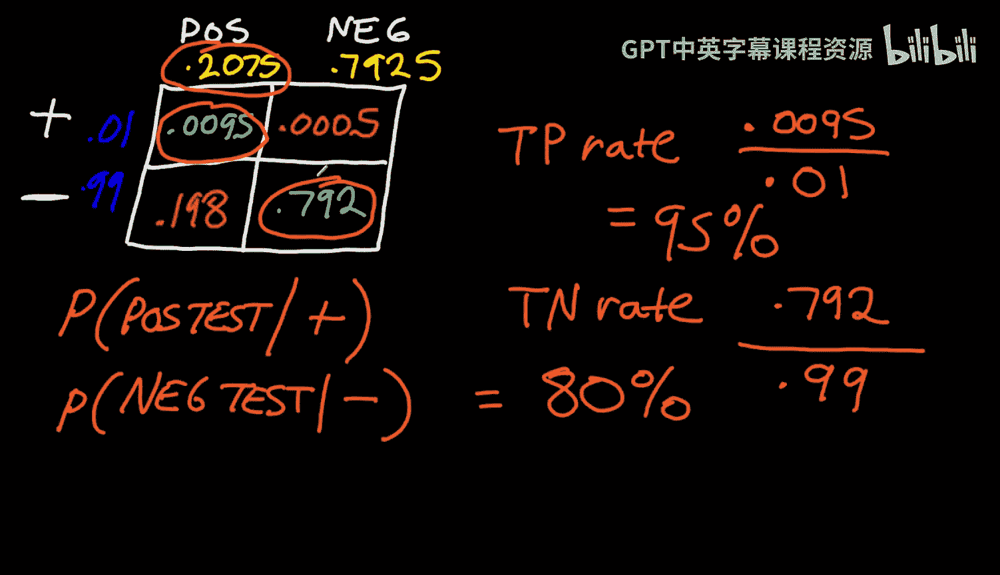
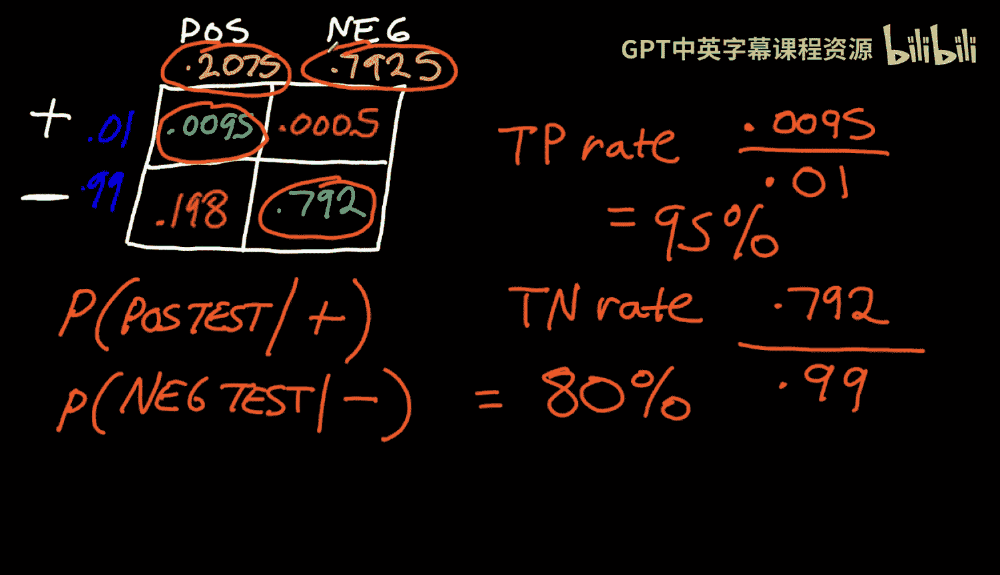
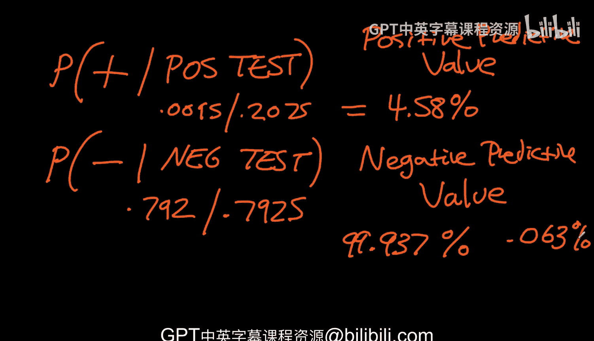

# 商业分析：5：计算阳性与阴性预测值 📊

在本节课中，我们将学习二元分类的另一个实际应用案例：如何计算医学诊断测试的阳性预测值和阴性预测值。我们将通过一个癌症诊断测试的例子，理解这些指标的实际意义，并学会如何计算它们。

## 从癌症诊断案例引入

上一节我们讨论了二元分类的基本概念，本节中我们来看看一个具体的医学诊断案例。这是一个典型的二元分类问题，涉及一种罕见癌症的蛋白质血液检测。

该癌症在我们研究人群中的发病率为1%。这意味着，在人们走进医生办公室并接受检测之前，他们有1%的概率患有这种癌症，有99%的概率没有患病。

## 理解测试的准确率指标

这个测试通常被认为是一个相当好的测试。原因在于它的**真阳性率**和**真阴性率**。

*   **真阳性率**的计算公式为：`真阳性 / 实际患病者`，本例中为95%。
*   **真阴性率**的计算公式为：`真阴性 / 实际未患病者`，本例中为80%。

如果你走进医生办公室并得到一个阳性检测结果，你可能会感到恐慌，特别是如果你被告知该测试的真阳性率高达95%。然而，真阳性率的含义并非如此。

## 定义条件概率

现在，我们首次将这些术语与**条件概率**的概念联系起来分析。

让我们将这些术语定义为条件概率：
*   **真阳性率** 是 **在患有癌症的条件下，检测呈阳性的概率**。
*   **真阴性率** 是 **在未患癌症的条件下，检测呈阴性的概率**。

但这并不是我们真正想知道的信息。我们真正想知道的是稍微不同的内容：
1.  在检测呈阳性的条件下，我们实际患病的概率是多少？
2.  在检测呈阴性的条件下，我们实际未患病的概率是多少？

这两个条件概率有专门的名称，因为它们在实际应用中非常重要。

## 计算阳性预测值与阴性预测值

第一个概率被称为测试的**阳性预测值**。第二个概率被称为**阴性预测值**。

我们通过回顾下面的诊断结果分布图来计算这些值。

以下是计算步骤：

**计算阳性预测值**
我们取所有阳性检测结果中的真阳性部分（即图中的0.0095），然后除以阳性检测结果的总数（0.2075）。

计算公式为：
`阳性预测值 = 真阳性数 / 总阳性数 = 0.0095 / 0.2075 ≈ 4.58%`

因此，如果我收到一个阳性检测结果，这只告诉我我有4.58%的概率患有癌症。这意味着，我仍然有超过95%的概率没有患癌。

**计算阴性预测值**
阴性预测值的计算基于真阴性数除以阴性检测结果的总数。

计算公式为：
`阴性预测值 = 真阴性数 / 总阴性数 = 0.792 / 0.7925 ≈ 99.937%`

## 结果解读与意义

在我走进办公室时，我患有癌症的先验概率是1%。现在，在得到阴性检测结果后，我患癌的后验概率降低到大约0.063%，远低于千分之一。

本节课中我们一起学习了如何计算和解读诊断测试的**阳性预测值**与**阴性预测值**。我们通过一个癌症诊断的实例，明确了真阳性率与阳性预测值的根本区别：前者反映的是测试识别病人的能力，而后者回答的是“检测呈阳性时，实际患病的概率有多大”这个对患者至关重要的问题。理解这一点对于正确评估测试结果和做出明智决策至关重要。