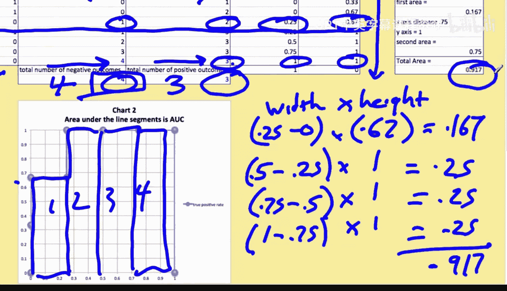
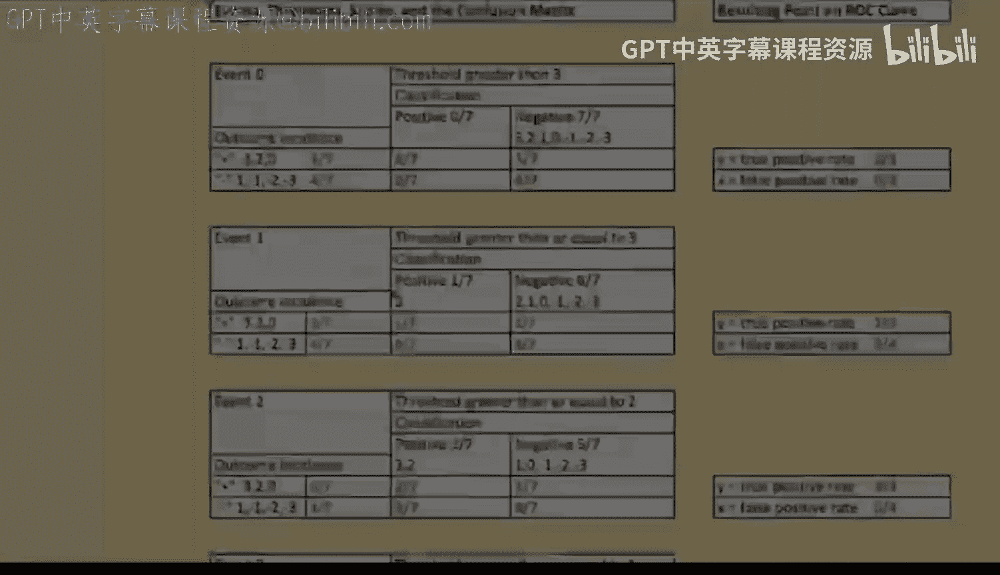
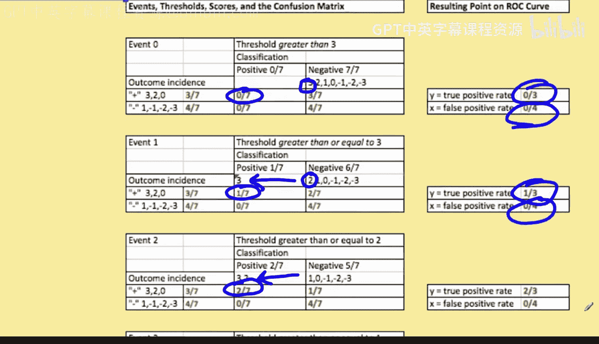
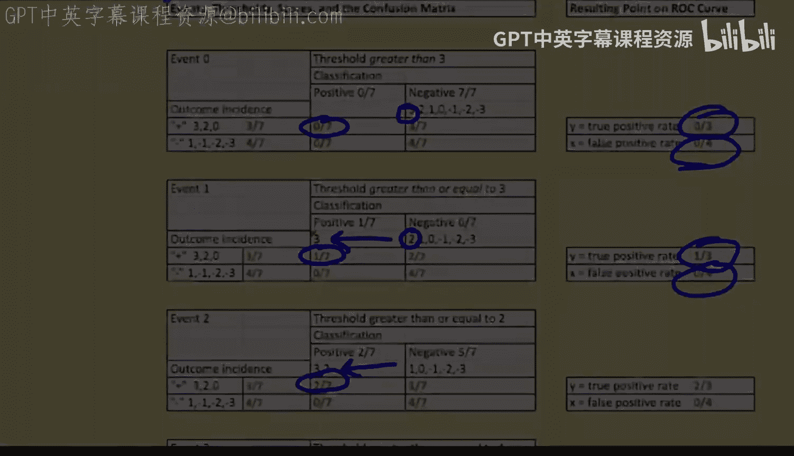

# 杜克大学《Excel 到 MySQL：商业分析（5课全）｜Excel to MySQL： Analytic Techniques for Business》中英 p50 15_03_06_ROC曲线下面积计算方法.zh_en -BV1mS421X7yw_p50-

The area under the receiver operating characteristic or ROC curve。Also called the AU。

Is the most widely used performance metric for binary classification models。

Its two great strengths are first。That AUC results do not change with changes in the incidence of the actual condition。

Nor is AU affected by changes in the relative costs of the two different types of binary classification errors。

 false positives and false negatives。Therefore。When either future incidents or the cost of classification errors or both。

Are unstable or cannot be known， the AUC is generally the best possible performance metric available。

The AU metric ranges from a minimum of1 half to a maximum of one。

An AU of1 half indicates total uncertainty about classification。

An AU of12 is the result when guessing outcomes at random。

An AUC of one would be classification with zero errors。

 a theoretical ideal that no one expects you to meet。A normal。

 good to very good area under the curve is typically in the 0。65 to 0。85 range。

A common technique in data analysis is to develop a binary classification model。

By varying certain parameters so as to maximize the AU on a sample set of data with known outcomes。

Often called a training set。You will calculate your own area under the curve on a training set and apply this technique for the final course project。

This video is a quick tutorial on how to calculate for a given classification model and collection of events with known outcomes。

 the resulting area under the curve。You should follow along using the review of AUC curve Excel spreadsheet。

Which I will now turn to。To make an ROC curve。We start with a collection of events。

In the example spreadsheet， there are seven events numbered one through seven。

In column B rows 20 through 26。Each event。Must be assigned a score and an outcome if we are to generate an ROC curve。

Our model is a procedure or algorithm that inputs known data about an event and outputs a single score。

Here we focus on turning scores and outcomes into an ROC curve。

 so we aren't concerned with how the scores are generated。

Our binary outcomes are represented by one for positive and zero for negative。

To generate an ROC curve。We need to know what the true outcomes are。And then we need to know。

How effective our model is at each possible threshold for positive classification。

The way that we find this out is that we rank。All of our events by score and you'll notice this has already been done for you but。

This procedure only works。If you have a strict rank ordering by score of all of your events。

And then you're going to proceed。Down your list， performing a classification at each distinct possible threshold。

The threshold that we're using， we will call the active threshold。

 the first threshold that we use is actually a number larger than or higher than the top score。

At this threshold， everything is classified as negative。Therefore。

 there are no false positives because nothing is positive。And there are no true positives。

Because nothing is classified positive。We're going to proceed through our list and at the very bottom threshold。

At a threshold of greater than or equal to negative 3。Every event。Is classified as positive。

And so we will have a total number of true positives here three。

 equal to the actual number of positives in our collection。

But all of the negative outcomes are classified incorrectly as false positives。

What an ROC curve is is a measure of the effectiveness of the model。At each possible threshold。

 in this case， there are eight thresholds from above the highest score to below or equal to the lowest score。

 we need to convert our total number of false positives and total number of true positives into a false positive。

Rate and a true positive rate。To generate the false positive rate。

We are going to divide the number of false positives at each particular threshold by the total true number of negatives or four。

Okay， so let's just pick one particular example， let's just pick a threshold。That is。

Greater than or equal to one。There are three outcomes， two positive outcomes and a negative outcome。

The negative outcome is incorrectly classified as positive， therefore there is one false positive。

And the two actually positive outcomes are correctly classified。

 therefore there are two true positives。The false positive rate is the number of false positives here one divided by four。

So one divided by4 is 0。25。And the true positive rate is the number of two positives here two divided by the total number of positive outcomes。

 which is three。Or two thirds。This ordered pair。One quarter， two thirds。

Is represented on our ROC curve。By the point。25。67 here。

And what we're doing when we work our way down from the top， down to the bottom。

Is we're starting with the point where everything is negative and we have a false positive rate。

Of zero and a true positive rate of zero。 and then we are proceeding。Up and to the right。

 Up and to the right。As we work our way down this list。Until we arrive at the 011， where。

Everything is classified positive， so we have three over three equals one and four over four equals one。

We next will sum the area under these rectangles。We have four rectangles， one， two， three， four。

Notice that。Only the X axis value or the Y axis value can change between。Any two points。

 we never have both changing at the same time because we are using narrow changes in threshold so that only one outcome at a time can be switched from a negative to a positive positive classification。

 so only the false positive rate or true positive rate can change not both。

So we sum the area of these rectangles to get an idea of the overall strength of our classification model。

 so we're going to take the width of each times its height。So the first rectangle has a width of 0。

25 minus0。And has a height of。67。The second rectangle has a width of。05 minus 0。25。

And it has a height of one third rectangle。Has a width of 0。75 minus。5。

 and it has a width of  one in the last rectangle has a width of 1 minus 0。

75 and it has a height of 1 and these areas are equal to。同意。9， one， seven。Which appears here？

And that is how you calculate the area under the ROC curve。

I'd like to point out that each threshold has its own confusion matrix。

 and these confusion matrices are provided in your spreadsheet。So we have。

Outcomes that do not change。Where we have three true positive outcomes and four actually negative outcomes。

But our classifications are shifting， so each time we move。Down our list。We are shifting one item。

Over。To from a negative to a positive classification。

So next we're going to take the item two and we're going to shift it from a negative to a positive classification。

And you see that one of our。Items here will change。Only one can change at a time。Okay。

And then we look at the false positive rate。And true positive rate。

And that is what gives us our points on our ROC curve。

I hope this has been instructive。Good luck in generating your own R O C curves。

I think you'll find that this is one of the most useful tools。Provided in this course。

