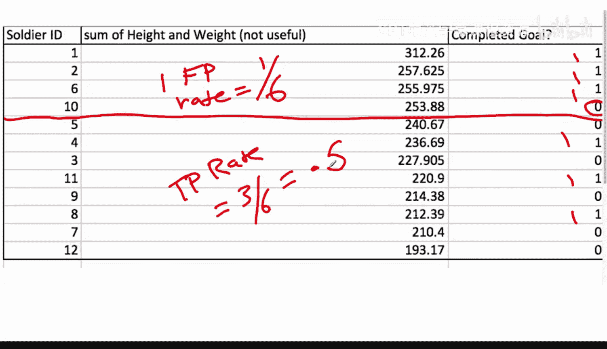

# 杜克大学《Excel 到 MySQL：商业分析（5课全）｜Excel to MySQL： Analytic Techniques for Business》中英 p51 16_03_07_多变量二分类分析.zh_en -BV1mS421X7yw_p51-

In our first binary classification problem。We had just one input。It was a for a cancer diagnostic。

 and we had a level of protein。And we ranked everything by that level。

And then we identify different thresholds above which。

Everyone would be declared to be a positive test and below the threshold。

 everyone would be declared to be a negative test。That exercise， I hope。

 helped you to understand where the area under the curve value comes from and how at different thresholds。

 you'll have a different false positive rate， a different true positive rate。

 and therefore a different point a different XY coordinate point on the XY plane where we map our ROC curves。

What we have in business problems？It has a whole bunch of inputs and we want to combine them so as to create the best possible model to predict our binary outcome。

How to combine them？There are a number of acceptable methods。

And the method that we teach here is designed to be effective， simple。Avoid overfitting。

 for the most part， can allow you to experiment and see your results clearly。

So let me give you a very simple example of what I mean by combining a binary classification variable。

We have an example of 12 soldiers。The soldier's mission is to carry a 100 pound pack。

Four miles in one hour。I provided a metric version for those of you who prefer metric。

The data that we have about each soldier is their height。Their weight and their age。

And so we'll have a series of outcomes and a positive outcome is marked with a1。

 a negative outcome with a0。 So our basic chart looks something like this。Now。

 we can sort by a particular variable。 So here I have sorted by height。

And you can do this yourself in the accompanying Excel spreadsheet， simply select the data sort。

Function choose descending and when it asks you to expand all rows， you say yes。

 and then it will reorder all of the data。So what I have here is a reasonably good result。

 but not really a great result。So let's say I'm using height as my binary classification variable and I've set a threshold here。

I've got six who completed the task。And6， who did not。So I have a false positive rate。Of 1，6。

Then I have a true positive rate。Of one half。Now， let's suppose that I sort。By weight。And again。

 I'm going to look at the top four。And here again， because there are six ones and six zeros。

I'm going to have a false positive rate。Of。1， next。And I'm going to have a true positive rate。Of1，2。

 three， over six or one half。그。

What I would like to be able to do is to combine these variables in some way so as to get a better result。

My recommendation， when you combine variables that have。

Very different scales is that you first standardize them。

 then it makes it much easier to figure out how much relative weight you should assign to each one。

 So in the accompanying spreadsheet I've already done that for you。

And if you take the standardized heights and standardized weights and you sum them。

 you get something that looks like this。If we take the top four scores。As our threshold。

We now have a false positive rate of zero。And a true positive rate。Of。One， two， three， four。

 out of six。Four out of six。Has two thirds。At this threshold。

 we have a much better result combining the information from height and weight into a single score than using scores based on height alone or weight alone。

Now。You might wonder。Why didn't we just add together the raw heights in inches and the weights in pounds？

But instead we converted to those units using standardization。

 which is explained in detail in later on in this course。

 well we get completely different outcomes depending on the units of height and weight that are used。

If we add weight in units of pounds and height in units of inches， as is shown here。

Then weight swamps the results and we get nearly the same outcome for the top four as a ranking based on weight only。

False， positive。We have one false positive， so we have a false positive rate of 16。

And we have a true positive rate of one， two， three out of four， five， six。

 so our true positive rate。April three over six。Pot5。The other extreme。

 we could use height in units of millimeters and weight in units of kilos。

 and the result would be nearly the same as a ranking based on height alone。

 by standardizing the data we find a way to treat each of the two input variables as equally important。

For instance， a height that is two standard deviations larger than the mean height would have the same impact as if a weight were two standard deviations heavier than the mean weight。

Clearly， this is a much stronger。Binary classifier。If you calculate the full area end of the curve。

 you will find that it is much superior。