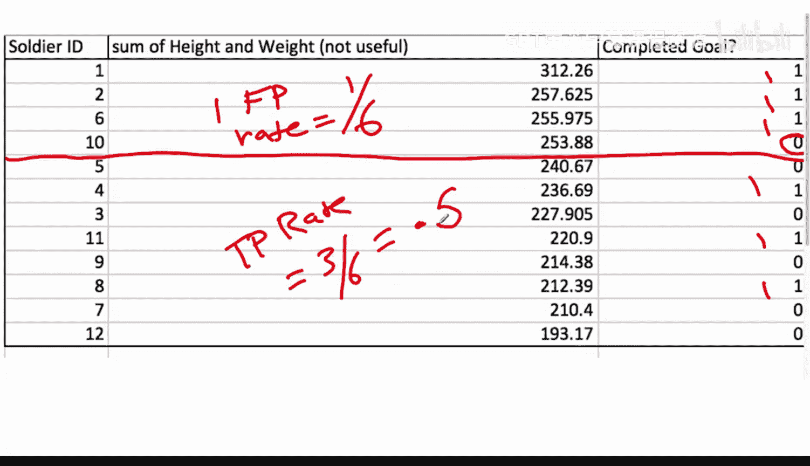

# Excel 到 MySQL：商业分析：5.1：多变量二分类分析 📊

在本节课中，我们将要学习如何将多个输入变量组合起来，构建一个更强大的二分类预测模型。我们将通过一个具体的例子，理解为什么以及如何标准化数据，并比较不同方法的效果。

---

在第一个二分类问题中，我们只有一个输入变量。那是一个癌症诊断的例子，我们根据蛋白质水平对样本进行排序。然后我们设定不同的阈值，高于阈值则判定为阳性测试结果，低于阈值则判定为阴性测试结果。这个练习旨在帮助你理解ROC曲线下面积值的来源，以及在不同阈值下，你会得到不同的假阳性率和真阳性率，进而在绘制ROC曲线的XY平面上得到不同的坐标点。

然而，在商业问题中，我们通常拥有大量输入变量。我们希望将它们组合起来，以创建最佳的模型来预测我们的二元结果。

那么，如何组合这些变量呢？存在多种可行的方法。我们在此教授的方法旨在**有效、简单**，并且**在很大程度上能避免过拟合**，同时允许你进行实验并清晰地看到结果。

让我通过一个简单的例子来说明什么是“组合变量进行二分类”。

我们有一个包含12名士兵的例子。士兵的任务是在一小时内背负100磅（约45.4公斤）的背包行进四英里（约6.4公里）。我为偏好公制单位的同学提供了公制版本的数据。我们掌握的每名士兵的数据包括他们的**身高**、**体重**和**年龄**。我们有一系列结果，阳性结果（完成任务）标记为`1`，阴性结果（未完成任务）标记为`0`。因此，我们的基础数据表看起来是这样的。

现在，我们可以按某个特定变量进行排序。这里我按身高排序。你可以在随附的Excel电子表格中自己操作，只需选择数据，使用排序功能，选择降序，当它询问是否扩展所有行时，选择“是”，然后所有数据将重新排序。

以下是我按身高排序后，设定一个阈值（例如取前四名）得到的结果：

*   **假阳性率**：1/6
*   **真阳性率**：1/2

接着，假设我改为按体重排序。同样，我查看前四名。因为数据中有六个`1`和六个`0`，我得到的结果是：

*   **假阳性率**：1/6
*   **真阳性率**：1/2

显然，仅使用单一变量（身高或体重）得到的结果并不理想。

---

我希望能够以某种方式组合这些变量，从而获得更好的结果。我的建议是，当你组合**尺度差异很大**的变量时，首先对它们进行**标准化**。这样能让你更容易确定应该赋予每个变量多大的相对权重。在随附的电子表格中，我已经为你完成了这一步。

以下是标准化处理后的步骤与结果：

1.  对身高和体重数据进行标准化。
2.  将标准化后的身高值与标准化后的体重值相加，得到一个综合分数。
3.  根据这个综合分数进行排序。

如果我们取综合分数最高的前四名作为阈值，现在得到的结果是：

*   **假阳性率**：0
*   **真阳性率**：4/6 ≈ 0.667

在这个阈值下，通过将身高和体重信息组合成一个单一分数，我们得到了比单独使用身高或体重分数**好得多**的结果。

---

你可能会想，为什么我们不直接把原始身高（英寸）和原始体重（磅）相加，而是要先转换成标准化单位呢？本课程后面会详细解释标准化。原因在于，根据所使用的身高和体重单位，我们会得到完全不同的结果。

如果我们像这里展示的那样，将**以磅为单位的体重**和**以英寸为单位的身高**直接相加，那么体重会主导结果，我们得到的前四名排名几乎与仅基于体重的排名相同。结果是：

*   **假阳性率**：1/6 ≈ 0.167
*   **真阳性率**：3/6 = 0.5

另一个极端是，如果我们使用**以毫米为单位的身高**和**以公斤为单位的体重**，结果将几乎与仅基于身高的排名相同。

**通过对数据进行标准化，我们找到了一种方法，使两个输入变量具有同等的重要性**。例如，一个比平均身高高出两个标准差的身高值，其影响与一个比平均体重大出两个标准差的体重值是相同的。

---

显然，这是一个**强大得多**的二分类器。如果你计算完整的ROC曲线下面积，你会发现它远优于使用单一变量的模型。

---

本节课中，我们一起学习了如何通过标准化处理多尺度变量，并将它们组合成一个综合评分，以构建更有效的二分类模型。我们了解到，直接组合原始数据可能因单位不同而导致某一变量主导结果，而标准化能确保每个变量被公平对待，从而提升模型的整体预测性能。