# 杜克大学《Excel 到 MySQL：商业分析（5课全）｜Excel to MySQL： Analytic Techniques for Business》中英 p54 19_04_04_猜谜游戏中的熵.zh_en -BV1mS421X7yw_p54-

Now consider a guessing game。Where my friend picks a number between one and 100。

 and I need to guess what it is asking only。Simple yes or no questions of the form is your number bigger than x？

My best strategy is going to be to eliminate half of the remaining possibilities， each time。

So let's say that my friend guesses。31。But of course， I don't know that。

So my first question is going to be。Is the number greater than 50。No。Is the number greater than 25？

Yes。Is the number greater than 37。No。Is it greater than 31。No， is it greater than。20。8ight。😡，Yes。

Is it greater than 30。Yes， is it 31？I can always guess your number in no more than seven questions。

And on average， it will take me if we play this game many。

 many times and you're truly picking your numbers at random， it will take me 6。64 questions。

On average， to get the correct answer。Try it yourself with a friend。Why does it require 6。

64 questions？Because that's the number of bits required to encode 100 possible states。

Or to put it another way。Two to the 6。64 equals 100。Or logged the base2 of 100。Equal 6。64。

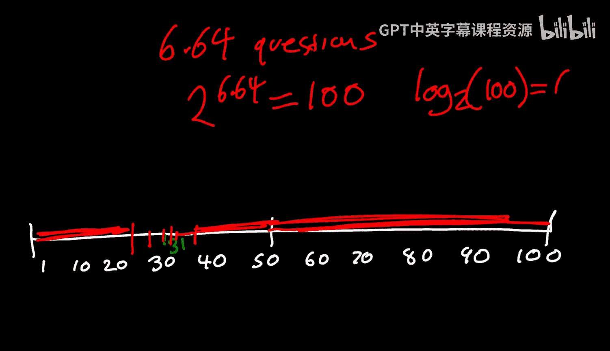

My friend picks a number between one and 10，000。ok， so i have no idea what number you pick。

What's the maximum number of questions on'll need to ask to find out your answer？

Turns out that I will need less than 14。And on average， I will need 13。29 questions。Why。

Because log 2。Of 10000。Is equal to 13。29。13。29 is the entropy of the 10，000 possibility gain。P it。

 let me put it another way。 it when I have no idea what number you picked。

My uncertainty at the beginning can be quantified as。13。29 Bs of uncertainty。

 because that's how much information I will have gained。On average。

When I learned what number you actually did pick。

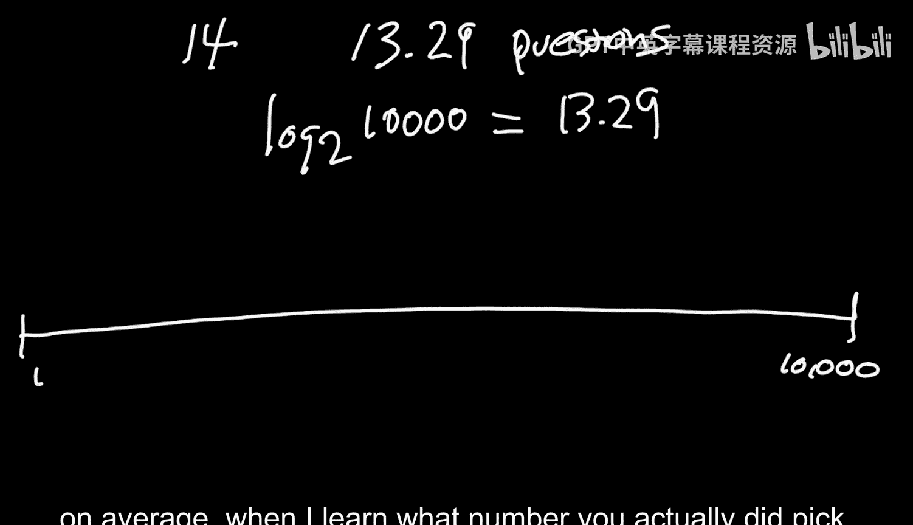

We have talked about our basic definition of entropy。Ass being equal to the summation。Of。P of I log。

One over piece of I。For I equals1 to n。Discrete。Possible outcomes for a probability distribution。

We now want to look at some related definitions。What about the。Joint entropy。Entropy of x and y。

We've seen an example of a joint distribution earlier in the course， when we talked about。

The diagnostic and the confusion matrix。And that grid will come up again and again。

As binary classification is one of our basic principles in data analysis。

 So you may remember that we had a。Picture that looked like this。 And we labeled these like this。

We could say this is our random variable。X， this is our random variable。hy。And EfGH。

Are the joint probabilities， right。The entropy of the joint probability。 So H of。E FGH。

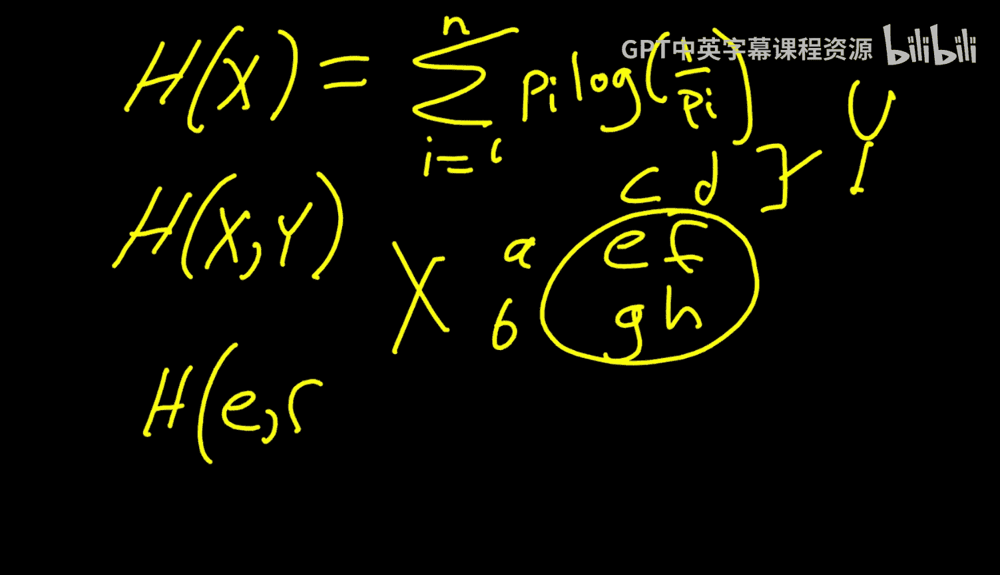

Is what we mean by。The joint entropy， H of。Tax y。

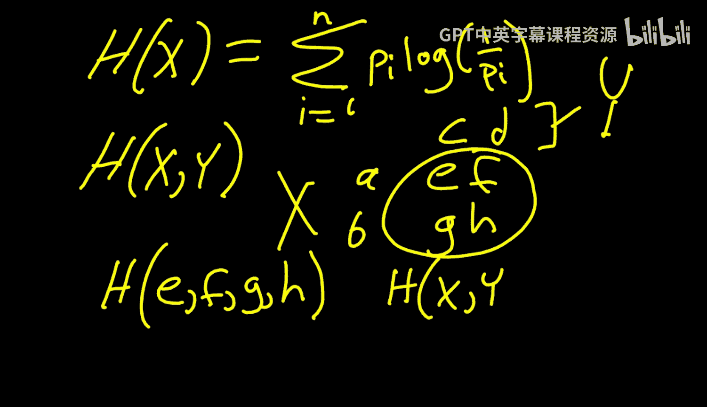

Now you may remember again。We have。The idea of。Conditional probability in our confusion matrix。

 for example， are true positive。Rate。Is equal to E over a。That's the conditional probability。

Of having a positive test。If you have the condition。Similarly， we have the concept of。

Conditional entropy。Which is equal to。The probability that y equals y1。Why1。Times the entropy。Of X。

 given that y equals。Y1 plus。The probability that。Y equals y 2。Times the entropy of x。

 given that y equals。

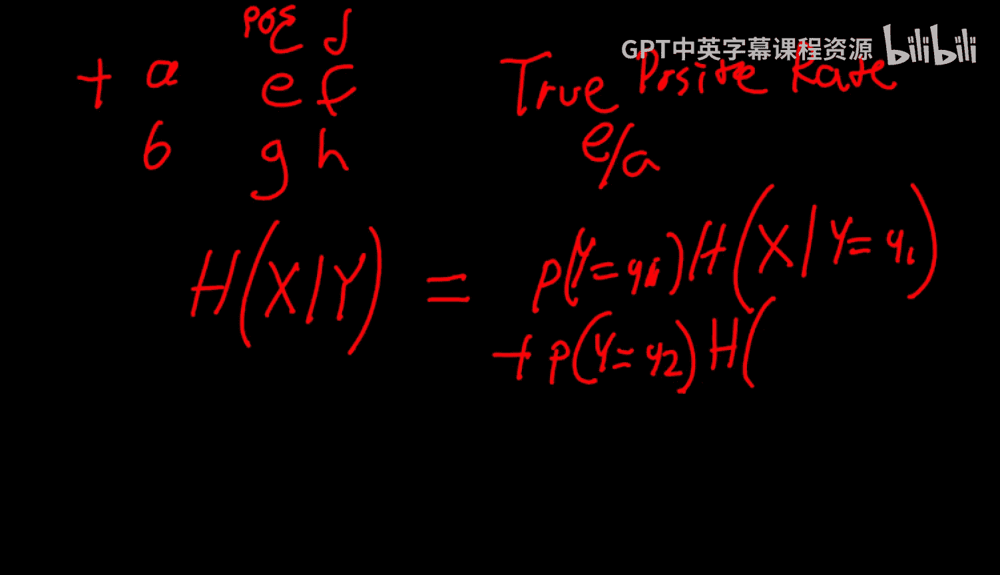

W2。So an example using our confusion matrix would be。

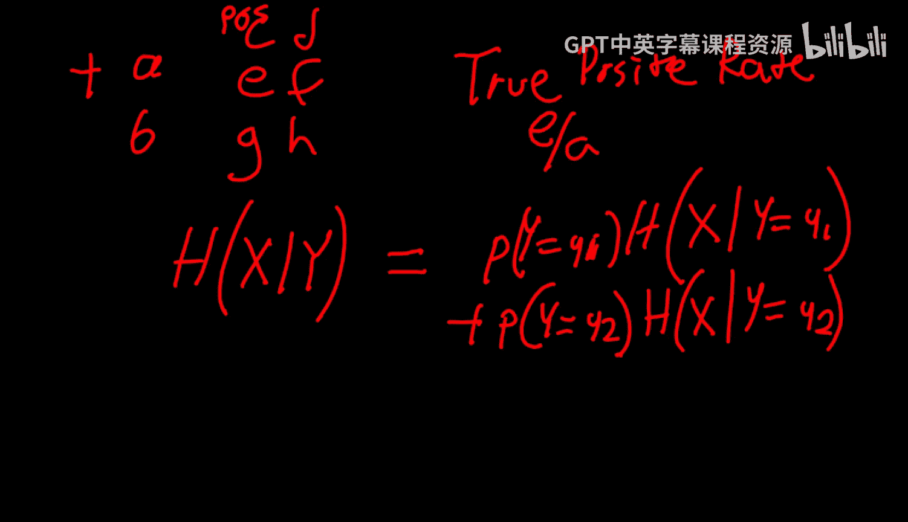

The probability that。Y equals y1， namely C。Times。H of。

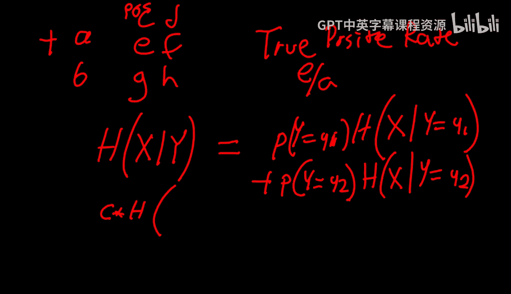

E over see， G oversee。Plus。D。Times the entropy of。

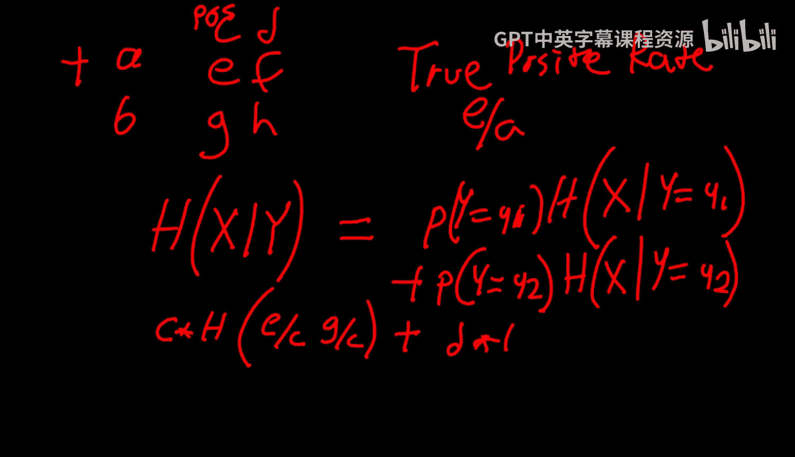

F over D。

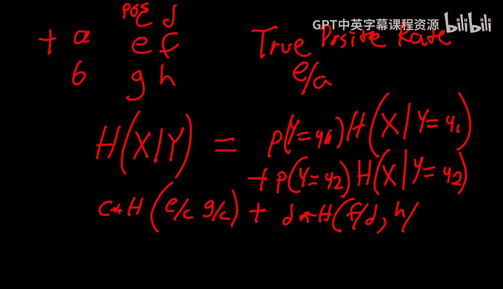

H over D。I appreciate that that seems rather abstract， but when you work some examples。

 I think you'll find that it's not as bad as it seems。

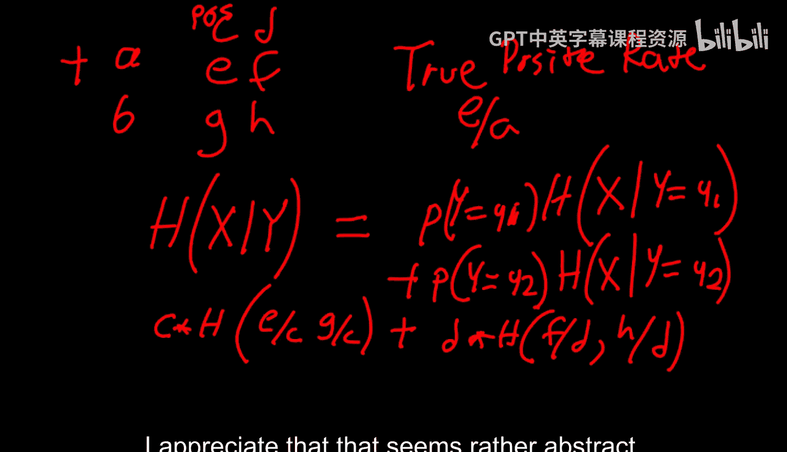

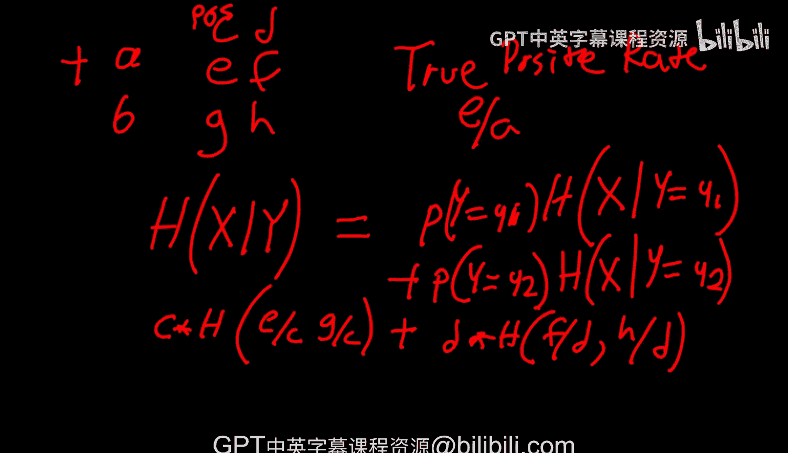