# 商业分析：5.4：猜谜游戏中的熵

在本节课中，我们将通过一个猜数字游戏来理解信息论中的核心概念——熵。我们将探讨如何量化不确定性，并介绍联合熵与条件熵的定义。

## 猜数字游戏与熵的引入

现在考虑一个猜数字游戏。我的朋友从1到100之间选择一个数字。我需要通过提问来猜出这个数字，但只能问“你的数字是否大于X？”这种简单的是或否问题。

我的最佳策略是每次排除一半的可能性。假设我的朋友选择了数字31，但我当然不知道。我的提问顺序如下：数字大于50吗？否。数字大于25吗？是。数字大于37吗？否。数字大于31吗？否。数字大于28吗？是。数字大于30吗？是。数字是31吗？是。

我总是能在不超过七个问题内猜出你的数字。如果我们多次进行这个游戏，并且你真正随机地选择数字，平均而言，我需要 **6.64** 个问题才能得到正确答案。你可以和朋友试试看。

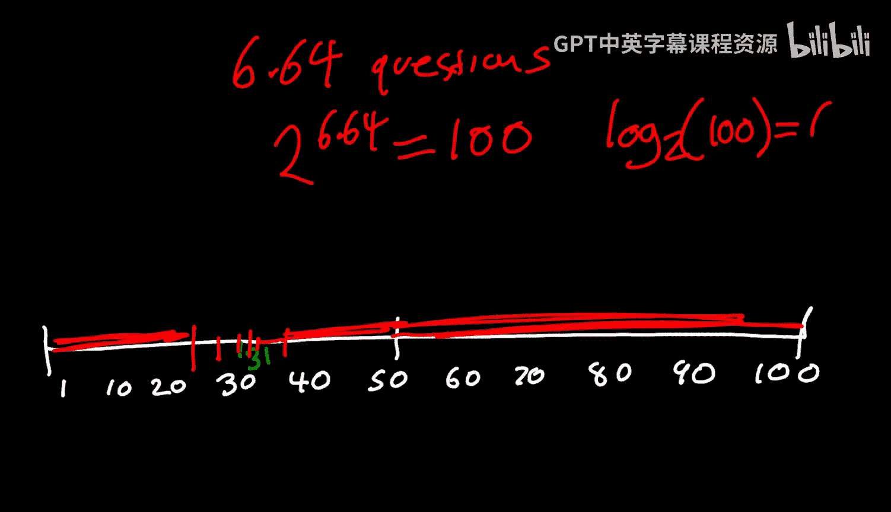

为什么需要6.64个问题？因为这是编码100种可能状态所需的比特数。换句话说，**2^6.64 = 100**，或者说 **log₂(100) = 6.64**。

## 扩展游戏：一万种可能性

上一节我们看到了100种可能性的情况，本节中我们来看看规模更大的游戏。我的朋友从1到10,000之间选择一个数字。我完全不知道你选了什么数字。

为了找出答案，我需要提问的最大问题数是多少？结果是我需要少于14个问题。平均而言，我需要 **13.29** 个问题。为什么？因为 **log₂(10000) = 13.29**。13.29就是这个包含一万种可能性的游戏的不确定性，即熵。

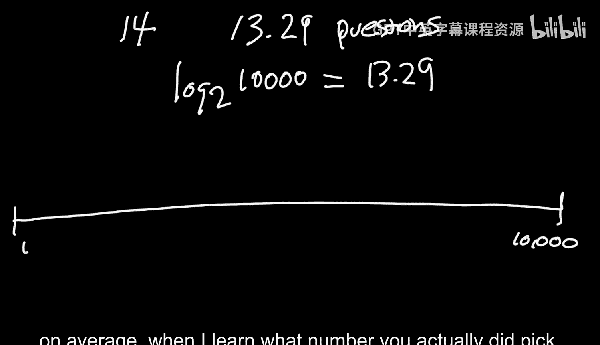

换句话说，当我完全不知道你选了哪个数字时，我最初的不确定性可以量化为 **13.29比特**。因为平均而言，这就是当我得知你实际选择的数字时，我将获得的信息量。

## 熵的基本与扩展定义

我们已经讨论了熵的基本定义，它等于概率分布中所有离散可能结果的概率与其倒数的对数之和，公式为：**H = Σ p(i) * log₂(1/p(i))**，其中 i 从 1 到 n。

现在我们想看看一些相关的定义。什么是**联合熵**，即 **H(X, Y)** 呢？在本课程早期讨论诊断和混淆矩阵时，我们已经见过联合分布的例子。那个网格会反复出现，因为二元分类是我们数据分析的基本原则之一。

你可能还记得我们有过这样一张图，我们可以说这是我们的随机变量 **X**，这是我们的随机变量 **Y**。而 E, F, G, H 是联合概率。因此，联合概率的熵 **H(E, F, G, H)** 就是我们所说的联合熵 **H(X, Y)**。

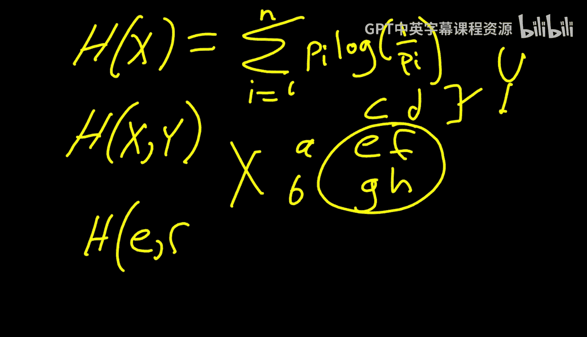

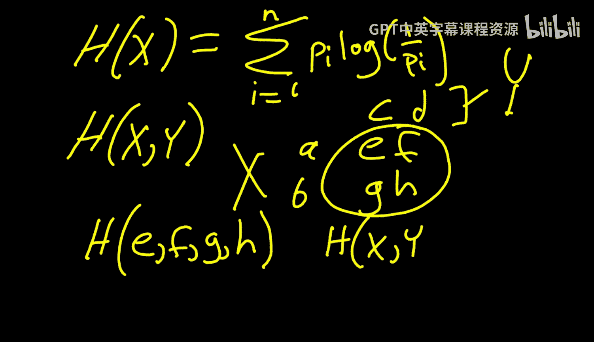

## 条件熵的概念

现在你可能再次记起，在我们的混淆矩阵中，有条件概率的概念。例如，**真正率 = E / A**，这是在给定患有疾病的条件下，检测呈阳性的条件概率。

类似地，我们也有**条件熵**的概念。它等于 Y 取特定值 y₁ 的概率乘以在 Y=y₁ 条件下 X 的熵，再加上 Y 取另一个值 y₂ 的概率乘以在 Y=y₂ 条件下 X 的熵。公式表示为：**H(X|Y) = P(Y=y₁) * H(X|Y=y₁) + P(Y=y₂) * H(X|Y=y₂)**。

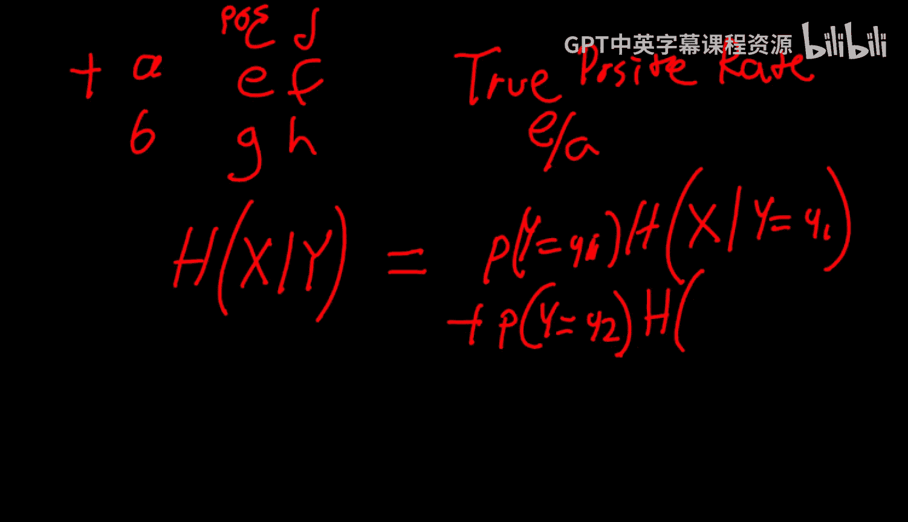

使用我们的混淆矩阵举例说明：条件熵等于概率 **P(Y = y₁)**，即 **C**，乘以熵 **H(E/C, G/C)**，再加上概率 **D** 乘以熵 **H(F/D, H/D)**。

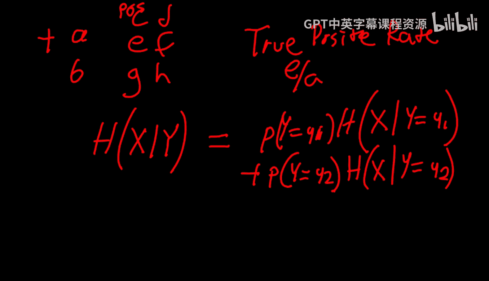

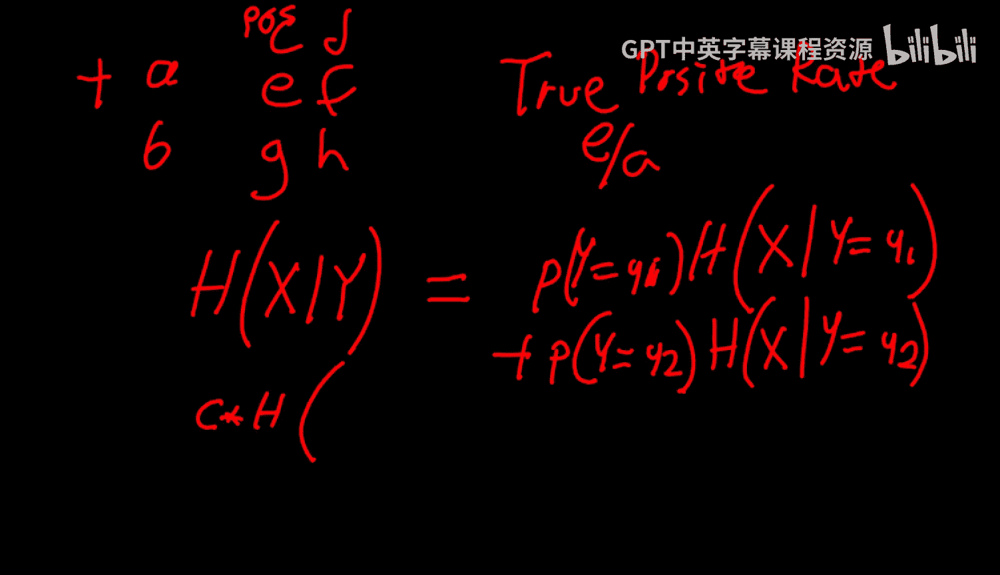

我理解这看起来相当抽象，但当你做一些练习后，你会发现它并不像看起来那么难。

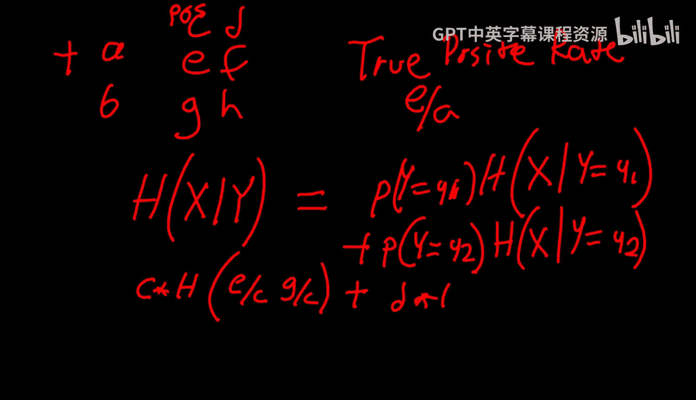

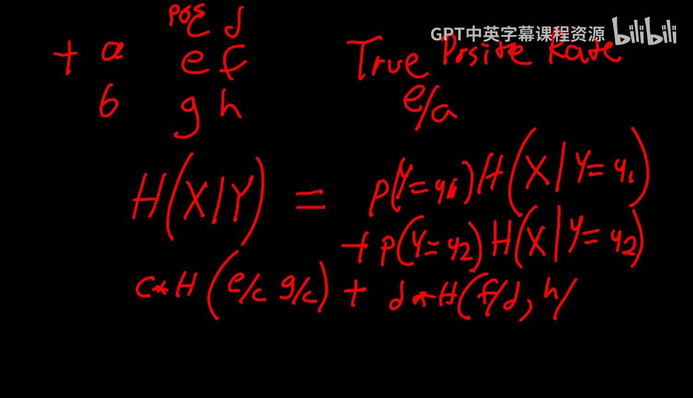

---

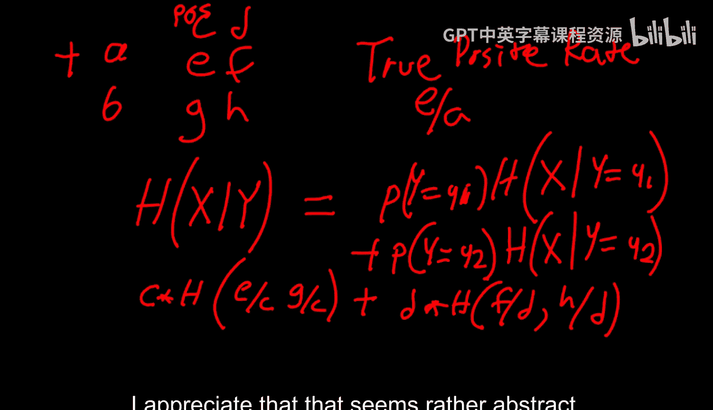

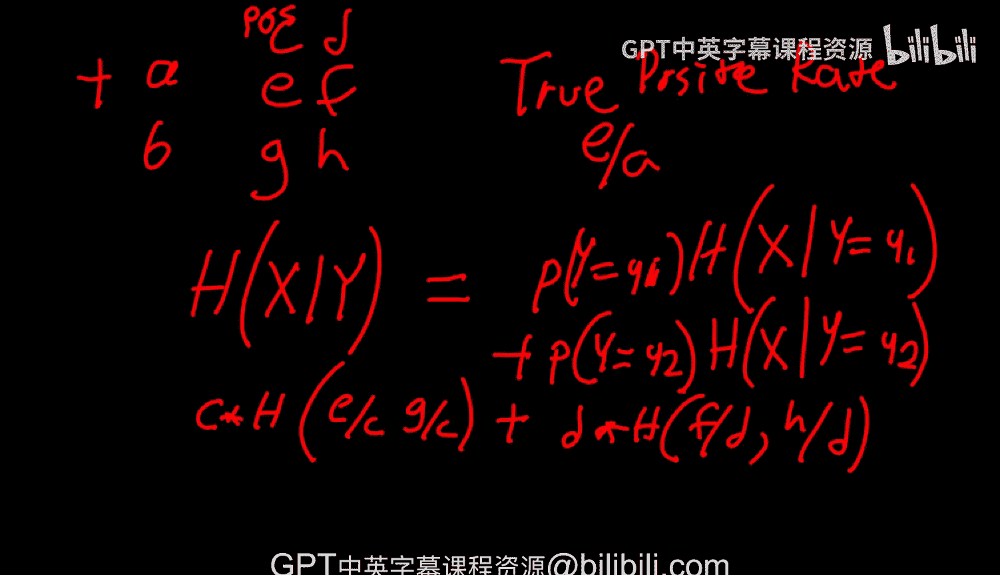

本节课中我们一起学习了如何通过猜数字游戏直观理解熵，即信息的不确定性度量。我们明确了熵的基本计算公式，并扩展学习了联合熵与条件熵的定义，这些是信息论中量化信息关系的重要工具。