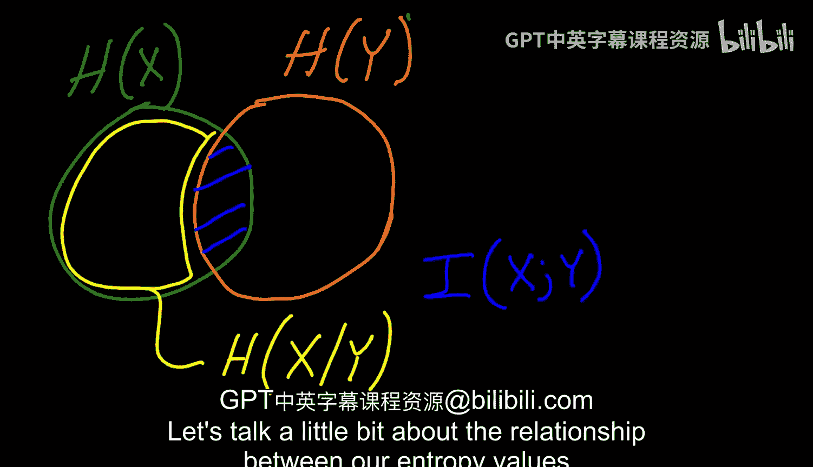
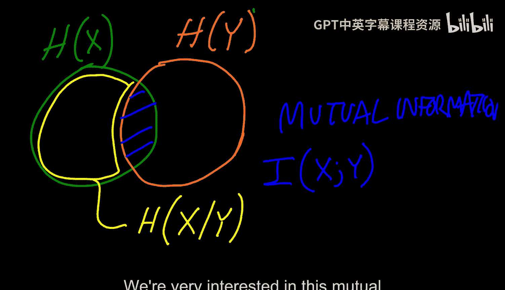
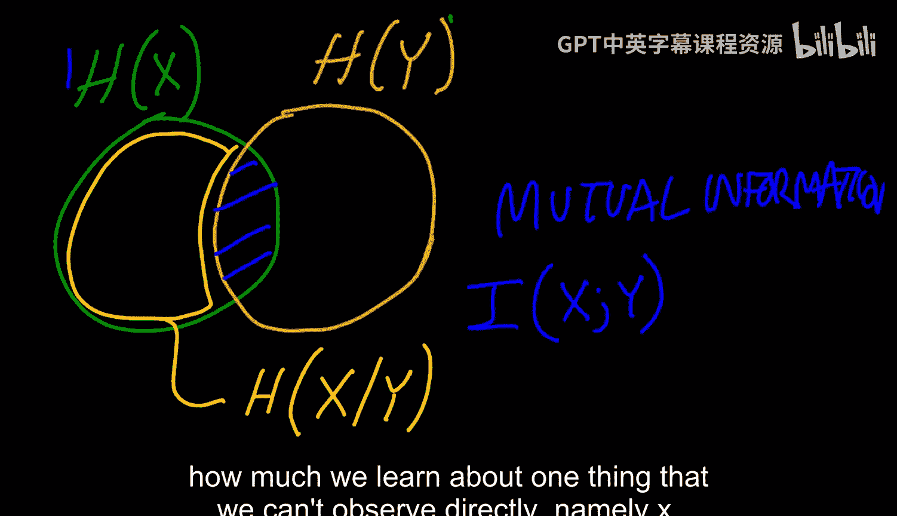
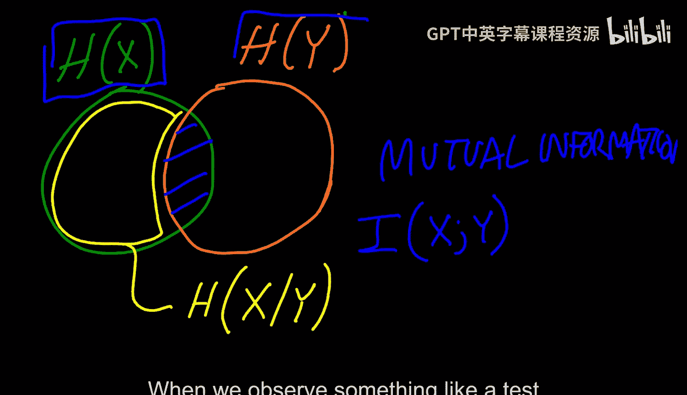
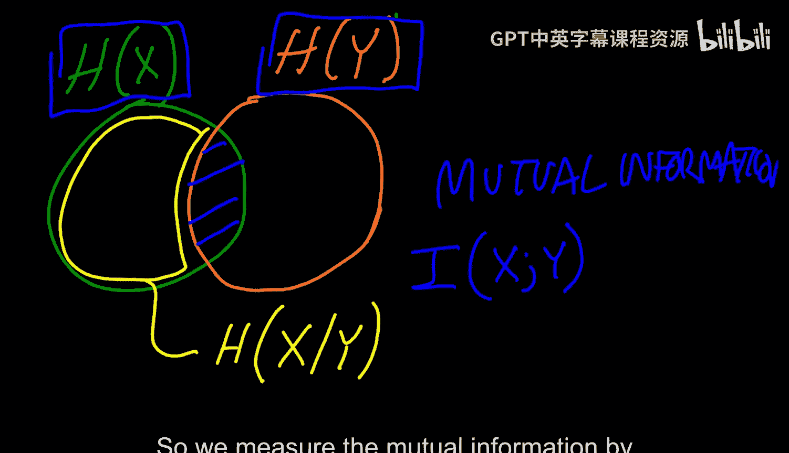
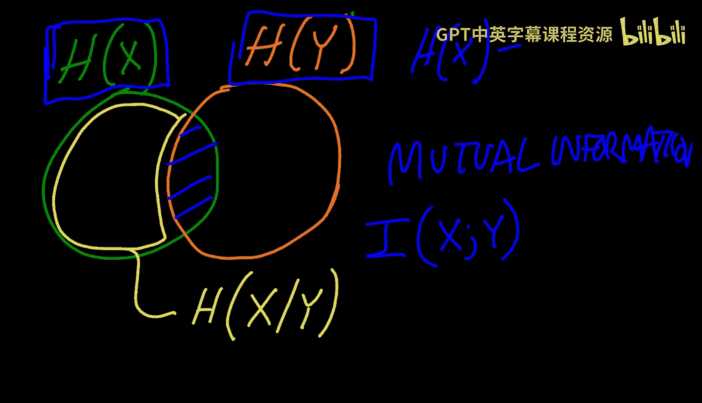
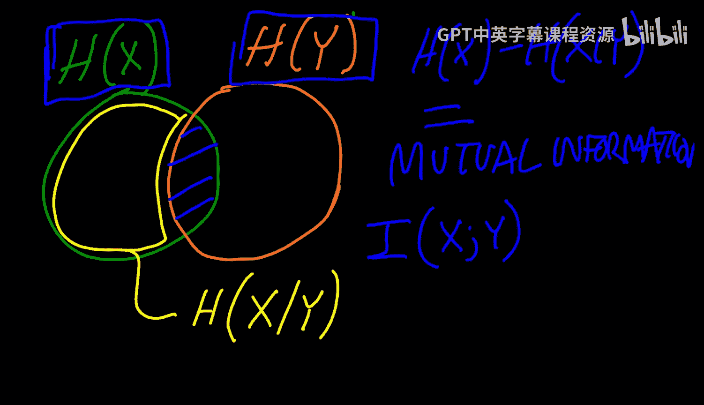
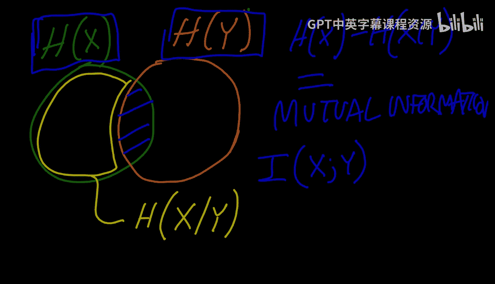
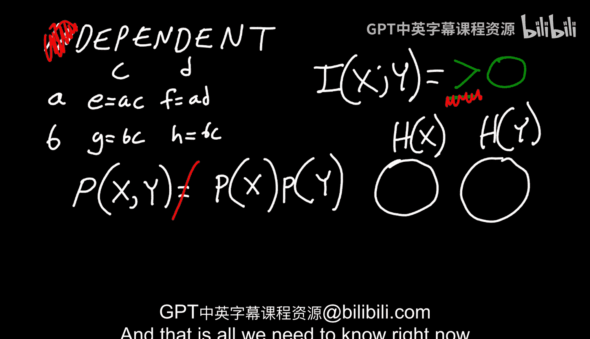

# 杜克大学《Excel 到 MySQL：商业分析（5课全）｜Excel to MySQL： Analytic Techniques for Business》中英 p55 20_04_01_依赖性与互信息.zh_en -BV1mS421X7yw_p55-

Let's talk a little bit about the relationship。

Between our entropy values， when we have two different probability distributions。

So unless these distributions are independent in which case these circles do not touch each other。

 there's some overlap。And the overlap is what's called the mutual information。

We're very interested in this mutual information because it represents how much we learn about one thing that we can't observe directly。

 namely X。 when we observe something like a test result or our data。

Namely， why directly。So we measure the mutual information by measuring the uncertainty we start with regarding x。

 that's H of x。

And then subtracting out。The uncertainty that remains for x after we learn y， so H of x。

Finus h of x given y。

Equals the mutual information。And we'll show some examples and again。

 this will become less mysterious when we actually work some problems。

We've talked before briefly about the difference between independent and dependent probability distributions。

And we said that the definition of independence is that the joint distribution is equal to the product distribution。

So in the example of our confusion matrix。That means that。E equals AC， F equals A D， and so on。

That's the scenario when x and Y。Are independent。And the mutual information。Is equal to zero。

And if we were to draw our little picture again。We would have these two distributions。Entros。

Are unconnected。So an alternative definition of independence is when the mutual information is equal to zero。

And you may remember， I mentioned that。Mutual information is。Never negative。So it's always at least。

Greater than 0。Or equal to0。If the joint distribution is。Not equal to the product distribution。And。

These two distributions。Are dependent。And the mutual information is greater than zero。

 and it's always possible to learn something about the distribution that you don't have direct access to。

When you know something about the distribution that you can study directly。

And that is all we need to know right now about。Entropy and mutual information。

