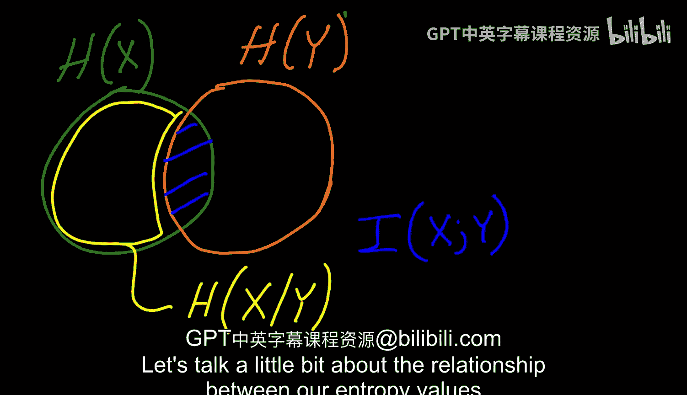
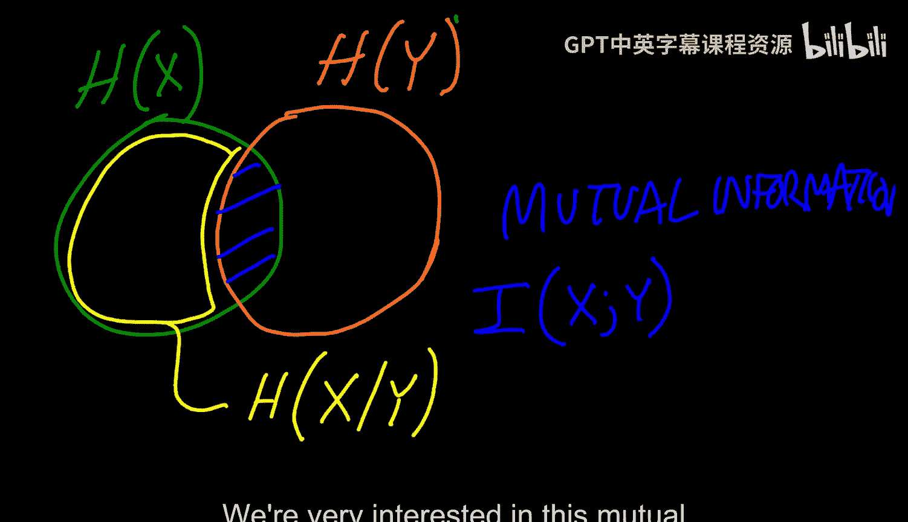
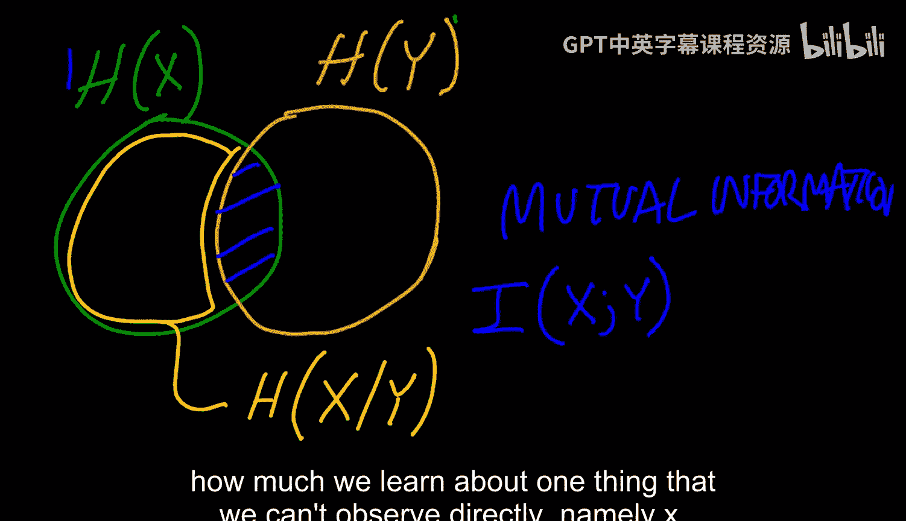
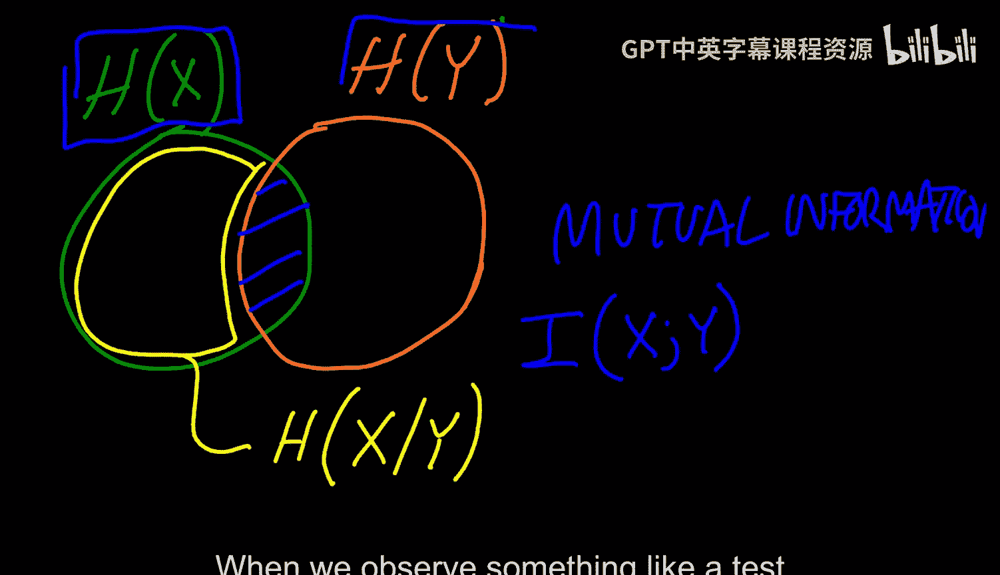
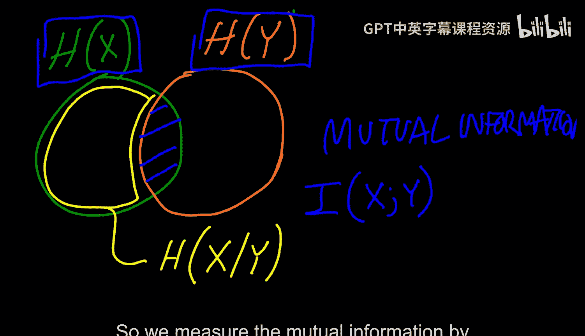
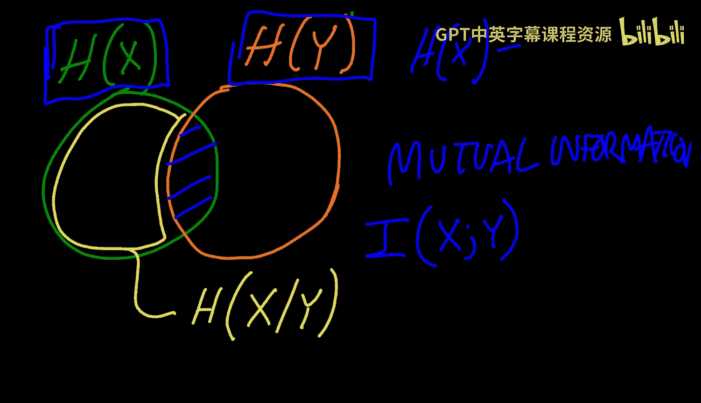
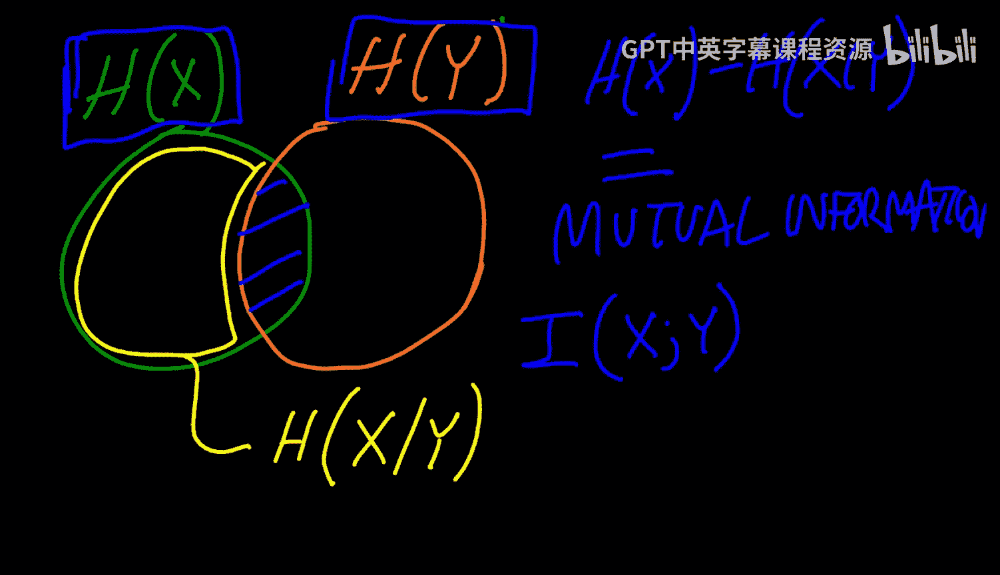
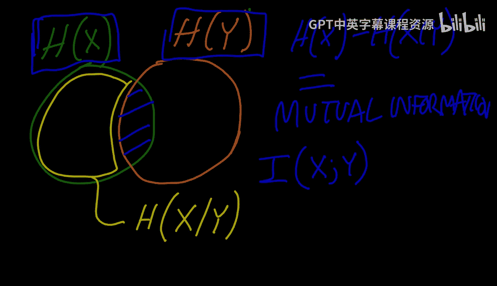
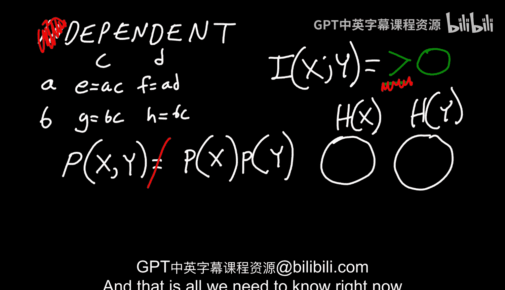

# 商业分析：5.5：依赖性与互信息 📊

在本节课中，我们将要学习两个概率分布之间的关系，特别是如何量化一个变量（如测试结果）能为我们揭示另一个不可直接观测的变量（如真实状态）提供多少信息。我们将介绍**互信息**这一核心概念，并探讨其与变量独立性之间的关系。

---

上一节我们介绍了熵的概念，它衡量了随机变量的不确定性。本节中我们来看看当存在两个不同概率分布时，它们的熵值之间存在何种关系。

除非这两个分布是独立的，否则它们之间会存在某种“重叠”。这种重叠就是所谓的**互信息**。

我们对互信息非常感兴趣，因为它代表了当我们观察到某些数据（如测试结果）时，我们能从中了解到多少关于另一个无法直接观测的事物（即变量X）的信息。

我们通过测量互信息来量化这种信息增益。具体方法是：先计算我们最初对变量X的不确定性，即 **H(X)**。然后减去在我们得知变量Y的信息后，X仍然剩余的不确定性，即 **H(X|Y)**。

因此，互信息的计算公式为：
**I(X; Y) = H(X) - H(X|Y)**

我们将展示一些例子。当实际处理一些问题时，这个概念会变得不那么神秘。

---

我们之前简要讨论过独立与依赖概率分布之间的区别。我们说，独立性的定义是联合分布等于乘积分布。

以我们的混淆矩阵为例，这意味着：
**E = A * C**
**F = A * D**
依此类推。

这就是变量X和Y相互独立的场景。在这种情况下，**互信息等于零**。

如果我们再次绘制示意图，这两个分布的熵值范围将是互不连接的。因此，独立性的另一个定义是：**当互信息等于零时**。

你可能记得我提到过，互信息永远不会是负数。它总是**大于或等于零**。

如果联合分布不等于乘积分布，那么这两个分布就是**依赖的**，并且互信息**大于零**。在这种情况下，总是有可能通过研究你能直接观测的分布，来了解你无法直接访问的分布的信息。

以上就是我们目前需要了解的关于熵和互信息的所有内容。

---

本节课中我们一起学习了互信息的概念及其计算公式 **I(X; Y) = H(X) - H(X|Y)**。我们明确了互信息衡量了两个变量之间共享的信息量，当变量独立时互信息为零，当变量相关时互信息大于零。理解互信息是评估数据间依赖关系和进行有效商业分析的关键一步。