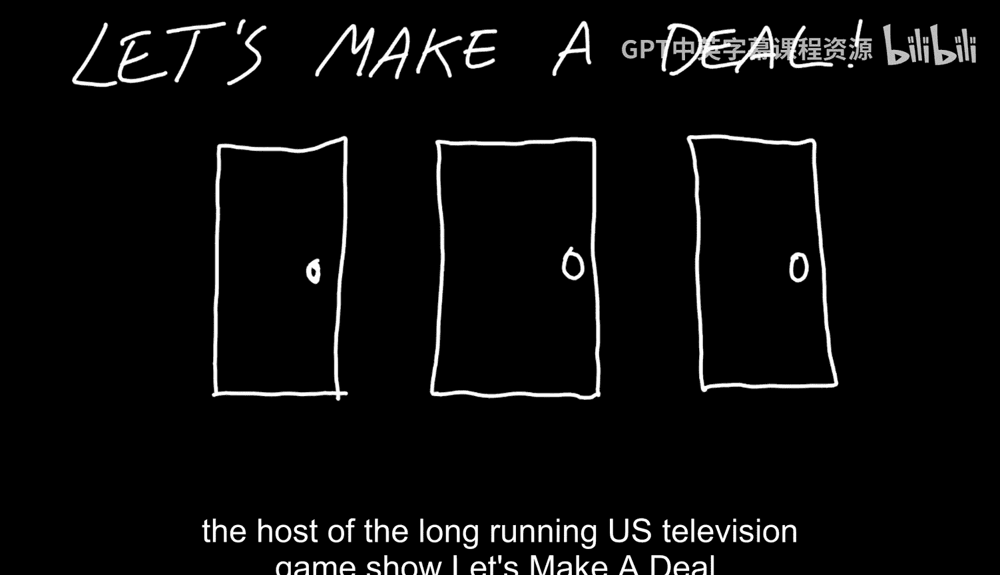
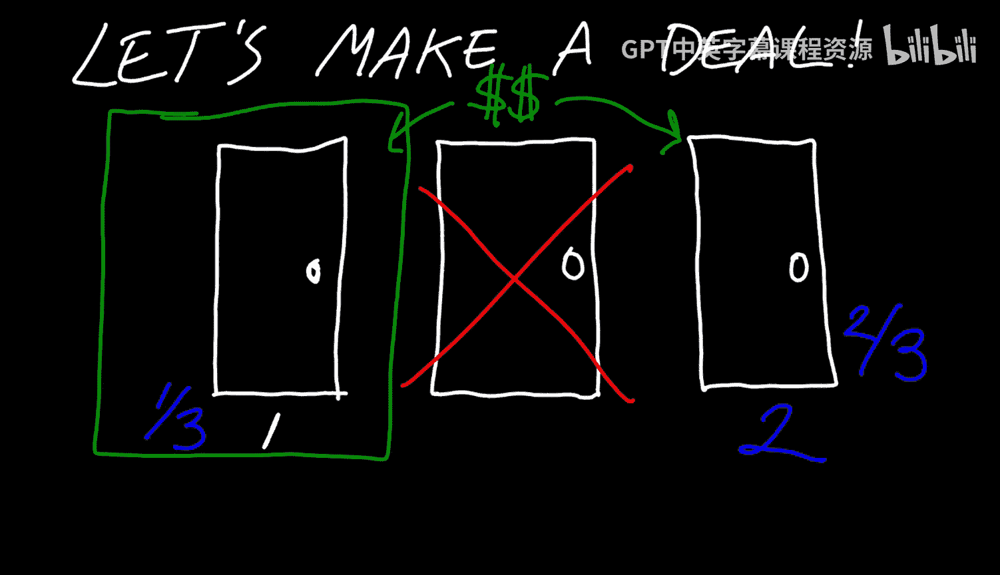
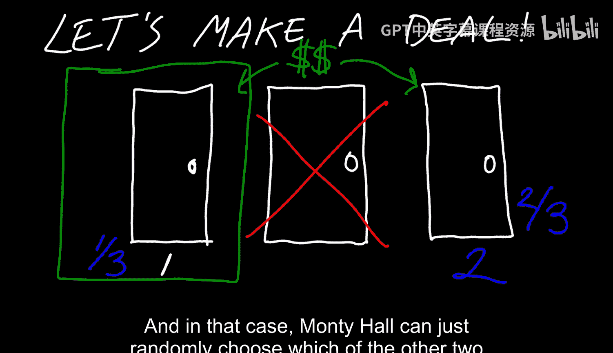
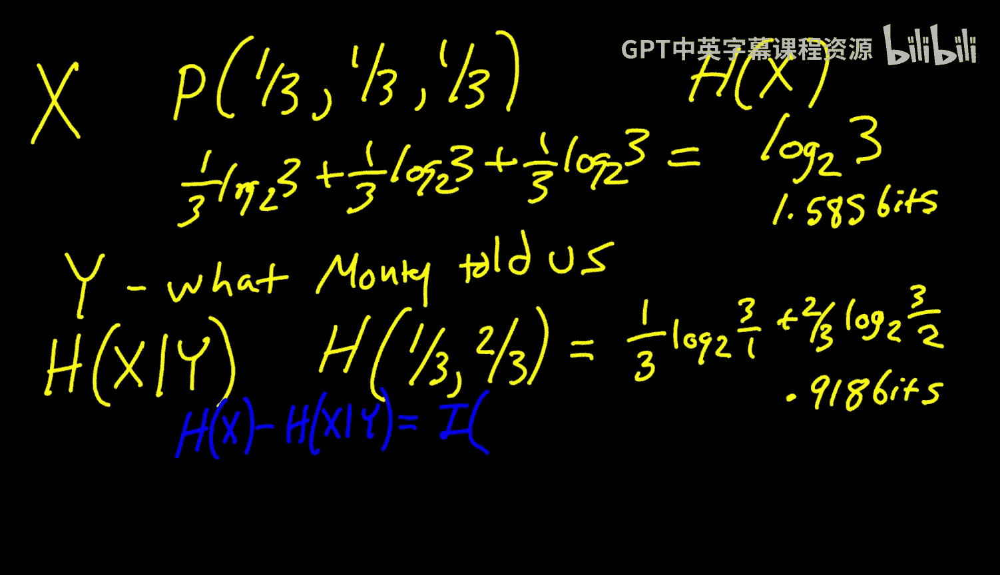
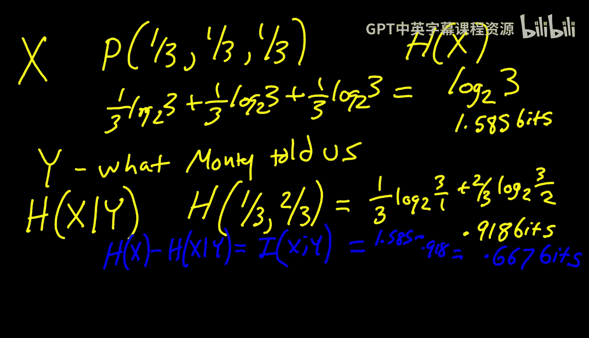
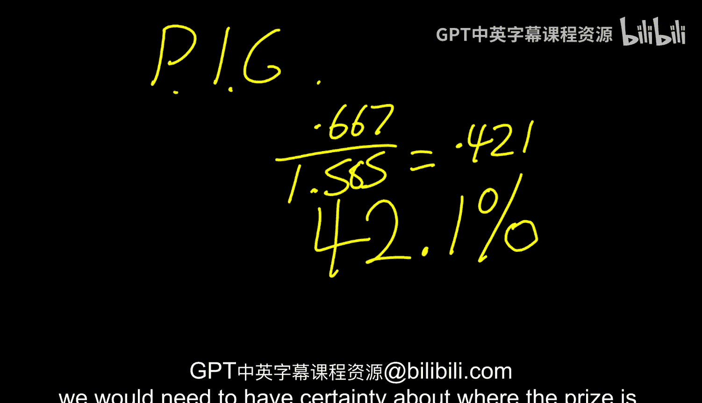

# 杜克大学《Excel 到 MySQL：商业分析（5课全）｜Excel to MySQL： Analytic Techniques for Business》中英 p56 21_04_02_蒙提霍尔问题.zh_en -BV1mS421X7yw_p56-

The famous Monty Hall problem。Is named for the host of the Long runningning US televisionion game show。

 Let's make a deal。

A valuable prize was hidden behind one of three identical doors。 If my doors don't look identical。

 excuse me。Imagine they are identical。A contestant could win the prize if they picked the correct door。

And at the beginning， the contestant is told， pick any of the doors and just for convenienceians will say that the contestant picks door number one。

With no basis for choosing between the doors， it's reasonable to assume that the probability of the prize behind being behind any one door is simply one third。

So the contestant has a one in three chance of winning。Monty Hall， then。Opens。One of the other doors。

So， he。Eliminate it as a possibility。Okay。He then offers the contestant the option of switching doors。

Before he reveals the location of the prize。So the mathematical question known as the Monty Hall problem is。

 should the contestant switch doors？Should they stay with door number one or should they go to what we're labeling door number two？

Or to put the problem a little bit more。Mathematically。

 what is the new probability distribution now that door 3 has been eliminated。

That the prize is behind each of doors，1 and 2。And is the probability now greater for one door than the other？

A common intuition is that the probability would now be split 50，50 between the two doors。 However。

 this is not correct。In fact。The probability that the prize is behind door  one remains at one third。

Just like it was when that door was first chosen。And all the probability that was formerly associated with door 3 migrates over to door 2 so that the probability of the prize being behind door 2 is now two thirds。

 So the correct answer is that the contestant should switch doors。Doubling their chance of winning。

keyey to understanding。How this could be。Is understanding that Monty Hall is not opening one of the three doors at random。

If one of the three doors swung open at random， say because of an earthquake and that just happened to be door number 3。

 then at that point， there might be a 5050 chance that the prize was behind either of the remaining two doors。

 But instead， Mon Hall is very constrained in what he can do。 He cannot open the door that has been。

Chosen by the contestant。And he cannot open the door。 That's got the valuable prize behind it。

 which might be that door。Might be that door， but in any case， it cannot be the door that he opened。

 So Mon Hall is making a decision to open a door in full knowledge of where the prize is。

One third of the time， the prize will be behind the door already chosen。 door number one。

 And in that case， money， all can just randomly choose which of the other two doors open。

 But two thirds of the time。

The prize is behind one of the doors。 The contestant did not choose。 And in those cases。

 Mon Hall must open the other door。 He has no choice。

So two thirds of the time Monty is signaling where the prize is， we just don't know which two thirds。

So that's a problem that I always thought was really。

 really interesting and it's fine as far as it goes and we'll look at some variations of it。

 like when there are more than three doors or you open more than one door and so on。

 we'll look at that later on。But the question that always bothered me。

 or I really wanted to know the answer to is， okay。

 I accept that we're getting communicated some information by Monty Hall when he opens that door。

 But I'd like to know how much information， exactly。

What percentage of the information required for total certainty is Monty providing？

Mnie could just tell us where thet prizeze is。And then that would be 100% of the information and we'd be done。

But instead， he's eliminating some uncertainty， but how much 10%， 20%， 5%。

So we can actually find the answer by calculating the entropy of the original probability distribution and then comparing it to the entropy of the probability distribution。

After。😡，So we'll just work this simple example， so just work this with me。

Initially， we have probabilities of one third。One， third。One third。And our entropy。

So we'll say this is our original probability distribution。

Our entropy is going to be one third log 2 of3 plus one third log 2 of3 plus one third log 2 of3。

 which is going to be equal to。Dog，2 of3。Okay。So that is。Page of。X。So。If we label as why。

What Monty told us。H of x。Given why。Is the entropy of the new probability distribution。1 third。

 Two third。Whi is equal to one， third。Log 2 of three plus two thirds。Log two of three hals。佢。

This happens to be。1。585 bits。And this happens to be point。9，1，8 Bs。

So using our mutual information formula。

He 고。1。585 minus。918 is equal to 0。667。So Monty has provided us with 0。667。Bits of information。

By opening one door。

If you'd like to know the。Percentage information gain。Or pig。That would be 0。667 divided by 1。

585 equals 。421。 So Monty Hall has provided us with 42。

1% of all the information we would need to have certainty about where the prize is。

