# 杜克大学《Excel 到 MySQL：商业分析（5课全）｜Excel to MySQL： Analytic Techniques for Business》中英 p57 22_04_03_单次抛硬币学习（上）.zh_en -BV1mS421X7yw_p57-

The formula that I've written。Would be read as follows。The probability of a given B。

Times the probability of B。Equals the joint probability of A and B。

So the conditional probability of a given B。Times the probability of B。Equals the joint probability。

And the situation often arises that we know the probability of B excuse me。

 we know the probability of a given B， but what we want is the probability of B given A。

So how on earth are we going to get there well？By symmetry， it turns out that。Probability。

 joint probability of A and B is equal to probability of B。And A。

So that would be equal to probability of。Be given a。Times probability of。A。So， now we could。

Divide both sides of our equation。By probability of a。Isolating what we want。

And we could say probability of B， given a equals。Probability of A， given B。Times probability of B。

Divided by probability of a。

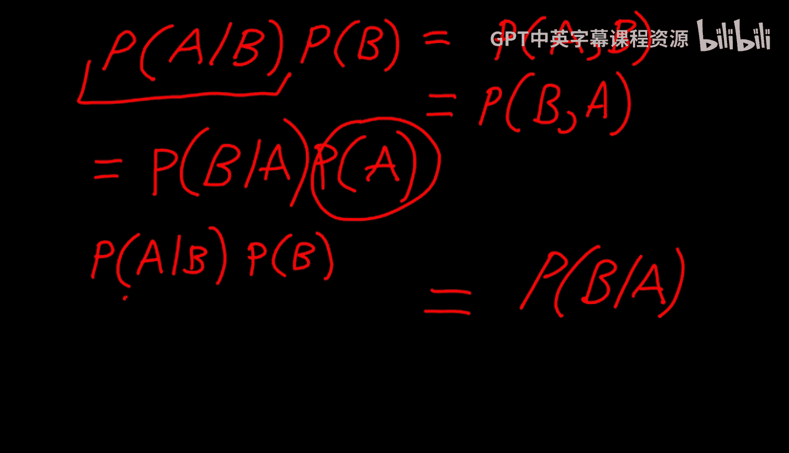

And this is the famous theorem。

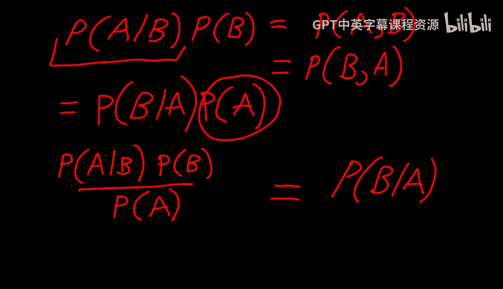

Which I am sure you have heard of。Go base the。

And it's one of the really powerful tools that we have in。

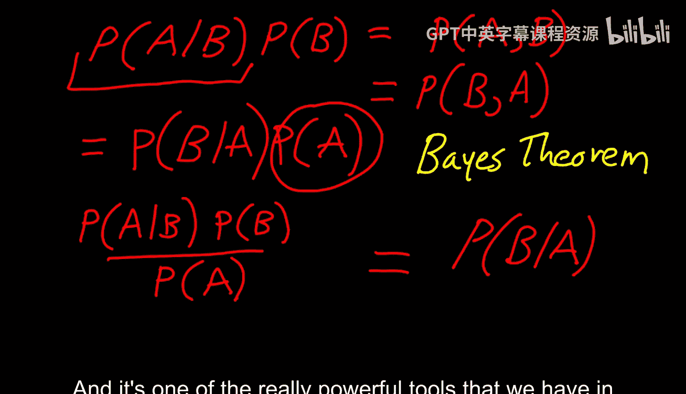

Figuring out。

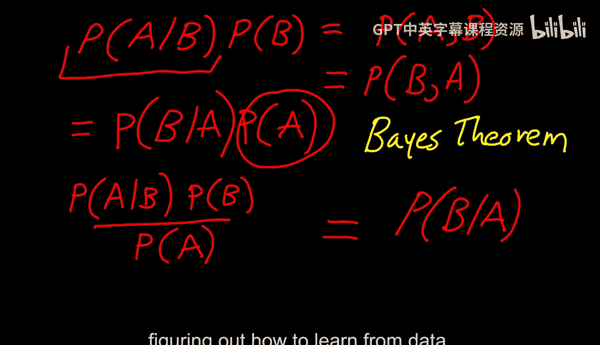

How to learn。From data。

Base theorem is one of the most powerful tools we have for turning facts into knowledge。

Entropy is the measure that we are going to use to track exactly how much we learn from the facts。

And Bayes theorem does the work， so you could say basees theorem does the work and entropy keeps score。

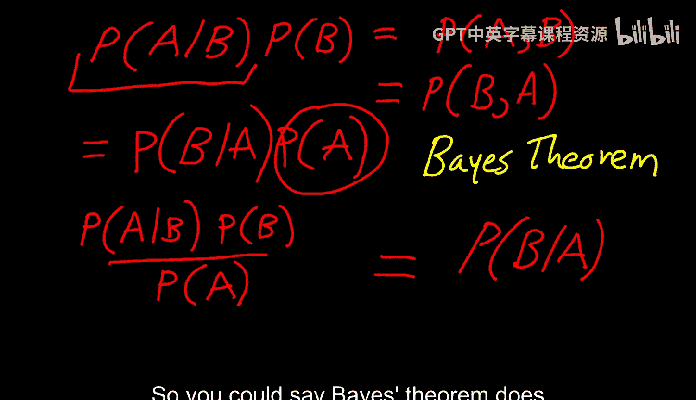

Both bay theorem and entropy operate on probability distributions。 So in this sense。

 probability distributions are carriers of information。

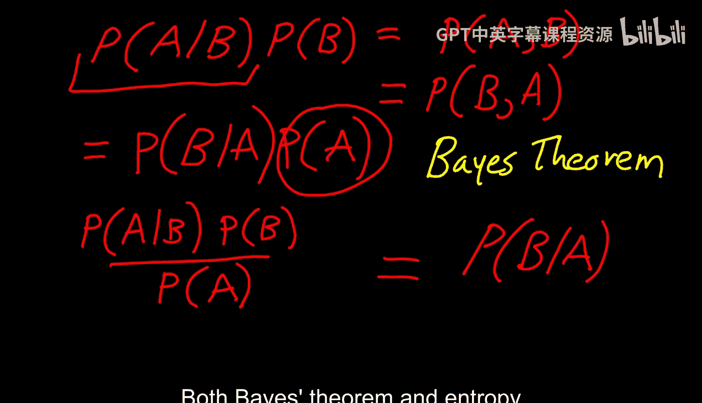

When we can frame questions so that the answer is given in the form of a probability distribution。

We can use Bayes theorem to extract useful information and entropy to record exactly how much information we have extracted。

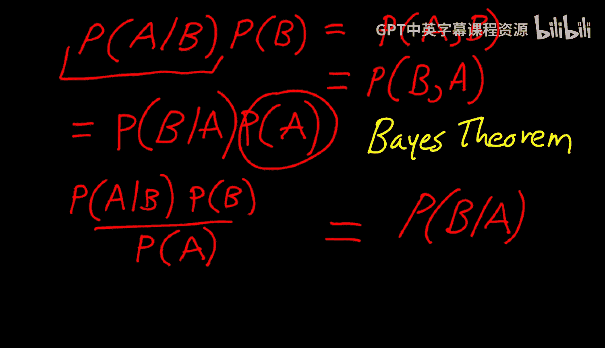

Fortunately， casting problems in terms of probabilities is very often possible。

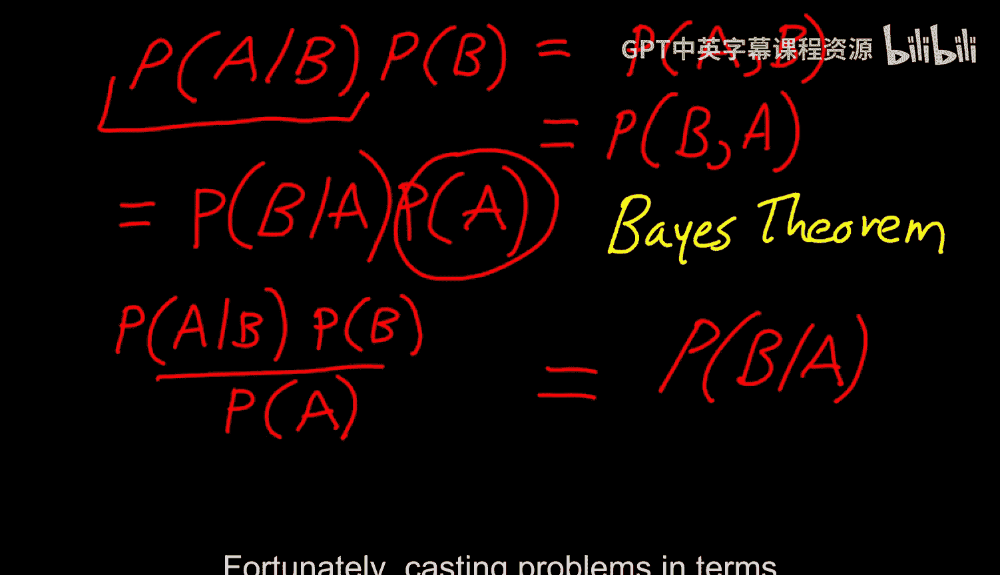

And we have many， many examples。In this course。

A friend of ours holds up a coin。And he says。Either this coin is fair。

In which case it will come up tails 50% of the time。And heads 50% of the time。Or。

It is crooked or bent。And it will come up。Tales。40% of the time。And heads。60% of the time。

 so this might be a coin that you could use to。Gmble and win against innocent people who are willing to take fair odds or two to one odds on predicting heads or tails。

So my friend doesn't tell me whether the coin is fair or crooked， so I have no knowledge。

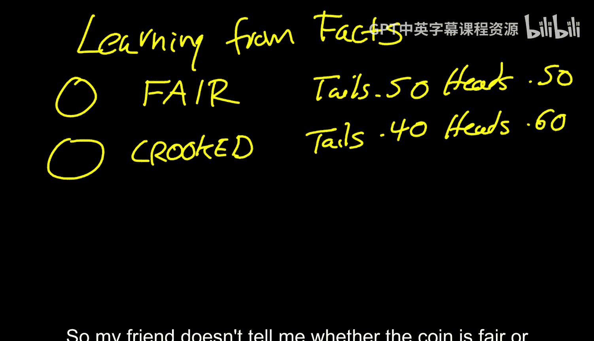

Then my friend is going to flip the coin just one time。

And we're either going to observe the fact of heads。Or the fact of tails。

 so we've only got two possible facts。Heads。😊，More tales。And what I would like to be able to do。Is。

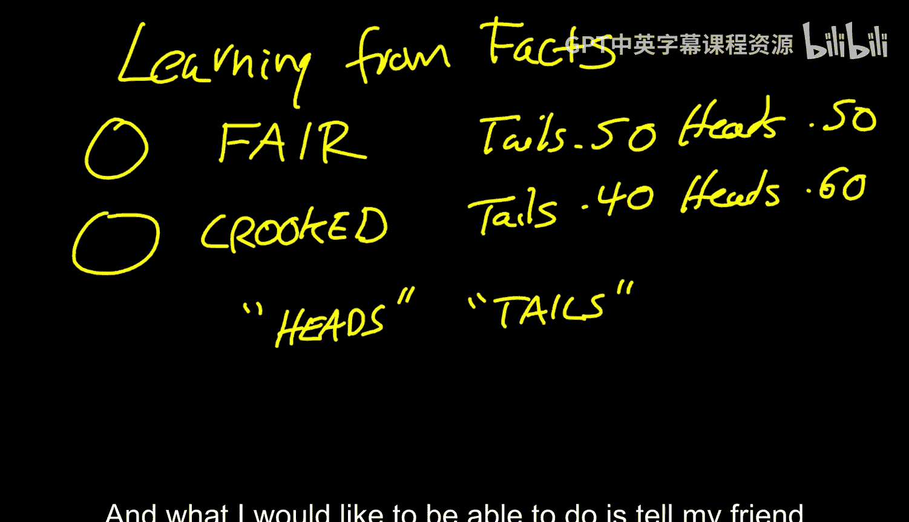

Tell my friend。Exactly what I learned about which coin he is using。

And exactly how much information I've been able to extract and what percentage my uncertainty has been reduced by observing this single flip of the coin。

That would be pretty impressive， wouldn't it？The way that we go about doing this type of problem。

 which is called an inverse probability problem。

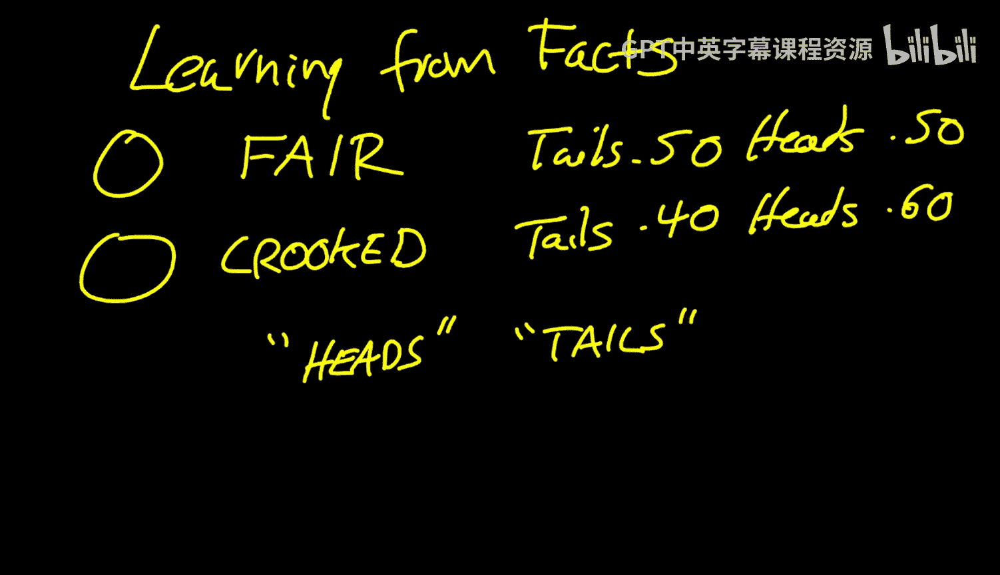

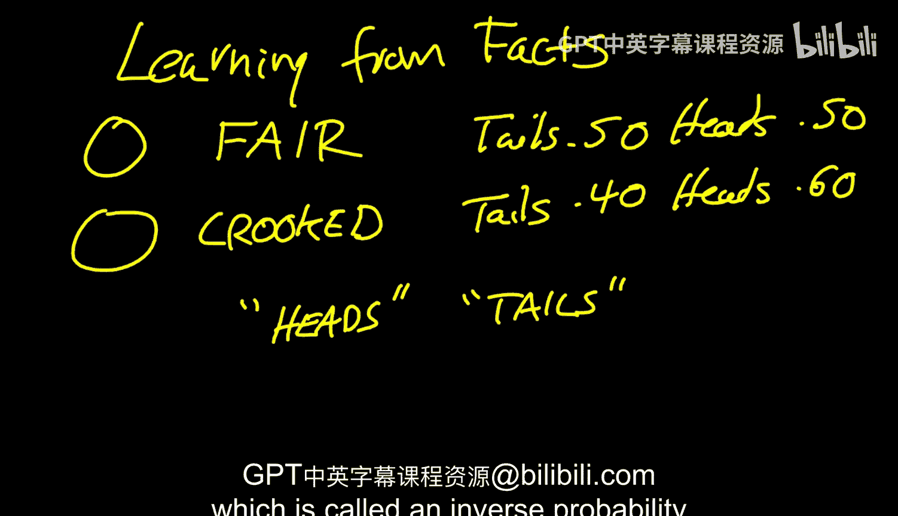

Is through use of Bay the。