# 商业分析：5.7：单次抛硬币学习（上）🎲

在本节课中，我们将学习如何利用贝叶斯定理和熵的概念，从单一数据点中提取信息并量化学习效果。我们将通过一个“公平硬币还是作弊硬币”的经典例子，来理解如何将问题转化为概率问题，并使用数学工具进行推理。

---

## 贝叶斯定理：从条件概率到信息提取

上一节我们介绍了条件概率和联合概率的基本关系。本节中我们来看看如何利用这种关系进行逆向推理。

我写下的公式可以解读如下：给定B的条件下A发生的概率，乘以B发生的概率，等于A和B同时发生的联合概率。

用公式表示即：
**P(A|B) * P(B) = P(A, B)**

因此，给定B的条件下A发生的条件概率，乘以B的概率，就等于联合概率。

我们常常会遇到这样的情况：我们知道给定B的条件下A的概率 **P(A|B)**，但我们真正想要的是给定A的条件下B的概率 **P(B|A)**。

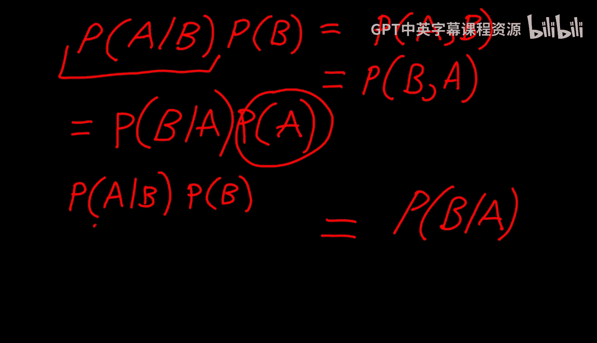

那么，我们如何才能得到它呢？根据对称性，A和B的联合概率 **P(A, B)** 等于B和A的联合概率 **P(B, A)**。

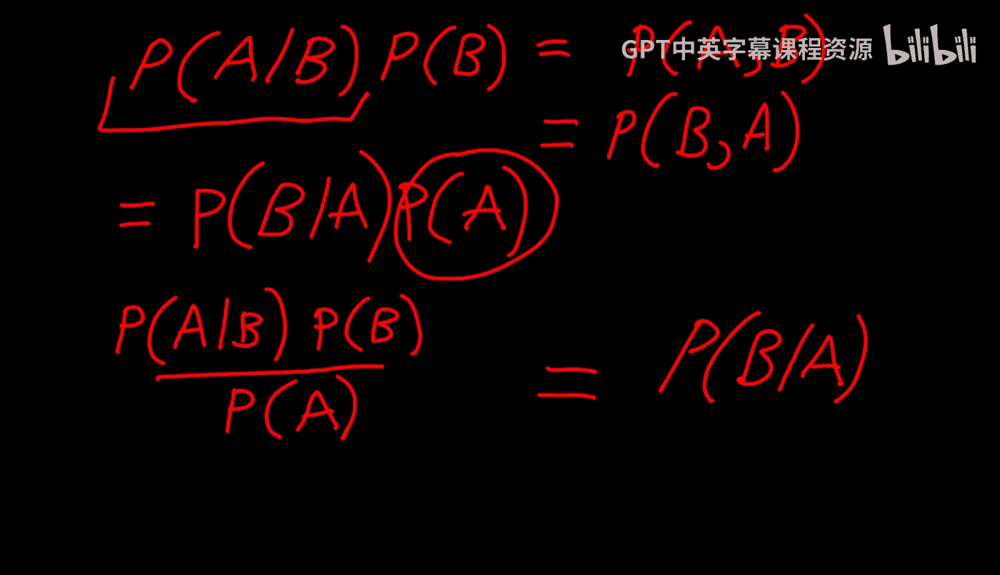

因此，它等于给定A的条件下B的概率，乘以A的概率：
**P(B|A) * P(A) = P(A, B)**

现在，我们可以将方程两边同时除以 **P(A)**，从而分离出我们想要的项。

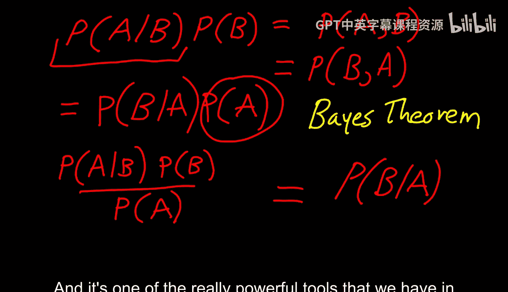

我们可以说，给定A的条件下B的概率等于：
**P(B|A) = [P(A|B) * P(B)] / P(A)**

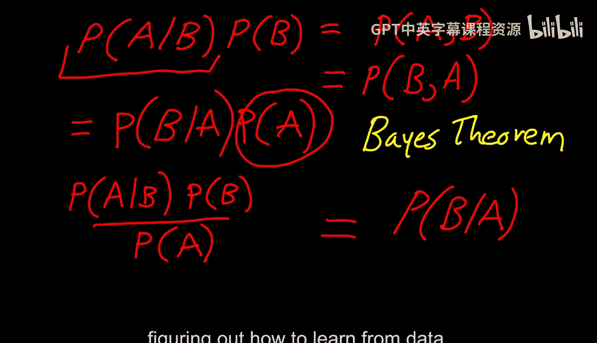

这就是著名的**贝叶斯定理**。

我相信你一定听说过它。

贝叶斯定理是我们拥有的最强大的工具之一，它能够帮助我们从数据中学习。

贝叶斯定理是将事实转化为知识的最有力工具之一。

---

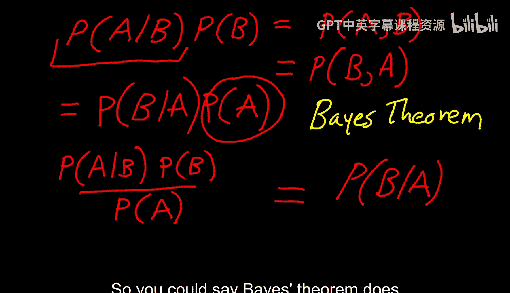

## 熵：量化信息获取量

熵是我们将要使用的一个度量标准，用于精确追踪我们从事实中学到了多少信息。

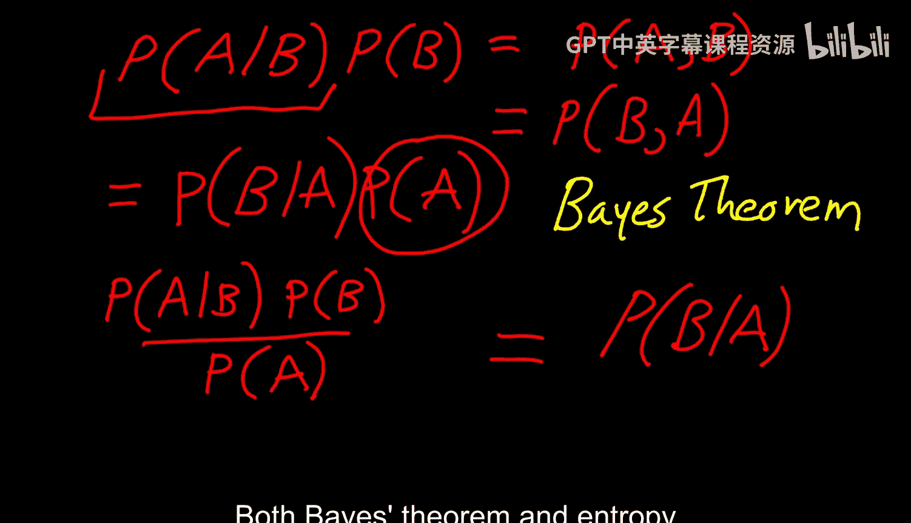

可以说，贝叶斯定理负责完成工作，而熵负责记录得分。

贝叶斯定理和熵都作用于概率分布。从这个意义上说，概率分布是信息的载体。

当我们能够将问题框架化，使得答案以概率分布的形式给出时，我们就可以使用贝叶斯定理来提取有用的信息，并使用熵来记录我们到底提取了多少信息。

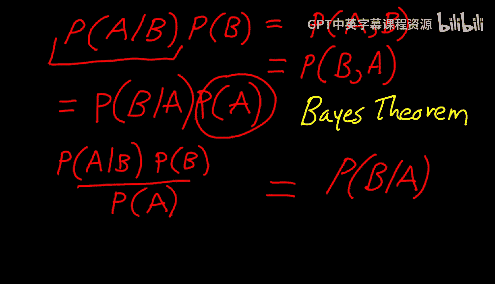

幸运的是，将问题用概率术语来表述通常是可行的。

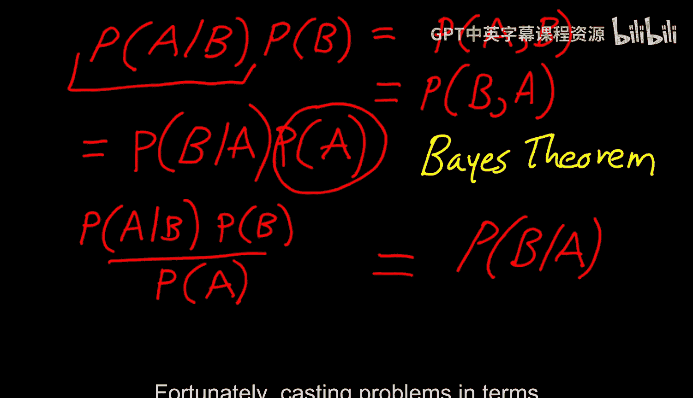

在本课程中，我们有很多这样的例子。

---

## 抛硬币问题：一个具体案例

我们的一个朋友拿出一枚硬币。他说，这枚硬币要么是公平的，在这种情况下，出现反面的概率是50%，出现正面的概率是50%；要么是作弊的或弯曲的，在这种情况下，出现反面的概率是40%，出现正面的概率是60%。

所以，这可能是一枚你可以用来赌博的硬币，用来对付那些愿意以公平赔率或二比一赔率来预测正反面的无辜者。

我的朋友没有告诉我这枚硬币是公平的还是作弊的，所以我没有任何先验知识。

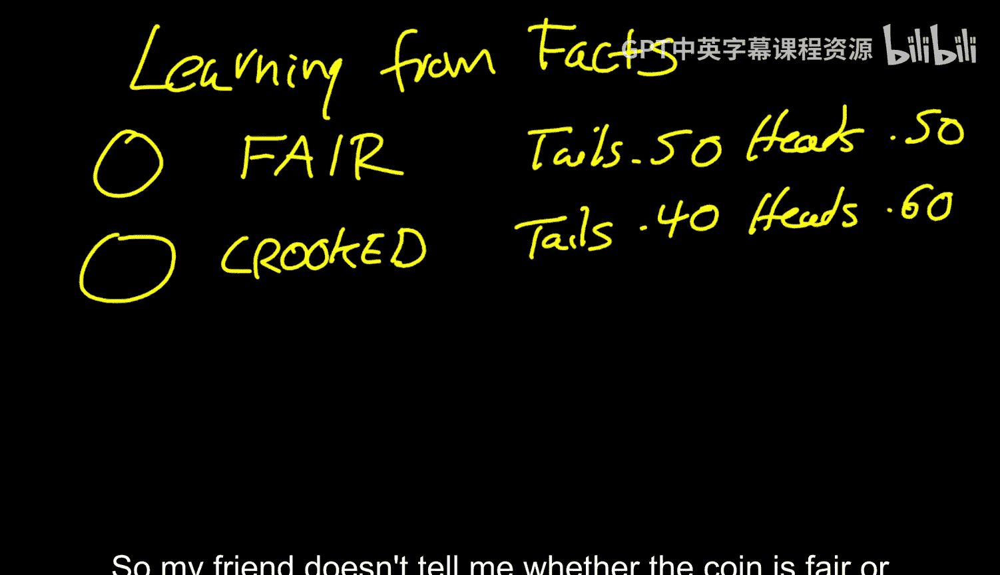

然后，我的朋友将只抛掷这枚硬币一次。

我们将观察到“正面”或“反面”这个事实。

所以我们只有两种可能的事实：正面或反面。

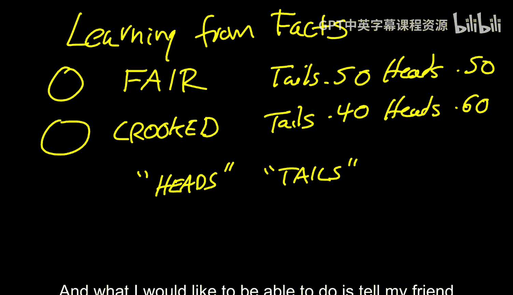

我希望能够做到的是，告诉我的朋友，我到底学到了关于他使用的是哪种硬币的信息，以及通过观察这枚硬币的这一次抛掷，我到底提取了多少信息，我的不确定性减少了百分之多少。

这将会非常令人印象深刻，不是吗？

我们处理这类问题的方法，被称为**逆概率问题**，就是通过使用贝叶斯定理。

---

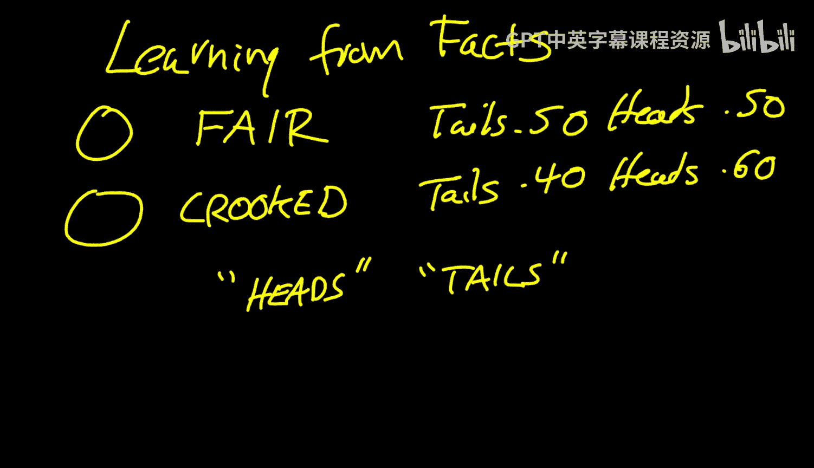

## 本节课总结

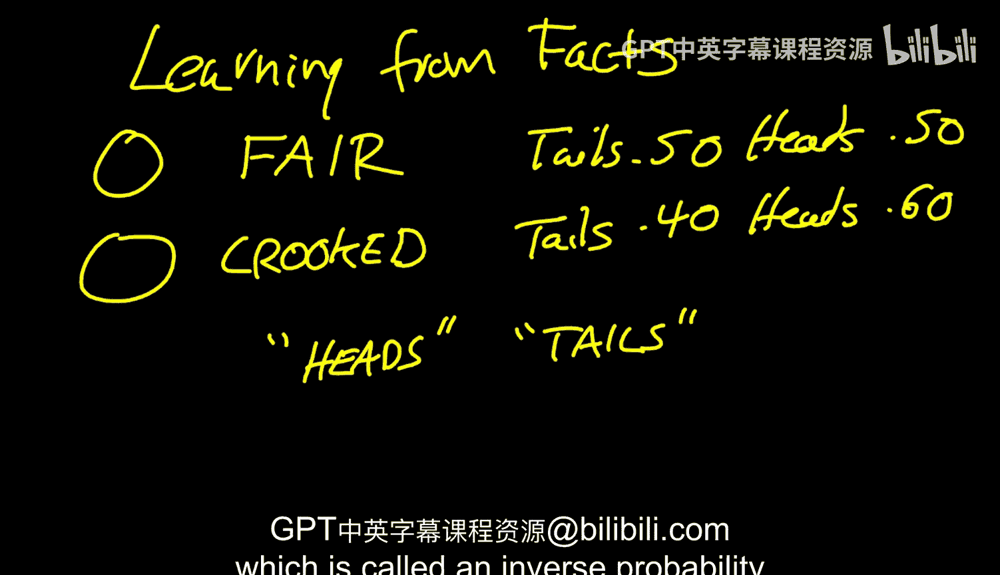

本节课中我们一起学习了贝叶斯定理的核心公式及其在信息推理中的重要性。我们了解到，贝叶斯定理是更新信念、从数据中学习的强大工具，而熵则用于量化学习过程中获得的信息量。最后，我们引入了一个具体的“单次抛硬币”逆概率问题，为下一节应用这些概念解决实际问题做好了准备。