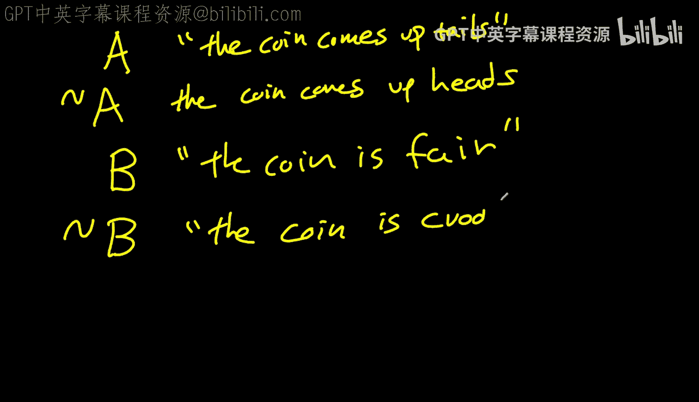
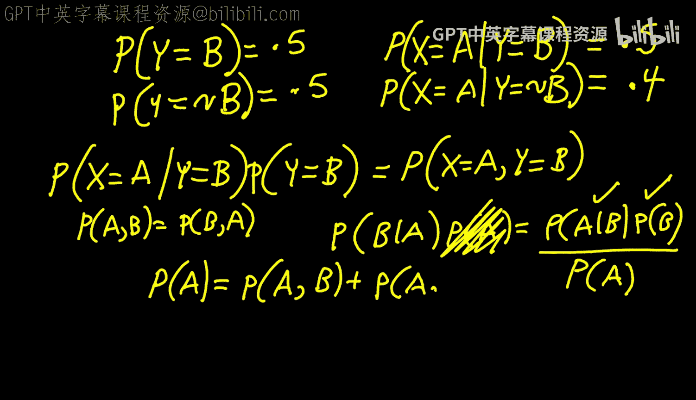
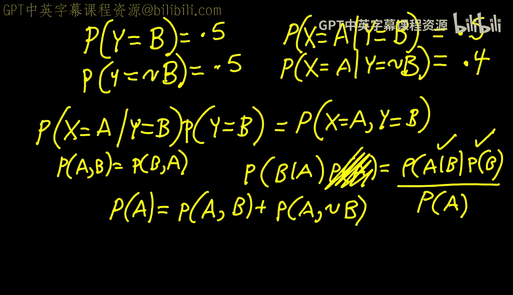
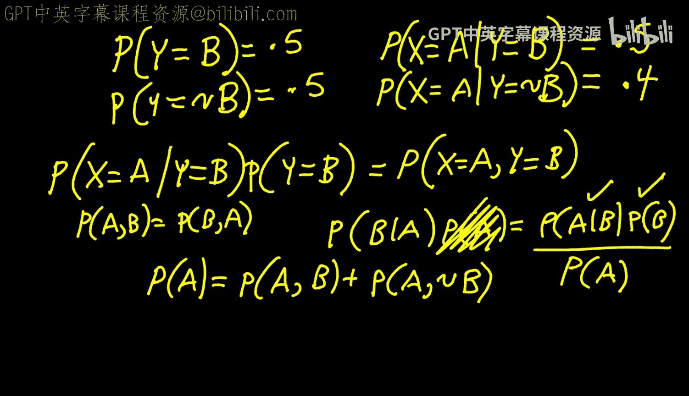
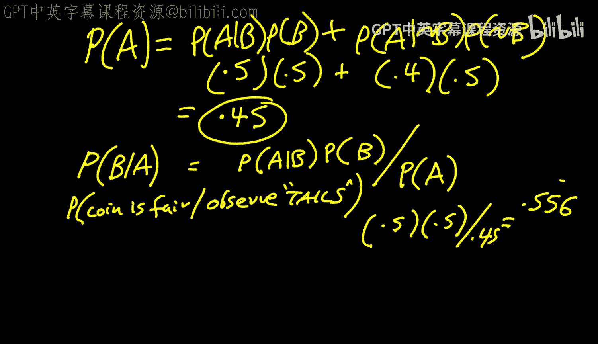
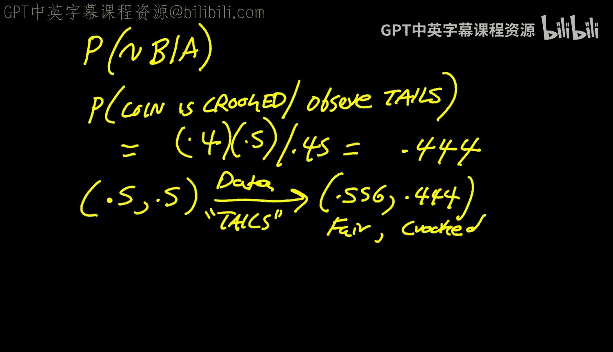
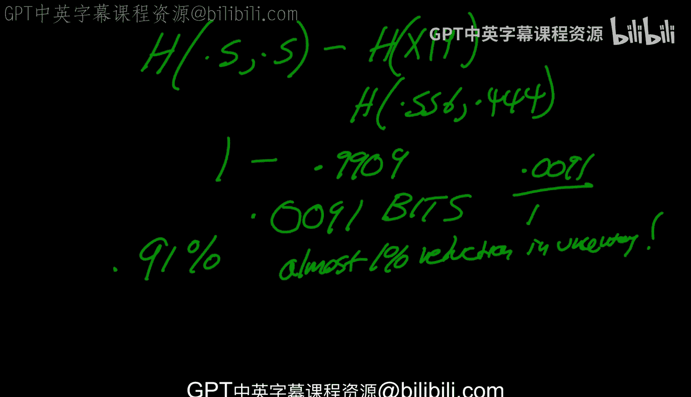

# 杜克大学《Excel 到 MySQL：商业分析（5课全）｜Excel to MySQL： Analytic Techniques for Business》中英 p58 23_04_04_单次抛硬币学习（下）.zh_en -BV1mS421X7yw_p58-

We're going to use the letter A to stand for。The coin comes up tails。And。Not a or negation of A。

For the coin comes up heads。Then， we're gonna to let。B。Stand for the parameter。The coin is fair。

And not be stand for the parameter。The coin is crooked。

Probability。That。We have outcome。B。Or a fair coin。Is initially 0。

5 and the probability that we have the crooked coin is 0。5。

We also know two conditional probabilities that are relevant to solving this problem。佢。

We know the probability。That the coin comes up tails。If。It is fair。Is equal to05。

 A fair coin just has a 50，50 probability of either outcome。And。The probability。That。The coin。

Comes up。Tales。Yes。We are using the crooked coin。Is 04。Okay。

So now we're going to use our product rule， which is where we started out before， which says。

Probability that x equals a。Given that y equals B。Times probability that。Y equals B。Is equal to。

The joint probability probability that x equals a。And。Y equals B。And by symmetry。

The fact that probability A B equals probability B。We can set up the formula。Probability of B。

 given A。Times probability of a。Equals probability of A， given B。Tounch probability of B。

We then divide both sides of the equation by probability of A。And this， again， is phase theorem。

Probability of B given a is the value we want to know the probability that the coin is fair。

Given that the coin came up Das。系。We already have values for probability of A， given B。

And for probability of B。But we also need an additional theorem of probability theory to establish the probability of A。

We're going to use the following fact。probability of a is equal to。Probability of a。And B plus。

The probability of。A and not B。 You remember that in this case， B and not B are exhaustive。

 So that covers all possibilities。 And so we can safely say that their sum is equal to the probability of a。

 It's the total probability that the statement A is true。 sum cross all possible cases。

 So probability a is the probability that。

Taleles will be observed。

By substitution using the product rule， we can say the probability of a equals。

Probability of a given B， sometimes probability of B。Plus， probability of A， given not B。

Times probability of not B。Which is equal to 。5。Times 。5。Plus。Poin4。Timeins 0。5。Which is equal to 0。

45。So that's the value that we can use for probability of a。Okay。

So now we're in a position to solve our problem。 probability of B， given a。That's what we want。

Probability that the coin is fair。If we observe tails。Is equal to。Probability of A， given B。

Times probability of B。Fideed by probability of a。So that is going to be able to point。five。Times 05。

Divided by 045。Which is equal to0556。

Similarly。Probability。Of not B， given A。Or the probability that the coin。Is crooked。

Given that we observe tales。Is equal to 04。Times 05， divided by 045， which is equal to 。44。4。

So we can conclude that from one observation of tails。

 we've changed our probability distribution from 50，50。We have data。Taleles。One time。

And now we have a distribution of 0556。44，4。 We have learned from our observation of tales that the coin is more likely to be fair。

Then it is to be crooked。Okay。And how much have we learned about which coin is being used。Well。

 that is pretty simple and it should be pretty simple to you now we've got。

The entropy of the original distribution。Minus。The new entropy， which is h of 05560444。

Is equal to 1 minus。9909 or0。0，0，9，1。Bits of information。This is a percentage information gain of 0。

0091 over1。Or point。9，1%。Just a little bit under 1%。Almost。1%。Reduction。In uncertainty。

Meaning moving toward surer knowledge。Of which coin is being used。By 1%。

Based on a single coinin toss。