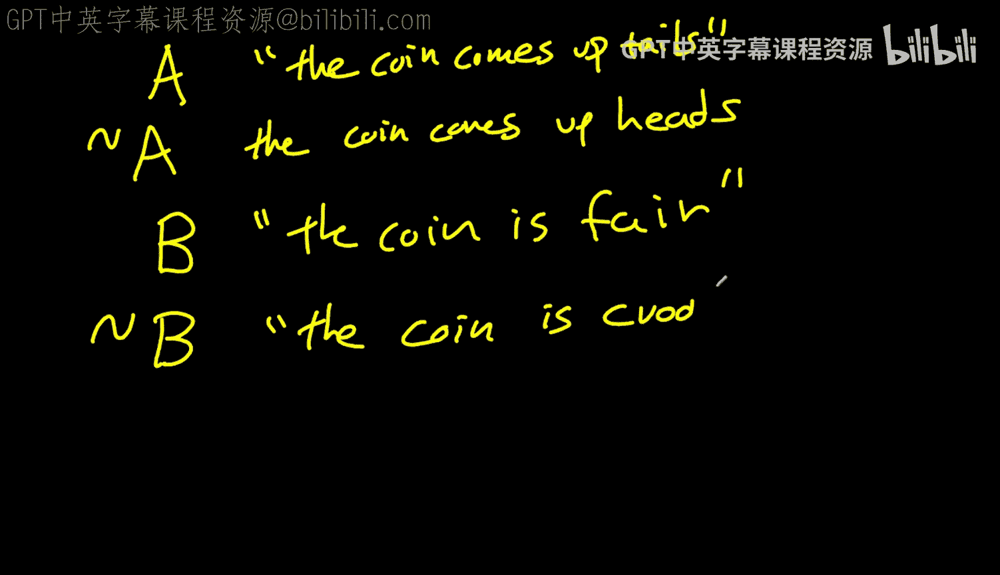
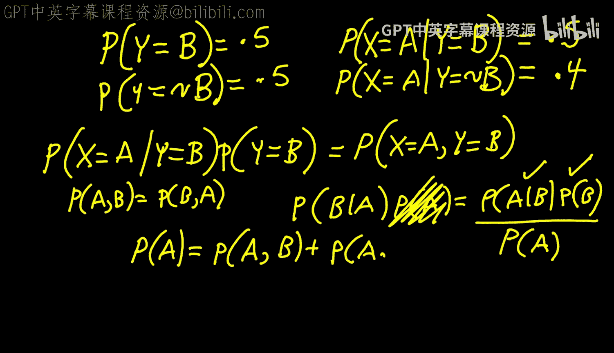
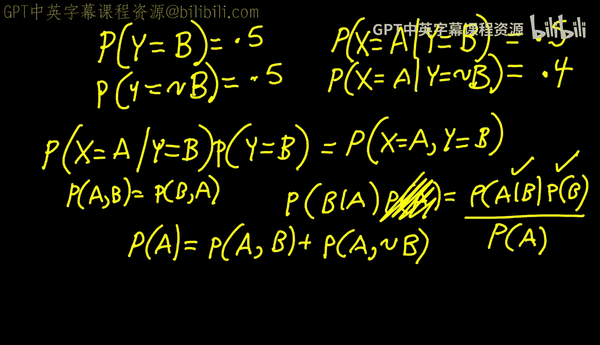
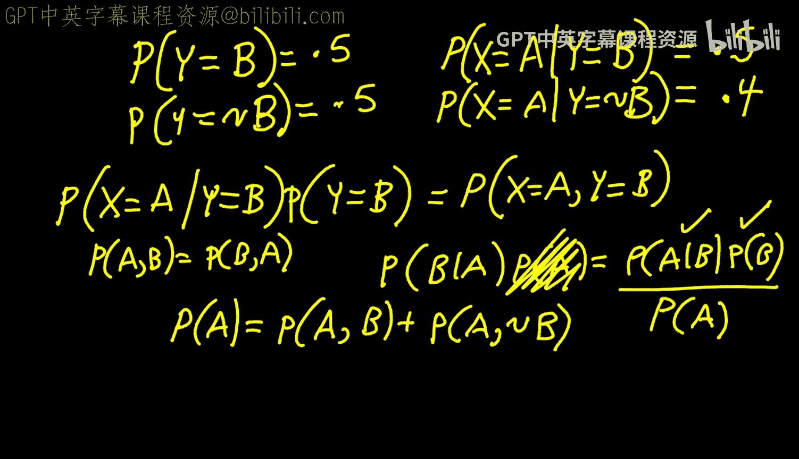
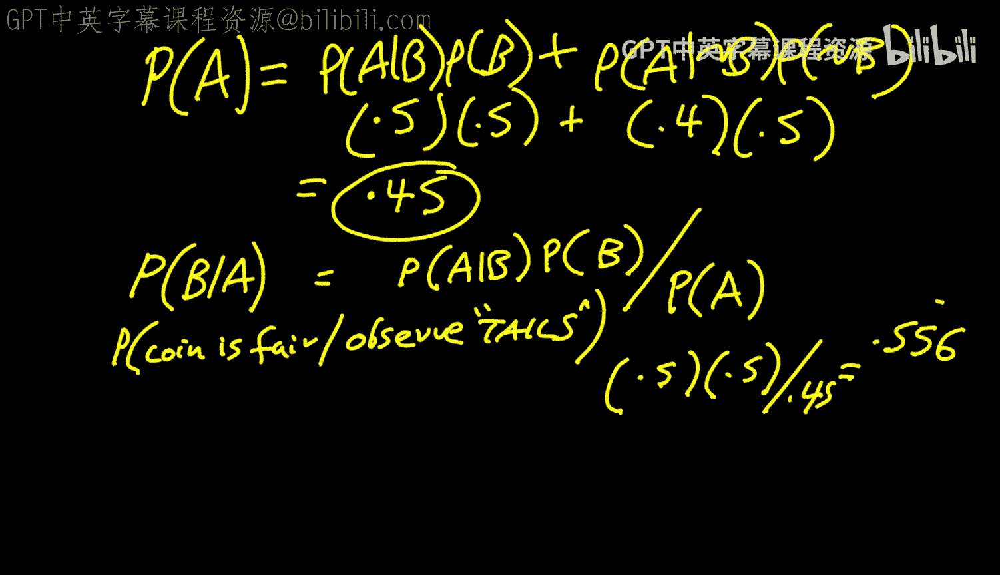
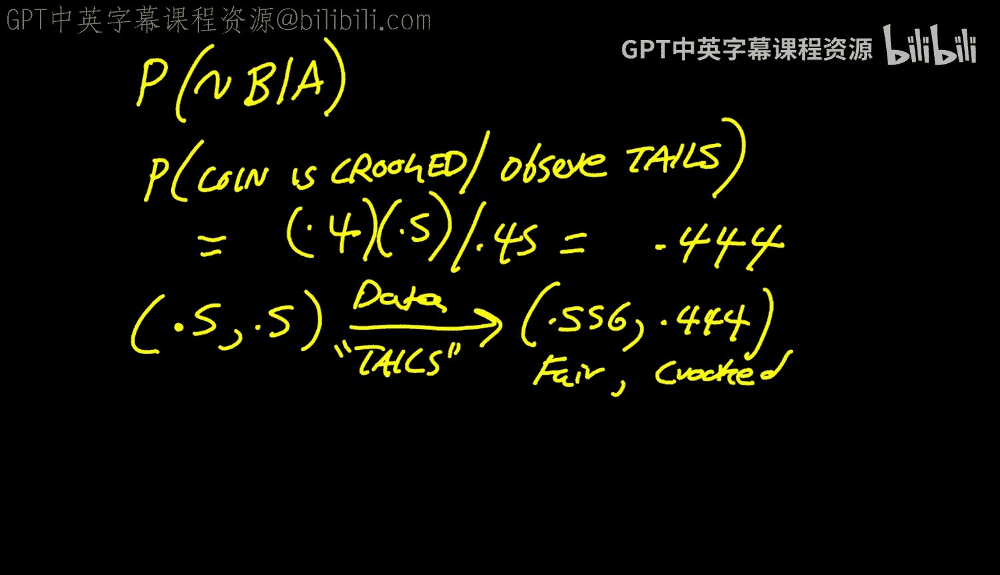
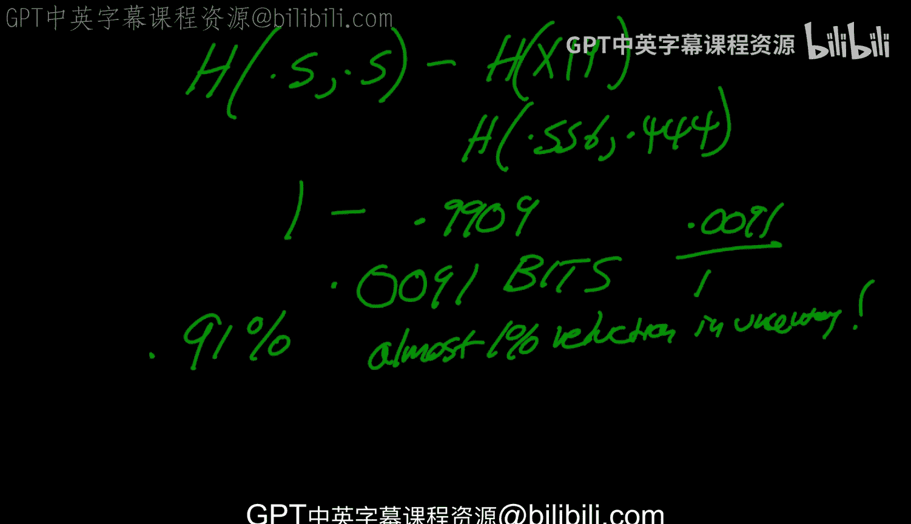

# 商业分析：5.3：单次抛硬币学习（下）🔍

在本节中，我们将继续学习如何应用贝叶斯定理和熵的概念，通过一次抛硬币的结果来更新我们对硬币是否公平的信念，并量化我们从中获得的信息量。

上一节我们介绍了如何用概率符号表示问题，本节中我们来看看如何具体计算和解读结果。

## 符号定义与已知概率

首先，我们明确所有符号的含义和已知的概率值。

*   用字母 **A** 代表事件：硬币结果是反面（Tails）。
*   用 **¬A** 代表事件：硬币结果是正面（Heads）。
*   用字母 **B** 代表参数：硬币是公平的（Fair）。
*   用 **¬B** 代表参数：硬币是偏斜的（Crooked）。

以下是已知的先验概率和条件概率：
*   硬币是公平的初始概率：`P(B) = 0.5`
*   硬币是偏斜的初始概率：`P(¬B) = 0.5`
*   已知硬币公平时，抛出反面的条件概率：`P(A|B) = 0.5`
*   已知硬币偏斜时，抛出反面的条件概率：`P(A|¬B) = 0.4`

## 应用贝叶斯定理

我们的目标是计算在观察到一次反面后，硬币是公平的概率，即 `P(B|A)`。我们将使用贝叶斯定理。

根据贝叶斯定理，公式如下：
`P(B|A) = [P(A|B) * P(B)] / P(A)`

我们已经知道 `P(A|B)` 和 `P(B)` 的值，但还需要计算 `P(A)`，即观察到反面的总概率。

## 计算总概率 P(A)

为了计算 `P(A)`，我们使用全概率公式。该公式指出，一个事件的总概率等于它在所有互斥场景下发生概率的总和。

具体到我们的问题，观察到反面（A）有两种可能：硬币是公平的（B）或硬币是偏斜的（¬B）。因此：
`P(A) = P(A 且 B) + P(A 且 ¬B)`

利用乘积规则 `P(A 且 B) = P(A|B) * P(B)`，我们可以将上式改写为：
`P(A) = P(A|B) * P(B) + P(A|¬B) * P(¬B)`

代入已知数值：
`P(A) = (0.5 * 0.5) + (0.4 * 0.5) = 0.25 + 0.2 = 0.45`

所以，单次抛掷出现反面的总概率是 0.45。

## 计算后验概率

现在，我们可以将数值代入贝叶斯公式，计算后验概率。

**1. 硬币是公平的后验概率：**
`P(B|A) = [P(A|B) * P(B)] / P(A) = (0.5 * 0.5) / 0.45 ≈ 0.556`

**2. 硬币是偏斜的后验概率：**
`P(¬B|A) = [P(A|¬B) * P(¬B)] / P(A) = (0.4 * 0.5) / 0.45 ≈ 0.444`

计算结果表明，在观察到一次反面后，我们对硬币状态的信念从最初的 (0.5， 0.5) 更新为 (0.556， 0.444)。这意味着硬币更可能是公平的。

## 量化信息增益

最后，我们来量化通过这次观察我们获得了多少信息，即不确定性的减少量。我们使用熵（Entropy）来计算。

初始分布的熵（50/50分布）为：
`H(初始) = H(0.5， 0.5) = 1 bit`

观察到一次反面后，新分布的熵为：
`H(新) = H(0.556， 0.444) ≈ 0.9909 bit`

信息增益（IG）是熵的减少量：
`IG = H(初始) - H(新) = 1 - 0.9909 = 0.0091 bit`

以百分比表示的信息增益为：
`0.0091 / 1 * 100% ≈ 0.91%`

## 总结

本节课中我们一起学习了如何完成一次完整的贝叶斯更新。我们从定义事件和参数开始，应用贝叶斯定理和全概率公式，计算了在观察到一次硬币反面后，硬币是公平的后验概率（从0.5更新为0.556）。最后，我们通过计算熵的差值，量化了这次观察所带来的信息增益——大约0.0091比特，相当于减少了不到1%的不确定性。这个例子清晰地展示了如何用数据（一次抛掷结果）来更新我们的信念，并衡量学习的“量”。