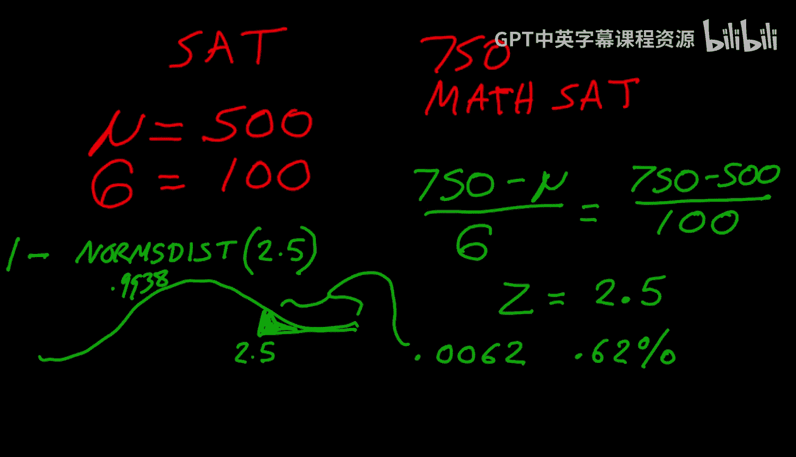
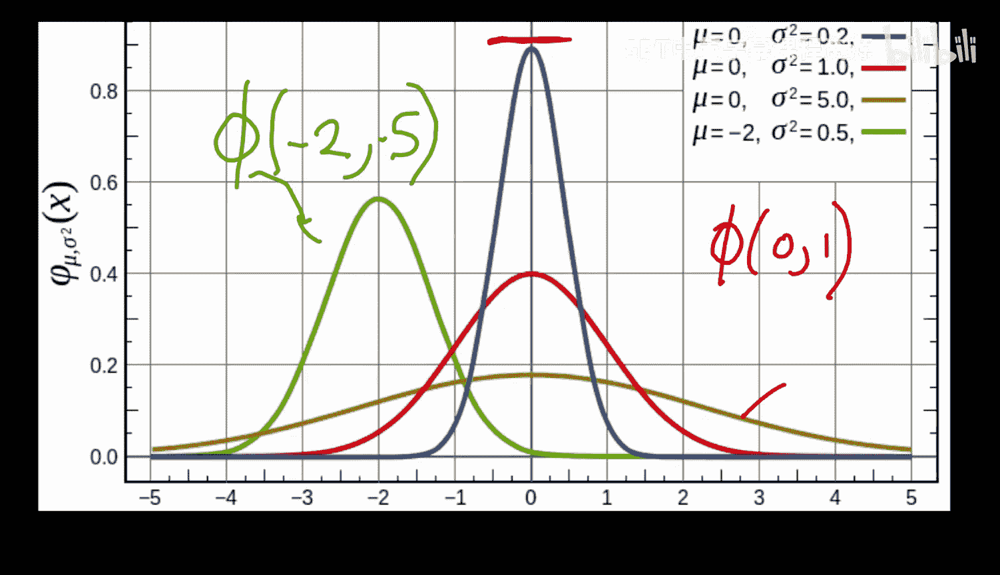

# 杜克大学《Excel 到 MySQL：商业分析（5课全）｜Excel to MySQL： Analytic Techniques for Business》中英 p62 27_05_05_基于Z分数的概率计算.zh_en -BV1mS421X7yw_p62-

You may be familiar with the SAT test。Suppose that you had a score of。750 on the math SAT。

The SAT test。Assumes。That the distribution of scores is Gaussian is a standard normal distribution with mean。

We'll use the Greek letter mu equals 500。And standard deviation equals 100。

So you may recall that to convert。750 to a Z score。We're going to take 7，50。Minus the mean。

Divided by the standard deviation， which is equal to 7，50-500。Divided by 1 hundred0。For a Z score of。

2。5。And this will tell us。How many people are to the left？Of 2。5。

So if we want to know how many people scored a 750 or better。We would like to have the this area。

Which is going to be one。Minus。Norm as。Of 2。5 norm as of 2。5。Is point。9，9，3，8。So one minus it。

This area here is 0。0062 or 062%。So we know that。Approximately。

610s of 1% of people who took the SAT scored at least 750 on the math part。

If the SAT were correctly normed to people taking the test this year。And over time。

 the SAT tends to drift out of。The perfect norm and they had readjusted every few years。

 but that is the goal and that's the idea。

This illustration， which is under Creative Commons license， which I obtained from Wikipedia。

 shows a number of。Normal distributions。One of them。Is a standard normal distribution。

 see if you can identify which one。One clue is that its maximum is just about 0。4。

So it would be the red one， red one with mean equals0 variance equal to 1。

So we would write that as follows。嗯。And these other distributions。Are also Gaussian。时间。

The idea is that in order to maintain an area of one and use them as probability distributions。

If they have a larger variance， they're going to be lower and flatter。

So that they all have the same area。So， if we have。A variance of five。

We've got a much lower and flatter object。And if we have a variance of 02。

 we've got obviously a much higher， more centralized object。嗯。

So we can represent any Gaussian using this basic。Mean invariance notation。 so for example。

This green。Gausian would have the following notation。Phi mean of -2。Varians。Of。5。

