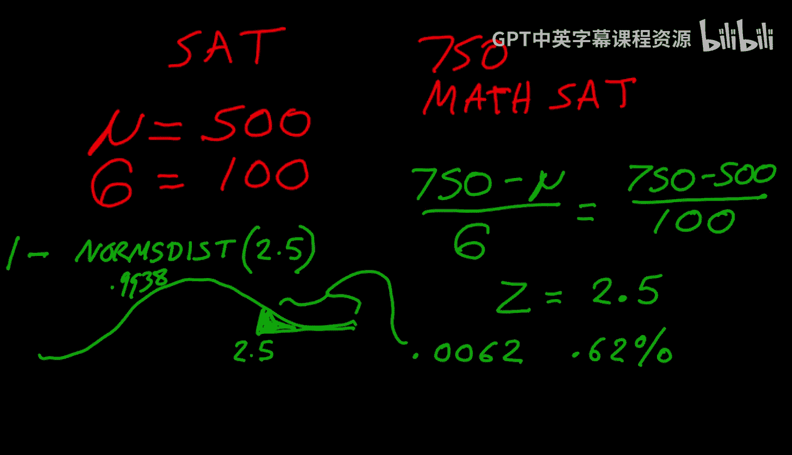
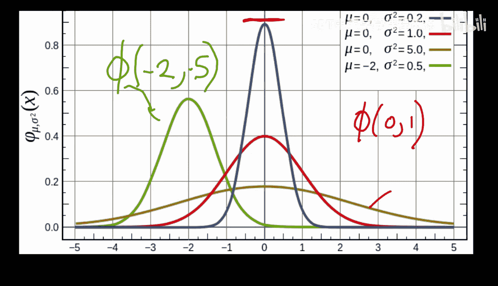

# Excel 到 MySQL：商业分析：5.2：基于Z分数的概率计算

在本节课中，我们将学习如何使用Z分数和标准正态分布来计算特定事件发生的概率。我们将以SAT数学考试为例，演示如何将原始分数转换为Z分数，并利用正态分布表或函数来评估成绩的排名。

## 概述：理解Z分数与概率

上一节我们介绍了正态分布的基本概念。本节中，我们来看看如何利用Z分数进行具体的概率计算。Z分数是将一个数据点标准化到标准正态分布（均值为0，标准差为1）的度量，它使我们能够比较不同数据集中的数据，并计算特定值出现的概率。

## SAT分数概率计算示例

假设你在SAT数学考试中获得了750分。SAT考试假设分数分布服从高斯分布（即正态分布），其均值（μ）为500，标准差（σ）为100。

为了计算获得750分或更高分数的概率，我们首先需要将原始分数750转换为Z分数。转换公式如下：

**Z = (X - μ) / σ**

其中，X是原始分数，μ是总体均值，σ是总体标准差。

将数值代入公式：
Z = (750 - 500) / 100 = 250 / 100 = 2.5

因此，750分对应的Z分数是2.5。这个Z分数告诉我们，750分比平均分高出2.5个标准差。

接下来，我们想知道有多少人的分数在750分或以上，也就是标准正态分布曲线下Z分数大于等于2.5所对应的右侧尾部面积。

我们可以使用标准正态累积分布函数（通常记为 `norm.s.dist` 或 `Φ`）来计算。`Φ(2.5)` 给出了Z分数小于等于2.5的概率（即曲线下左侧的面积）。我们需要的概率是1减去这个值。

计算过程如下：
`Φ(2.5) ≈ 0.9938`
那么，`P(Z ≥ 2.5) = 1 - Φ(2.5) = 1 - 0.9938 = 0.0062`

所以，大约有0.62%的考生在SAT数学部分获得了至少750分。这意味着如果你的SAT成绩是750分，你击败了大约99.38%的考生。

## 正态分布的可视化与参数

为了更直观地理解不同参数下的正态分布，我们可以参考一些图表。

下图展示了多个正态分布曲线，其中一个就是标准正态分布（均值为0，方差为1）。识别它的一个线索是其峰值大约在0.4左右。

（此图采用知识共享许可协议，来源于维基百科）

以下是图中各分布的特点：

*   **标准正态分布（红色）**：其均值为0，方差为1。我们将其记作 **N(0, 1)**。
*   **其他高斯分布**：它们也都是正态分布。为了保持曲线下总面积始终为1（这是概率分布的基本要求），当方差增大时，分布曲线会变得更低、更扁平；当方差减小时，曲线会变得更高、更集中。
*   **参数表示**：任何高斯分布都可以用均值和方差（或标准差）来表示。例如，图中绿色的分布可以表示为 **N(-2, 0.5)**，表示其均值为-2，方差为0.5。

通过调整均值和方差这两个参数，我们可以描述各种不同形态的正态分布，但它们都共享相同的钟形曲线特征。

## 总结

本节课中我们一起学习了基于Z分数的概率计算。我们首先通过SAT分数的例子，演示了如何将原始数据转换为Z分数。接着，我们利用标准正态分布表或函数，计算了特定Z分数对应的概率（即数据点的相对排名）。最后，我们通过可视化图表回顾了正态分布的形状如何随均值和方差的变化而变化，并理解了所有正态分布都可以通过标准化（计算Z分数）与标准正态分布联系起来。掌握这一方法，对于商业分析中评估业绩、分析风险和进行统计推断至关重要。