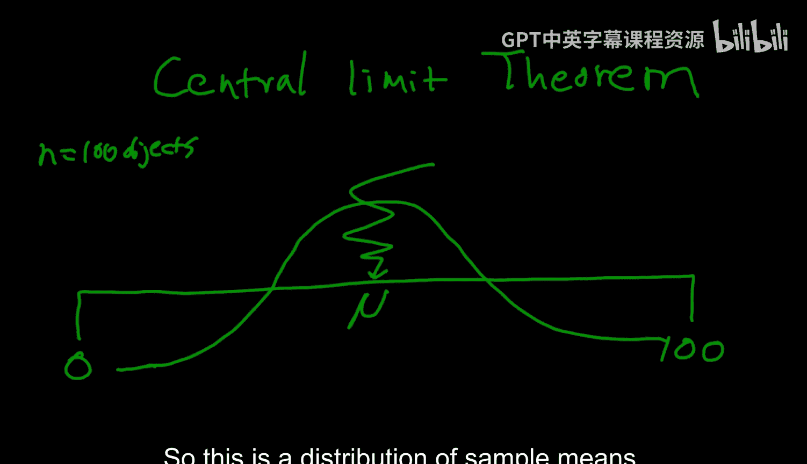
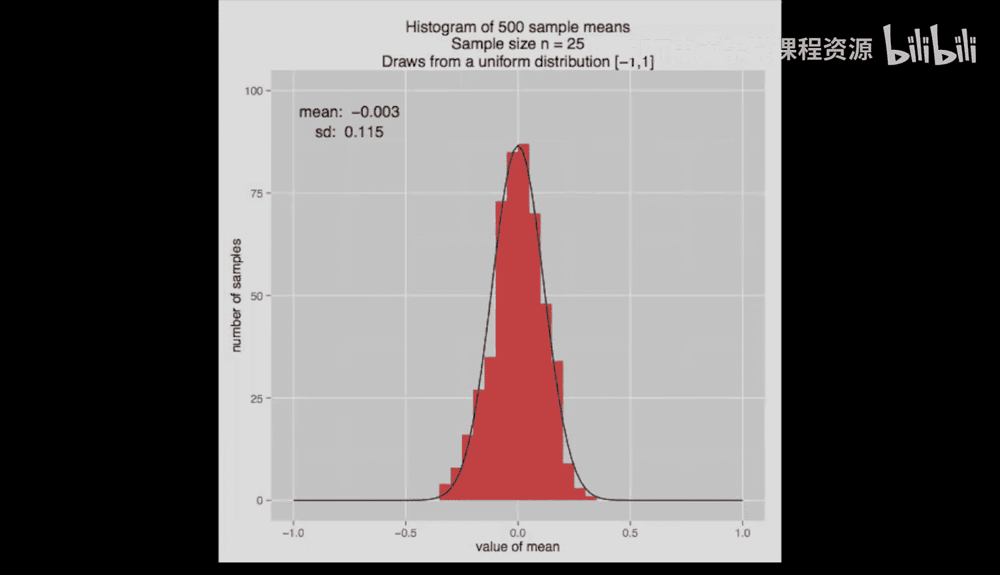

# 杜克大学《Excel 到 MySQL：商业分析（5课全）｜Excel to MySQL： Analytic Techniques for Business》中英 p63 28_05_06_中心极限定理.zh_en -BV1mS421X7yw_p63-

There are a number of reasons why the Gaussian distribution。

Occurs constantly in nature and constantly in our data when we work as data analysts。

One of the most important reasons is something called the central limit theorem。

What the central limit theorem says is if you take。

A number of draws from any distribution with defined mean。And defined variance。So for example。

A uniform distribution。From 0 to 100。And you draw。Let's say a sample of 100 things from it。

And then you take the mean of that sample。So you have for each sample you've got。

N equals 100 objects。And you're taking the mean。Several important things happen。

One is if you take a large number of samples。Mean of your samples will approach the original mean。So。

 you will be。As you get samples， you will be bouncing around near this mean。

 but eventually you will get closer and closer and closer to it。In addition， your。

Verance of your sample means。Will be directly related to the original variance of the distribution。

We'll go into the detail of that later。Perhaps most surprisingly and importantly。

 the distribution of your sample means。Is going to form a nice Gaussian distribution。

 even though the original underlying distribution can be of any shape。

So this is a distribution of sample means。As we're showing in the animation。

We will draw 500 independent samples of size 25 from a uniform distribution over negative one to one and record the mean of each sample on a histogram。

The mean and standard deviation of the original distribution are 0 and 。577。

The central limit theorem tells us that three things must happen as the number of draws gets large。

First， the mean of our sample means will approach zero， the mean of the original distribution。Second。

 the standard deviation of sample means will approach 0。115。

 the standard deviation of the original distribution divided by the square root of 25， so here 5。

Third， even though the original distribution has a different shape。

 the histogram of sample means forms an approximate Gaussian distribution here marked by the curved line。

