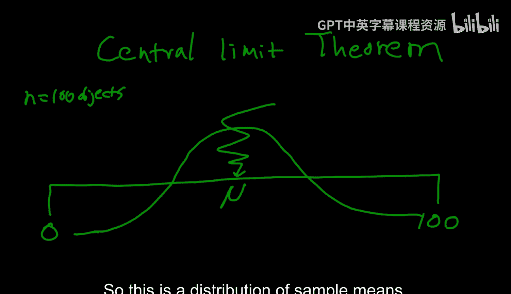
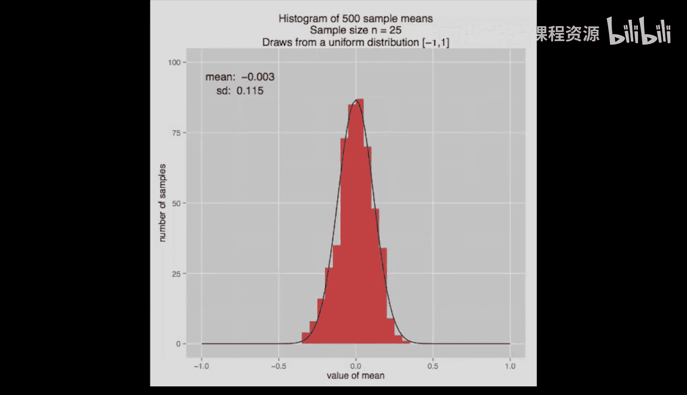

# 商业分析：5：中心极限定理 📊

在本节课中，我们将要学习一个在数据分析和自然界中极其重要的概念——中心极限定理。理解这个定理，能帮助我们明白为何正态分布（高斯分布）如此普遍地出现在我们的数据中。

## 概述

高斯分布在自然界和数据分析工作中频繁出现，原因有很多。其中最重要的一个原因，就是中心极限定理。这个定理描述了当我们从任意分布中抽取样本并计算其均值时，会发生的一系列关键现象。

## 中心极限定理的核心内容

上一节我们介绍了中心极限定理的重要性，本节中我们来看看这个定理具体说了什么。

中心极限定理指出：如果你从一个具有**定义明确的均值**和**定义明确的方差**的任意分布中进行多次抽样，会发生以下重要现象。

以下是该定理描述的三个核心结果：

1.  **样本均值的均值趋近于总体均值**：如果你抽取大量样本，这些样本均值的平均值将无限接近原始分布的总体均值。随着样本数量增加，样本均值会在总体均值附近波动，并最终越来越接近它。
2.  **样本均值的方差与总体方差直接相关**：样本均值的方差（或标准差）与原始分布的方差有直接关系。具体来说，样本均值的标准差等于总体标准差除以样本量的平方根。公式表示为：`σ_sample_mean = σ_population / √n`。我们稍后会详细探讨这一点。
3.  **样本均值的分布趋近于正态分布**：最令人惊讶且重要的是，无论原始分布的形状如何（可以是均匀分布、指数分布等），只要样本量足够大，这些样本均值的分布本身会形成一个漂亮的正态分布（高斯分布）。

## 定理演示与实例

为了更直观地理解上述概念，我们来看一个具体的动画演示。

我们将从一个定义在区间 [-1, 1] 上的均匀分布中，抽取 500 个独立的样本，每个样本的大小为 25。然后，我们计算每个样本的均值，并将这些均值记录在直方图上。

原始均匀分布的均值是 0，标准差约为 0.577。

根据中心极限定理，随着抽样次数（此处为500次）足够多，三件事情必然发生：

首先，我们样本均值的平均值将趋近于 0，即原始分布的均值。
其次，样本均值的标准差将趋近于 0.115，这个值由原始分布的标准差 0.577 除以样本量 25 的平方根（即 5）计算得出：`0.577 / 5 ≈ 0.115`。
第三，尽管原始分布是均匀的（形状不同），但样本均值的直方图形成了一个近似的高斯分布（图中由曲线标出）。

这个演示清晰地验证了中心极限定理的威力：即使原始数据不是正态的，其样本均值的分布也会随着样本量增大而趋向于正态分布。

## 总结

本节课中我们一起学习了中心极限定理。我们了解到，该定理解释了为何正态分布如此普遍，它指出无论原始数据分布如何，其大量样本均值的分布都会趋近于正态分布，并且样本均值的均值等于总体均值，其标准差也与总体标准差和样本量相关。这是许多统计推断方法（如假设检验、置信区间）能够成立的理论基石。掌握这个定理，对于理解数据分析中的许多核心概念至关重要。