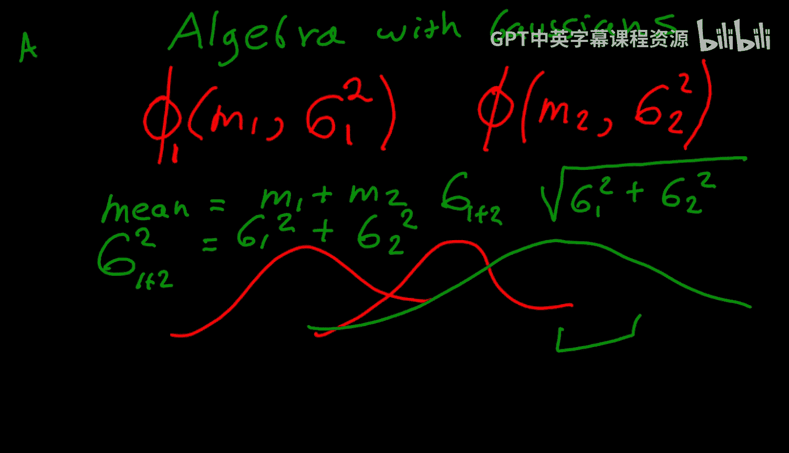
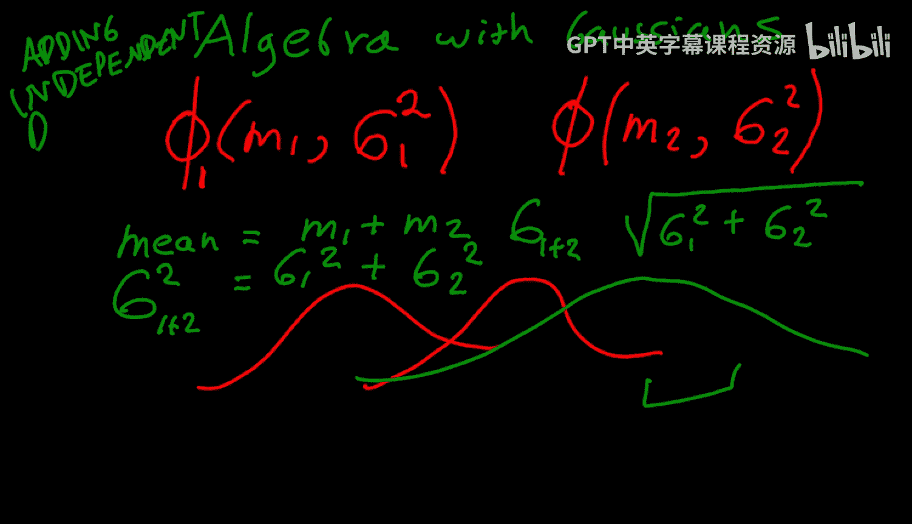
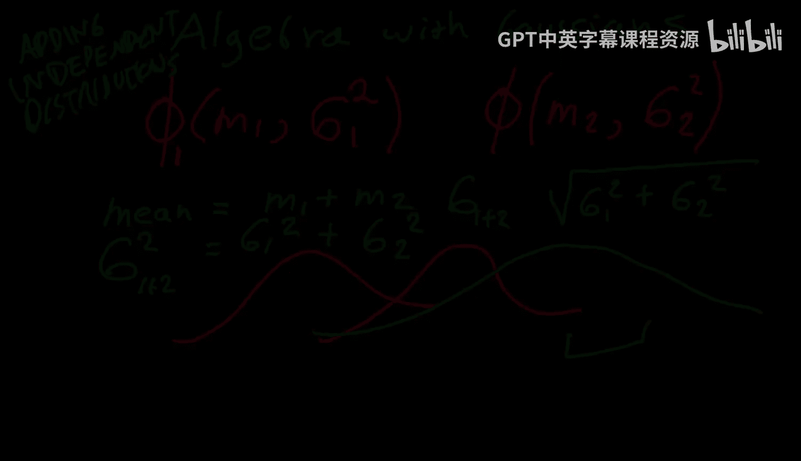
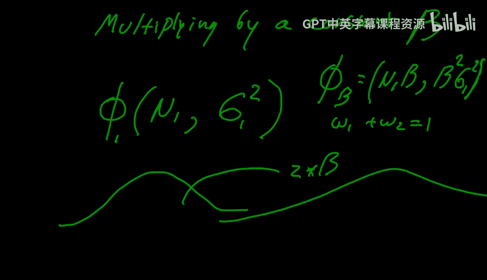
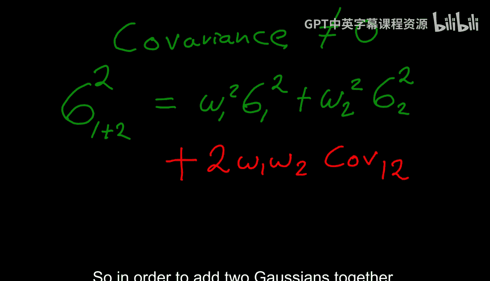
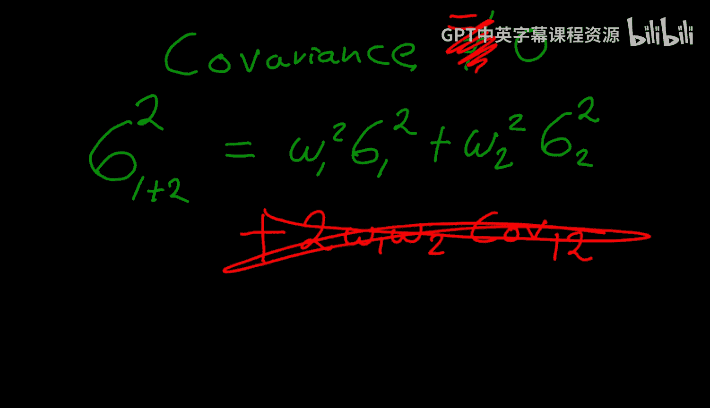

# 杜克大学《Excel 到 MySQL：商业分析（5课全）｜Excel to MySQL： Analytic Techniques for Business》中英 p64 29_05_07_高斯分布代数运算.zh_en -BV1mS421X7yw_p64-

Now we want to talk about algebra with Gaussians。Gauussians have a number of。Unusual properties。

Which。You really wouldn't appreciate how unusual these were unless you tried to combine other probability distributions and found out what a mess the resulting numbers are。

But if you have two Gaussian probability distributions。So one has mean one。And the second has。

Varance 1。Let's use our sigma squared symbol for variance。Tandard deviation squared。

And then we have a second Gaussian distribution。With me too。And variance 2。

If we take a draw from one。And I draw from the other。Our combined distribution。

We'll look something like this。It will have。Min。Equal to M1 plus。M2。And it will have variances。Of。

Equal to。Vance 1 plus。Vararianance 2。So if we want to know the standard deviation of our new distribution。

 it would simply be the square root。Of。The variance of one plus the variance of the other。

A very important。Alert here。 This is true if the two distributions are independent。

If they are independent。Then this is how we sum them。

If they have some dependency or correlation or covariance。

Then we need to sum them a little bit differently with an adjustment term。

 which we'll cover in a minute。But the first idea we want to emphasize with algebra Gaussians。

Is adding independent distributions， So that's what we've just done。

Adding。Independent。Distributions。

The next idea in our algebra with Gaussians is。Multiplying by a constant。So。

Let's say we are going to multiply by beta。So we have a Gaussian。我。Mean muu。And variance。Sigma。

And we're going to take each individual value。And we're going to when we draw it。Oop。

 so we take a random draw of this。And we get some。Z。And we're going to multiply at times beta。Well。

 what happens is。So， the mean。4。Multiplying times beta。It is going to be equal to mu  one。I'm Tata。

And the variance will be equal to beta squared。Time's the variance。Okay。So， if you think about。

Waiting a weighted combination。Of Gaussians。You would wait them first。By multiplying。

Each mean by its little weight， So say we had W1 plus W2 equals 1。You would， first。

Multiply the mean by its weighting。And then you would multiply the variance by its。

Waiting， squared。Now we want to deal with the situation where there is。

Correlation or covariance between the two。When the covariance does not equal 0。The variance。Of。

combinedbined portfolios。Is equal to。The weight on the first one， squared。

Times its original variance。This is， of course， the situation where W 1 plus W 2。Equals one。Plus。

The weight on the second squared。Times its variance。So far。

 this is no different than what we talked about earlier for linear transformations。

But now we introduce a new term。So in order to add two Gaussians together。

 we need to know their covariance。

If we're fortunate and we know that their covariants。Is equal to0。Then this whole term drops out。

And we're simply summing。Just as we did， using our first two algebra methods。

But if we know the covariance is not equal to zero， then we need to include this term。

