# 杜克大学《Excel 到 MySQL：商业分析（5课全）｜Excel to MySQL： Analytic Techniques for Business》中英 p66 31_05_01_线性回归的坐标标准化.zh_en -BV1mS421X7yw_p66-

What I've done is calculate these Z scores for a second set of values。

 which we're calling the y values。

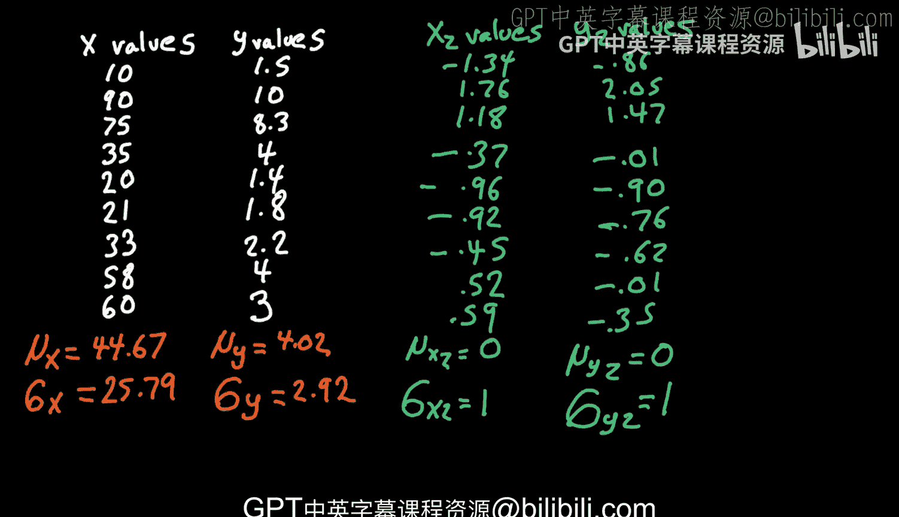

And what you'll notice is that although the x values have a very large range。

There's a standard deviation of 25 and a mean of 44 and the y values。

Have a much smaller range and a much smaller standard deviation。When they've been standardized。

Both the X and Y axis values。Have the same。Mean and standard deviation。

So this is what we mean by standardizing them。So now we're going to look at some relationships of ordered pairs。

 and our question is this。If we look at certain standard relationships like covariance。Correlation。

The slope of the best fit line that plots。Y against x。The Y intercept。

Will they be the same for the original values and the standardized values。

 or will they be different and if they're different？How will they be different and why？

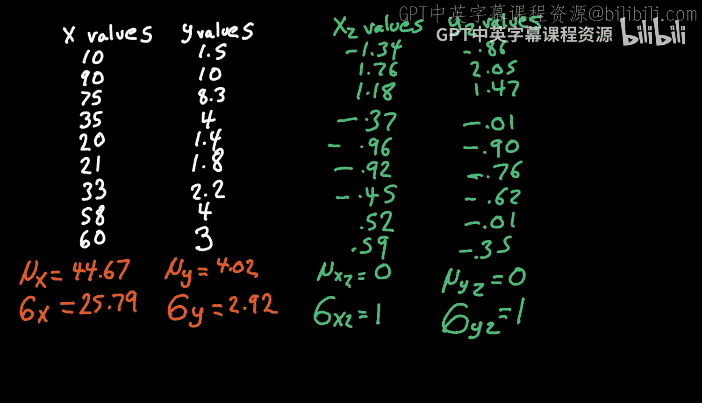

First， we'll look at the covariance of x and Y。You take each individual x sub I and subtract the mean of all x's from it。

Take each individual y sub I that goes together with it in an ordered pair。

 subtract the mean of all ys from it， multiply them together。 Then you do that n times。

 you add them all up， and you divide by n。And our covariance。For our original set。

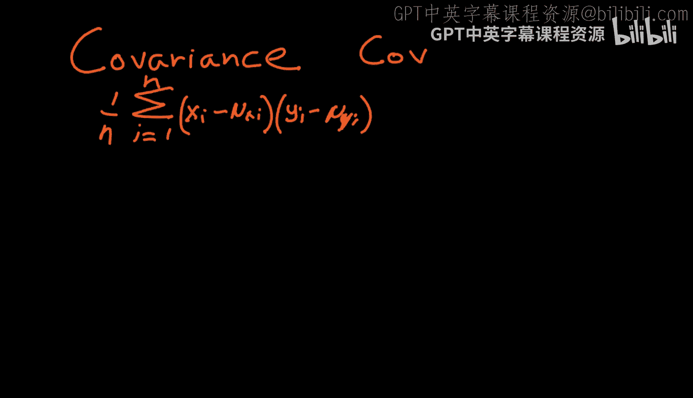

Using this formula。Would be。67。89。And our covariance for our new set。Would be point。

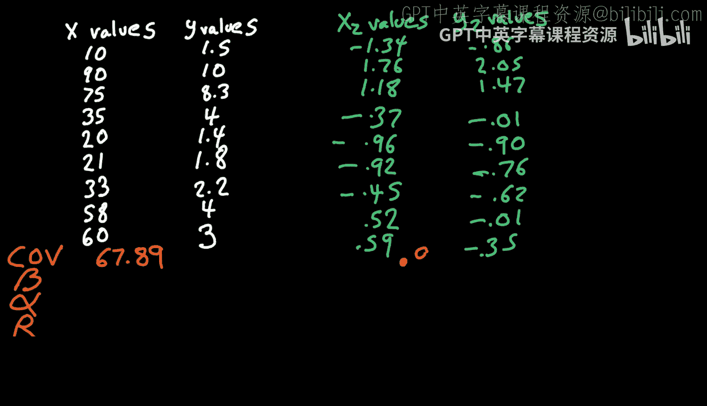

9。Next， we're going to look at beta。This is the Greek letter beta。It stands for the slope。Have。

The best fit line。So if you picture our。对咧。You the line。Telta y over Delta x equals the slope。

Of that line equals beta。And you can think about。Our best fit model。As being for each。Why sub I。

We're estimating that。Y some I equals theta times x sub I。Plus。Alpha。That is our formula。

 that has the smallest。Some of squared errors。So we want to know beta the slope of this line。

And for our regional values。

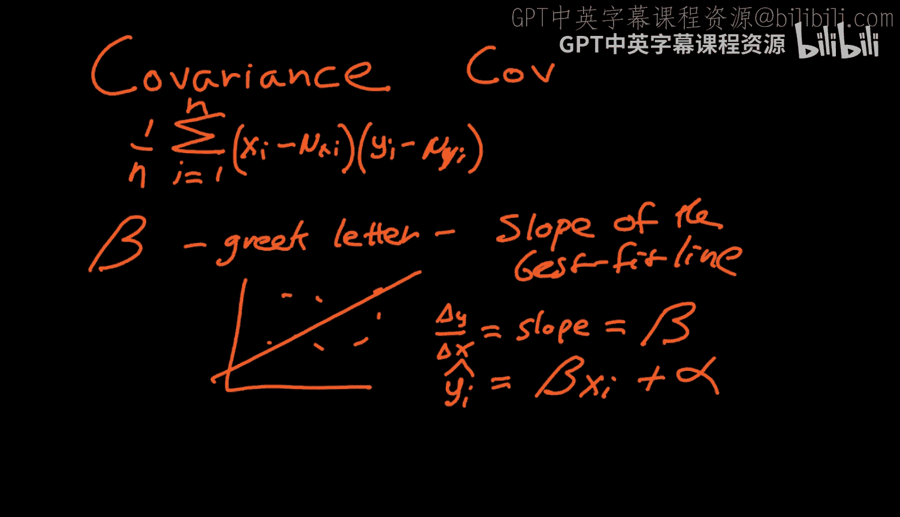

Beta is equal to point。1。While beta4 hour。Standardized values is equal to09。嗯。Similarly。

 we know that。

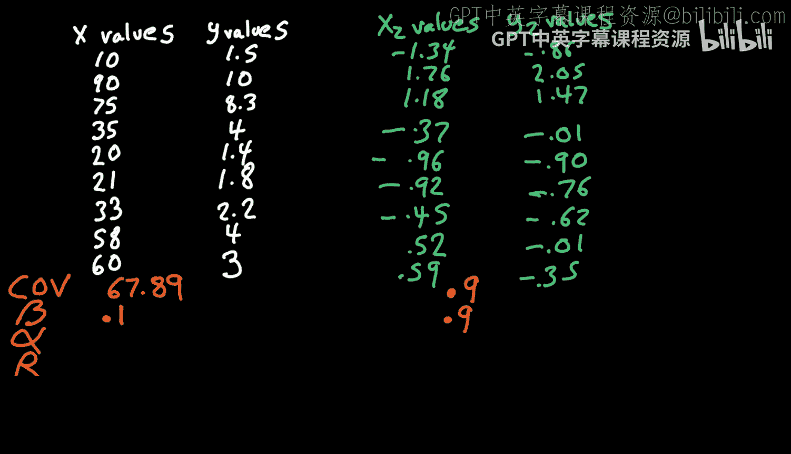

For our standardized values。Alpha must always be equal to 0。

 The reason why we know this is because the mean。그 미。Is always on our best fit line。

The mean of x and the mean of y ordered pair。 And we know that for standardized values， this is 0。

0 so that we know that the best fit line must go through the origin 0，0。 but that， of course。

 is not true in general。 And， in fact， our value for alpha is。

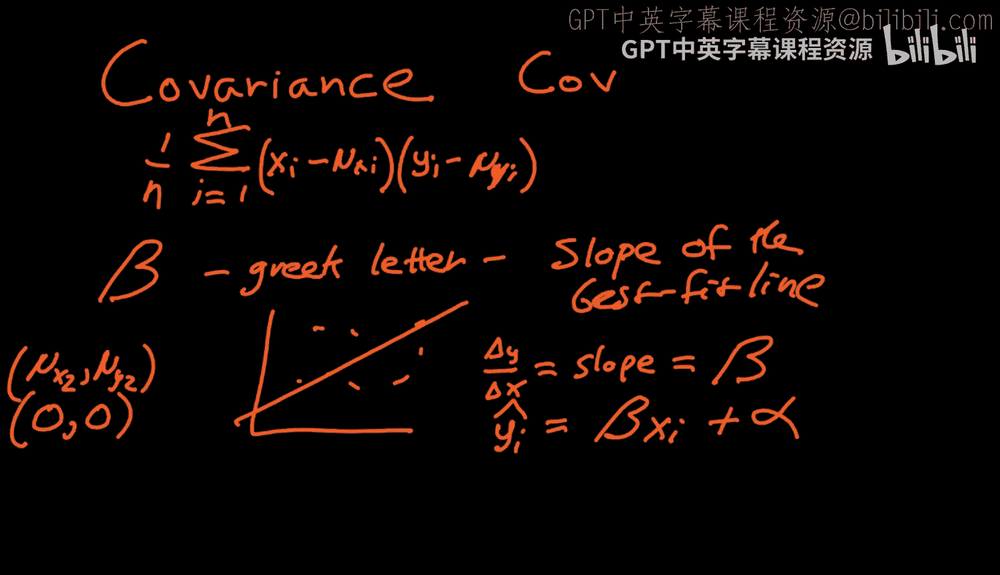

Negative 054， Where here our value for alpha is 0。

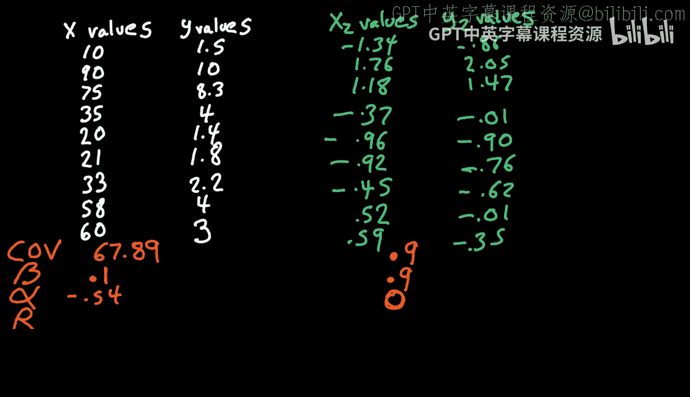

嗯。And then finally， we're going to look at the correlation。

Correlation is equal to the covariance。

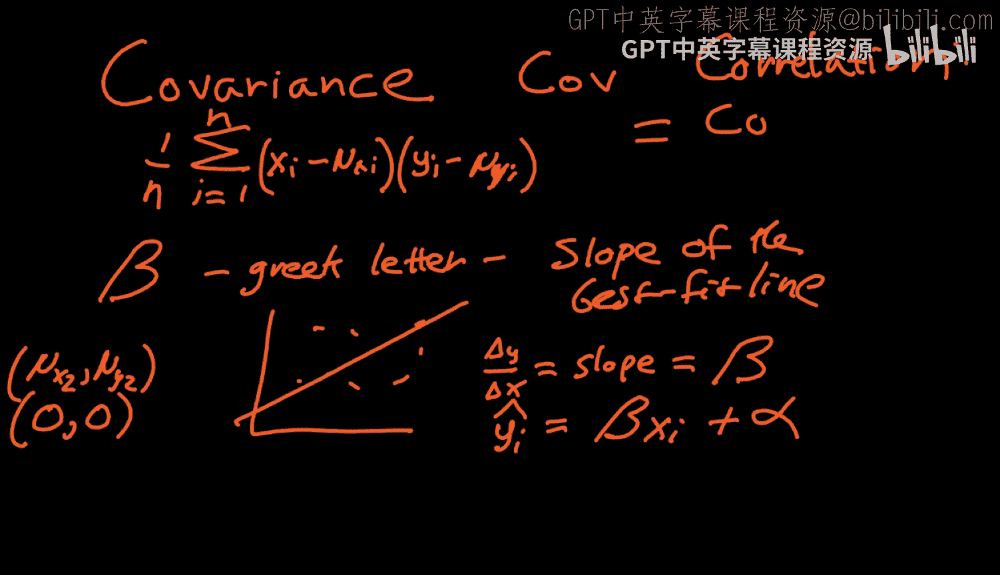

Of x and Y， divided by。

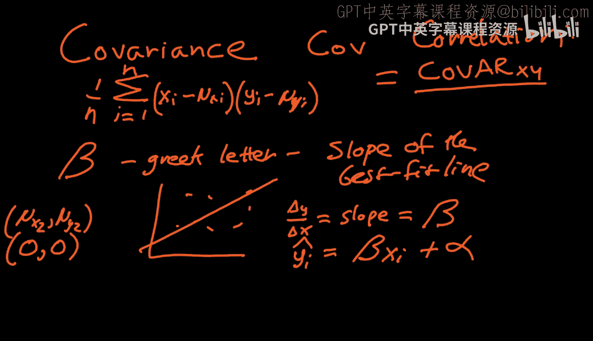

The standard deviation of x。Times。😔。

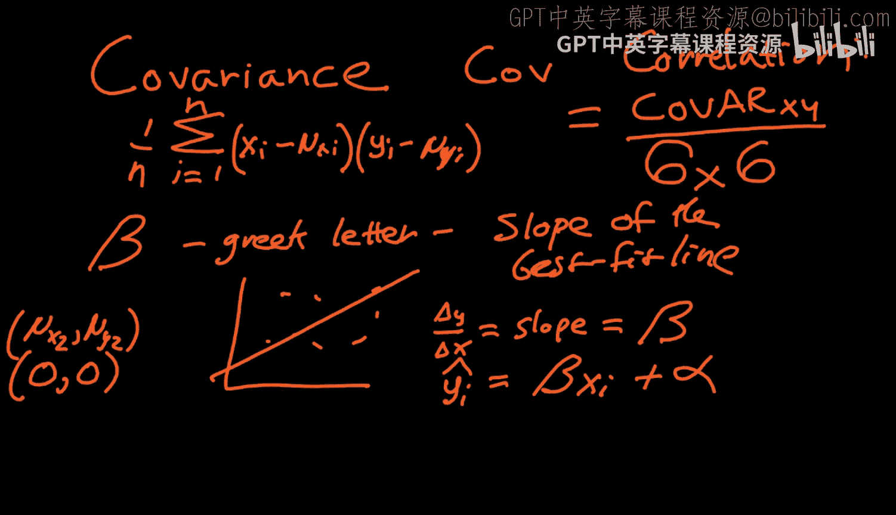

The standard deviation of why。So our values for R R 。9。And。9。

So what conclusions can we draw from this？Well。The only thing that remains constant。

Over our transformation to standardized values or Z scores is the correlation。

The correlation is unchanged。For every standardized set。Alpha is equal to0。 so that is simple。

And for every standardized set。Both beta。And the covariance。Are equal to the correlation R。

So we've made things very simple， indeed。

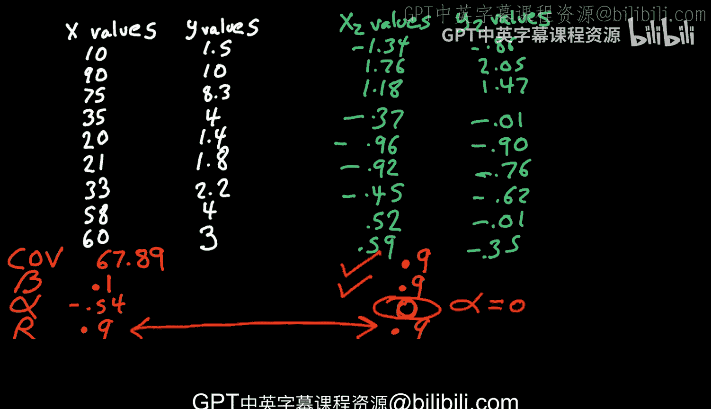