# 商业分析：5.1：线性回归的坐标标准化 📊

在本节课中，我们将要学习一个重要的数据处理技巧：坐标标准化。我们将探讨当原始数据被转换为Z分数（即标准化值）后，线性回归中的几个核心统计量（如协方差、斜率和相关系数）会发生怎样的变化。

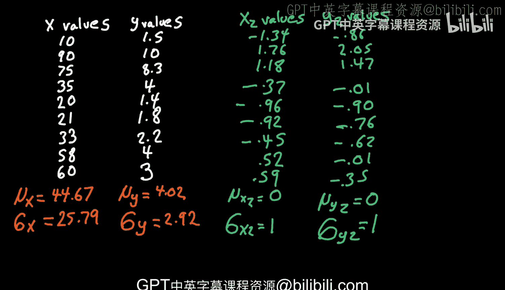

## 数据标准化概述

上一节我们介绍了数据标准化的概念。本节中，我们来看看对两组数据（X值和Y值）同时进行标准化后的效果。

我已经计算了第二组数值（我们称之为Y值）的Z分数。

你会发现，尽管X值的范围非常大（标准差为25，均值为44），而Y值的范围小得多，标准差也更小。但当它们被标准化后，X轴和Y轴的值将拥有相同的均值和标准差。这就是我们所说的“标准化”的含义。

## 标准化前后的关系对比

现在，我们将观察一些有序对之间的关系。我们的问题是：如果我们观察某些标准关系，如协方差、相关系数、Y对X的最佳拟合线斜率（β）和Y截距（α），它们对于原始值和标准化值来说是相同的还是不同的？如果不同，它们将如何不同以及为什么？

以下是我们要对比的几个核心统计量。

### 协方差对比

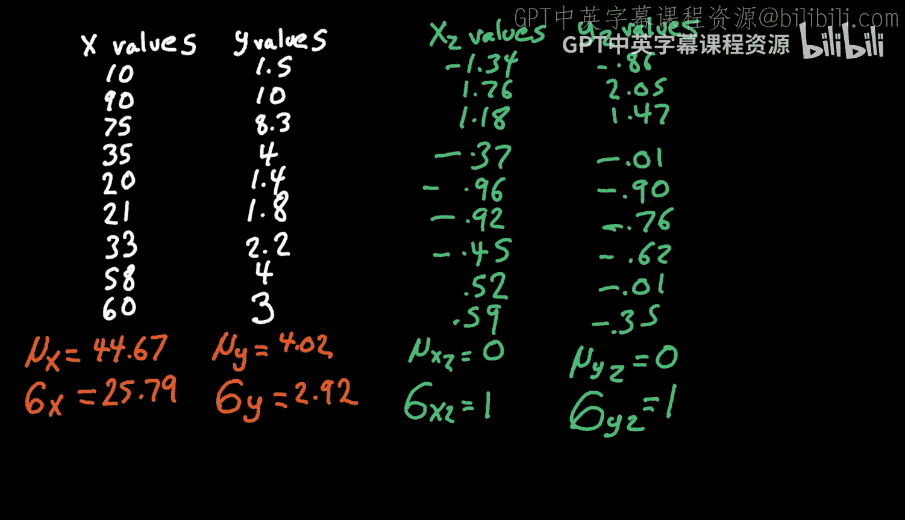

首先，我们来看X和Y的协方差。协方差的计算公式是：取每个单独的X_i减去所有X的均值，再取与之配对的有序对中的Y_i减去所有Y的均值，将这两个差值相乘。对n个数据点重复此操作，将所有乘积相加，然后除以n。

对于我们的原始数据集，使用此公式计算出的协方差是 **67.89**。

而对于我们新的标准化数据集，协方差是 **0.9**。

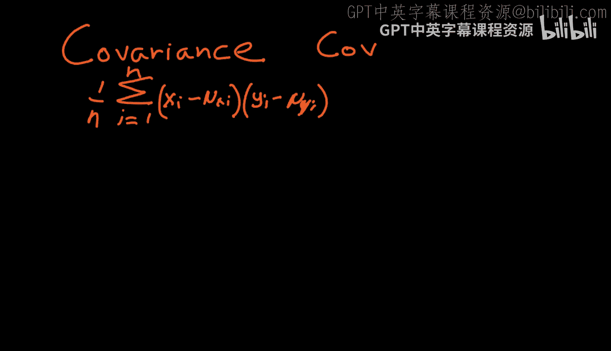

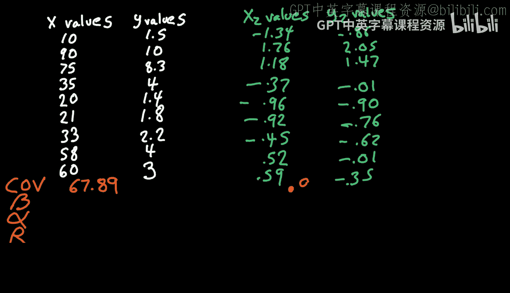

### 斜率（β）对比

接下来，我们看β（希腊字母beta）。它代表最佳拟合线的斜率。你可以想象我们的散点图，直线的斜率Δy/Δx等于β。我们的最佳拟合模型可以表示为：对于每个Y_i，我们估计 **Y_i = β * X_i + α**。这是我们希望误差平方和最小的公式。

对于原始值，β等于 **0.1**。

而对于标准化值，β等于 **0.9**。

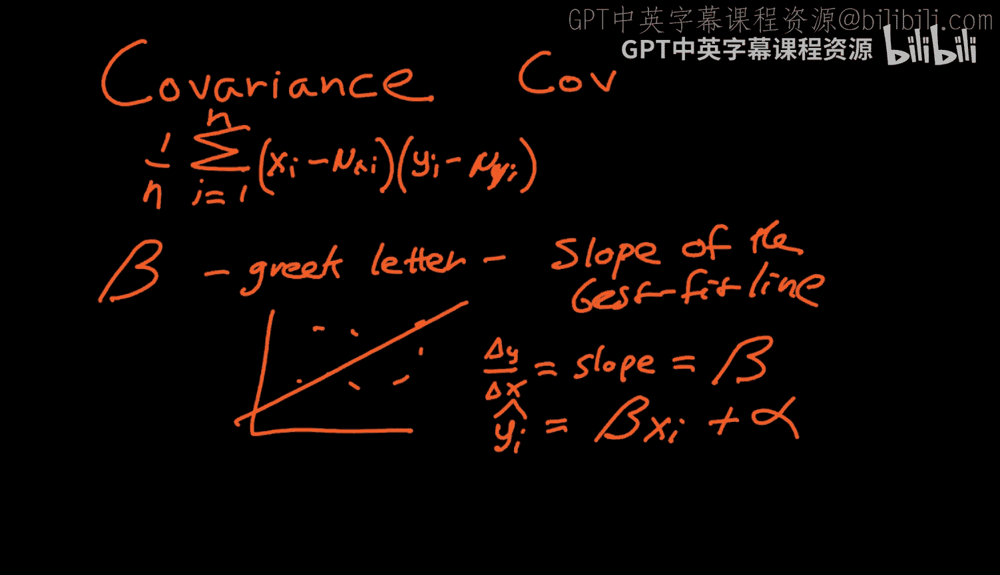

### 截距（α）对比

我们知道，对于标准化值，α必须始终等于 **0**。原因在于，均值点（X的均值，Y的均值）总是位于我们的最佳拟合线上。对于标准化值，这个点是(0, 0)，因此最佳拟合线必须经过原点(0,0)。但这在一般情况下并不成立。

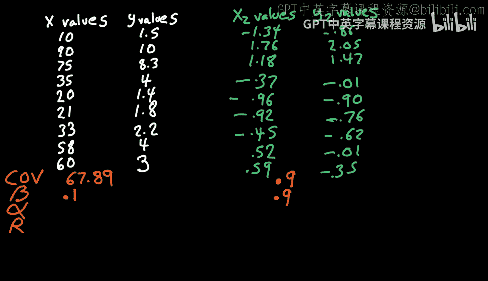

事实上，我们原始数据的α值是 **-0.54**。

而这里，我们标准化数据的α值是 **0**。

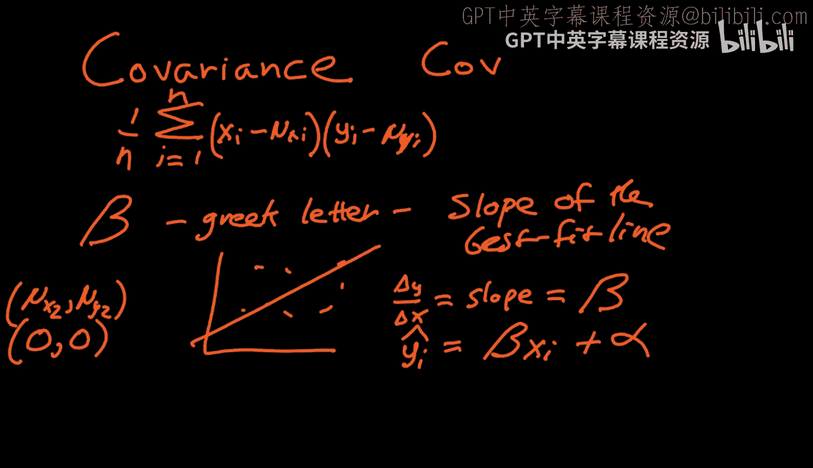

### 相关系数（R）对比

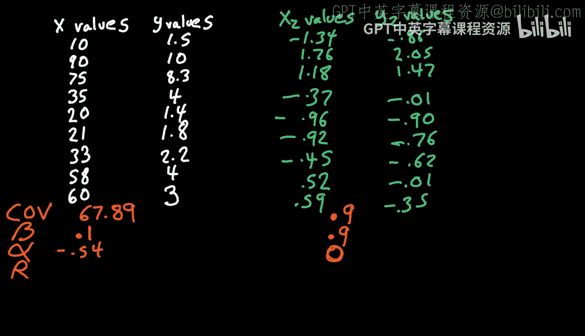

最后，我们来看相关系数。相关系数R等于X和Y的协方差，除以X的标准差乘以Y的标准差。

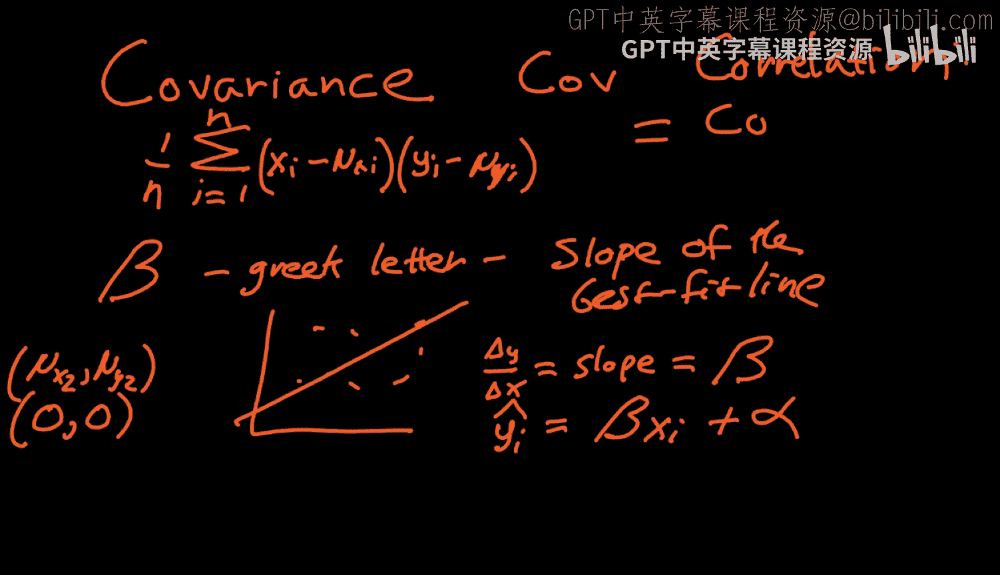

我们原始数据和标准化数据的R值都是 **0.9**。

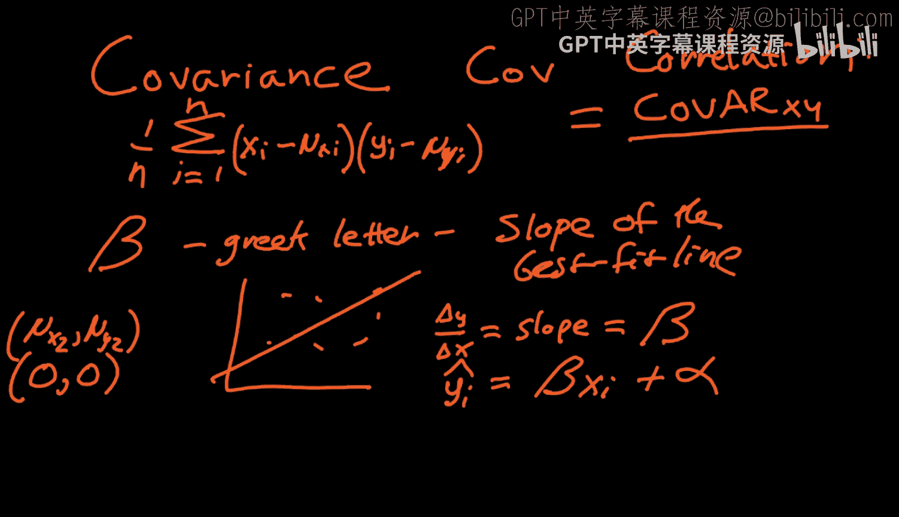

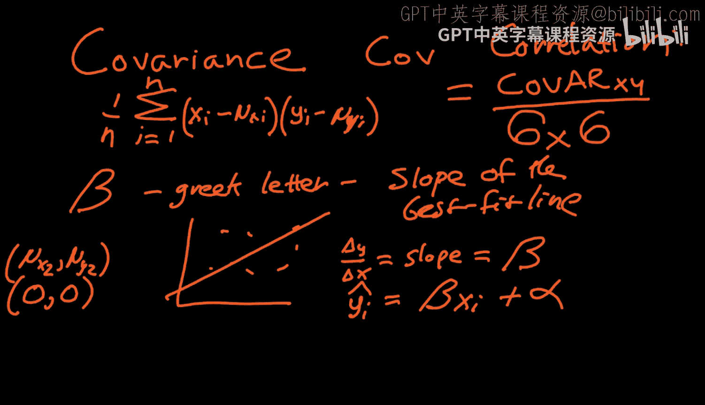

## 结论与总结

那么，我们能从这些对比中得出什么结论呢？

在数据转换为标准化值或Z分数的过程中，唯一保持不变的是**相关系数R**。相关系数在标准化前后是**不变的**。

对于任何标准化数据集：
*   **α（截距）恒等于0**，这很简单。
*   **β（斜率）和协方差都等于相关系数R**。

因此，标准化确实让事情变得非常简单明了。它消除了量纲的影响，使得不同数据集之间的比较和模型解释变得更加直接。

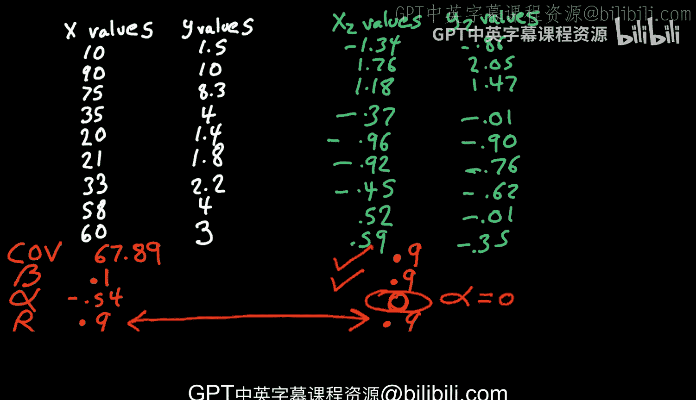

本节课中，我们一起学习了数据标准化对线性回归核心参数的影响。我们了解到，标准化后，截距变为0，而斜率和协方差都简化为相关系数，这大大简化了数据分析过程。