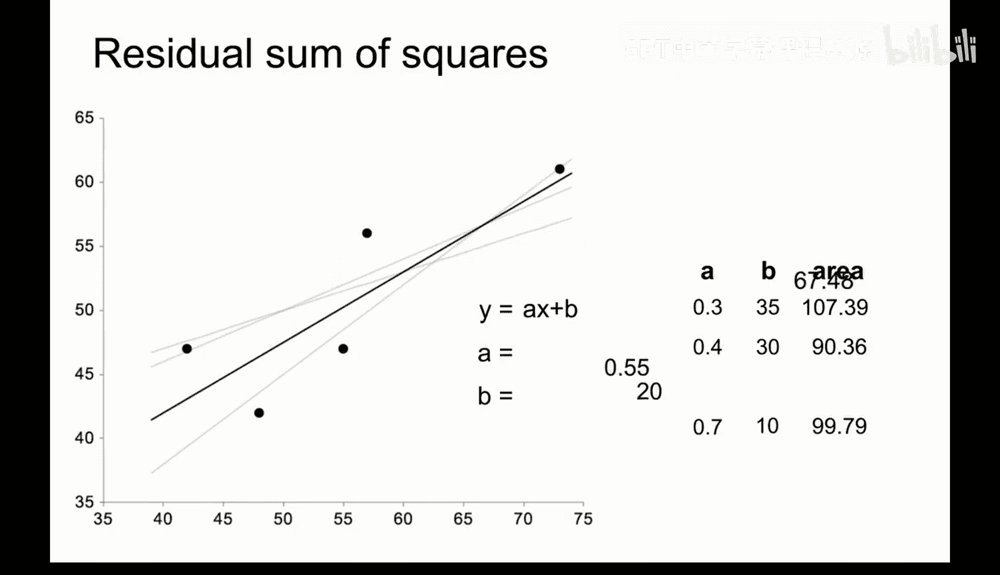
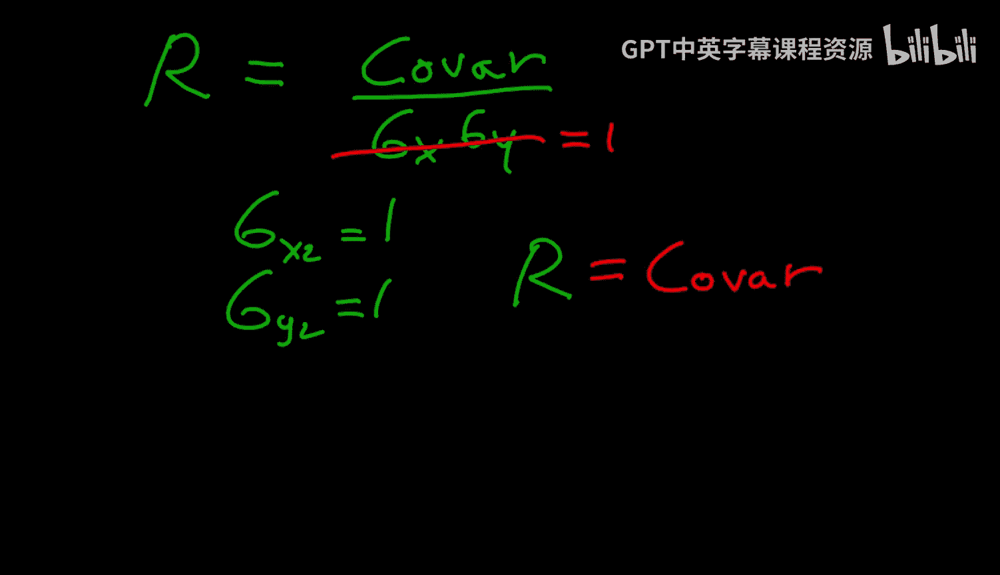

# 杜克大学《Excel 到 MySQL：商业分析（5课全）｜Excel to MySQL： Analytic Techniques for Business》中英 p67 32_05_02_标准化简化线性回归.zh_en -BV1mS421X7yw_p67-

。

What we are seeing is the trial and error process by which a certain unique line is defined that represents the linear relationship or association。

Between a specific set of ordered pairs， X and Y。The line is found that minimizes the sum of squares of errors。

The errors being the differences between。The true values of y and the so called line estimate of y。

The best fit line for a set of ordered pairs。Provides a model for the values of y。

The regression line provides the best linear model for y。That we can obtain from X。In the sense that。

The sum of all the residuals or errors in our estimate of y generated by the line。Is minimized。

So what we're trying to do is we're trying to minimize。The sum of squared errors。

And the errors are defined as the true value of y sub I。Minus our line estimate for y sub I。

 and we're going to use a little hat here。To represent our model estimate for the value of y。

So our goal is to find the line that minimizes this value。There。Why hat。Is equal to。Beta x of I。

Plus alpha。Where beta is the slope of the line。And alpha is the y intercept。Meaning the point。

Value for y when x equals0。So substituting in， we can say that what we're trying to minimize。Is。

This value。Now we are also interested in something slightly different。

 We're interested in the standard deviation。Of residuals。Residuals being those individual errors。

So we know that the standard deviation of residuals is going to be。

The square root of one over n times the summation。Of each individual residual。Minus。

The mean for all residuals。Squared。It turns out very fortunately for us。

That it can be shown that when the parameters is beta。

And alpha are chosen correctly so as to minimize the root mean square error。The mean residual。

Is always equal to 0。What that means for us is that。The root mean square error。Is the same thing as。

The standard deviation of the errors， which we will write。As so。And in parametric models。

 we will assume that the errors have a Gaussian or normal distribution as well。

We are going to establish the interesting result that when you convert X and Y。

 the ordered pairs into standardized values or z scores。

The slope of the best fit line beta is equal to R and which is equal to the covariance。

Let's recall our definition of covariance。In its relationship to correlation。

Eals r times the standard deviation of x。Times the standard deviation of y。So of course。

 correlation is equal to the covariance。Of x and y divided by standard deviation of x times the standard deviation of y。

And let's remember what the covariance is。 That seems to be the key different term。It's。

The mean value。4。Each individual， X of I。Minus the mean of the x's。Times each individual， wise sub I。

Minus the mean。Of all the wide values in the set。So if we think about it for a moment。

 we know that for our Z scores。X of z。Mux x is going to equal 0。And。4 R these scores for y。

Mux sub Y is going to equal0。So for our standardized data only。For our standardized data only。

We could write this formula as the summian。Of。X sub I， Y sub I。So it's possible to。Calculate。

The best fit lines slope。data。Using simple calculus where we take the first derivative。

Of our residual formula。Which is the summation of。Why sub I minus。Data x sub I。Squared。

 we've dropped alpha because we're using standardized data here。Okay。

And we set the first derivative equal to0， and then we solve for beta。

And the result gives us the following formula。Beta equals。Smation of x sub I， Y sub I divided by。

X sub I squared， which again in this case， because the mean of x is equal to 0。

Is equal to the variance of x。Which in this case， because the mean of x is equal to 0。

Is equal to the variance of x。And as we know。The standard deviation of our Z score。Lust equal1。

 therefore， the variance equals 1。 Therefore， this whole term equals 1。And as we mentioned before。

 this term equals the covariance。So we've established that beta is equal to the covariance。

And our formula for correlation。But again， for our Z scores。So we've established。That。

That term is equal to one。And therefore， R is equal to covariance as well。

