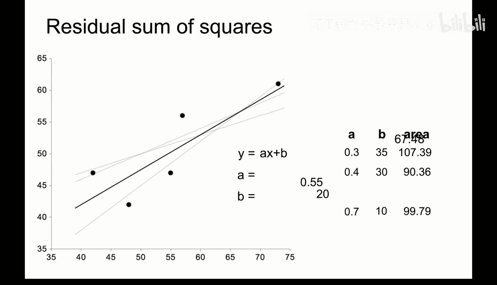
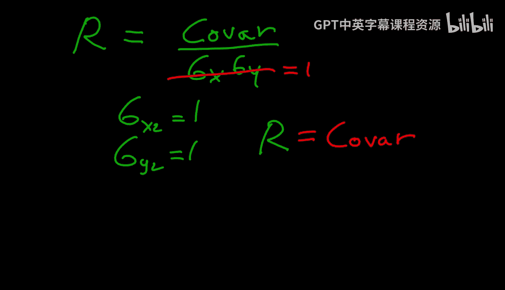

# 商业分析：5.2：标准化简化线性回归 📊

在本节课中，我们将学习如何通过标准化数据来简化线性回归模型。我们将看到，当将数据转换为Z分数后，回归线的斜率会与相关系数相等，这使得模型的理解和计算变得更加直观。

---

我们看到的是一种通过试错来定义特定唯一线的过程，这条线代表了一组特定有序对（X和Y）之间的线性关系或关联。

这条线被找到，它使得误差的平方和最小化。这里的误差指的是y的真实值与所谓的y的线性估计值之间的差异。

---

## 最佳拟合线与回归模型

对于一组有序对，最佳拟合线为y的值提供了一个模型。

回归线为我们提供了从X中可以获得的最佳y线性模型。其意义在于，由该线生成的y估计值中所有残差或误差的总和被最小化了。

因此，我们的目标是**最小化误差平方和**。

误差被定义为第i个y的真实值（y_i）减去我们对第i个y的线性估计值（ŷ_i）。我们使用一个小帽子（^）来表示y的模型估计值。

所以，我们的目标是找到最小化以下值的直线：
`ŷ_i = β * x_i + α`
其中，β是直线的斜率，α是y轴截距，即当x等于0时的y值。

代入后，我们可以说我们试图最小化的值是：
`Σ (y_i - ŷ_i)²`

---

## 残差的标准差

我们同时也对一个略有不同的概念感兴趣：**残差的标准差**。残差即那些个体误差。

我们知道残差的标准差将是：
`√[ (1/n) * Σ (e_i - μ_e)² ]`
其中，e_i 是每个残差，μ_e 是所有残差的均值。

非常幸运的是，可以证明，当参数β和α被正确选择以最小化均方根误差时，**残差的均值总是等于0**。

这对我们意味着，**均方根误差** 与 **误差的标准差** 是同一回事，我们将其写作 `σ_e`。在参数模型中，我们通常假设误差也服从高斯分布或正态分布。

---

## 标准化的魔力

我们将建立一个有趣的结果：当你将有序对X和Y转换为标准化值或Z分数时，最佳拟合线的斜率β就等于相关系数r。

让我们回顾一下协方差的定义及其与相关系数的关系：
`Cov(X, Y) = r * σ_x * σ_y`
当然，相关系数等于：
`r = Cov(X, Y) / (σ_x * σ_y)`

让我们记住协方差是什么，这似乎是关键的不同项。它是：
`Cov(X, Y) = (1/n) * Σ [ (x_i - μ_x) * (y_i - μ_y) ]`

如果我们思考一下，我们知道对于我们的Z分数：
*   x的Z分数均值 μ_{x_z} 将等于0。
*   y的Z分数均值 μ_{y_z} 将等于0。

因此，**仅对于我们的标准化数据**，我们可以将协方差公式写为：
`Cov(X_z, Y_z) = (1/n) * Σ (x_{z_i} * y_{z_i})`

---

## 推导标准化后的斜率公式

我们可以使用简单的微积分来计算最佳拟合线的斜率β。我们对残差公式求一阶导数（这里我们省略了α，因为我们使用的是标准化数据）：
`Σ (y_{z_i} - β * x_{z_i})²`
然后令一阶导数等于0，并解出β。

结果得到以下公式：
`β = Σ (x_{z_i} * y_{z_i}) / Σ (x_{z_i}²)`

在这个情况下，因为x的Z分数均值等于0，分母 `Σ (x_{z_i}²)` 就等于x的方差。而我们知道，Z分数的标准差等于1，因此方差也等于1。所以整个分母项等于1。

正如我们之前提到的，分子项 `Σ (x_{z_i} * y_{z_i})` 等于协方差（对于标准化数据）。

因此，我们确立了：
`β = Cov(X_z, Y_z)`
并且根据相关系数公式，对于标准化数据，`r = Cov(X_z, Y_z) / (σ_{x_z} * σ_{y_z}) = Cov(X_z, Y_z) / (1 * 1) = Cov(X_z, Y_z)`。

所以，我们最终得到结论：**对于标准化数据（Z分数），最佳拟合回归线的斜率β等于相关系数r**。

---

## 总结

本节课中，我们一起学习了线性回归的核心目标——最小化误差平方和，并引入了残差标准差的概念。最重要的是，我们探讨了数据标准化的强大作用：当将X和Y转换为Z分数后，回归模型的y轴截距α变为0，而斜率β变得与相关系数r完全相等。这极大地简化了线性关系的理解和表达，揭示了相关系数在描述标准化变量间线性关系强度时的本质含义。