# 杜克大学《Excel 到 MySQL：商业分析（5课全）｜Excel to MySQL： Analytic Techniques for Business》中英 p68 33_05_03_线性回归误差建模.zh_en -BV1mS421X7yw_p68-

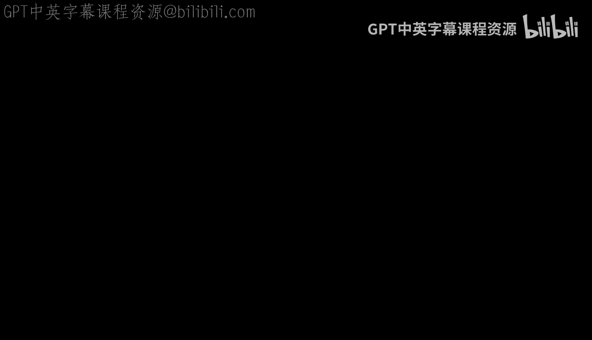

We have assumed。That we can work with standardized data。

Now we're going to make an additional assumption， which is a parametric assumption。We assume that。

X and y。Are Gaussian in shape。In other words， individual values are drawn from。

Probability distribution function。 That is。Normal in distribution。So， then， we can write。

That there's a Gaussian distribution for the values of x。With me in 0。And standard deviation，1。

And similarly。There's a Gaussian distribution for our y variables with mean 0 and standard deviation 1。

 So here is a question we would like to know。What。Is。The standard deviation of our errors。

We know that it too is a Gaussian。We know that the mean of errors is zero。But， we don't know。

What the value is。4。The variance of the error itself。

And what we'd like to do is we'd like to relate the variance of this error。

Directly to the correlation and directly to the slope of the best fit line。

And that is exactly what we are going to do next。So how are we going to do that well？

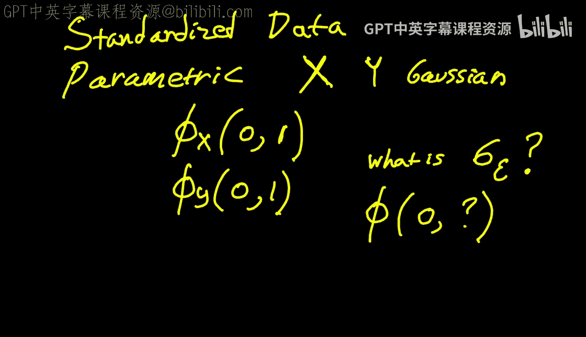

We know that our y values。Are made up of。The sum of our x values with our model。

And now our model consists of beta， the linear association because alpha is equal to 0。Plus。

An error term。The root means square error。Or。We can write it like so。

So our error term looks like this。 We know that the mean of the errors。Is 0。

 the mean of residuals is 0 for the best fit line， and the variance is as so。

We know that the variance of something multiplied by beta is going to be multiplied by beta squared。

 so our variance。Here is， again， mean 0 and variance beta squared。Sigma x squared。

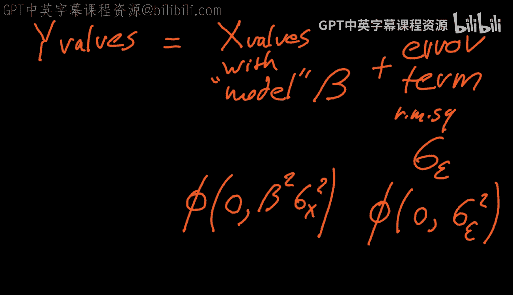

And we know that our value for y。Is。

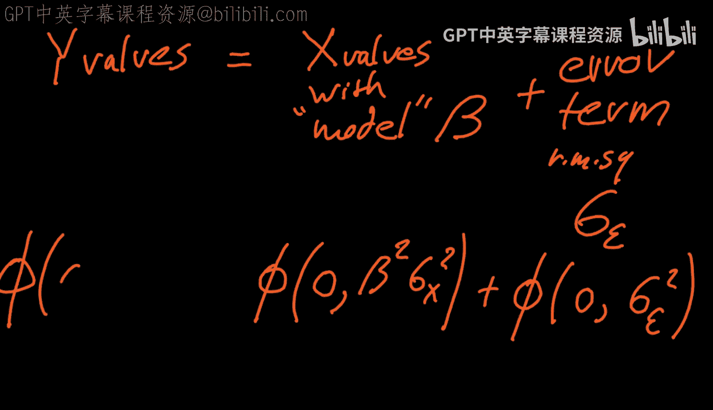

Equal to one。So， we know that。This is equal to one for our standardized problem and。

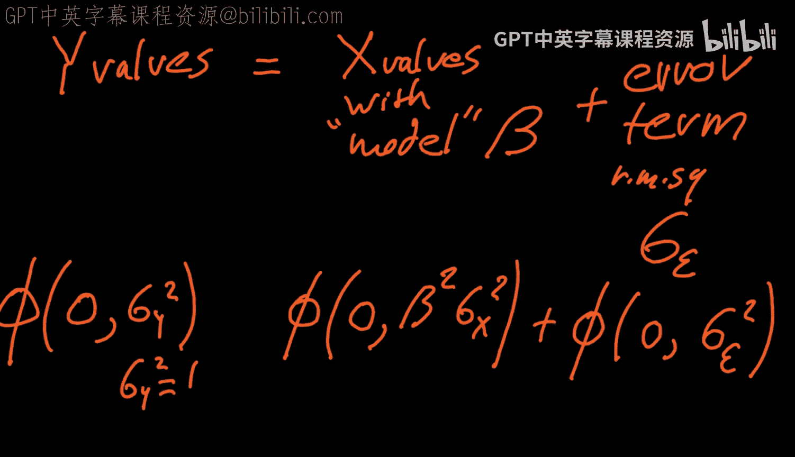

This is equal to one for our standardized problem。What that tells us is the following。

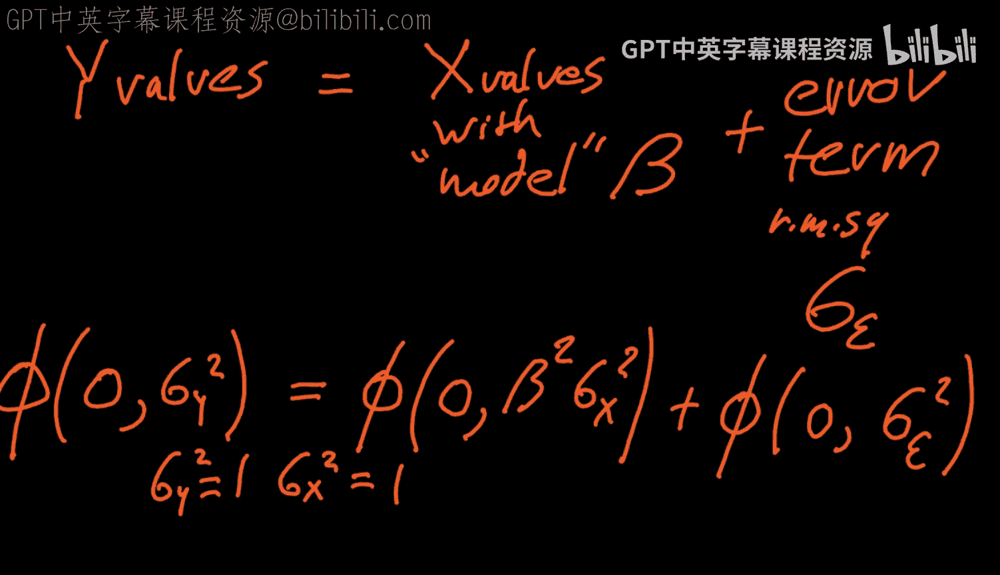

By our basic Gaussian addition rules。

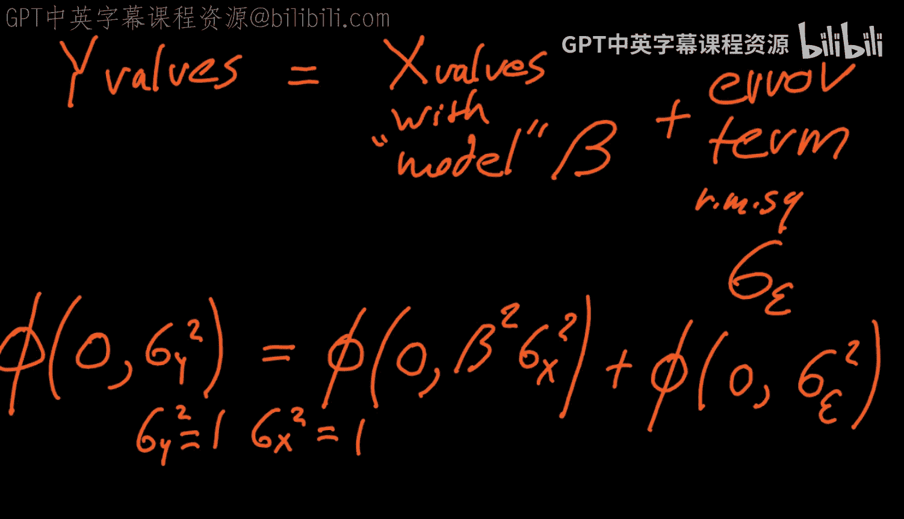

1。That's。The standard deviation of。Why。And the variances of y。Equals sigma squared。Plus。

The variance of the error。But we know that for our standardized data。

Beta is equal to the correlation。So we know that one equals。R squared。Plus。The error squared。

So this tells us the relationship between correlation。

Or more precisely the coefficient of determination。Coeicient of determination。Is a fancy name。

For our correlation value。Squared。So， we know that。R squared。Equals1 minus。Our error squared。

And we know that our error squared。

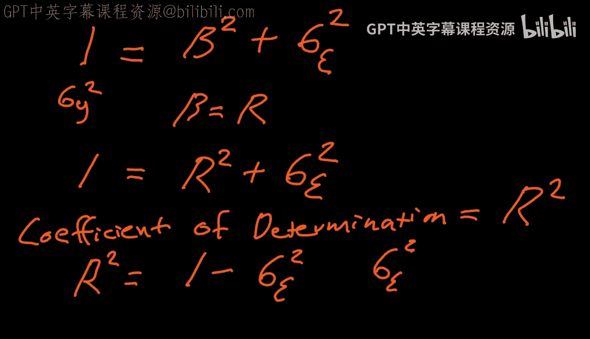

Equals1 minus。R squared。What this means is that there is a direct relationship。

Between the standard deviation of our errors。And the correlation。

And the reason why this is important and valuable。Is that when we use our linear regression model。

To make a forecast。So we are forecasting。Wai。As theta x of I。

There's always going to be some error built into our forecast。

And we would like to know what that error is so that we can give not only a point。Forecast。

 but actually a forecast that's in the form of probability distribution。Where the mean is。

Our estimate for y sub I。And。We have error around that point。

And the standard deviation is equal to the standard deviation of our residuals。

And this allows us to be very precise， for example， to say。We have。A best。Maximum likelihood point。

But what we're really saying is perhaps we have 95% confidence。That the value will be between。

These different Z values。

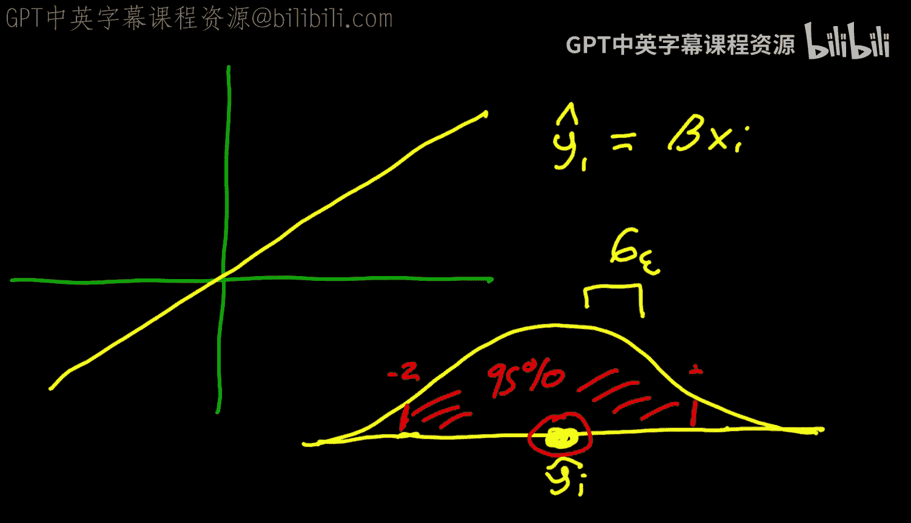

Let's suppose we had。A relationship where there is no association whatsoever。

Correlation is equal to 0。In that case， the line。There really is no line。 The line is。Flat。

The standard deviation of y。Is equal to one， and the standard deviation of our error is equal to one。

可。At the other extreme。Would be our perfect model。Where R equals one。And in this case。

 there would be no error at all。And this would mean that every single value。Actually， was on。

This slide。So you can think about our confidence intervals。Shrinking。To 0。From one to zero。

As are changes。So if you think about a picture like this。If we plot。Are here。And。We plot。The error。

Here。The relationship is。R equals the square root of1 minus。Singlish squared。

So that is going to look something like。

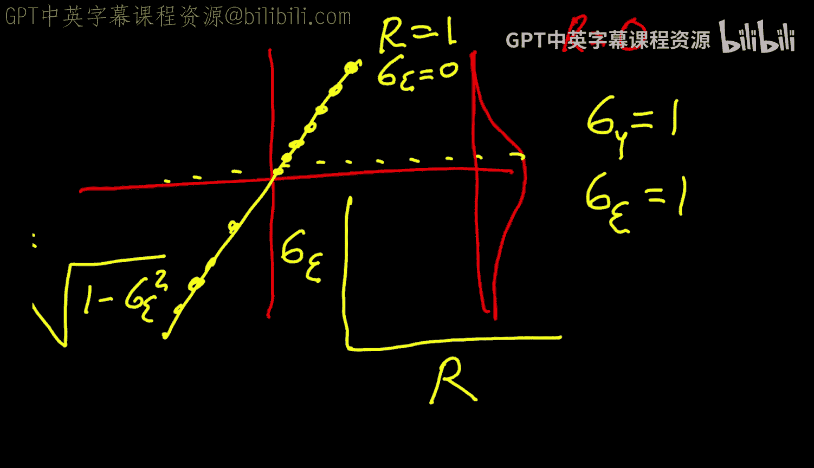

This。Be sure and note that。The error itself。Is not a Z score。Right。

 we know that it's always going to be less than or equal to one。It's going to be equal to。

Beta squared in our standardized model。So we've got an error。Around our ideal point。And if。

 let's say， we want a。90%。Confidence interval。 So we have 5% above and 5% below。

Then we're going to be a Z scores， 1。64 and minus1。64。So if we have an error of let's say， 051。

Which was what we would have if we had a correlation of R equals。7。

Then if we have a standard deviation of error。That is equal to。5，1。We would take our。Estimate。

 our best estimate for y。beta x of I。And we would add。1。64。Times 0。51。And that would put us out here。

And we would subtract。So we have negative 1。64。Times 。51。

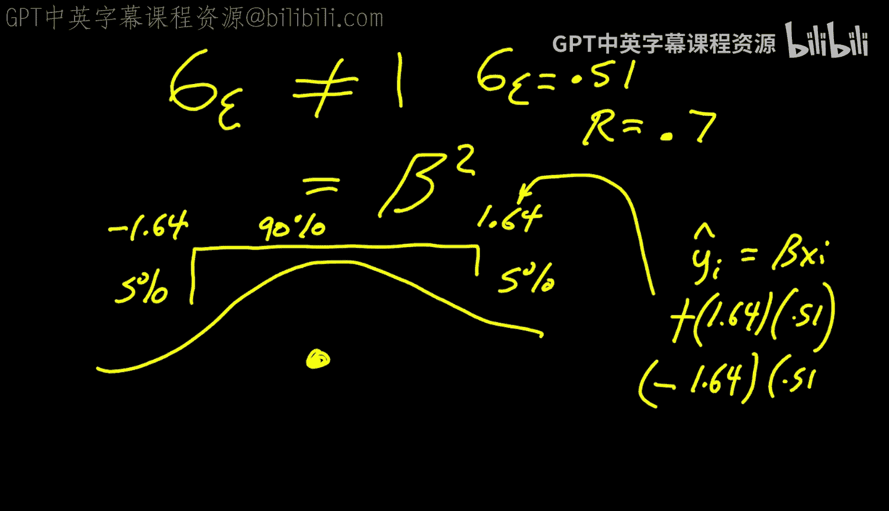

And that would put us。here。And that would give us。Our。9ine0% confidence interval。

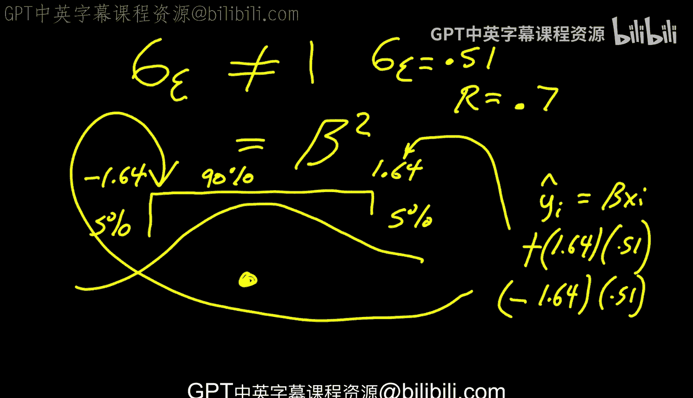