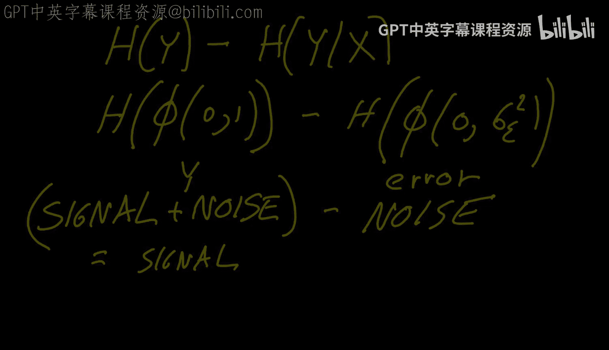
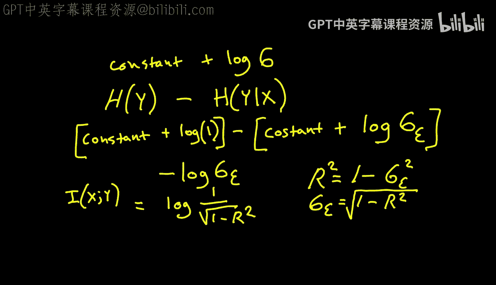
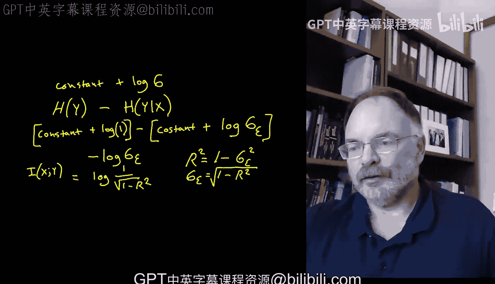

# 杜克大学《Excel 到 MySQL：商业分析（5课全）｜Excel to MySQL： Analytic Techniques for Business》中英 p69 34_05_04_线性回归的信息增益.zh_en -BV1mS421X7yw_p69-

I'd like to briefly touch on one additional topic which will not be tested for this course。

But which I think is very interesting and worth mentioning。 We are familiar with our entropy formula。

For discrete probability distributions。But there is also an entropy measure。

Called differential entropy。For continuous probability distributions like the Gaussian。

And this would be。So superficially， it looks very similar。It behaves in a slightly different manner。

So be aware that it can take negative values。And some of our algebra works a little bit differently。

Mutual information。Ha two distributions become identical？Approaches infinity。

So just be aware if you ever work with differential entropy。

 it has some slightly different properties， but what I wanted to point out is that there is a direct relationship between our correlation measure and mutual information and it works as follows。

The basic formula for mutual information is。H of y minus。H of y。Given X。

So we have the entropy of our original Gaussian distribution。And so。This is why。Minus the entropy。

Of our new Gaussian distribution， of our error。Okay。Error。Because the error。

Is the noise that's left behind。Why is the signal plus the noise。

And the signal plus the noise minus the noise equals the signal。

So I promised that I would explain how mutual information and linear regression are connected。

And we are almost there。It turns out that the differential entropy of a Gaussian。

Is equal to a constant。Plus。The log。Of its standard deviation。So。For our。Forula H of y。Minus H of y。

Give an X。We have。A constant。Plus， log。Of one。See how handy our standardization is。

 see how much incredible work it saves us。Mus。A constant。Plus。Log。Of our error。Which， of course。

 is simply equal to。Constant minus constant0 minus log error error， minus log。Of our error term。

And we know the relationship between the correlation R and the error is as follows。

Or put another way。The relationship between the error and R。Is。Square root of。1 minus r squared。

So we can simply substitute。That into to our equation here。And we can say that。

The mutual information。Is equal to。The log of one over the square root of1 minus r squared。

And this is the connection between linear regression and mutual information。

In a parametric model where we have Gaussian distributions。And that concludes。

Our material along linear regression。