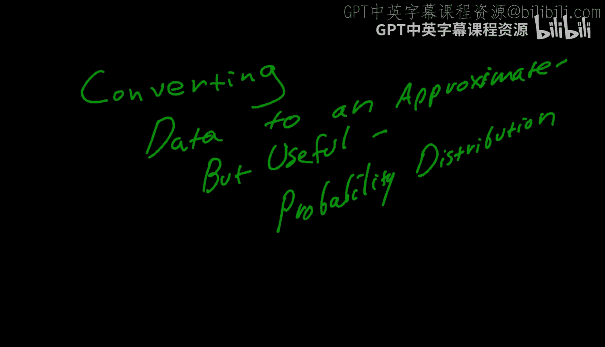
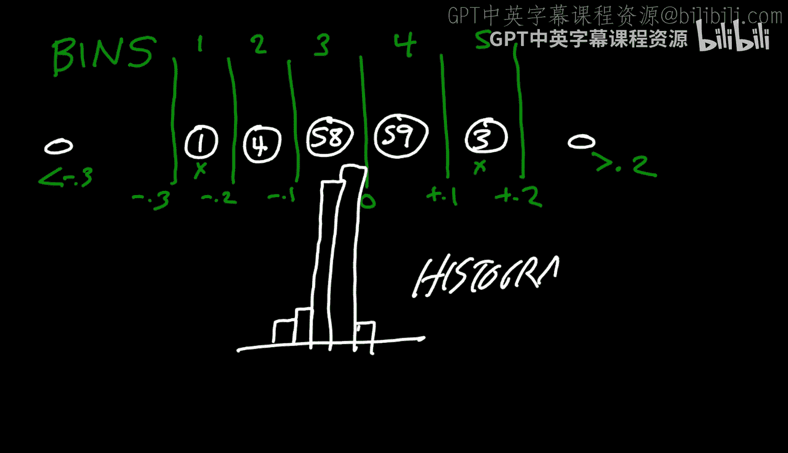
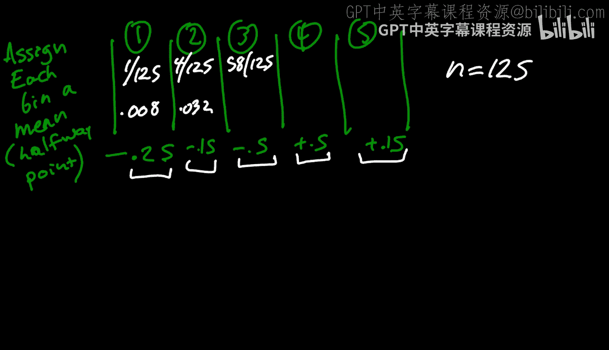
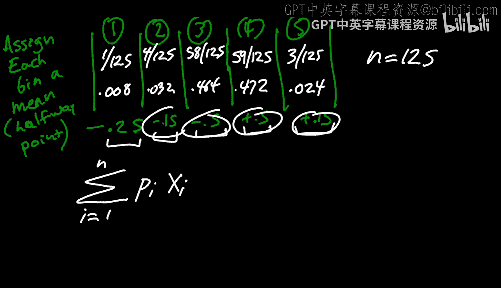
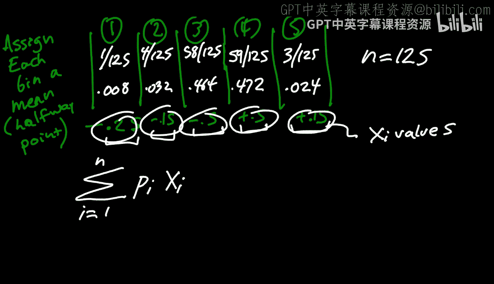
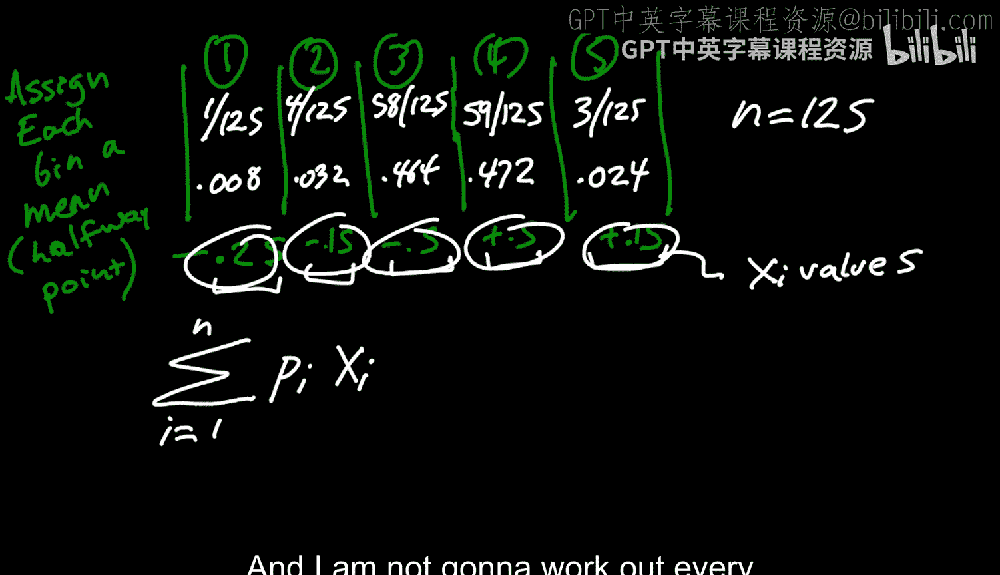
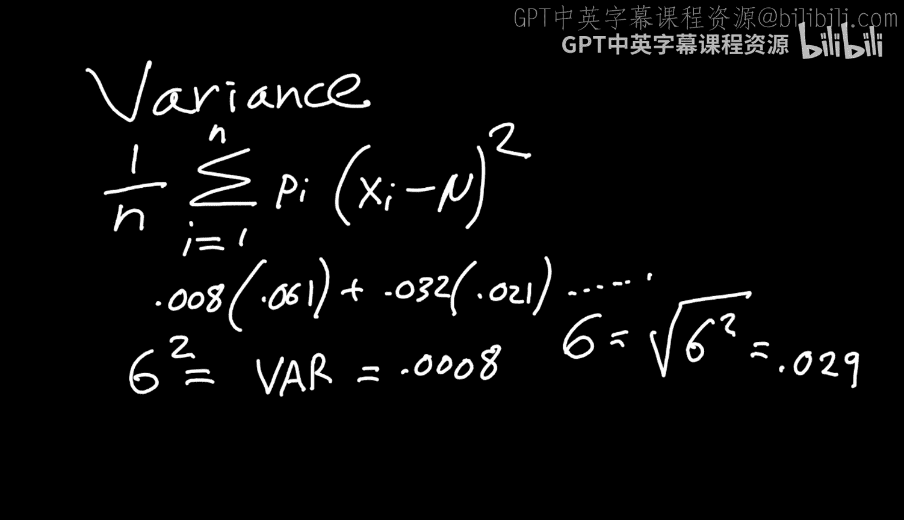
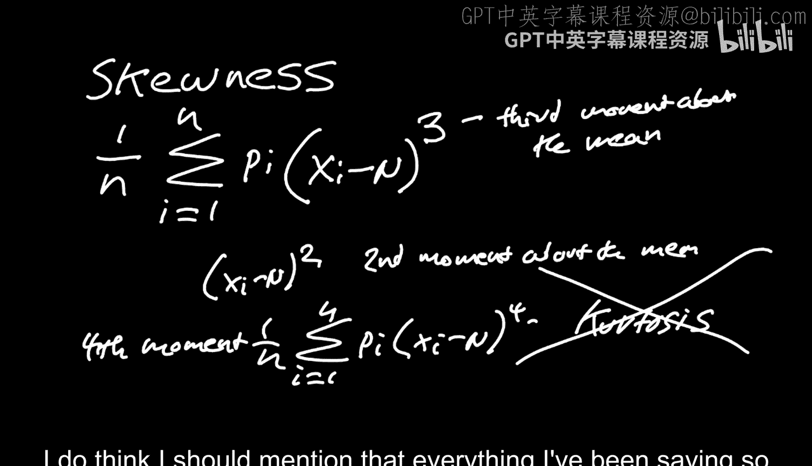
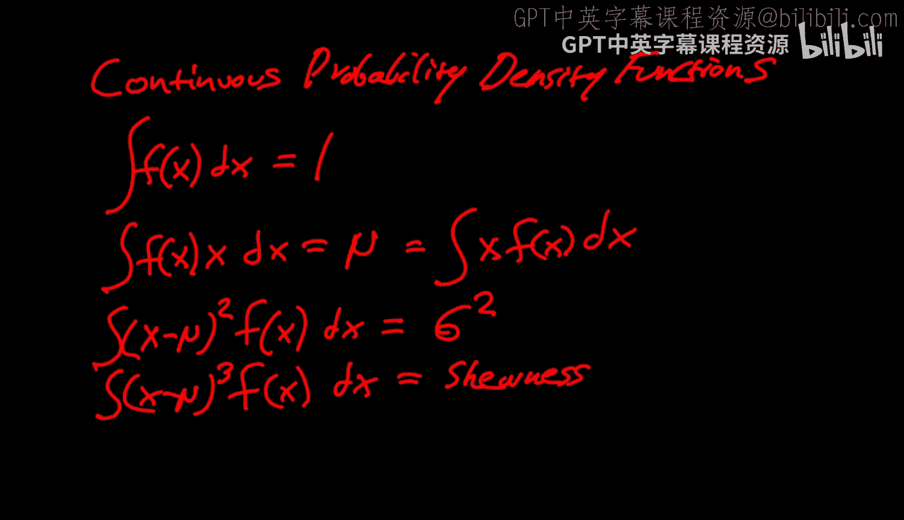
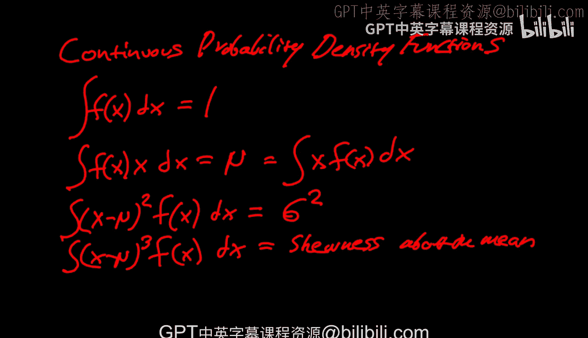

# 杜克大学《Excel 到 MySQL：商业分析（5课全）｜Excel to MySQL： Analytic Techniques for Business》中英 p70 35_06_01_直方图与概率分布函数描述.zh_en -BV1mS421X7yw_p70-

You've probably noticed by now that I like to describe everything I can in terms of a probability distribution。

And we're about to explore taking sets of data。That that can be mapped out in something called a histogram。

 which is a chart。Of ranges of their values。 And then that histogram can be converted into something that I like to call a probability histogram。

 It's a。Appimate is an approximate probability distribution。

And we'll talk about how to describe probability distributions。 So after you've created one。

 what are the descriptive terms you might use to communicate what it's like to other people。Well。

 you might talk about its maximum and minimum， how spread out it is。

 its variance or standard deviation。Is it nice and symmetrical or is it skewed one way or another？

And how much uncertainty does it represent， What is its entropy。

 And we'll talk about all of those things for some standard probability distributions。

 So I'd like to start with。Converting a set of data。

To an approximate but useful probability distribution。

We've got a set of bins。And we're pulling values。 And you can follow this。

Exercise in the appropriate。Excel spreadsheet。Where I've taken data from our random draw of 100 from a uniform distribution from minus1 to1。

And I'm interested in placing each individual term into a bin。 So if I have a term that's minus 027。

 I'm going to place it in here。If I have a term that's point。1，4，4。

 I'll place it here and so on and so on。 And I'm gradually accumulating more and more information。

And let's say that after I've gathered 125 points， it looks something like this。Let's say， I've got。

one value here， four values here。58 values here，59 values here， and three values here。

And there are no values。Above my upper bin or below my bottom bin。So。

I can represent this by a picture。 My picture would look something like this。That's one。 That's 4。

 That's 58。That's 59。 That's 3。That is a histogram。

Okay， so we've created our first histogram。Now。I'm going to assign a midpoint。To each bin。

When I convert it over to a probability distribution， and now I'm going to take my original number。

 and I'm going to divide by my total。 So as I mentioned， we have 125 draws。

So I'm going to have one divided by 125 is about 0。008。4 divided by 1，25 is about。032。

58 divided by 1，25 is about。

봉 있지。4，6，4。59 over 125 is about 0。472。And3 over 125 is about 。024。Now。To calculate the mean。

I'm actually calculating the expectation of the probability distribution。

 So I'm taking the sum from I equals one to n of each probability。Times each value x of I。And here。

 these。

The means of each bin， these are our x of i values。Next。

 we want to look at the variance of a distribution and I am not going to work out every single arithmetic here because it's all in the Excel spreadsheet for you。

 But I want you to understand what variance is。

The variance is the variance of a probability distribution is 1 over n times the summation from I equals 1 to n。

A peace of eye。Times。X of I minus the mean of all the x's。

 The thing that we just calculated a minute ago。Square。So I'll just do the first couple terms。

 It would be 0008。Times 0061 plus 。032 times。021 and so on and。We you'll find that。For our example。

 we have a variance of 0。0008。And， of course， the standard deviation。

Is simply the square root of the variance。Thech in this case， is equal to 0029。

So you can follow along the details in the Excel spreadsheet。

 we're going to look at one more descriptive statistics that follows the same pattern。

And that's called the skewness。Skewness is a measure of how asymmetrical something is or how it tends to be heavy to the left or the right。

And it's equal to one over n。Times the summation。Of piece of eye。Times each x sub I minus。The mean。

Cubed。So you'll notice we have a pattern。When we have x squared， we have x of I minus mu squared。

 This is called the second moment。About the mean。And this is the third moment about the mean。

And that's as high as you need to go for this course。 But if you're curious。

 the fourth moment is calculated the exact same way。And it is known as the kptosis。Okay。

 but I repeat， you do not need to know that for this glass。

I do think I should mention that everything I've been saying so far is for discrete distributions。

 so for continuous distributions。

We call them probability， density functions。그。Their area always equals one。

Okay you'll also see this written the other way。X F of x。DX is obviously the same。系。Then we have。

X minus mu。Squared。Times F of x。The x not equals the。Vance。And x minus mu。Or the mean cubed。

Times f of x dx。And that equals the skewness。About the mean。

Or the third central moment。

