# 杜克大学《Excel 到 MySQL：商业分析（5课全）｜Excel to MySQL： Analytic Techniques for Business》中英 p71 36_06_02_重要常见概率密度函数.zh_en -BV1mS421X7yw_p71-

Something that you'll notice when you work with data a lot is that many。

 many phenomenon closely approximate certain distributions and many and in many cases。

Certain distributions should be chosen if we don't know what the true distribution is。

 They are the most appropriate representation of our ignorance。

 and theres actually a good logical and mathematical reason for that。

 They are the distributions that have maximum entropy or maximum uncertainty subject only to the constraints that we know about。

And so those would be the ones to choose for representing your data until or unless you know more。

So let's look first at a uniform continuous distribution。This， of course。

 is what we were using for the minus1 to one example for our central limit theorem。Okay， in general。

 we represent this as。Over range A to B。So it looks like that。In order to get the first。

The integral f of x equal to1。We know that this distance here is b minus a。

So we know that this height must be equal to 1 over b minus a。So， this function is always。

1 over b minus a at every value。Okay。It's support set。

Or the place where it's defined as greater than 0。Sometimes simply abbreviated as it。Support。

Is the real number line A to B。It's variance。Is equal to。B minus a squared。Over 12。

 And as we saw for the example of  minus-11， the variance was equal to。

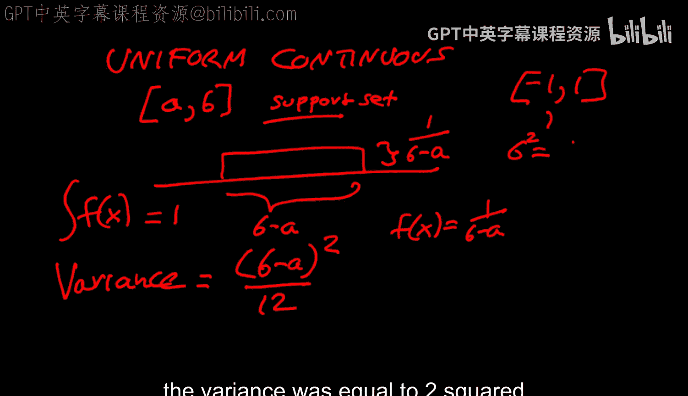

Two squared over 12， where it was equal to one third。

The standard deviation was equal to the square root of one third。Okay。The skewness。

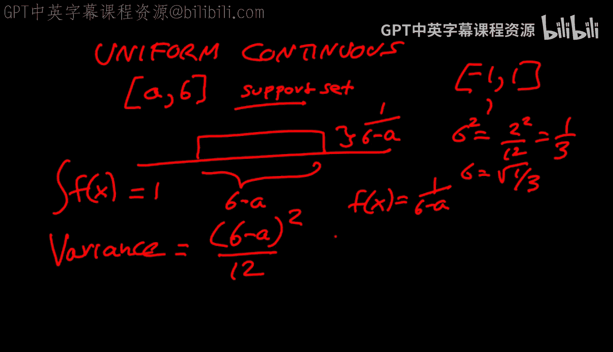

About the mean。Is equal to 0。 It's completely symmetrical about its mean。

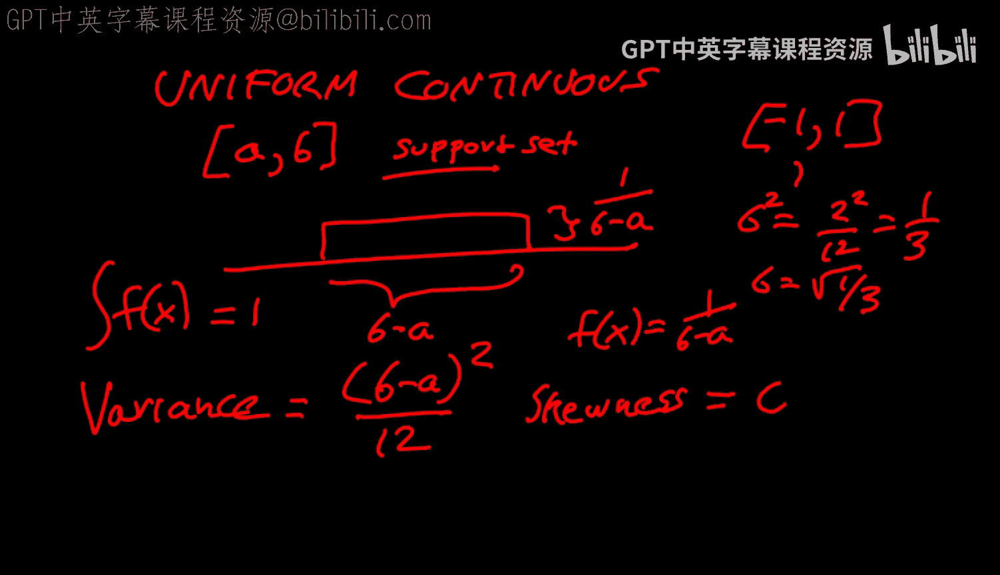

Okay。The mean itself。Is simply a plus B over 2。And its entropy or its uncertainty is represented as log。

 we're using base 2， log of base 2。

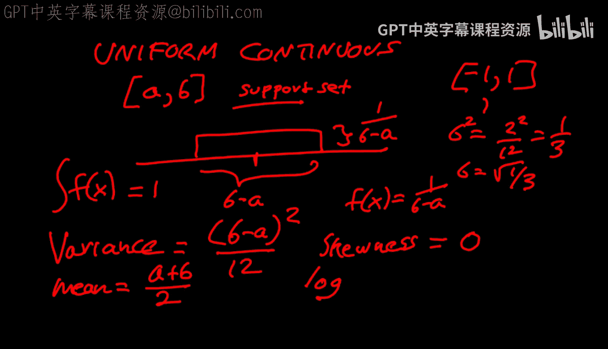

Of B minus a。

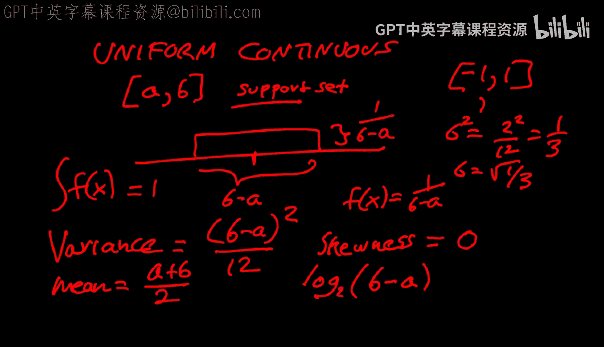

And if all we know。Is that something is distributed between two finite known points， A and B。

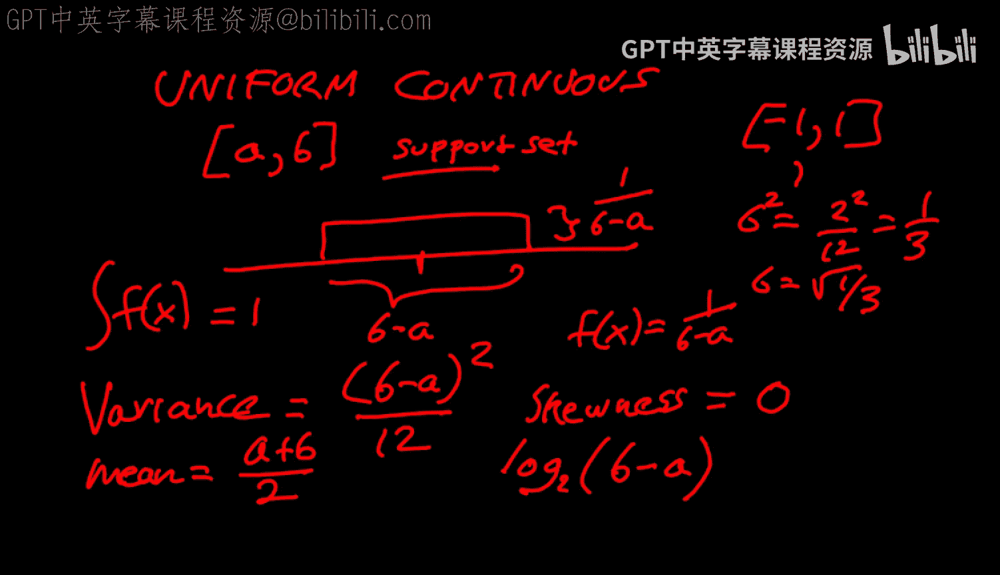

But that's it， then the appropriate distribution to choose would be the maximum entropy distribution。

And that is the uniform continuous distribution。 So it is max and。

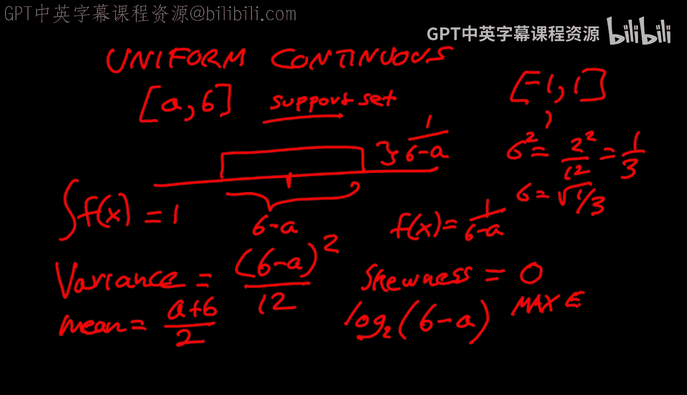

For a and B， finite。And no。

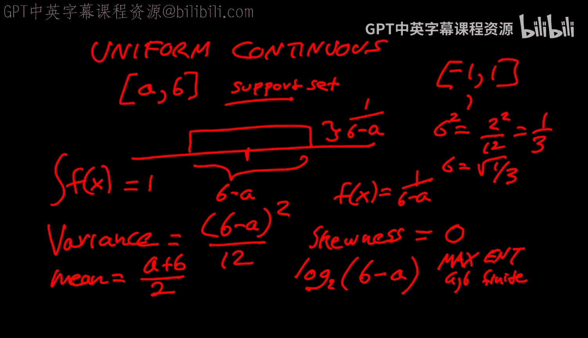

So an example of this would be， say， a fair die where we could get the values 1，2，3，4。Five or six。

 but we're certainly not going to get any values between。ok。So this is also typically representative。

This is also typically represented as having the support set。From  one to 6。

 But it's understood that this is discrete。It has a mean also of a plus B over  two。However。

 its variance is a little different。The variance。For the discrete distribution is B minus a plus  one。

Squared， -1。Over 12。The standard deviation is simply the square root of the variance。

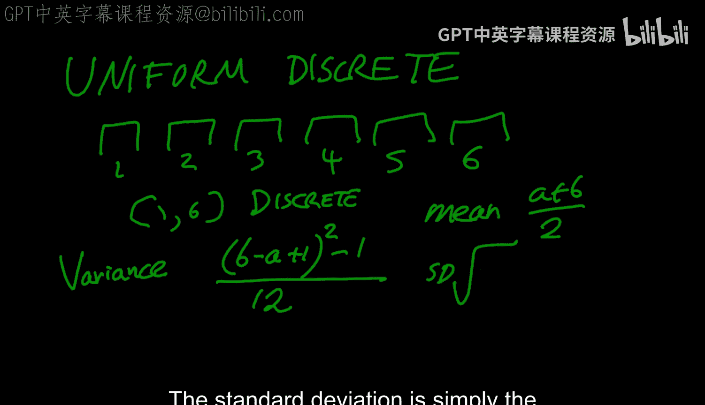

Course。The skeness。Is， of course， equal to 0。 This thing is completely symmetrical about its mean in 3。

5。And it's entropy。Is equal to log n。

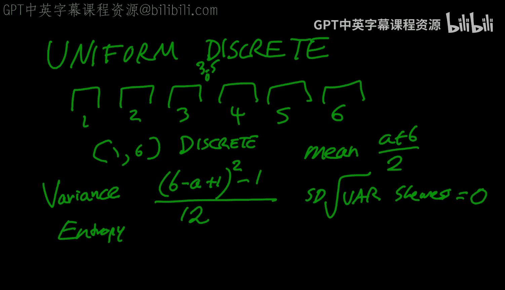

And if we have a situation where something can take any value between a known minimum and maximum。

 but the values are discrete， that is they must。Be represented by a a whole number。Then。

This is our maximum entropy distribution， And this is the most appropriate distribution to choose if we are otherwise ignorant among or between the choice of outcomes。

Finally， it wouldn't be a very fun discussion without our old friend。

 the Gaussian continuous distribution。😊，So let's talk about the Gaussian continuous distribution。

Probability， density function。As you probably remember by now， this has a normalizing constant。

That is dependent upon the value of our variance。This is our function。It has a support set。

From minus infinity to infinity。 So it's support。

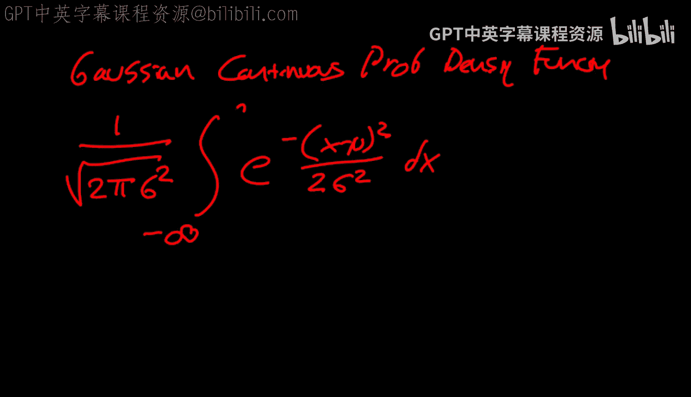

Is minus infinity to infinity。Its mean is， of course， equal to mu。Its variance is， of course。

 equal to its variance。The skewness。Is。0。And the entropy。Is equal to 2。05。Plus。Log。

Of the standard deviation。And it won't surprise you to find out that when we have a distribution that can take any value from minus infinity to infinity and all that is known is the variance or the standard deviations。

 So for a fixed。

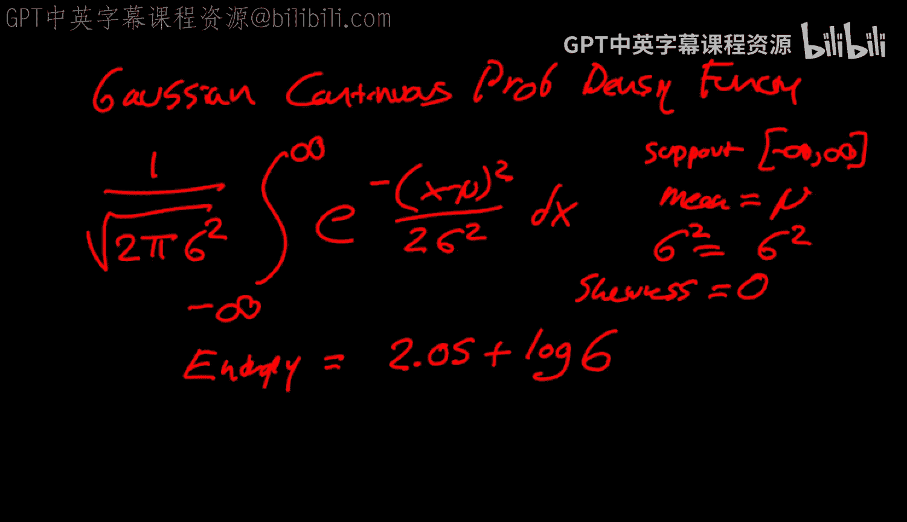

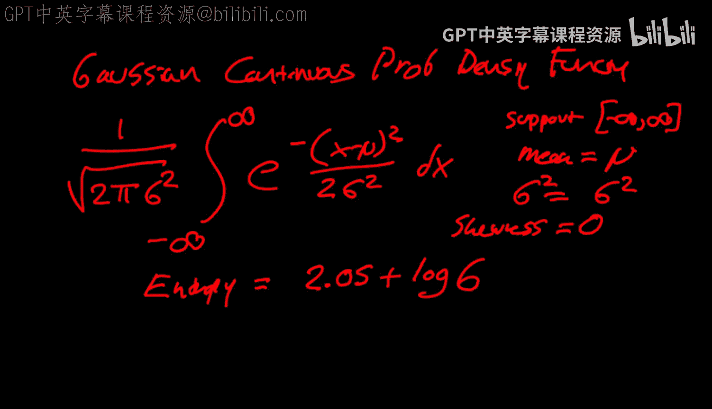

Variance。

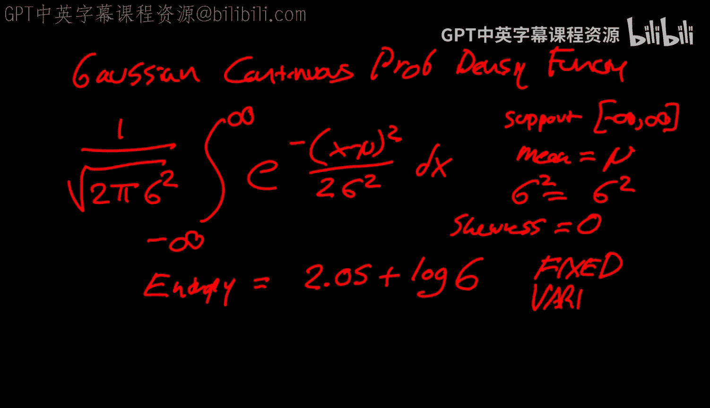

It can be proven or demonstrated that the Gaussian is the maxentt distribution。

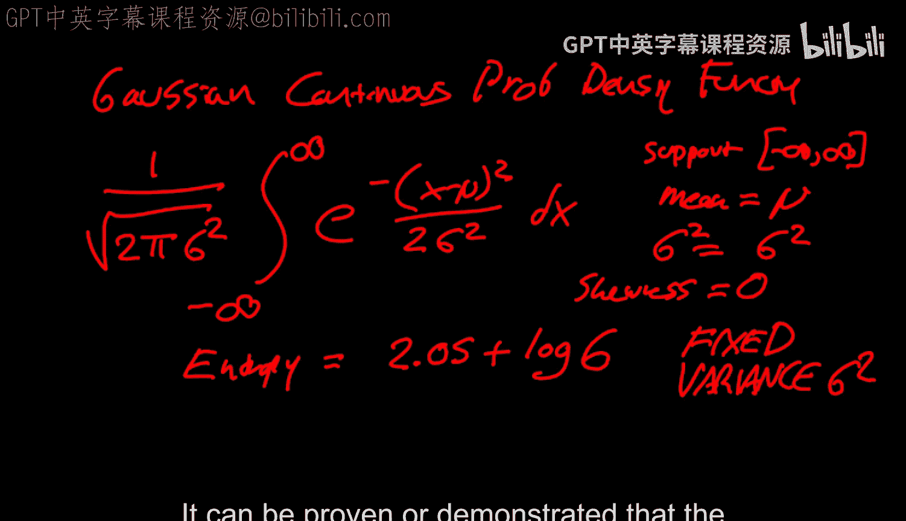

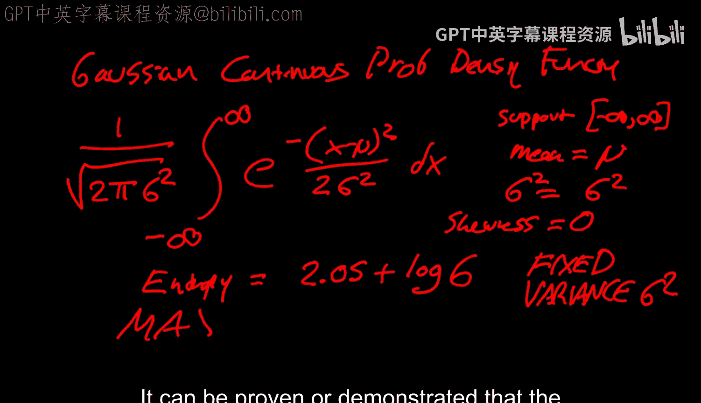

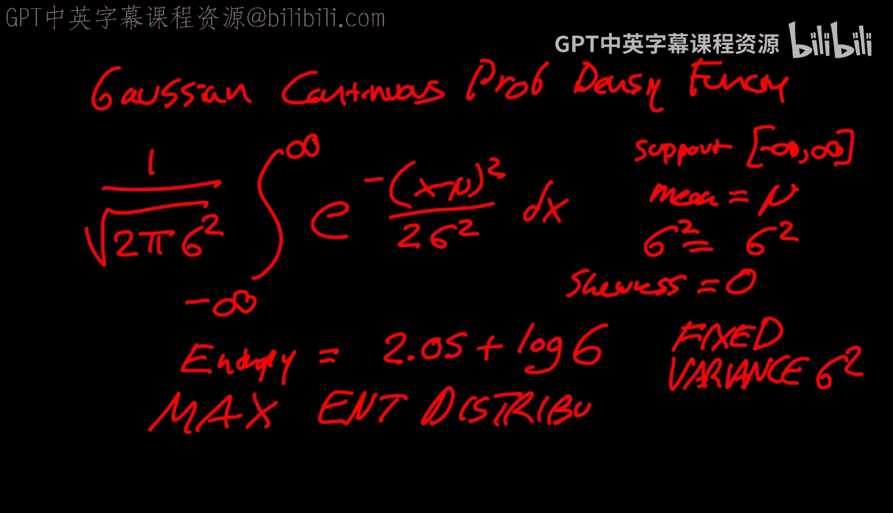

Meaning。That if we have complete ignorance of a phenomenon， except that we know its variance。

We ought to represent it using a Gaussian， and this is perhaps perhaps a deeper and more satisfying explanation or rationale for why we continually use Gaussians for noise with an unknown distribution。

Because actually， until we know more。If we know the variance of the noise。

 this is the most appropriate distribution we could use。

