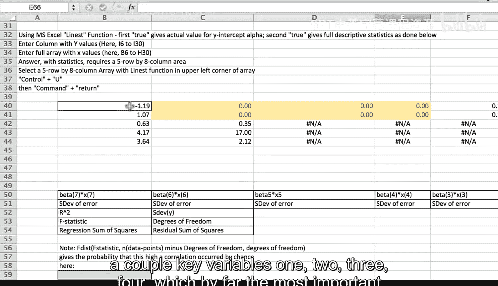
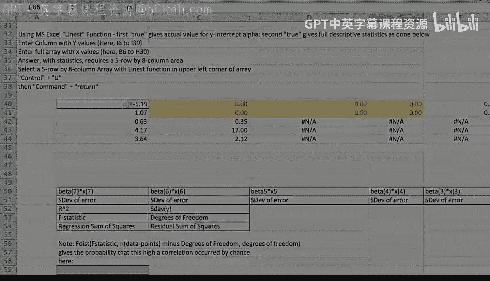

# 杜克大学《Excel 到 MySQL：商业分析（5课全）｜Excel to MySQL： Analytic Techniques for Business》中英 p72 37_06_04_多变量线性回归.zh_en -BV1mS421X7yw_p72-

What I've done here is select a sample of data from the credit scoring problem that will be the final project for this course。

Imagine that we are a company issuing credit cards。And over time。

 we've evaluated which of our customers ultimately paid off all the money they owed us。

 plus interest in which fell behind and ultimately failed to pay us the money and defaulted。

And we're interested in the future in selecting customers or agreeing to issue cards to customers who will not default。

We have a number of input variables that may be able to help us model the probability of default or not。

Including the potential customer age， how many years they've worked at their current job。

 how many years they've lived at their current address， their income level。

 how much money they owe on other credit cards and automobile debt and so on。

 So the way that this works is that we allow Excel to find the best fit line that assigns betas to each of these variables。

And if the variable adds no additional information。

This may be because it has a property known as co linearity。

Meaning that it could be just another way of saying the same information， so for example。

 if we had age in years and age in months。One of those two columns would be redundant。

 and it would have complete colineity。We also can have partial cuity。

 so in the circumstance we have here we have a debt to income ratio。

 and that's going to have high correlation with our debt inputs and our income inputs I would expect。

So let's try it now。The line asked function。Has a number of inputs。

We start with the column of data that represents our target variable。

Then we put in the full array that represents。All of our。

Input variables from their upper left hand corner to their lower right hand corner。

 So we put in the first。Of the first variables。 And then。The last or bottom of the far。

Rightite variables。Then we select true， meaning that we want the true value of alpha。

 and we select true again， meaning that we want to have additional descriptive statistics provided。

We need to select a region 1，2，3，4，5。Bye。5 by 8。Whi will represent which will give us these statistics and other inputs that we need。

We enter control U。Then we enter command return。诶。I've created a little chart below for what each of these things are。

You'll notice that it gives us our beta values。In reverse order。It would be useful to。

Forat the cells。So that if they're very， very close to0 and Excel is actually trying to give us a zero value。

That becomes clear， and you'll notice that this whole group of betas， along with their errors。

Are set at 0。 This means that these have high co linearity and they don't contribute anything to our model。

So what you'll see is。Most of our model consists of a couple key variables。1，2，3，4， of which。

 by far the most important， is the final one， which is our debt to income ratio， I believe。

That is how you do a multivariate linear regression。And when you do the actual problem。

 you won't be matching to zeros and ones。 you'll have a more realistic situation where the Y variables are can be any number。

 and they represent the ultimate profit or losses associated with this particular customer。

 but I didn't want to do that here because I want to leave something for you to do on your own。

