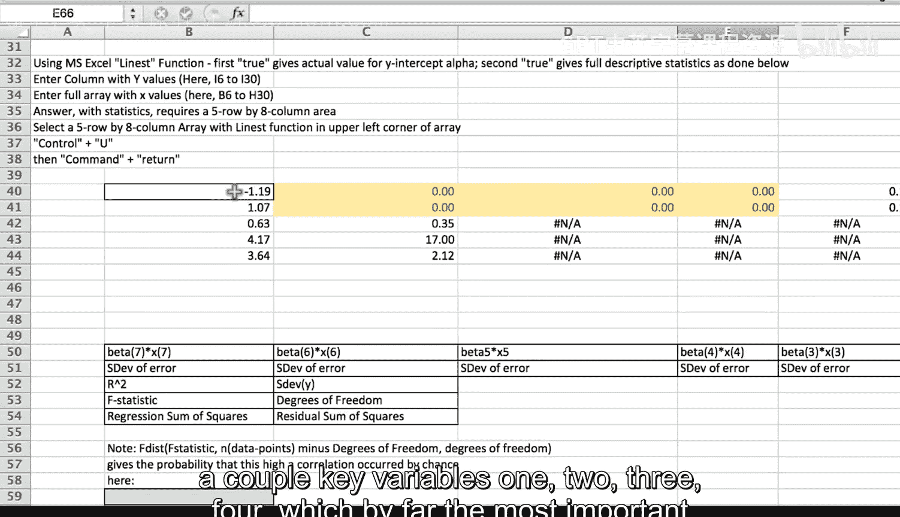
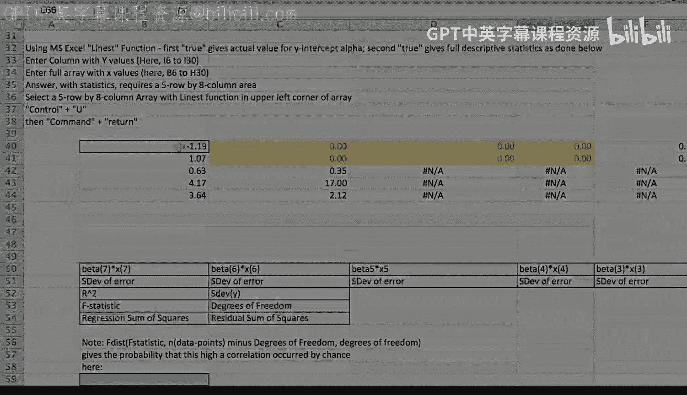

# 商业分析：P72：多变量线性回归 📊


在本节课程中，我们将学习如何使用Excel的`LINEST`函数进行多变量线性回归分析。我们将以一个信用卡评分的实际业务问题为例，构建一个预测模型，以识别哪些客户更可能违约。

## 概述

想象我们是一家信用卡发卡公司。随着时间的推移，我们积累了客户数据，记录了哪些客户最终全额偿还了欠款（包括利息），哪些客户拖欠并最终违约。我们的目标是建立一个模型，利用客户的多个特征（如年龄、收入、债务等）来预测其未来违约的概率，从而在未来更明智地批准信用卡申请。

## 数据与变量说明

以下是我们在模型中可能使用的一些输入变量示例：
*   **年龄**：潜在客户的年龄。
*   **当前工作年限**：客户在当前职位的工作年数。
*   **当前居住年限**：客户在当前地址的居住年数。
*   **收入水平**：客户的收入。
*   **其他债务**：客户在其他信用卡和汽车贷款上的欠款等。

我们的目标变量（Y）是客户是否违约（例如，用1表示违约，0表示未违约）。

## 执行多变量线性回归

上一节我们介绍了回归分析的目标，本节中我们来看看如何在Excel中具体操作。核心是使用`LINEST`函数来找到最佳拟合线，该线能为每个输入变量分配一个系数（Beta值）。

`LINEST`函数的基本语法结构如下：
```
=LINEST(known_y‘s， [known_x‘s]， [const]， [stats])
```
*   `known_y‘s`：代表目标变量（Y）的数据列。
*   `known_x‘s`：代表所有输入变量（X）的数据区域。
*   `const`：逻辑值，指定是否强制截距为0。通常设为`TRUE`以计算常规截距（Alpha）。
*   `stats`：逻辑值，指定是否返回额外的回归统计信息。设为`TRUE`以获取详细信息。

现在让我们尝试一下。操作步骤如下：
1.  首先，选择一片足够大的空白单元格区域来输出结果。对于k个自变量，如果需要统计信息，通常需要选择一片 **5行 x (k+1)列** 的区域。
2.  输入公式：`=LINEST(目标变量数据列， 所有自变量数据区域， TRUE， TRUE)`。
3.  由于是数组公式，在输入后需要按 **Ctrl+Shift+Enter**（Windows）或 **Command+Return**（Mac）组合键确认。

## 解读回归结果

执行回归后，Excel会输出一个结果矩阵。理解这个矩阵的布局至关重要。

下图展示了`LINEST`函数输出结果的典型布局和含义：


关键点解读：
*   **Beta系数**：输出矩阵的第一行包含了每个自变量的系数（Beta），**顺序与输入的自变量顺序相反**。最右边的系数对应第一个自变量，最左边的系数对应最后一个自变量。倒数第二个值是截距（Alpha）。
*   **统计显著性**：如果某个变量的系数及其标准误差都显示为0（或极其接近0），这通常意味着该变量存在**共线性**问题。
*   **共线性解释**：共线性意味着该变量提供的预测信息与其他变量高度重复。例如，如果我们同时有“年龄（岁）”和“年龄（月）”，其中一列就是完全冗余的，会导致完全共线性。更常见的是部分共线性，例如“债务收入比”这个变量，很可能与“债务”和“收入”这两个变量高度相关。

## 模型简化与关键变量

在我们的示例分析中，格式化结果单元格后，可能会发现一整组Beta系数及其误差都为零。这表明这些变量因高度共线性而未对模型做出贡献，可以从模型中移除。

最终，有效的模型可能只由少数几个关键变量构成。例如，在我们假设的案例中，最重要的预测变量很可能是**债务收入比**。识别并关注这些关键变量，是构建简洁而强大预测模型的核心。





## 总结

本节课中我们一起学习了多变量线性回归的完整流程。我们了解了如何使用Excel的`LINEST`函数，通过选择目标变量和多个自变量区域来拟合模型。我们重点学习了如何解读输出结果，特别是理解Beta系数的反向顺序，以及如何识别因共线性而无用的变量。最终，我们明白了模型简化的意义，即找出真正驱动预测结果的关键变量。

这就是进行多变量线性回归的方法。在实际的课程项目中，你的目标变量可能不是0或1，而是一个连续数值（例如代表该客户带来的最终利润或损失），但核心的分析步骤和原理是相通的。这里使用简化示例是为了让大家能更清晰地掌握方法，并将更复杂的应用留给大家在实践中探索。