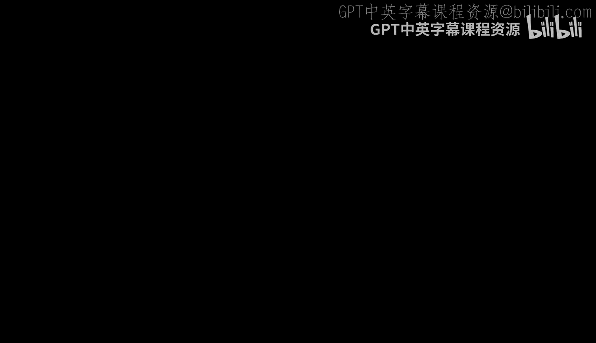
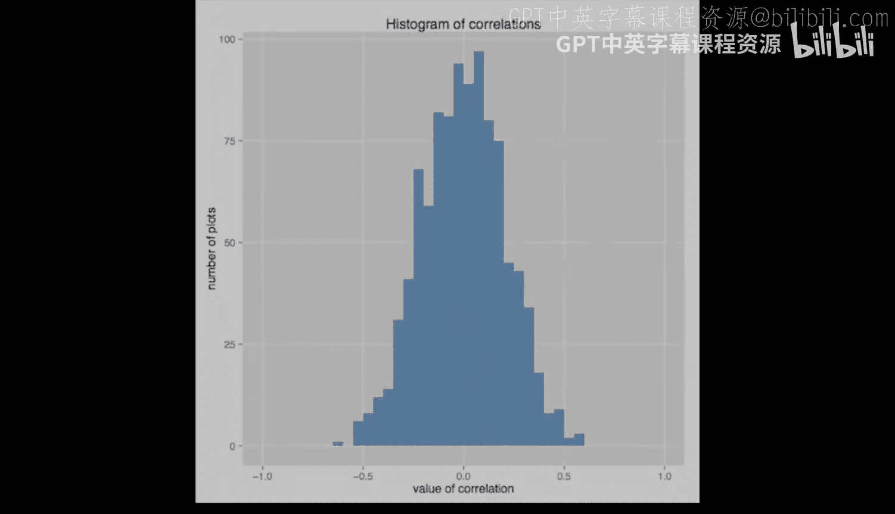
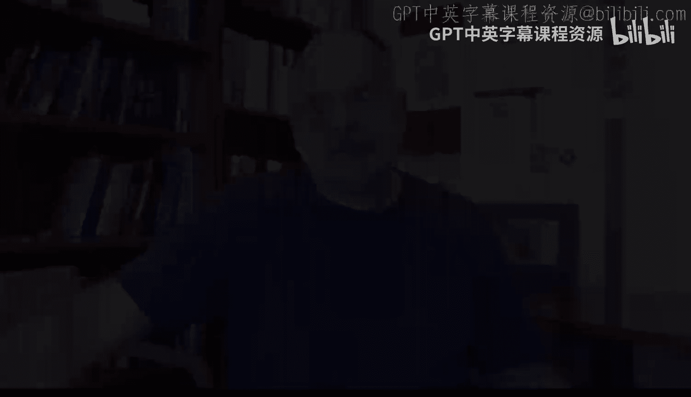

# 杜克大学《Excel 到 MySQL：商业分析（5课全）｜Excel to MySQL： Analytic Techniques for Business》中英 p73 38_06_05_过拟合现象成因解析.zh_en -BV1mS421X7yw_p73-

A major problem in data analytics。Is that it's become so easy with computers to fit。

Any set of data with a complex model。That when you then try to apply that model to new data。

Data that the model did not train on or was not designed with。The model simply does not work at all。

 where it performs extremely poorly。This phenomenon has its own name。It's called overfitting。

And at the end of the course when we have our final project。

 you'll practice some techniques to avoid overfitting。

 but I wanted to show you an example of data that is completely random。

And how common it is for random data to have patterns that appear to be associations and appear to be something that can be modeled。

So what we have here is。Ordered pairs， X， Y values。

 each of which are selected at random from a Gaussian distribution with mean 0。

And we select 25 ordered pairs。And then we calculate the best fit line。

And using the points and the line， we can of course， calculate the correlation R。

What you'll see is that these correlations range from。

Extreme values less than negative 05 all the way down to negative 0。

63 and then up to greater than positive 05。And none of these correlations are due to anything other than chance。

 the actual correlation of the two underlying random variables， X and Y is 0。

One way to understand overfitting is that it occurs when we are overconfident about our model's ability to extract signal from a mixture of signal and noise。

Our model includes some of the noise in our training set data as if it were part of the signal。

 so we think the signal is stronger than it really is。Then when we try to forecast new outcomes。

 using our model on new data。The new noise tells us nothing about the new outcomes。

 and our model performs much worse than we were expecting。

To better understand this view of overfitting。We will first consider an ideal situation of a simple linear regression model with no overfitting。

Assume an unchanging or stationary process that inputs real number values。

 we'll call them x subi and outputs real number values Y subi。We'll assume the process is parametric。

 meaning that the x values and the errors are both drawn from independent Gaussian distributions with。

Mean  zero and standard deviation1。That means that the standard deviation of our Y output。

 the combination of signal and noise is also equal to one。So this is a simplified model。

 but it gives us the basic idea， which is we have a particular x subi。We。

Multiply that x sub I by beta。So our Y all value。Is going to be。Beta times x sub I。

 say this is x sub I。Beta times x sub I。Then we add a constant called alpha， but again。

 in our simplified model with means zero， alpha will equal to zero。

 and then finally there's an element of uncertainty。In the values of our y。

That uncertainty takes the form of a Gaussian distribution with standard deviation。

Known as Sigma sub E， it's the standard deviation of the random error component。

So if you think of our model as generating estimates of y。Equal to。Beta times x。

And we're going to use Y subi。Hat。😡，To symbolize that this is an estimate of why。

The true value of y is different， it is a draw from a Gaussian distribution with mean equals0。

And variance。Of our random error。How much is our random error？

Using some arithmetic that occurs elsewhere in the course。

 we know that the standard deviation of our random error is equal to the square root of 1 minus r squared。

And we know， because of our standardization that。嗯。R is equal to the slope， beta。

And that is also equal to the standard deviation of our signal。 So we're combining a。Signal。

 which is。Beta x sub I signal。With noise。To get the true value of y sub I。

 So if you imagine that this line show oh'm sorry。You imagine that this line shows a point here。

And we have some kind of Gaussian distribution of error， the true value of y could lie。

Anywhere within this distribution， it's likely to lie near。The signal value。

 but the error gives us an additional component。The difference between。Y sub I？And why sub I hat？

Is known as the residual。That's the residual and if we take the standard deviation of our residuals。

 that is what we mean by the standard deviation of our error。In most of this course。

 we make the simplifying assumption that the best fit line on a set of observed ordered pairs accurately defines。

Fixed parameters， alpha， beta， and the standard deviation of error。Real life can be more challenging。

 even if we are lucky enough to model a process that really is actually stationary。

 we still don't know the true values for alpha， beta， and the standard deviation of random error。

What we derive from a sample of ordered pairs drawn from some underlying process are estimates。So。

 we have。An estimate for beta， we have an estimate for alpha， and we have an estimate。For the error。

The whole purpose of the animation that you've just watched is to convince you that without。

Further testing， the parameters of a linear model generated from a small to medium size set of order pairs cannot be relied upon to predict future unknown outcomes。

Now mathematical methods exist to calculate the probability distribution of errors for each of our estimates。

Beta hat， alphapha hat， Sigma E hat。Our true error for Y sub I is not Sigma E hat。

 but some combination of all three of these errors， however。

 these calculations are beyond the scope of the present course。

 text that explain these adjustments in detail are cited in the bibliography document。Instead。

 we raise the issue in order to demonstrate that overfitting is not only modeling noise as if it were signal。

 but the effect of overfitting is to increase the residual when using our model on new data so that not only are our errors。

Greater than we expect， they are actually greater than the true noise of the situation if we had a correct knowledge of beta。

In other words， overfitting makes our error even worse。Let me show you what I mean。

We assume a stationary process where the true correlation R equals 05。

And that means that our true standard deviation of random error。Would be。Square root of one minus。

R squared。Would be equal to square root of 1 minus 0。25 would be equal to 0866。However。

Let's imagine that we developed this model using some collection of。Ordered pes。

And our best fit line was beta hat。line with slope 。85， we would believe。That the correlation。

Equal 0 a5。 and therefore we would believe。That the true error equals the square root of 1 minus 。

85 squared。Which happens to come out to be。Point。5，2，7。So taking the ratio of these two numbers。

 you see that the true error is 64% larger。Thenhan what we expected from our overfit model。

Why do I say that because？866。Excuse me，5hi to by。527 equals 1。64。Okay。However。

 there is an additional error and let me show you what I mean。The additional error。

Let's say we have y sub I equals2。We're going to have the point。2， one，2。One。

 and we're going to have the point2。1。7。The additional error。Is equal to 0。7。In fact。

 the additional error。Is going to be dependent on the value of x sub I。

 and it is going to be equal to x sub I times the difference between what do we believe our slope is and what the true slope or true correlation is。

So how can we add in this additional overfitting error well since we know that。

The x values are also drawn from a Gaussian with mean zero and standard deviation 1。We can。

Add in the impact of this additional error term over all possible x's。

 meaning if we don't know the value of x， there's an expected value to this error。

This expected value to this error is going to look like this。Why， because。

That is equal to the difference between our estimate and the true value。

If we add this error to the previous error we had and take the square root of it。

 we're going to have the square root。Of point。8， six，6 squared。Plus，035 squared。

Is going to be equal to 093。So our new total error。Is。77%。Rather than 64%。Worse。

That's the penalty that we pay for overfitting。

In general， if you develop a model with a high correlation on a modest amount of data。

 it is much more likely that the true correlation is lower than your estimate rather than higher。

A much lower correlation on a second set of data is a sure sign of overfitting。

The closer a new correlation estimate on a new data set is to your previous correlation estimate。

 the more likely it is that both estimates are relatively near to the true value of the signal。

