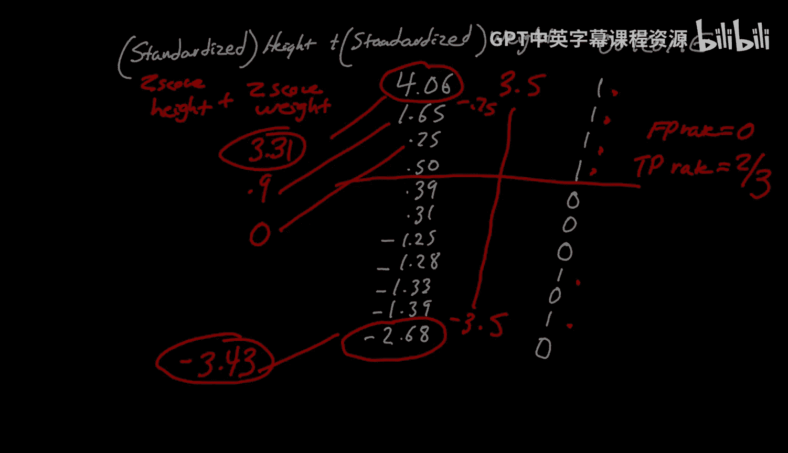

# 杜克大学《Excel 到 MySQL：商业分析（5课全）｜Excel to MySQL： Analytic Techniques for Business》中英 p74 39_07_02_最终项目说明（上）.zh_en -BV1mS421X7yw_p74-

The first half。Of our final course project。Requires you to engage in binary classification。

Using a number of different inputs and combine them so as to create the best model you can。

For forecasting default by applicants for credit cards。

We have a group of people who want credit cards from a bank。

And your model will use historical data on people who were granted credit cards and some defaulted and some did not。

You will use that historical data to try to forecast。

Who will default in future based on the same input variables for new people that you have on your training set and test set of about 400 people。

What you will do is optimize your model to maximize the area under the curve。

You will do this optimization。By combining。Different input variables。I have provided a spreadsheet。

Whereas long as the weighted combination of your input variables falls between 3。5 and negative 3。5。

You can simply paste your combined input variable into one column of the spreadsheet。

 and the spreadsheet will calculate the area of the curve immediately without needing to do separate calculations for individual thresholds。

So this is intended to save you a lot of time， but one thing you do need to be aware of is。

Going back to our example here where we did the standardized heights and standardized weights。

You'll see that the maximum value here is 4。05， the minimum value is negative 2。

38 in the spreadsheet that I provided you for convenience， the values need to range from 3。

5 to negative 3。5。So all that matters is the rank ordering。

 so there are several different ways that you could convert。This particular set of data over to fit。

ok。One way would be that you would subtract。point75 from every value。You're now below 3。

5 for the largest value。And youre above negative 3。5 for the smallest value。

An equally acceptable method would be to divide everything by the same。Constant。

So you could just divide everything by 1。5， for instance。I will leave the details to you。

 it really doesn't matter how you do that。This tool is just for your convenience。

 of course you can calculate the area end of the curve。

 the old fashioned way threshold by threshold if you like， but it is really really not necessary。

