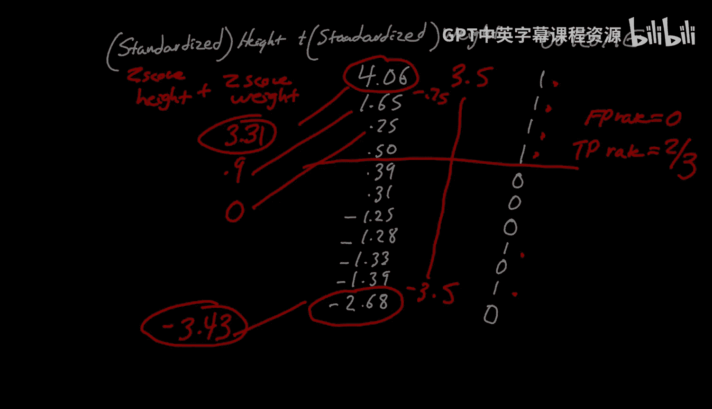

# Excel 到 MySQL：商业分析：5：最终项目说明（上）📊

在本节课中，我们将学习最终课程项目的第一部分。这部分要求你进行二元分类，结合多种不同的输入变量，以构建一个最佳的预测模型，用于预测信用卡申请人的违约情况。

## 项目概述与目标 🎯

我们有一组希望从银行获得信用卡的申请人。你的模型将使用历史数据，这些数据来自过去获得信用卡的人群，其中一部分人违约了，另一部分人则没有。你将利用这些历史数据，基于与训练集和测试集（约400人）中相同的输入变量，尝试预测未来新申请人的违约情况。

## 模型优化与评估方法 ⚙️

上一节我们介绍了项目的目标，本节中我们来看看如何优化和评估你的模型。

你的任务是优化模型，以最大化曲线下面积（Area Under the Curve, AUC）。你将通过组合不同的输入变量来完成这项优化。

为了方便大家，我提供了一个电子表格。只要你的输入变量的加权组合结果落在 **3.5** 到 **-3.5** 之间，你就可以直接将组合后的变量粘贴到表格的某一列中。表格会立即计算出曲线下面积，而无需为每个单独的阈值进行单独计算。这样做是为了节省你的大量时间。

## 数据标准化处理说明 📝

但有一点需要注意。回顾我们之前标准化身高和体重的例子，你会看到这里的最大值是 **4.05**，最小值是 **-2.38**。在我提供的便利表格中，数值范围需要控制在 **3.5** 到 **-3.5** 之间。不过，真正重要的是数据的**排序顺序**。

因此，有几种不同的方法可以转换这组特定数据以适应要求。

以下是几种可行的转换方法：

*   **方法一：平移**。你可以从每个值中减去一个常数（例如 **0.75**）。这样，最大值就会低于 **3.5**，而最小值则会高于 **-3.5**。
*   **方法二：缩放**。同样可以接受的方法是除以一个常数。例如，你可以将所有值除以 **1.5**。

具体细节留给你自己处理。你采用哪种方法真的不重要。这个工具只是为了方便你。当然，如果你愿意，也可以按照传统方式，逐个阈值地计算曲线下面积，但这完全没有必要。

## 总结 ✨

本节课中我们一起学习了最终项目上半部分的核心内容。我们明确了项目目标是构建一个预测信用卡违约的二元分类模型，并了解了通过组合输入变量来优化AUC评分的方法。同时，我们介绍了如何使用提供的便利工具进行快速评估，以及如何对模型输出值进行简单的标准化处理以符合工具要求。下一部分我们将继续探讨项目的其他细节。