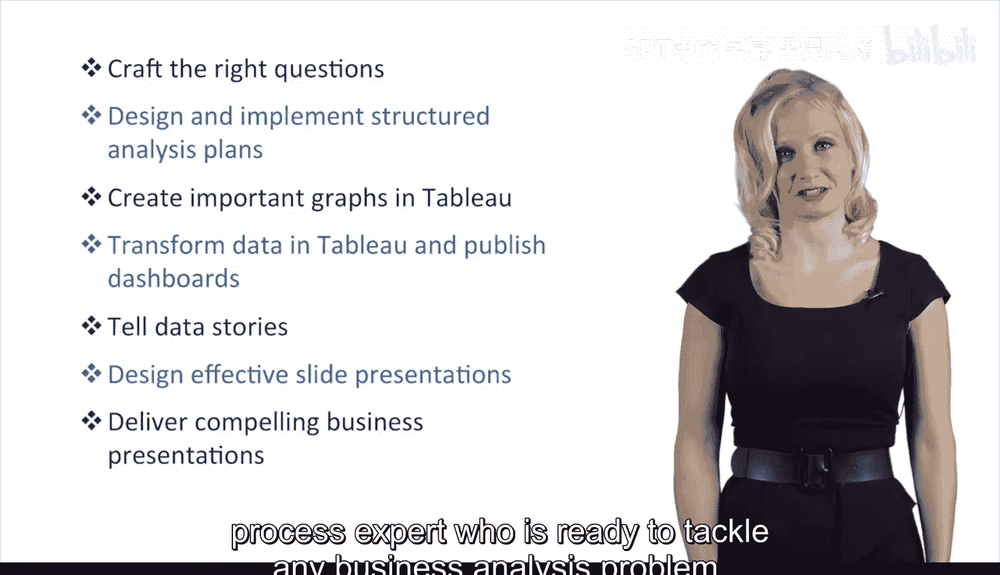

# 杜克大学《Excel 到 MySQL：商业分析（5课全）｜Excel to MySQL： Analytic Techniques for Business》中英 p77 02_01_01_欢迎来到课程.zh_en -BV1mS421X7yw_p77-

Welcome to Data Visualization and communicationmunication with Tableau。

In the first course of the specialization， business metricss for data driven companies。

 you learned all about the big data ecosystem and what types of metrics are most important for creating and evaluating business value。

In the second course of the specialization， mastering data analysis in Excel。

 you learned how to use Excel to model your business data in order to make predictions。

 estimate uncertainty， and create actionable insight。In this course。

 we are going to take advantage of the power of visualization to expedite the rate at which you generate those business insights and then communicate them effectively。

The human brain is an extraordinary visual pattern detector。

One of the reasons it took so long to design a computer that could outperform humans at jess is that we simply couldn't figure out how to get computers to recognize patterns the same way someone like Gary Casperrov Arrguably the world's most famous gen Jeess champion could。

A recent trend in big data analytics tries to take advantage of this。

 The idea is that if we can make it easier for people to see their data。

 they will naturally see important patterns in their data。

 and they will do so in a way that is much faster than running statistics。

 especially if we don't know what statistics to run in the first place。

 which is often the case when you are working with real life， big and messy data。

If you were sympathetic to this idea， then a natural extension is that we should try to allow as many people as possible to see a company's data。

 because the more expertise eyes we have， the more patterns we are likely to detect。

That is why the idea of company dashboards has become so popular。

 They are there to allow people all over the company to look for patterns。

The business world has also tried to take advantage of the human brain's propensity for patterns in another way。

 and that's in the way the brain naturally turns patterns into stories or narratives。

Narative stories transmit the meaning of complex information very efficiently。

 much more quickly and completely than a list of factss。Recognizing this。

 the business world has gotten very excited about using both visualizations and narratives to communicate the actionable implications of complex data。

This course will prepare you to jump into these new trends in business data analytics。

Over the next few weeks， you are going to learn how to use visualizations to first very quickly narrow in on what factors are most important for explaining your data and influencing your business metrics。

 And second， to link your analyses together into a story that results in a business process change。😊。

I'm going to teach you how to use the visualization software tableableau in this course。

 but my goal is more than to just make you a tableableau expert。

I want to help you become an expert in using Tableau to maximize the efficiency and efficacy of your business data analytics projects。

 That may sound like a nuanced difference， but it's an important one。

 This course is likely a little different from other data visualization or tableableau courses you've seen。

 and that this course will be organized according to the life cycle of a data analysis project。

 rather than only according to the features of Tableau。

We will learn when and how to use Tableau to achieve specific steps to the data project lifecycle and learn how to leverage what Tableau provides to craft compelling presentations that use data to recommend changes in business processes。

As important as visualization is， you will see that visualizing data should be neither the first nor the last thing you do in a data analysis project。

The human brain is very good at seeing patterns， but it's also very good at making up patterns and seeing what it wants to see rather than what is actually in front of it。

Thus especially when you are analyzing really big data。

 you want to go into even the visualization part of your analysis project or the plan。

 and the best way to organize that plan is to use carefully thought out questions and hypotheses as your guideposts。

Further， once you've implemented all your visualizations and models and think you understand what your data mean。

 you still have some work to do in order to make your analysis into a story other people understand and to convince people that they should follow the recommendations you make based on your analytic conclusions。

Putting this all together， my goals are that by the end of this course。

 you will know how to craft the right questions to ensure your analysis project succeed and leverage questions to design and implement logical and structured analysis plans。

Then with those frameworks under your belt， you will create the most important graphs used in business analysis in Tableau。

 transform data and make dashboards in Tableau and tell stories with data。

Once you have a data story in your hand， you will learn how to design effective slide presentations to showcase your data story and how to deliver compelling business presentations。

 You will be a tableau power user。 But even more so。

 you will be a data analysis process expert who is ready to tackle any business analysis problem。

 That may seem like a lot to cover on course。 but I know you are up for it。😊。

