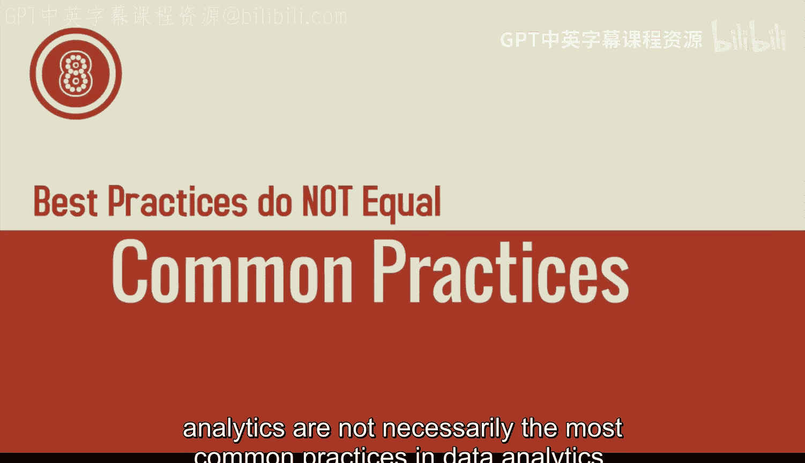

# 杜克大学《Excel 到 MySQL：商业分析（5课全）｜Excel to MySQL： Analytic Techniques for Business》中英 p78 03_02_01_成为数据分析师的技巧.zh_en -BV1mS421X7yw_p78-

Before we get started， I wanted to give you some of my own personal advice about how to use data to improve business processes。

 Here are my top 10 tips for learning to become an analyst who consistently creates value out of data。

Tip number one， ask questions， nourish curiosity， and embrace the unknown。

The business data analytics field is constantly moving， changing and evolving。

 That makes it very exciting to be part of， but it also means that to stay competitive。

 your skill set will need to be dynamic， too。 As a consequence。

 the people who are most successful in this field are the people who like learning are self motivated to try new things and who easily adapt to new environments。

 The best way to excel and stand out is to be curious and unstoppable in your desire to deeply understand problems and come up with creative solutions。

 tip number two， Start thinking about everything you see as a dependent or independent variable。

 your most fundamental job as a data analyst will be to figure out how to make every business question you come across and numbers that can be tested。

 to analyze those numbers， you need to know which ones you are going to treat as dependent variables and which ones you are going to treat as independent variables。

 The dependent variable is the measure you are most interested in understanding。

 in your analysis you examine it to see if its value is dependent on or changes in response to Other factors。

 Those other factors are the independent。😊。

And variables。 So for example， when I ask， does the amount of ice cream I have for breakfast affect my happiness that day？

My happiness that day is the dependent variable， because it is the phenomenon I am measuring and am most interested in。

 The amount of ice cream I eat is the independent variable。

 because I want to see if it affects my happiness。 And I assure you， it does affect my happiness。

 by the way。😊，Let's look at an example from business data。

The Nielsen company famously collects data from a sample of consumers who are paid to track everything they buy。

 When those consumers come home from a store， they scan the barcodes of every single item they bought that day into a special device that saves the data and sends it to a huge database where it can be mined in combination with demographics and other people's data to determine patterns and customer purchasing behavior。

With this data， you can ask questions like， does the amount of organic meat people buy relate to how many years of education they have？

In this data question， the amount of organic meat people bought is the dependent variable because it is the thing you are measuring and interested in understanding。

The years of education people have is the independent variable because you want to see if it affects or influences organic meat purchasing behavior。

Turning questions into numbers you can analyze can feel un natural to do in many situations。

 so start practicing now with relationships you see around you。Every time you see a relationship。

 ask yourself if I wanted to know more about this relationship。

 what would be the dependent variable and what would be my independent variable。Tip number 3。

 explore the advantages and disadvantages of continuous versus discrete variables。

 Con variables are measurements that can take on an infinite number of values between a minimum and maximum value like you would have if you were taking a measurement with a ruler。

Discrete variables or measurements that can take only a specific set of values。

 Like if you wanted to record whether a customer is a member of a Democratic Republican or independent political party。

 If you had a question about conversion rates on your website。

 you could either represent conversion rates as a percentage in a continuous variable that would have an infinite number of possibilities between 1 and 100 per cent。

 or you could represent conversion rates as a discrete variable with only three possible values of high。

 medium or low。Whether you treat variables as continuous or discrete can have a big impact on what statistical models you will use or what strategies you will have available to you。

 And it can also have a big impact on the type of information you are likely to glean。

 Disreet variables are generally easier to analyze and understand。

 but they are also often less precise than continuous variables。 And if they are designed poorly。

 they can hide important patterns。 continuous variables， On the other hand。

 can often be harder to interpret by eye， but they can provide more detailed information about relationships。

 When we start making visualizations later in the course。

 You are going to have to make decisions about whether to make variables discretere or continuous。

 Discreet variables tend to be displayed in bar graphs and continuous variables tend to be shown in line graphs。

 Start paying attention now to charts you see in newspapers and ads or stories you see or hear that refer to data to try to convince you of something。

 Note which graphs or data stories you find most convincing。

 This will help you build intuition for what kinds of variables and graphs will be most effective to use in your own persuasive arguments in business settings。

Tip number 4， make sure you always listen and contribute。

Data analysis projects are almost always collaborations。

 They will not be successful if your team doesn't work together。

 And if you can't communicate information， make it a priority to become a really good listener so that you are able to incorporate and internalize what other people say。

 but also make it a priority to be an active participant in all project related conversations。

 You are being hired for your expertise， and you need to put it to good use。

 especially given how much variability， there isn't how open companies are to data insights。

 This is important to remember， because sometimes your data analysis will suggest paths forward that are inconsistent with other people's intuitions。

 So as you move forward， focus on being both a collaborative and engage participant in your data analysis projects。

 towards that end， here is my tip number 5。 train your skepticism and muscles。

 I'm telling you this some experience。 Whenever you see a really dramatic or surprising effect in your data that nobody in your team or company expected。

9 times out of 10 or maybe even 99 times out of 100。 It's due to a bookkeeping or coding mistake。😊。

There's probably a bug in your code， a misaligned column in your spreadsheet or incorrect labels somewhere in your dataset set。

 Similarly， whenever somebody tells you something with extreme confidence， temper your expectations。

 It's probably more complicated and messy than they are making it out to be。 Tiip number 6。

 That's why you need to seek details。 Real life situations are messy。

 You often need to track down the details of mess in order to get to a vantage point where you can finally understand what's going on。

This picture could represent a hair ball， a pile of spaghetti， an abstract painting of an ear。

 You can't be sure。 But if you have the patience to follow the thread。

 you will eventually find the needle and be able to see the big picture。

This goes back to the B curiously I mentioned before。

Don't be satisfied with taking your data at face value。

 Be curious about what your data really look like and what they really mean。

 Go hand in hand with this。 tipip number 7， cherish precision。

 being precise allows you to make progress and rule out inefficient directions much more quickly than vagueness。

 in such a dynamic field with so many unknowns。 You often won't be able to make precise predictions。

 Hypotheses or goals。 but I do promise you， once you do， things will get easier。

 So I am not suggesting that you should dogmatically require precision。

 but I am suggesting that you should cherish it。 I should warn you that what I just said might be a little controversial。

 Some people might， I would argue correctly， believe that precision squashes creativity and innovation。

 My experience tells me the opposite。 that precision allows the most creative and innovative ideas to become reality。

 but that brings me to tip number 8， which is that the best practices in data analytics are not necessarily the most common practices in data analytics。

 It is important for you to know both， so that you can choose which kind of practice will be。😊。

Most successful in a given situation。 Now， tip number 9， as I said before。

 you will almost always be working in teams and business data projects。

 and the expectations of your teammates and stakeholders matter。

 no matter how good an idea you have or how cool your data analysis is。

 If what you are going to tell them is contrary to what they expect。

 it will likely not be received very well and all your hard work will stop dead in its tracks。

 That now brings us to tip number 10。😊。

Despite what you might have thought when entering a data driven field。

 one of the key skills that will allow you to succeed is the ability to understand other people's perspective。

 In other words， the ability to put yourself in other people's shoes。

 You need to know what your partners and stakeholders think and feel about in order to make your solutions or recommendations successful。

 The better you are at anticipating their thoughts and feelings。

 The more efficient you will be at your projects。 So make it a priority to become an expert in putting yourself in other people's shoes。

You will see every single one of these concepts come up somewhere in the course。

 sometimes multiple times。 I'm telling them to you here in words。

 but soon you will see how they play out in real life data analysis scenarios as well。

 Keep them in the back of your mind， because you will definitely hear them again。

