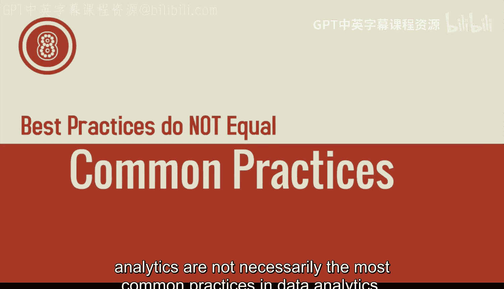

# 商业数据分析：03：成为数据分析师的十大技巧 🧠

在本节课中，我们将学习如何利用数据改进业务流程，并掌握成为一名能持续从数据中创造价值的分析师所需的十大核心技巧。这些技巧涵盖了从思维方式到实践协作的各个方面，是数据分析师职业生涯的基石。

## 概述

数据分析领域充满变化与挑战。要在此领域脱颖而出，不仅需要技术技能，更需要正确的思维方式和协作能力。以下十大技巧将帮助你构建坚实的数据分析基础。

## 十大核心技巧

上一节我们介绍了课程的整体目标，本节中我们将逐一探讨成为高效数据分析师的十个关键技巧。

以下是十大技巧的详细列表：

1.  **培养好奇心，勇于提问，拥抱未知**
    商业数据分析领域在不断变化和发展。这意味着要保持竞争力，你的技能组合也需要是动态的。因此，在这个领域最成功的人是那些喜欢学习、有动力尝试新事物并能轻松适应新环境的人。脱颖而出的最佳方式是保持好奇心，并坚定不移地深入理解问题、提出创造性的解决方案。

2.  **将一切视为因变量或自变量**
    数据分析师最基本的工作是将遇到的每个商业问题转化为可测试的数字。为了分析这些数字，你需要知道哪些将被视为**因变量**，哪些将被视为**自变量**。
    *   **因变量**：是你最感兴趣、最想理解的那个测量指标。在分析中，你检查它，看其值是否依赖于或随其他因素而变化。
    *   **自变量**：是那些可能影响因变量的其他因素。

    例如，问题“早餐吃冰淇淋的量是否影响我当天的幸福感？”中：
    *   `因变量 = 当天的幸福感`
    *   `自变量 = 早餐吃冰淇淋的量`

    在商业场景中，例如尼尔森公司收集消费者购买数据。你可以问：“人们购买有机肉类的数量是否与其受教育年限有关？”
    *   `因变量 = 购买有机肉类的数量`
    *   `自变量 = 受教育年限`

    将问题转化为可分析的数字在许多情况下可能感觉不自然，因此现在就开始练习观察身边的关系。每当你看到一个关系，就问自己：如果我想更多地了解这个关系，什么是因变量，什么是自变量？

3.  **探索连续变量与离散变量的优缺点**
    *   **连续变量**：是在最小值和最大值之间可以取无限多个值的测量值，就像用尺子测量长度一样。
    *   **离散变量**：是只能取一组特定值的测量值，例如记录客户属于民主党、共和党还是无党派。

    例如，关于网站转化率的问题：
    *   你可以将转化率表示为**连续变量**（百分比），在1%到100%之间有无限种可能。
    *   或者，你可以将转化率表示为**离散变量**，只有高、中、低三个可能值。

    将变量视为连续还是离散，对你将使用的统计模型、可用的策略以及可能获取的信息类型都有很大影响。离散变量通常更易于分析和理解，但往往不如连续变量精确，如果设计不当，可能会隐藏重要模式。连续变量则可能更难直观解释，但能提供更详细的关系信息。在本课程后期开始制作可视化图表时，你将需要决定是将变量设为离散还是连续。离散变量倾向于用条形图显示，连续变量则倾向于用折线图显示。现在开始注意你在报纸、广告中看到的图表，或听到的引用数据试图说服你的故事。注意哪些图表或数据故事你觉得最有说服力，这将帮助你建立直觉，了解在商业环境中进行说服性论证时，使用哪种变量和图表最有效。

4.  **确保始终倾听与贡献**
    数据分析项目几乎总是协作进行的。如果你的团队不能一起工作，项目就不会成功。如果你无法沟通信息，请优先成为一个优秀的倾听者，以便能够吸收和内化他人所说的话。但同时，也要优先成为所有项目相关对话的积极参与者。公司雇用你是看重你的专业知识，你需要好好利用它，尤其是在公司对数据洞察的开放程度存在很大差异的情况下。这一点很重要，因为有时你的数据分析会提出与他人直觉不一致的前进路径。因此，在前进过程中，请专注于在你的数据分析项目中成为一个既协作又投入的参与者。

5.  **训练你的怀疑精神**
    根据经验，每当你在数据中看到一个非常戏剧性或令人惊讶的效果，而你的团队或公司中没有人预料到时，十有八九（甚至百分之九十九）是由于簿记或编码错误造成的。你的代码中可能有错误，电子表格中有错位的列，或者数据集中某处有错误的标签。同样，每当有人极其自信地告诉你某件事时，请降低你的期望。实际情况可能比他们所说的更复杂和混乱。

6.  **因此，你需要追寻细节**
    现实生活的情况是混乱的。你通常需要追踪混乱的细节，才能到达一个制高点，最终理解正在发生什么。不要满足于数据的表面价值。要对你的数据真正看起来是什么样子、真正意味着什么感到好奇。

7.  **珍视精确性**
    精确性能让你比模糊性更快地取得进展并排除低效的方向。在这样一个充满未知的动态领域中，你通常无法做出精确的预测、假设或目标。但我向你保证，一旦你做到了，事情就会变得更容易。我并不是建议你应该教条地要求精确，而是建议你应该珍视它。需要警告的是，我刚才说的可能有点争议。有些人可能（我认为是正确的）认为精确性会扼杀创造力和创新。但我的经验告诉我恰恰相反：精确性能让最具创造性和创新性的想法变为现实。

8.  **数据分析中的最佳实践不一定是数据分析中最常见的实践**
    了解这两者对你都很重要，这样你才能在特定情况下选择哪种实践最可能成功。

9.  **考虑队友和利益相关者的期望**
    正如我之前所说，你几乎总是在团队和商业数据项目中工作。无论你的想法有多好，或者你的数据分析有多酷，如果你的发现与他们的预期相反，很可能不会得到很好的接受，你所有的辛勤工作都会戛然而止。

10. **理解他人的视角**
    尽管在进入数据驱动领域时你可能不这么认为，但让你成功的关键技能之一是理解他人视角的能力。换句话说，就是设身处地为他人着想的能力。你需要知道你的合作伙伴和利益相关者的想法和感受，才能使你的解决方案或建议获得成功。你越善于预测他们的想法和感受，你在项目中的效率就越高。因此，请优先成为设身处地为他人着想的专家。

## 总结

本节课中，我们一起学习了成为高效数据分析师的十大核心技巧。从培养好奇心和变量思维，到理解数据类型、注重团队协作、保持怀疑精神、追寻细节、珍视精确性，再到认识最佳实践与常见实践的区别、管理期望以及最重要的——理解他人视角。这些概念将在课程中反复出现，请将它们记在脑海中，因为你一定会再次遇到它们。掌握这些技巧，将为你在商业数据分析领域的成功奠定坚实基础。