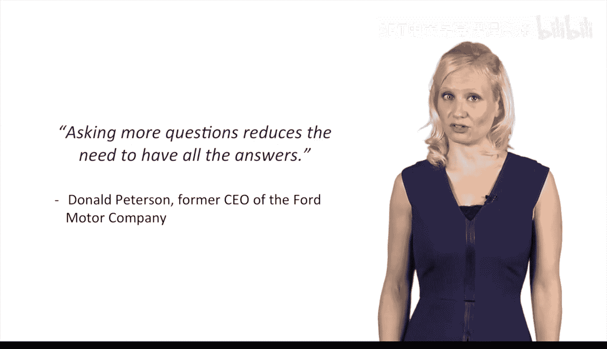

# 杜克大学《Excel 到 MySQL：商业分析（5课全）｜Excel to MySQL： Analytic Techniques for Business》中英 p79 04_02_02_提出正确的问题.zh_en -BV1mS421X7yw_p79-

。We put data visualization first and data communication second in this course title。

 because that's the order in which you do things when you are in a data analysis project and you've already started doing your analysis。

 but our title leaves out a critical step。The communication that happens before you even touch your data。

Academic researchers and the Terradata University Network ran a study to determine the state of business。

 intelligence and analytics。They asked over 400 recruiters from technical companies to respond to the following prompt。

When I recruit for business intelligence or business analyst roles。

 it is important that the students have the following courseworker knowledge。

Then the recruiters had to rank a bunch of possible responses。

The number one answer companies gave in this survey was communication skills， believeve it or not。

 Communic skills was then followed by S QL and query skills， and then basic analytics。

So according to this data， communication skills are even more important than technical or quantitative skills for getting a business analysis job。

Another piece of research proving how important communication is for business analysts comes from the data analytics company Gartner。

 They ran a research study to determine why big data projects fail。

 They wanted to know what percentage of big data projects fail due to organizational problems。

 including communication and what percentage fail due to technical problems。

In the chart to my right in the column all the way at the edge with the pie chart that is 100% blue。

 You can see the percent of companies who responded that 100% of the reasons their data analytics projects failed were related to organizational issues。

 And the column next to that with the pie chart that is 75% blue。

 You can see the percent of companies who responded that most of the reasons their data analytics projects failed were organizational。

 The column next to that shows you the percent of companies who responded that half or some of the reasons their data analytics projects failed were organizational issues。

 and the column all the way on the other edge shows you the percent of companies who responded that most of the reasons the data analytics projects failed were due to technical issues。

 You'll notice there's only 1% in that bar。So as you can see。

 99% of companies said that at least half of the reasons their data analytics projects failed were due to poor organizational skills。

 not technical skills， isn't that amazing？Now， of course。

 one of the most important organizational skills is the ability to communicate。

 the ability to communicate the value of the analysis you are working on。

 but also the ability to talk to and understand the people who will be influenced by a project。

 Those people who are influenced by a project are called your stakeholders。Stakeholders。 Get it。

 stakeholder。 I was very proud of that joke。 Data interpretations are fundamentally influenced by their context。

 Part of the context is driven by your stakeholders。

 but an equally influential part of the context is driven by you as the analyst。 Your assumptions。

 your hypotheses and what you already know。😊，A successful analyst needs to learn how to anticipate issues in both the context created by the stakeholders and the context created by you。

 your own knowledge and your biases as an analyst。In this module。

 I want to show you that one way to ensure your data's project context works for you rather than against you is to ask and then answer a series of logically thought out and connected questions about first the project and second the data。

Some people call these connected questions a framework。

Other people might call them the right questions。There's a lot of mystique about asking the right question in business analysis。

 This mystique makes it sound like one right question will suddenly make a perfect answer。

 fall out of the sky to your feet。That sounds very nice。 It really does。

 But real life and real data are much more messy than that。 First of all。

 you will never know if one question is the right question until you actually have an answer。

 And second of all， very rarely， does one question answer your entire business problem。😊，Further。

 the right question can come in many flavors。 Sometimes the right question is the one that solves your business problem。

 but other times， the right question is the one that prevents you from misinterpreting your data or from recommending a business process change that has no chance of being adopted by your stakeholders。

Therefore， I think it's misleading。To talk about asking the right question。

 because there are lots of right questions。 So instead of worrying about asking the right question。

 I want you to focus on asking a lot of questions。Be really， really curious all the time。

 Be insatiable in your desire to understand the ins and outs of every business situation you encounter。

 be a sponge and soak up as much information as you possibly can in the time your project allows。😊。

Your job is to be a detective and identify all the things that can either solve your business a problem。

 affect your data interpretation or influence your eventual recommendation。

 The best way to make sure you eventually cover the right question is to ask and answer as many questions as you can come up with。

In this module， we are going to go over some of the key questions you should make sure to ask before you even touch any data。

We are also going to go over ways you can organize your questions so that you can navigate the problem space of your data analytics project as efficiently as possible。

My goal is that by the end of this module， you will feel confident that you can organize a deliberately chosen set of questions to cover all the content you need to in a very short amount of time。

Are you ready to ask some questions？

