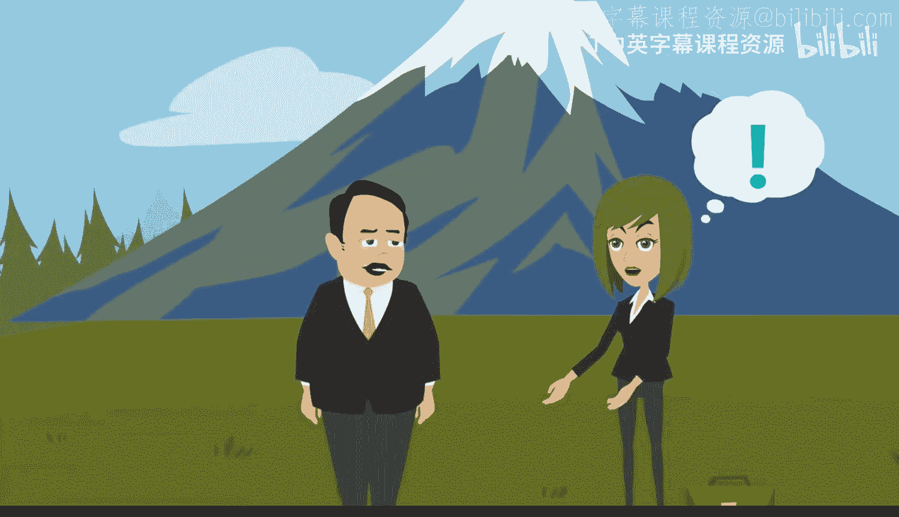
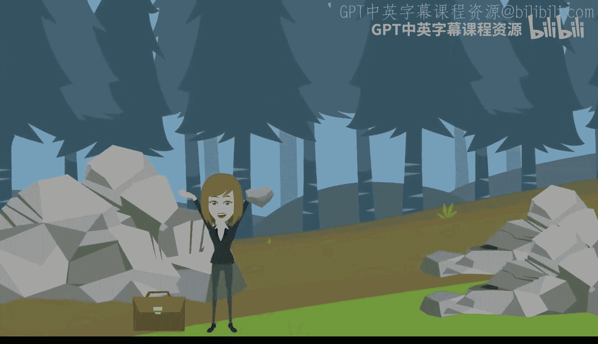
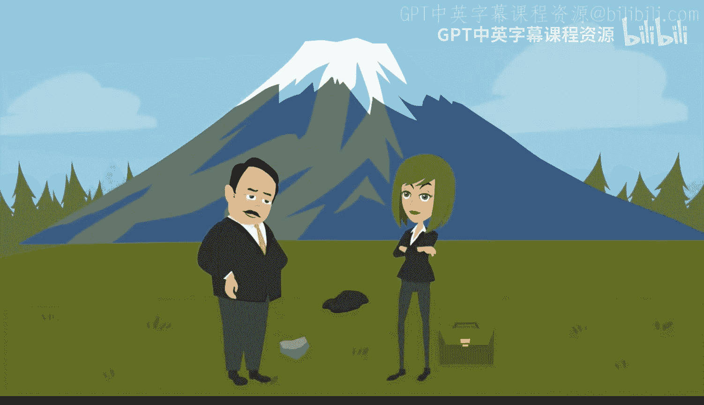
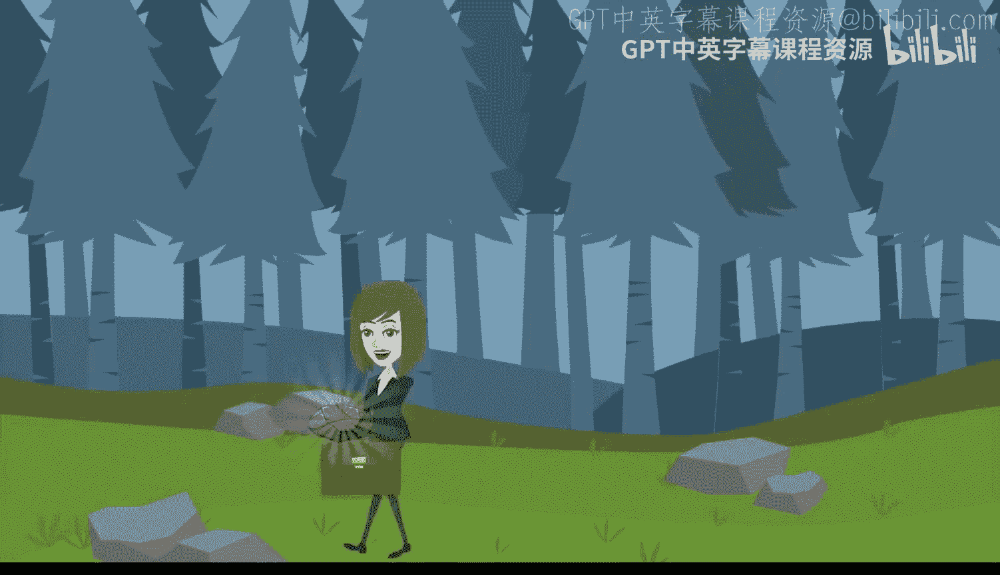
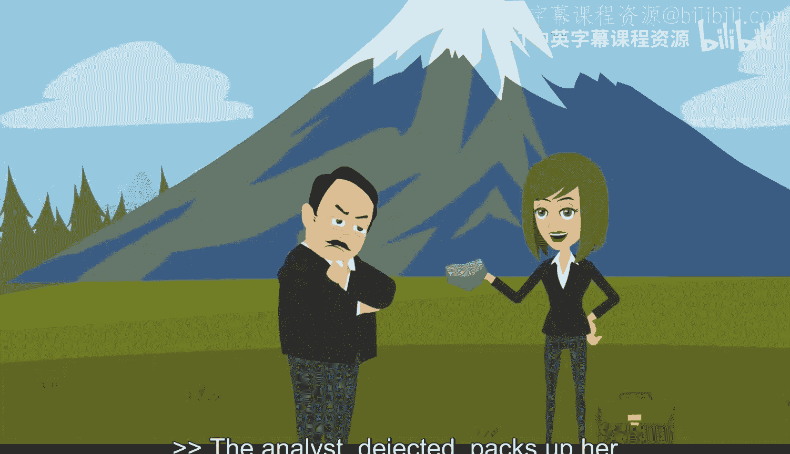
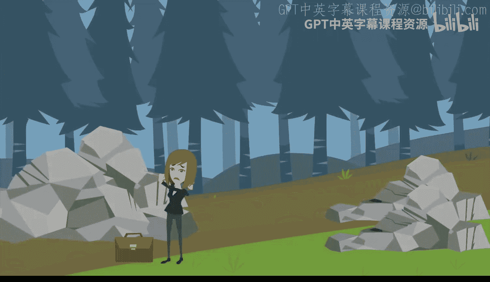
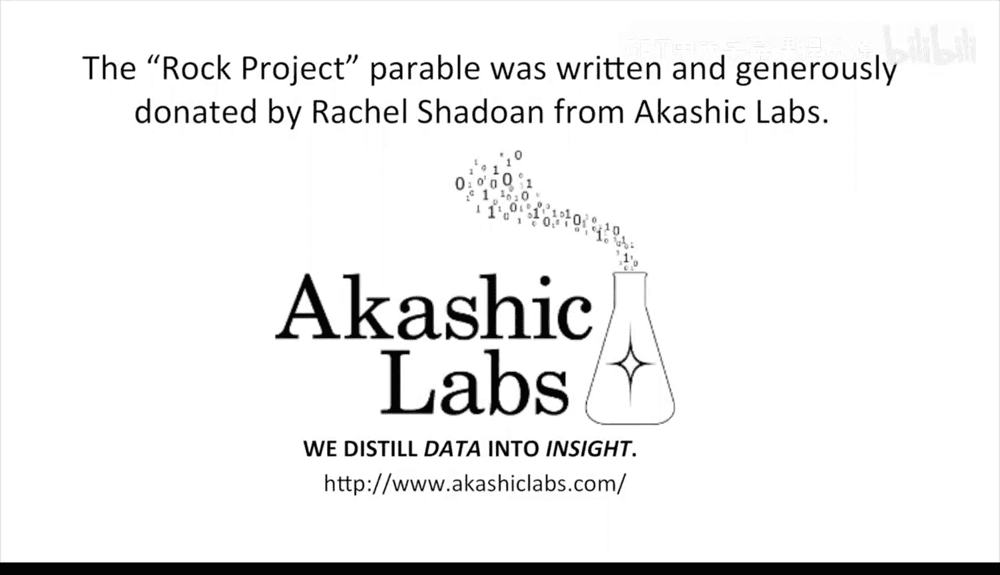

# 杜克大学《Excel 到 MySQL：商业分析（5课全）｜Excel to MySQL： Analytic Techniques for Business》中英 p80 05_02_01_摇滚项目.zh_en -BV1mS421X7yw_p80-

I would like to tell you a story about rock projects。

Bring me a rock。 The stakeholder says， I'll spend a lot of money on the great big mountain。

 and I need you to bring me a rock from the mountain that makes the expense worth while。Cool， rock。

 I can do。 I'm all about Ros。 The analyst says， what kind of rock are you looking for。😊，Oh。

 I don't know， a rock， a rock that will change the way we see things， an important rock。

Important rock。 check， coming right up， the analyst agrees。

So the analyst goes off to the mountain。She hammers at it and bahes at it with a pickaxe and washes away the dust and gravel until finally she finds it。

 an important rock。

Delighted， she picks up the important rock and races down the mountain to show the stakeholder。

 I'm back。 The analyst cries。 I returned from the mountain with an important rock。

 just like you asked for。😊，The stakeholder takes the rock and inspects it， looking unsatisfied。

We can do a lot of great and interesting things with this important rock。 The analyst continues。

 Don't you think it's a good one。Well。The stakeholder turns the rock over in his hands。

I'm not sure it's just， it's not quite what I have in mind。 It may be that this is an important rock。

But I think I would like a different rock。 Could you go back to the mountain and bring me another one。

呃。Of course， I， I can do that right away。 The analyst agrees eager to please。😊。

Could you maybe tell me a bit more about the rock you want this time？

 Are we talking a sedimentary rock， memmorphic， maybe a crystal。Oh， you know， I'm not exactly sure。

 but you'll find it。 I know you will。 I bought this whole mountain， after all。

The analyst packs up for tools and returns to the mountain。She hammers and she chisels。

 and she blows up some boulders until finally， she finds another important rock。

It is different than that first important rock， And she thinks it's even better。 Yes。

 this is the rock that the stakeholder wants off， she goes back down the mountain to show the stakeholder。

 Check out this important rock。 The analyst cries。 It's significantly more awesome than the first one。

 Look at all of its great rock lake features。😊，This is a very good rock， the stakeholder agrees。

Under other circumstances， it might even be the rock that I need。But things being what they are。

 I'm not sure this is the rock for me。Did you find any other good rocks while you were up there。

 Would you mind going back to check。Well。This rock is a very good rock。

 The analyst says the bit crest fallen。I'm not sure that the mountain is going to produce many more rocks this good。

But I'll go back up and take a look。

The analyst packs up for tools and returns to the mountain。By now。

 she's familiar with the mountain's idiosyncrasies。

 so she decides that the only way to find another great rock will be to invest in some major infrastructure。

She digs a mine deep into the mountain。She hammers away at the heart of the mountain over and over and over again。

 Her head lamp the only light illuminating potential rocks as she inspects them。 Not that rock。

 Not that rock。 Nope， not that one， either。唉。She had just about given up pope when the circle of light from her headlandamp passed over it。

 oh my gosh。It was the perfect rock。I mean perfect。

 It's so far superior to the rocks you found previously。

 now she's a little embarrassed to haveve even thought she should even consider bringing those other rocks to the stakeholder。

 This rock。This rock is a truly amazing rock。Down the mountain， she races。

 cradling the perfect rock and her outstretched palms。 Stholder， The analyst shouts， exuberant。

 Have I got a truly amazing rock for you。 Check out its ultrafin rock qualities。

 It is so much better than the previous rocks。 It is an all out rock star。😊。

Wow， that is a nice rock， the stakeholder says。But， well。

I'm still not sure that this is the rock I had in mind。The mountain was really an investment。

I just wanted to make sure that we're making the most of it。

Perhaps try the other side of the mountain。 I heard that other people were having good luck finding rocks on that side of the mountain range。

The analyst dejected， packs up her tools and returns to the mountain。

And this is how it goes on for eternity。 The cycle continues。

 with the analysts bringing new important rocks to the stakeholder。

 only to see the rocks dejected once again。

Until one day， the analyst snaps and pels the stakeholder with rocks。

 or the stakeholder sells the mountain to the prospectors for a loss。First of all。

 I think we can all agree that story rock。The rock story you just heard was parable for what happens when a data analyst agrees to take on an analysis project without first defining very clearly what value the data analysis is supposed to create。

What happens is if the analyst keeps trying new things。

 the clients or stakeholders keep asking for something different because they don't feel like their needs are being met and the project goes on and on and everybody on all sides becomes increasingly frustrated。

The good news is you can prevent this from happening。 And in next few videos。

 you're going to find out how。

