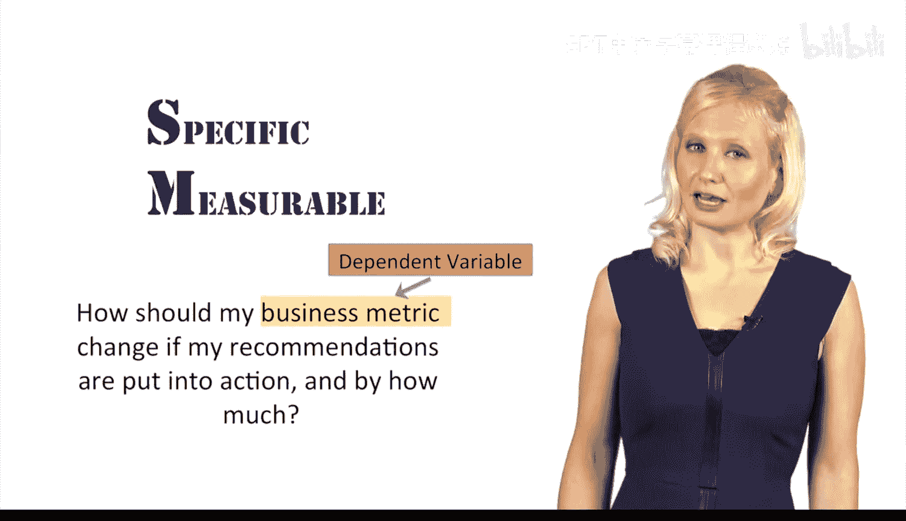
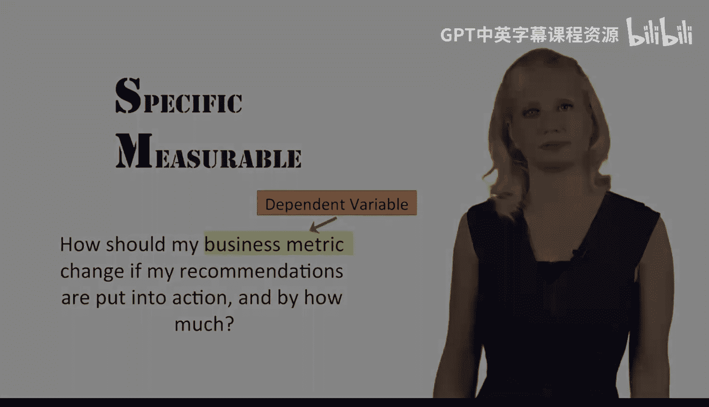
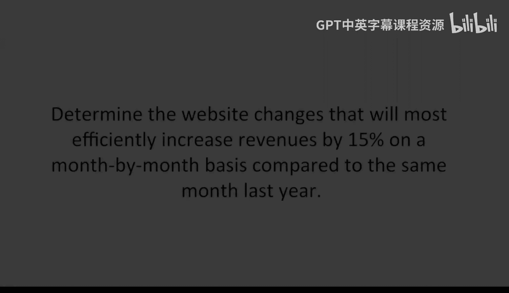
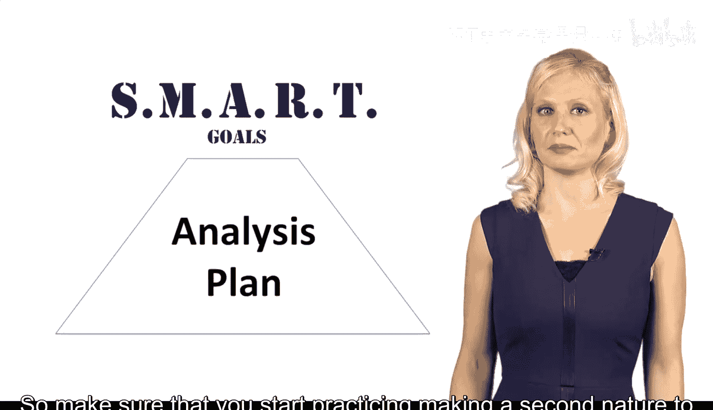

# 杜克大学《Excel 到 MySQL：商业分析（5课全）｜Excel to MySQL： Analytic Techniques for Business》中英 p81 06_02_02_S-M-A-R-T目标.zh_en -BV1mS421X7yw_p81-

If you watched the last video， you'll know what a rock project is。

 If you didn't watch the last video， go watch it。Rock projects stink。

 No one wants to be part of a rock project。 So why do I happen。

They happen because an analyst agrees to jump into a data analysis project without first defining what value the analysis is supposed to provide。

Unless you are lucky enough to own your own data set that you are paying yourself to analyze。

 your job as a data analyst will be to use data to solve your paying stakeholders' business problem。

 That means that in order for your work to be success。

 you need to know what business problem you and they are trying to solve。 And when I say no， I mean。

 really， really know。 You need to understand the ins and outs of what is motivating your stakeholders to come to you in the first place。

 So how do you figure this out。In line with the theme of this module， you ask questions， of course。

 then you give smart answers， and then you get the stamp of approval on your smart answers。

 Let me explain what I mean。The very first thing you should do when you consider whether you will take on a data analysis project is plan a meeting with the primary people who are funding the project。

 go into this meeting prepared to ask questions， lots and lots of questions。

The goal of your question should be to put yourself in their shoes and figure out where all your stakeholders' true motivations and financial interests lie。

 And remember， unfortunately， they might not always know where their motivations and financial interests lie。

 even if they think they know。In order to figure this out。

 plan on asking questions that aim to get specific information but keep the questions as open ended as possible so that your stakeholders。

Can talk in a way that is natural for them。I suggest you start with。

What problem is this business having that you are hoping to solve by developing this project。

Then you can follow up with questions like， can you tell me more about how this problem is affecting the business and then？

What is your ideal outcome for this project？I can't give you an exact script of what every meeting will be like because every meeting will be different。

 but I have provided some links on our course website that you can check out for ideas of other questions you might want to ask。

Whatever questions you do ask， remember， really listen to your stakeholders' answers。

 Their needs drive the project， and this is your chance to figure out what their needs are。

After you' have had your meeting， your next job is to synthesize what you heard and draft up a smart statement that reflects the goal of the analysis project。

 Now， I know all of you are incredibly bright students， but in this case。

 I'm not using the word smart to allude to your brain power。😊。

The smart framework was introduced by George Duran in 1981 as a method for designing effective objectives。

 It's been used in a bunch of different contexts with a bunch of different meanings。

 But here we are going to understand smart objectives or goals as those that are specific。

 measurable， attainable， relevant and time bound。I think using these adjectives as a checklist is really useful for making sure you are on the same page as your stakeholders。

 especially the specific and measurable parts。How do you make sure the objective of your project is smart？

Well， the first thing you do is you go back to coursese one of the specialization。

 business metrics for data driven companies， and you pick the one or two business metrics that best fit your particular problem。

Then you specify clearly how that metric should change if your recommendations are put into action and by how much。

This simple procedure will make the goal specific and measurable， which in turn。

 makes it very clear what you are dealing with so you can assess whether the project scope is realistic by confirming a metric。

 you can immediately start thinking of your project in terms of numbers。

 Your metric is basically going to be your dependent variable and the most important story points of your analysis。

 See whether you can imagine any independent variables that will change the metric to the level that is expected by the project。

 That will help you evaluate the feasibility of the scope of the project。

Let's look at an example。 Imagine your client is an online retailer of a designer men's clothing store called Be Bell。

When your project manager describes the job to you， she says。

People aren't returning back to our site after they log in for the first time。

 I need you to tell us how to convert first time visitors to returning visitors。

So given that， a pretty vague way of phrasing the project goal would be increase the number of returning visitors。

But a smarter way of phrasing the goal would be increase the number of returning visitors on a month by month basis by at least 15% compared to the same month during last year。

It's specific and it's measurable。 You know exactly what you're supposed to do。

 And you can imagine what kinds of rows and columns would be needed in your actual data set to assess the success of the project。

But we can make the goal even smarter。I'm going to come back to the a part of the smart goal in a second。

 Right now， I want to focus on the R part。What does it mean to make sure a goal is relevant？

Let's go back to what I said about asking your stakeholders open ended questions to get insight into what it is they really care about。

Your project manager may have opened the conversation saying。

 I want you to increase the number of returning visitors to our website。

But when you asked her what business problems she was trying to solve， here's what she said。

We started this project because revenue has been declining lately。

 And that's very concerning because our costs remain the same。 This impacts profitability。

 So we need to figure out a way to increase our profits。

I know that other companies have been able to increase their revenue by increasing customer loyalty and that they did it by converting first time visitors to returning visitors。

 I want you to do the same for us。Through asking directed， open ended questions。

 you learned that what your project manager really cares about is bringing in more money。

 not returning customers per se。 She was just making the assumption based on things she read。

 that the reason profits were down was because customers weren't returning to the website。

 That's a good hypothesis。 But in reality， we have no idea whether the number of returning customers will be relevant to the drop in revenue。

 And if it turns out that the number of returning customers is not relevant to the drop in revenue。

 And your analysis is solely dedicated to the changing the number of returning customers。

 Your project manager and the rest of your stakeholders are not going to be very happy。😊。

So make sure your project goal is relevant。So given what we now know from asking questions。

 here's a statement that more accurately reflects what the stakeholder cares about。

The goal of the project is to determine the website changes that will most efficiently increase revenues by 15% on a month by month basis compared to the same month last year。

Now， we can make this goal even smarter by making it time bound so that we know how much time we will have to accomplish it。

 So let's look at this version。The goal of the project is to， by the end of two months。

 determine the website changes that will most efficiently increase revenues by 15% on a month by month basis compared to the same month last year。

N beta， this is looking pretty good。 this point。 This goal makes it pretty clear what you need to accomplish。

However， there's one letter left in the smart goal， and sometimes it can be the trickiest to ci。

 That's the a， which stands for attainable。How quickly you can determine what to do to the website to increase revenue depends on what data you have available。

 Sure， if your stake's company collects every click each website visitor makes and connects that to all kinds of demographic and previous buying history information。

 This project seems feasible。But what if your stakeholders' company scores very low in the checklist we heard about。

 in course one of the specialization that evaluates how data ready your company is。

 and they don't actually collect any data from their website yet other than how many times the same IP address contacts it。

Then you have a much bigger problem on your hands。Either you will need to hand the project over to another kind of analyst who design solutions without using data。

 or you will have to discuss methods for helping your stakeholders collect data that will help you solve the business problem。

These methods may take a long time to implement， depending on what type of solution they want。

 and the two month deadline might be infeasible。 So here are two new versions of the goals that meet the attainable criteria。

So here's the first one。The goal of the project is， to， by the end of two months。

Analyze archived clickstream data to determine the website changes that will most efficiently increase revenues by 15% on a month by month basis compared to the same month last year。

Here is a different version that might have two parts。 First， in three months。

 install a system that will collect and store clickstream data in a cloud based relational database。

Then the second part could be by the end of two months after the system has been installed。

 this data will be analyzed to determine the website changes that will most efficiently increase revenues by 15% on a month by month basis compared to the same month last year。

Now， compared these smart goals to what we started with。

 which was increase the number of returning visitors。

Which type of goal would you prefer to put your time and money behind？At some final steps。

 make sure you show your first draft of the smart goals to your stakeholders and go back and forth with them until everybody signs off on the goals。

 depending on the context， you can supplement the goals with the document specifying things like other important deadlines。

 who will assess the project and what types of business process changes are or not up for Grs。

 If you start your project by asking your stakeholders open ended questions about the business problem they are trying to solve and have them sign off on smart goals。

 You won't find yourself in the middle of a rock project。Equally important。

 these smart goals you set at the beginning of your project will serve as the keystone to help you center and focus your analysis plan。

 which will make sure you don't get lost in analysis para down the line because you aren't sure what you should be doing with your data。

We'll be returning to these smart goals many times throughout the course。

 so make sure you start practicing， making it second nature to add smart criteria to all of your project goals。

