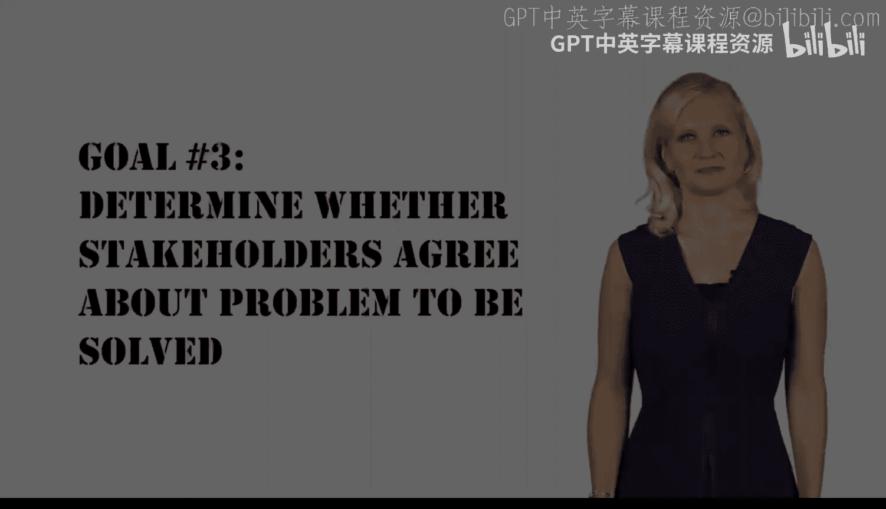

# 杜克大学《Excel 到 MySQL：商业分析（5课全）｜Excel to MySQL： Analytic Techniques for Business》中英 p82 07_02_01_需求获取中倾听利益相关者.zh_en -BV1mS421X7yw_p82-

。I talked about the role of context and asking questions earlier。

There's actually a term for the process of asking your stakeholders questions about your project。

 and it's called elicitation。Elicciitation sessions occur after you've already accepted an analysis job and occur throughout the entire life cycle of the project so that you can continuously monitor how your stakeholders are feeling。

Elicitation techniques are actually used by many fields， including anthropology， cognitive science。

 and business management just to name a few， but in all contexts。

 elicitation refers to the process of gathering information directly from people。

In business or data analytics， the elicitation process is talked about most commonly and long term roles that involve rolling out new software and implementing new data collecting techniques。

 but it's important for the pure data analyst too。To give you an idea of how important it is。

 I've posted on the course website， a data scientist job posting from SaS。

 a well known business analyticsnalytic software company。

 You'll see that one of the job description items is elicit information from groups and plan and conduct elicitation sessions with working groups to develop and assess alternatives uncertainties and value and risk preferences。

 So clearly， it's important even for a data scientist。Now。

 what do you do during the so called elicitation？I think you know one thing I'm going to say。

 ask questions。I recommend thinking about elicitation sessions as trying to achieve three main goals。

Your first goal is to determine who your key stakeholders are。As a reminder。

 stakeholders are anybody who's affected by your data analysis project or who might have a strong interest in it。

For example， imagine you are in charge of analyzing archive sales data from the electronics department of a small department store chain。

You are supposed to design an algorithm that will predict when would be the best time to send specific customer group coupons。

The ultimate vision for the project is to use this algorithm to change when the business sends coupons to its customers。

In this scenario， the project sponsor who has hired you and has a vision for the entire project。

 certainly a stakeholder。 But so are the people who would actually be responsible for sending out the coupons in the marketing department。

 Even if they don't know anything about the project as a whole。 After all。

 if they don't have any method for incorporating your predictive insights。

 you won't have any way to effect when coupons are sent out。

 which means you ultimately won't be able to improve the business。

Other stakeholders of your project include the database team who organize the database that houses the archive data or other departments who might want to use your algorithms for their own purposes。

There also might be stakeholders outside of the company， such as the US government。

 If any part of your analysis runs the risk of being interpreted as invading customer privacy。

 the government might want to know about it。So as you can see。

 the list of potential stakeholders can get very large。

That's why one of your goals for elicitation should be to narrow down this list to the stakeholders who will have the greatest potential to affect whether your project succeeds or fails。

There are many different ways to elicit information from people， including。

 but not limited to in person meetings， focus groups and emails。

I've included links to these websites and the course materials as resources to help you figure out what combination of elicitation techniques works best for you。

Once you've figured out what techniques you are going to use。

 I've also included a link to this article that I think does a good job of helping you figure out how to achieve that final goal of defining who your most important stakeholders are。

The second goal of your elicitation sessions should be to get some hints about what types of effects or factors you should be considering in your data analysis。

 In other words， you are trying to figure out how to prioritize the independent variables you want to examine。

Often， the person who hires you isn't the person closest to the business problem or the data。

 So they might not be able to give you all the specific factors that are relevant to solving the problem。

Therefore， no matter what other elicitation techniques you use。

 I strongly recommend that you include in person meetings with as many of your potential stakeholders as you can。

 especially with people who you know are going to be highly impacted by your project。

And our example from before about analyzing sales data to predict when would be the best time to send coupons to certain groups。

This would mean in having in person meetings with the people who would actually be responsible for sending out those coupons。

Similar to when you are trying to establish the goals of project with project leaders。

 go into these elicitation meetings with the stakeholders with a plan to ask directed。

 open ended questions that allow your stakeholders to talk naturally。

Do your best to get their honest perspective about what's going on。Now。

 there are many different templates for these meetings。

 but some of my favorite questions that you can ask are。

What has been tried before and how did it turn out？

What do you think might improve this business problem？These kinds of questions， when successful。

 will give you specific ideas about what factors you should operationalize as independent variables in your analyses。

 It will also help you learn about potential constraints of the business process changes you will ultimately suggest at the end of the project。

Learn as much as you can about what types of changes are easy or hard to do given your company's business culture or data architecture。

 and make sure you take these factors into consideration when you craft your recommendation strategy。

For example， if your stakeholders seem distrusful of data。

 you don't likely want to recommend that the company completely overhaul its data structure overnight。

 Instead， you'll want to come up with a more gradual solution that will ensure stakeholders buy in。

Your third goal during elicitation sessions is to be honest， very controversial。

 But I mention it because I think it's important to be aware of。

I'm going to introduce it to you through a real story about a car company shared with me by Splano Sler。

 research director at Gartner， one of the world's largest big data advisory companies。

The real name of the car companies Ft Lana told me about has purposely been removed。

 but this is a true story from Gartner's research about why data analytics projects fail。

The senior executives of a car company decided to use data analytics to search for competitive insights that could help their dealers boost sales to customers。

The company invested millions of dollars in a customer sentiment analysis project。

 which was conducted over a period of six months。The executives were incredibly excited about this project and started advertising all over the company about how the findings revealed by the data analysis would revolutionize the way they sold cars and boost revenue for all。

😊，When the analytics project was complete， a report containing its findings was distributed to the franchises。

 along with what the executives thought were excellent brand new selling tips based on the data findings。

The report was sent out to the carf franchises。But to the executive surprise。

 the dealers were not happy at all with what they read。 In fact， they were downright frustrated。

They already knew everything in the report。 The data analysis didn't offer anything they weren't already doing。

So the executives had committed literally millions of dollars to this project。

 but they never asked for the advice of the people who would actually be using the product of the data analysis。

 As a result， all of those millions of dollars were completely wasted。

 This mishap caused the executives lots of money and pride。

 but at least they learned an important lesson for their next data analytics project。

Always remember to talk to your stakeholders。

The third goal of elicitation questions should be to find out whether all the stakeholders agree about what business problem needs to be solved。

Be prepared to learn that some stakeholders will actually have a completely different view of the project than what you heard from the person who assigned you the project。

Since your solution will only succeed if you have at least most of the stakeholders buy in。

 if you do find out that there is a discrepancy between what stakeholders want out of the project。

 get everybody into a room and discuss the business problems and then revise your smart goals until everybody。

 or at least a critical mass is on board。It might not be pleasant， I know。

 but it'll be a lot more pleasant than being held responsible for the company wasting millions of dollars。

To summarize， part of your job as a business analyst and certainly a part of what will make you most successful will be keeping thoughtful tabs on who participates in the context in which you are trying to solve your business problem。

Throughout your project， keep talking to people， keep asking questions， Keep listening。

 and keep thinking about how you can turn what people say into variables you can test。

 no matter how long you have been in the specific industry。

 your stakeholders are the best domain experts in the specific problem you are trying to solve。

Asking them questions and listening to their answers will be the best way you can ultimately take advantage of their business knowledge in your data analysis。

