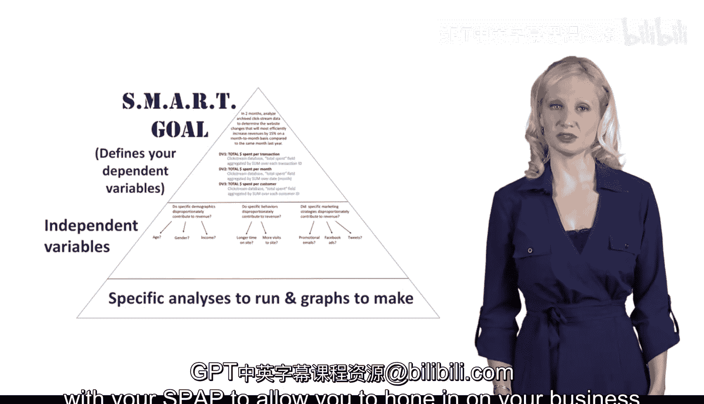

# 杜克大学《Excel 到 MySQL：商业分析（5课全）｜Excel to MySQL： Analytic Techniques for Business》中英 p84 09_02_02_使用SPAPS构建思维框架-第一部分.zh_en -BV1mS421X7yw_p84-

Through the process of elicitation， you now have the beginnings of a skeleton for your data analysis。

 You already know what the dependent variable of most of your analyses should be。

 because you got your team to sign off on a smart goal with a smart metric。

You also have some ideas of what types of factors or independent variables should affect that business metric。

 because you ask your stakeholders lots of questions， and they gave you some helpful answers。

 You're ready to start jumping into your data analysis， right。not quite。

Unless you have unlimited time and resources， just like you shouldn't agree to jump into a data analysis project without defining the value the analysis is supposed to provide。

 you shouldn't jump into the data analysis itself without a plan for what you are going to do。

When you have a lot of information understand and work through。

 it is very resource and efficient to explore data set aimlessly or without hypotheses。

 It's also very difficult for a team to work together on a project without having some kind of common road mapap they can refer to for guidance and direction。

That's why I am taking the time to talk about analysis plans before we start learning how to use Tableau。

Having a plan doesn't mean you can't be creative or that you won't be flexible to change it。

What it does mean is that you have forced yourself to articulate and communicate what you are going to do so that you stay on track。

 get feedback along the way， and have a framework in which to understand the insights you find。

To be more specific， having a clear analysis plan will give you a map to make sure you stay on task and you'll get distracted with data that aren't relevant to your smart goals。

 make it easier to track if there are gaps in your thinking。

Give you a framework to convey your conclusions。Give you a straightforward structure to report your progress and will make it possible for an entire team to be on the same page about what needs to happen next。

In this lesson， I would like to share with you an approach I call the structured pyramid analysis plan or Spap for developing data analysis plans。

 In this video， we'll go over how to set SPs up。 And the next video will go over the details of how you work through your Sps。

I designed the SPAP because I have always found it useful to think of the framework of your data analysis as a pyramid where your smart goal and the problem metric you use to assess progress go at the top and underneath that。

 all the variables that could affect your metric are organized in ever widening layers of increasing amounts of detail。

The visualizations you will use to assess those variables go at the bottom of the pyramid。

To make an SPAap yourself， you will either need a huge whiteboard that won't get erased。

 a big piece of paper， some post it notes or some software that allows you to easily draw hierarchies and links。

 something like mind mapping a software that's freely available on the web。

You can also just draw the SP in a really big PowerPoint slide。

That's the method I will demonstrate here this time。 But my favorite option honestly。

 is to actually brainstorm mass appss with post it notes or index cards and put the file will result into mind mapping software that is easy to share over email or the web。

To begin your Sap， write your smart goal at the top of your pyramid。 It is， after all。

 the keystone and driving force of your analysis。To start transforming that goal into numbers you can analyze。

 as you hear me say often， you will treat your smart metric as your dependent variable。

For illustration purposes， I am going to use the clickSt example from earlier videos， so in our case。

 revenue will be the metric we care about。The next step is very important。

 I want you to actually write the dependent variable you are going to use to measure your metric right underneath the smart goal itself。

 on your SP。That may sound simple， but one of the first things you will notice when doing this is that sometimes。

 no matter how specific you thought your smart objective was when you first wrote it。

 there ends up being a couple different useful ways to assess your smart metric。

 Although each of those ways may be valid， they will likely give you slightly different information or time resolution。

For example， in our scenario， increased revenue seems specific。

 but once you are given the data to help you calculate how much revenue is brought in。

 it will quickly become apparent how many different ways you could calculate and represent revenue。

Here's a sample of what the data might look like。 You see that you have a different row of data for every item purchased。

For each of these items， you know who bought it， how many they bought， what else was bought with it。

 and what each item cost。One way to compute revenue would be to assess the total money spent by a customer during each transaction。

 In other words， you would sum up all the rows I've color coded for you here。

 where each color is determined by transaction I D。

Computing revenue this way would allow you to investigate whether specific experiences customers had during a given visit relate to how much they spent on that specific visit。

Another way to assess revenue would be to compute the total revenue brought in per month。

In this case， you would sum up all the rows in a given color I have provided for you here。

 but this time， each color would be determined by the month of the transaction。

Computing revenue this way would allow you to investigate how the website is doing as a whole。

 especially in comparison to how it did during previous years。

Yet another way to assess revenue might be to compute the total money spent by each customer。

 In this case， you would sum up all the rows in the given color again。 But this time。

 each color would be determined by the customer I D。

 Computing revenue this way would facilitate looking up different groups of customers。

Which method you choose for an analysis will be dependent on your question。

 What level of granularity， other variables you are interested in have and what types of models or statistics you want to use。

 We'll see examples of what I mean by this when we get to the tableau lessons For now。

 when you think there might be multiple useful measurements that you can represent with your smart metric。

 I want you to write them all down on your S。 Do so will help you clarify your thinking about exactly how you will answer each question you have about your data and about how long it will take to come up with each of those answers。

Once you have finished with your smart goal and metrics and layer 1。

 you are ready for the deeper layers。 The layers that come underneath the smart goal are meant to define a logical structure or framework to organize the factors you will be exploring。

😊，This is where you will organize the general categories and subcategories of issues that will be important for achieving your smart goal。

Think of all these factors as your independent variables that can impact your smart metrics。

 which remember are your dependent variables。We're going to go over one way to organize your independent variables right now。

 but it's not very important to me that you use a specific method。

 What I do care about is that you organize your variables in some kind of logical way that makes it possible for you and the rest of your team to track what you've done and work through issues efficiently。

The method we demonstrate here designs the middle layers of your SPP based on the issues you learned about through talking to your stakeholders and through your own experience。

 In essence， you need to take everything you learn during elicitation and organize it into categories and subcategories of factors。

 you know you have to examine。In illustration， I have filled in the middle layers of our SP with some of the issues that might affect the revenue brought in by our website example。

You can see that in layer2， I have one large category of issues that has to do with the demographics of our customers。

Another large category that has to do with the behaviors the customers might exhibit when they get to the website and a third category that has to do with marketing strategies that might interact with the success of the website。

Each of these larger categories are then broken up into more specific categories in layer 3。

 I've only listed a few categories and subcategories here， but in the real project。

 you should make as many layers and sublay as you need to cover all the issues you want to make sure you document or address。

Remember， your SPAap will be for both helping you streamline your analysis and also for communicating to the rest of your team and stakeholders what you are working on。

 what you have done。 So it is worth documenting the issues you will address as well as you can。

It might take a while to document all these issues when you have a really big project。

 but I promise it'll be worth it。In the next video。

 we'll learn how to combine making visualizations with your SAP to allow you to hone in on your business recommendations as quickly and efficiently as possible。

