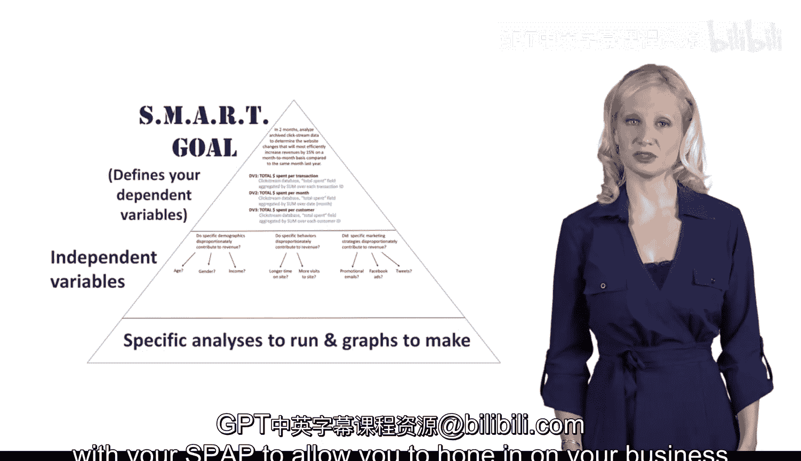

# 杜克大学《Excel 到 MySQL：商业分析》：课程 5：使用 SPAPS 构建思维框架 - 第一部分

## 📋 概述
在本节课中，我们将学习如何为数据分析项目制定一个清晰的计划。我们将介绍一种名为“结构化金字塔分析计划”的方法，帮助你系统地组织分析目标、指标和影响因素，确保分析工作高效且有方向。

## 🏗️ 构建分析计划的必要性
通过前期的需求启发过程，你已经为数据分析搭建了一个初步的骨架。你已经明确了大多数分析中的**因变量**，因为你的团队已经确认了一个包含 SMART 指标的目标。同时，你也对可能影响该业务指标的因素或**自变量**有了一些想法，因为你向利益相关者提出了许多问题并获得了有用的答案。

然而，除非你拥有无限的时间和资源，否则你不应该在未制定计划的情况下直接开始数据分析。正如你不应该在未定义分析预期价值的情况下就同意启动一个数据分析项目一样。

当你需要理解和处理大量信息时，漫无目的或没有假设地探索数据集是非常耗费资源且低效的。同样，对于一个团队来说，如果没有一个可供参考的共同路线图来指导方向，也很难协同工作。

这就是为什么我们在开始学习使用 Tableau 之前，要花时间讨论分析计划。

## 📝 清晰分析计划的好处
拥有计划并不意味着你不能发挥创造性，也不意味着你不能灵活调整。它的意义在于，它迫使你清晰表达并沟通你将要做的事情，从而确保你保持在正确的轨道上，在过程中获得反馈，并拥有一个理解所发现洞察的框架。

具体来说，一个清晰的分析计划将为你提供一张地图，以确保你专注于任务，不会被与 SMART 目标无关的数据分散注意力。它还能让你更容易地追踪思维中的漏洞，为你提供一个传达结论的框架，为你提供一个报告进度的直接结构，并使整个团队对下一步需要做什么达成共识。

## 🏔️ 引入结构化金字塔分析计划
在本课中，我想与你分享一种我称之为“结构化金字塔分析计划”的方法，用于制定数据分析计划。在本视频中，我们将介绍如何设置 SPAPS。下一个视频将详细介绍如何执行你的 SPAPS。

我设计 SPAP 是因为我发现将数据分析的框架视为一个金字塔非常有用。你的 SMART 目标和用于评估进展的问题指标位于金字塔顶端。在其下方，所有可能影响你指标的变量被组织在层层展开、细节逐渐增多的层级中。用于评估这些变量的可视化图表则位于金字塔的底部。

## 🛠️ 创建 SPAPS 的工具
要自己制作一个 SPAPS，你需要一块不会被擦掉的大白板、一张大纸、一些便利贴，或者一些允许你轻松绘制层次结构和链接的软件，例如网络上免费可用的思维导图软件。

你也可以在一个非常大的 PowerPoint 幻灯片中绘制 SPAPS。这次我将演示这种方法。但老实说，我最喜欢的选择是先用便利贴或索引卡进行头脑风暴，然后将最终结果输入到易于通过电子邮件或网络共享的思维导图软件中。

## 🚀 开始构建 SPAPS：顶层目标与指标
要开始你的 SPAPS，请将你的 SMART 目标写在金字塔的顶部。毕竟，它是你分析的基石和驱动力。为了将这个目标转化为可以分析的数字，正如你常听我说的，你将把你的 SMART 指标视为你的**因变量**。

为了说明，我将使用之前视频中的 ClickSt 示例。在我们的案例中，**收入**将是我们关心的指标。

下一步非常重要。我希望你实际上将用于衡量指标的具体**因变量**写在 SMART 目标的正下方，在你的 SPAPS 上。这听起来可能很简单，但当你这样做时，首先会注意到的一件事是，有时无论你最初写下 SMART 目标时认为它有多具体，最终总会有几种不同的有用方式来评估你的 SMART 指标。虽然每种方式都可能有效，但它们可能会给你略有不同的信息或时间分辨率。

例如，在我们的场景中，“增加收入”看起来很具体。但一旦你拿到数据来计算带来了多少收入，你很快就会意识到有多少种不同的方式可以计算和表示收入。

以下是一个数据可能看起来的示例。你可以看到，每个购买的商品都有一行不同的数据。

| 交易ID | 客户ID | 商品 | 数量 | 单价 | 月份 |
| :--- | :--- | :--- | :--- | :--- | :--- |
| 001 | A | 商品1 | 2 | $10 | 一月 |
| 001 | A | 商品2 | 1 | $15 | 一月 |
| 002 | B | 商品3 | 1 | $20 | 一月 |
| 003 | A | 商品1 | 1 | $10 | 二月 |

对于这些商品中的每一个，你知道谁买了它，买了多少，一起买了什么，以及每个商品的成本。

一种计算收入的方法是评估客户在**每次交易**中花费的总金额。换句话说，你需要汇总我在这里为你用颜色编码的所有行，其中每种颜色由**交易ID**决定。

`收入_每次交易 = SUM(单价 * 数量) GROUP BY 交易ID`

以这种方式计算收入可以让你调查客户在特定访问期间的特定体验是否与他们在那次特定访问中的花费有关。

另一种评估收入的方法是计算**每月**带来的总收入。在这种情况下，你需要再次汇总给定颜色的所有行，但这次，每种颜色将由交易的**月份**决定。

`收入_每月 = SUM(单价 * 数量) GROUP BY 月份`

以这种方式计算收入可以让你调查网站的整体表现，特别是与往年相比。

还有一种评估收入的方法可能是计算**每个客户**花费的总金额。在这种情况下，你需要再次汇总给定颜色的所有行。但这次，每种颜色将由**客户ID**决定。

`收入_每位客户 = SUM(单价 * 数量) GROUP BY 客户ID`

以这种方式计算收入将有助于查看不同的客户群体。

你为分析选择哪种方法将取决于你的问题、所需的粒度级别、你感兴趣的其他变量以及你想要使用的模型或统计类型。当我们学习 Tableau 课程时，我们将看到这方面的例子。

现在，当你认为可能有多种有用的测量方法可以代表你的 SMART 指标时，我希望你把它们都写在你的 SPAPS 上。这样做将帮助你理清思路，明确你将如何回答关于数据的每个问题，以及得出每个答案需要多长时间。

## 🧱 构建金字塔的中间层：组织影响因素
一旦你完成了 SMART 目标和指标（第一层），你就可以开始构建更深层次了。位于 SMART 目标之下的层级旨在定义一个逻辑结构或框架，来组织你将探索的因素。

在这里，你将组织对于实现 SMART 目标很重要的**问题的一般类别和子类别**。将所有这些问题视为你的**自变量**，它们可以影响你的 SMART 指标（记住，这些是你的**因变量**）。

我们现在将介绍一种组织自变量的方法，但对我来说，你是否使用特定方法并不重要。我关心的是，你以某种逻辑方式组织你的变量，使你和你的团队能够跟踪已完成的工作并高效地处理问题。

我们在此演示的方法基于你通过与利益相关者交谈和自身经验了解到的问题，来设计 SPAPS 的中间层。本质上，你需要将启发过程中学到的一切，组织成你知道必须检查的**因素的类别和子类别**。

作为说明，我已经用一些可能影响我们网站示例收入的问题填充了 SPAPS 的中间层。

你可以看到，在**第二层**，我有一个与**客户人口统计**相关的大问题类别。另一个大类别与客户访问网站时可能表现出的**行为**有关。第三个类别与可能影响网站成功的**营销策略**有关。

然后，这些较大的类别在**第三层**被分解为更具体的类别。我在这里只列出了几个类别和子类别，但在实际项目中，你应该创建尽可能多的层级和子层级，以涵盖你希望确保记录或解决的所有问题。

请记住，你的 SPAPS 既可以帮助你简化分析，也可以用于向团队其他成员和利益相关者传达你正在做什么、已经做了什么。因此，尽可能好地记录你将解决的问题是值得的。对于一个大型项目，记录所有这些问题可能需要一些时间，但我保证这是值得的。

## 🔮 总结与预告
本节课中，我们一起学习了如何为数据分析构建一个清晰的计划框架——结构化金字塔分析计划。我们明确了从顶层的 SMART 目标和因变量指标开始，到系统地组织可能影响指标的自变量类别的重要性。这确保了分析工作有方向、可协作、可沟通。

在下一个视频中，我们将学习如何将制作可视化图表与你的 SPAPS 结合起来，使你能够尽可能快速高效地聚焦于你的业务建议。